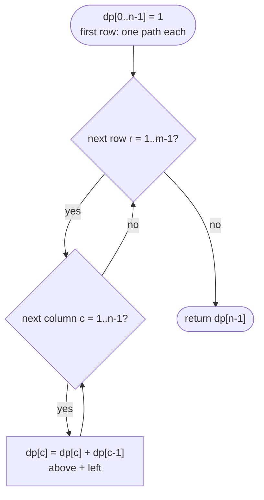

# LC 62 Unique Paths

> [!abstract] In one sentence
> A robot that can only move right or down reaches a cell either from the cell above or from the cell to its left, so the number of paths to a cell is the sum of the two — the first row and column have exactly one path each, and the bottom-right cell holds the answer.

**Map:** [[NeetCode 150 MOC]] → [[DSA Dashboard]] · Pattern: [[2-D Dynamic Programming]]

> [!question] Predict before you read
> A 3 × 3 grid has 6 paths from the top-left to the bottom-right. Every such path is a word of length 4 over the letters `R` and `D`. How many `D`s does each word have, and what does that make 6 equal to as a binomial coefficient?

## Problem

A robot starts in the top-left cell of an `m × n` grid and wants to reach the bottom-right cell. At each step it moves one cell right or one cell down. Count the distinct paths.

Example: `m = 3, n = 7` → `28`. Example: `m = 3, n = 2` → `3` (`DDR`, `DRD`, `RDD`).

Constraints that matter: 1 ≤ m, n ≤ 100, and the tests guarantee the answer is ≤ 2 · 10⁹ — so `int` suffices for the table, while the binomial shortcut must multiply in `long`.

## Clarifying questions

1. Only right and down, no other moves? — Yes; with up/left allowed, paths could loop and the count is infinite (or the question changes to shortest paths).
2. Obstacles? — None here; Unique Paths II adds cells that zero out.
3. Does the answer fit in an `int`? — Guaranteed ≤ 2 · 10⁹; say you would switch to `long` or a modulus otherwise.
4. Is a 1 × 1 grid a valid input? — Yes, one path of zero moves.

## Brute force

DFS from the start: at each cell branch right and down, count the leaves that reach the goal. The number of leaves *is* the answer, so this is Ω(answer) — exponential in `m + n` — and the subtree below a cell is explored once per path leading to it. Only `m · n` distinct cells exist.

## The key insight

The last move into any cell other than the start came from above or from the left, and those two sets of paths are disjoint. So `paths[r][c] = paths[r − 1][c] + paths[r][c − 1]`, with the top row and left column fixed at 1 (there is exactly one way along an edge). This is [[LC 70 Climbing Stairs]] in two dimensions: the same "sum of the ways to the predecessor states", with predecessors now a cell up and a cell left. The closed form follows from counting words: a path is `m − 1` downs and `n − 1` rights in some order, `C(m + n − 2, m − 1)` of them. Recognition cue: "move only right or down", "count paths", "min path sum" (same cells, `min` instead of `+`).

## Optimal approach

1. State: `dp[r][c]` = number of paths from `(0, 0)` to `(r, c)`.
2. Base: `dp[0][c] = 1` and `dp[r][0] = 1`.
3. Transition: `dp[r][c] = dp[r − 1][c] + dp[r][c − 1]`.
4. Order: row by row, left to right; each cell reads one cell up (previous row) and one cell left (current row). Because the "up" value is the previous row's value in the same column, a single array can hold the current row: `dp[c] += dp[c − 1]`, where `dp[c]` still holds the row above before the update.



> [!example]- Excalidraw version — the same diagram as an editable canvas
> ![[LC 62 Unique Paths — Optimal approach.excalidraw]]
> [[LC 62 Unique Paths — Optimal approach.excalidraw|Open in Excalidraw]] — needs the Excalidraw plugin (see [[Plugins to Install]]).

Column 0 is never touched by the inner loop, so it stays 1 — the left-edge base case for every row for free.

## Walkthrough

`m = 3, n = 4` → 10.

> [!example] paths[r][c] for a 3 x 4 grid
> ![[LC 62 Unique Paths — paths-r--c- for a 3 x 4 grid.excalidraw]]
> [[LC 62 Unique Paths — paths-r--c- for a 3 x 4 grid.excalidraw|Open in Excalidraw]] — paths[2][3] = paths[1][3] + paths[2][2] = 4 + 6 = 10 = C(5, 2)

%% excalidraw-spec
{"kind": "grid", "title": "paths[r][c] for a 3 x 4 grid", "col_labels": ["c=0", "c=1", "c=2", "c=3"], "row_labels": ["r=0", "r=1", "r=2"], "rows": [ [1, 1, 1, 1], [1, 2, 3, 4], [1, 3, 6, 10] ], "highlight": [ [2, 3] ], "arrows": [ [ [1, 3], [2, 3] ], [ [2, 2], [2, 3] ] ], "caption": "paths[2][3] = paths[1][3] + paths[2][2] = 4 + 6 = 10 = C(5, 2)"}
%%

Rolling-row view of the same computation — the array before and after each row:

| row | dp before | updates `dp[c] += dp[c − 1]` | dp after |
|---|---|---|---|
| 0 | — | initialised | `[1, 1, 1, 1]` |
| 1 | `[1, 1, 1, 1]` | c=1: 1+1, c=2: 1+2, c=3: 1+3 | `[1, 2, 3, 4]` |
| 2 | `[1, 2, 3, 4]` | c=1: 2+1, c=2: 3+3, c=3: 4+6 | `[1, 3, 6, 10]` |

The table is Pascal's triangle tilted: `dp[r][c] = C(r + c, r)`.

## Java solution

```java
import java.util.*;

class Solution {
    public int uniquePaths(int m, int n) {
        int[] dp = new int[n];                     // dp[c] = paths to (current row, c); starts as row 0
        Arrays.fill(dp, 1);                        // one path along the top edge to every cell of row 0
        for (int r = 1; r < m; r++) {
            for (int c = 1; c < n; c++) {
                dp[c] += dp[c - 1];                // old dp[c] is the cell above, dp[c-1] is already this row's left cell
            }                                      // dp[0] stays 1: the left edge
        }
        return dp[n - 1];
    }
}
```

**Time** O(m · n) · **Space** O(n)

Top-down, which is how the recurrence is found — memo on the cell:

```java
// snippet
int[][] memo;                                      // memo[r][c] = paths from (r, c) to the bottom-right; 0 = unknown
int paths(int r, int c, int m, int n) {
    if (r == m - 1 || c == n - 1) return 1;        // on the last row or column only one direction remains
    if (memo[r][c] != 0) return memo[r][c];
    return memo[r][c] = paths(r + 1, c, m, n) + paths(r, c + 1, m, n);
}
// memo = new int[m][n]; answer = paths(0, 0, m, n). O(m · n) time and space, recursion depth m + n
```

Full 2-D table, the picture above as code:

```java
// snippet
int[][] dp = new int[m][n];
for (int r = 0; r < m; r++) dp[r][0] = 1;
for (int c = 0; c < n; c++) dp[0][c] = 1;
for (int r = 1; r < m; r++)
    for (int c = 1; c < n; c++) dp[r][c] = dp[r - 1][c] + dp[r][c - 1];
return dp[m - 1][n - 1];                           // O(m · n) time and space
```

Closed form, O(min(m, n)) time and O(1) space — exact as long as the answer fits, since every partial product is a smaller binomial times a factor ≤ 198:

```java
// snippet
long res = 1;
int total = m + n - 2, k = Math.min(m - 1, n - 1);
for (int i = 1; i <= k; i++) res = res * (total - k + i) / i;   // res is C(total - k + i, i) after each step, always an integer
return (int) res;
```

## Why it works

State: `dp[r][c]` counts right/down paths from the origin to `(r, c)`. Transition: delete the last step of any such path; it was a down step from `(r − 1, c)` or a right step from `(r, c − 1)`, and the shortened path is a path to that cell — this map is a bijection between paths to `(r, c)` and the disjoint union of paths to the two predecessors, so the counts add. Base: cells on the top row and left column have one path. Order: row-major, because each cell needs its upper and left neighbours, both earlier in that order.

## Edge cases

- `m = 1` or `n = 1` — a single row or column: the loops do nothing, `dp[n − 1] = 1`.
- `m = n = 1` — 1 (the empty path).
- `m = 3, n = 7` — 28, matches `C(8, 2)`.
- Large grid with a small answer guarantee, e.g. `m = 2, n = 100` — 100; the `long` binomial stays well within range.
- `m = n = 100` is excluded by the guarantee — `C(198, 99)` overflows even `long`; the DP would silently wrap.

## Common mistakes

> [!warning] Pitfalls
> - **Initialising the rolling row to 0 with `dp[0] = 1` only** — works too, but you must then start the inner loop at `c = 1` and rely on `dp[0]` never changing; initialising all to 1 is the clearer statement of the top-row base case.
> - **Reading the "above" value after overwriting it** — in the rolling row `dp[c]` must be read *before* assignment; `dp[c] += dp[c − 1]` does that in one expression.
> - **Off-by-one on the binomial** — it is `C(m + n − 2, m − 1)`, not `C(m + n, m)`; count moves, not cells.
> - **Computing the binomial with `int` or with factorials** — overflows at tiny sizes; multiply-then-divide in `long`.
> - **Memo initialised to 0 when 0 is a legal answer** — fine here (every cell has ≥ 1 path) but wrong in Unique Paths II; use −1 there.

## Variants & follow-ups

- Obstacles (Unique Paths II, LC 63) — blocked cells get 0; the first row/column base cases stop at the first obstacle.
- Minimum path sum (LC 64) — `grid[r][c] + min(above, left)`; same table, different operator.
- Allow diagonal moves — add `dp[r − 1][c − 1]`; the binomial no longer applies (Delannoy numbers).
- Count paths modulo 10⁹ + 7 for huge grids — the same loop with `%`, or a modular binomial with inverse factorials.
- Longest path with an increasing condition — [[LC 329 Longest Increasing Path in a Matrix]] drops the right/down restriction and uses memoised DFS on the resulting DAG.
- Two-string tables — [[LC 1143 Longest Common Subsequence]] has the same above/left dependencies with a diagonal added.

## Interview script

1. Restate: count monotone right/down paths across an `m × n` grid.
2. Brute force: DFS, exponential, since it enumerates the paths.
3. Insight: last step came from above or left; `dp[r][c] = up + left`; edges are 1.
4. Approach: one rolling row of length `n`, `dp[c] += dp[c − 1]`; mention the binomial as the O(1)-space alternative.
5. Complexity: O(m · n) time, O(n) space; closed form O(min(m, n)).
6. Tests: `1 × 1`, `1 × n`, `3 × 2`, `3 × 7`.

The interviewer is checking that you explain why the two predecessor sets are disjoint, that you can collapse the table to one row and say which cell holds "above", and that you know the combinatorial identity.

## Related

- [[2-D Dynamic Programming]] — grid paths section
- [[DP Pattern Catalogue]] — row 9
- [[LC 70 Climbing Stairs]] — the 1-D version of "sum over predecessor states"
- [[LC 1143 Longest Common Subsequence]] — the next table: above, left and diagonal
- [[LC 329 Longest Increasing Path in a Matrix]] — grid DP without a fixed fill order
- [[DSA Patterns in Java]] — 2-D DP skeleton and rolling rows
- [[Java Pitfalls in Interviews]] — `long` for products

## Attempt log

| Date | Result | Minutes | What I got wrong |
|---|---|---|---|
| | | | |

### Mastery checklist
- [ ] Solved without hints in under 25 minutes
- [ ] Stated complexity before coding
- [ ] Handled every edge case above
- [ ] Code compiled first time
- [ ] Can do the follow-up variant (obstacles; minimum path sum)

## Open questions
- [ ]
