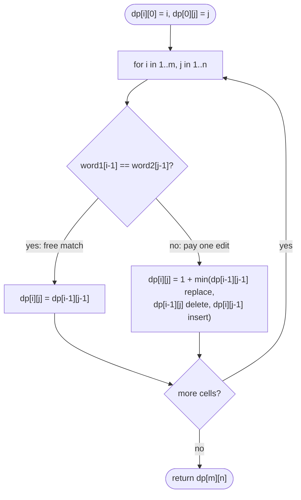

# LC 72 Edit Distance

> [!abstract] In one sentence
> Line the two words up as a grid of prefixes: the cost of turning prefix `i` of one word into prefix `j` of the other depends only on the three cells up, left and diagonal — match for free on the diagonal, or pay one edit and borrow from the cheapest neighbour — so the whole table fills in O(mn) and the bottom-right cell is the answer.

**Map:** [[NeetCode 150 MOC]] → [[DSA Dashboard]] · Pattern: [[2-D Dynamic Programming]]

> [!question] Predict before you read
> `horse → ros`. You can insert, delete or replace one character per step. Before building any table: if the last characters of two prefixes are equal, why should the answer for those prefixes equal the answer for both prefixes shortened by one?

## Problem

Given `word1` and `word2`, return the minimum number of operations (insert a character, delete a character, replace a character) to convert `word1` into `word2`.

- `horse`, `ros` → `3` (horse → rorse → rose → ros)
- `intention`, `execution` → `5`
- `""`, `abc` → `3`

Constraints that matter: lengths up to 500, so O(mn) = 250 000 cells is trivial; lowercase letters.

## Clarifying questions

1. Do all three operations cost 1? — Yes here; weighted costs change the constants, not the structure.
2. Is a swap of adjacent characters an operation? — No (that is Damerau–Levenshtein, an extra case).
3. Can either string be empty? — Yes; the answer is the other string's length.
4. Do we need the sequence of edits or just the count? — The count; the sequence is recoverable by backtracking through the table.

## Brute force

Recursion on the two indices: at `(i, j)`, if the characters match recurse on `(i+1, j+1)`, otherwise try all three edits and take the minimum. Three-way branching → O(3^(m+n)). The waste: the same `(i, j)` pair is reached by many different edit sequences and recomputed each time — there are only `(m+1)(n+1)` distinct pairs.

## The key insight

Define `dp[i][j]` = edit distance between `word1[0..i)` and `word2[0..j)`. The last decision is about the last characters of the two prefixes: if they are equal, no edit is needed and `dp[i][j] = dp[i−1][j−1]`; if not, the optimal last operation is one of exactly three — replace `word1[i−1]` with `word2[j−1]` (then the rest costs `dp[i−1][j−1]`), delete `word1[i−1]` (rest `dp[i−1][j]`), or insert `word2[j−1]` at the end (rest `dp[i][j−1]`). Base cases: `dp[i][0] = i` (delete everything), `dp[0][j] = j` (insert everything). This is the same table shape as [[LC 1143 Longest Common Subsequence]] with a different cell rule.

## Optimal approach

1. Allocate `dp[m+1][n+1]`; `dp[i][0] = i`, `dp[0][j] = j`.
2. For `i = 1..m`, `j = 1..n`: if `word1[i−1] == word2[j−1]` → `dp[i][j] = dp[i−1][j−1]`; else `dp[i][j] = 1 + min(dp[i−1][j−1], dp[i−1][j], dp[i][j−1])`.
3. Answer `dp[m][n]`.
4. Space optimisation: only the previous row is needed → two rows of `n+1`, or one row with a saved diagonal.



> [!example]- Excalidraw version — the same diagram as an editable canvas
> ![[LC 72 Edit Distance — Optimal approach.excalidraw]]
> [[LC 72 Edit Distance — Optimal approach.excalidraw|Open in Excalidraw]] — needs the Excalidraw plugin (see [[Plugins to Install]]).

## Walkthrough

`word1 = horse` (rows), `word2 = ros` (columns):

> [!example] Edit distance table for horse -> ros
> ![[LC 72 Edit Distance — Edit distance table for horse -- ros.excalidraw]]
> [[LC 72 Edit Distance — Edit distance table for horse -- ros.excalidraw|Open in Excalidraw]] — dp[5][3] = 3; the last step deletes 'e' (comes from the cell above, 2, plus one)

%% excalidraw-spec
{"kind": "grid", "title": "Edit distance table for horse -> ros", "col_labels": ["", "\"\"", "r", "o", "s"], "row_labels": ["", "\"\"", "h", "o", "r", "s", "e"], "rows": [ [0, 1, 2, 3], [1, 1, 2, 3], [2, 2, 1, 2], [3, 2, 2, 2], [4, 3, 3, 2], [5, 4, 4, 3] ], "highlight": [ [6, 4] ], "arrows": [ [ [5, 4], [6, 4] ] ], "caption": "dp[5][3] = 3; the last step deletes 'e' (comes from the cell above, 2, plus one)"}
%%

Reading one cell: `dp[2][2]` (`ho` vs `ro`): last characters `o == o` → copy the diagonal `dp[1][1] = 1` (`h` vs `r`, one replace). `dp[3][1]` (`hor` vs `r`): `r == r` → diagonal `dp[2][0] = 2` (delete `h`, `o`).

## Java solution

```java
import java.util.*;

class Solution {
    public int minDistance(String word1, String word2) {
        int m = word1.length(), n = word2.length();
        int[][] dp = new int[m + 1][n + 1];
        for (int i = 0; i <= m; i++) dp[i][0] = i;            // delete all i characters
        for (int j = 0; j <= n; j++) dp[0][j] = j;            // insert all j characters
        for (int i = 1; i <= m; i++) {
            for (int j = 1; j <= n; j++) {
                if (word1.charAt(i - 1) == word2.charAt(j - 1)) {
                    dp[i][j] = dp[i - 1][j - 1];              // free match
                } else {
                    dp[i][j] = 1 + Math.min(dp[i - 1][j - 1],                 // replace
                                   Math.min(dp[i - 1][j], dp[i][j - 1]));     // delete, insert
                }
            }
        }
        return dp[m][n];
    }
}
```

**Time** O(mn) · **Space** O(mn), reducible to O(min(m, n))

Top-down with memoisation (the version to write if you derive it recursively in the interview):

```java
// snippet — memoised recursion on (i, j) = remaining suffixes
Integer[][] memo;
int solve(String a, String b, int i, int j) {
    if (i == a.length()) return b.length() - j;              // insert the rest of b
    if (j == b.length()) return a.length() - i;              // delete the rest of a
    if (memo[i][j] != null) return memo[i][j];
    int best = a.charAt(i) == b.charAt(j) ? solve(a, b, i + 1, j + 1)
             : 1 + Math.min(solve(a, b, i + 1, j + 1), Math.min(solve(a, b, i + 1, j), solve(a, b, i, j + 1)));
    return memo[i][j] = best;
}
```

Space-optimised to one row:

```java
// snippet — single row plus a saved diagonal
int[] row = new int[n + 1];
for (int j = 0; j <= n; j++) row[j] = j;
for (int i = 1; i <= m; i++) {
    int diag = row[0]; row[0] = i;                                   // diag = dp[i-1][j-1] for j = 1
    for (int j = 1; j <= n; j++) {
        int tmp = row[j];                                            // dp[i-1][j] before overwriting
        row[j] = word1.charAt(i - 1) == word2.charAt(j - 1) ? diag : 1 + Math.min(diag, Math.min(row[j], row[j - 1]));
        diag = tmp;
    }
}
return row[n];
```

## Why it works

State: `dp[i][j]` is a function of the prefixes only, because an optimal edit script can be reordered to process characters left to right, and the last operation touches the last character of at least one prefix. Transition: enumerating what the last operation can be (match, replace, delete, insert) covers every edit script, and each branch reduces to a strictly smaller state, so the minimum over branches is optimal. Base: empty prefixes have one option each. Order: row-major with `i` and `j` increasing visits `(i−1, j−1)`, `(i−1, j)`, `(i, j−1)` before `(i, j)`. The table has `(m+1)(n+1)` cells with O(1) work each.

## Edge cases

- One string empty → length of the other (base row/column).
- Identical strings → 0 (the diagonal copies zeros all the way).
- No common characters (`abc` vs `xyz`) → `max(m, n)`: replace `min` and insert/delete the rest.
- One is a prefix of the other (`abc` vs `abcd`) → 1 insert.
- Single characters: `a` vs `b` → 1; `a` vs `a` → 0.
- Unicode: `charAt` compares UTF-16 units; say so if the interviewer cares.

## Common mistakes

> [!warning] What goes wrong
> - Indexing the strings with `i`/`j` instead of `i − 1`/`j − 1` after allocating `m+1`/`n+1` rows.
> - Forgetting `+ 1` in the mismatch case, or adding `+ 1` in the match case.
> - Taking `min` over only two of the three neighbours (delete and insert without replace gives the LCS-style answer, which is wrong here).
> - Base cases set to 0 instead of `i`/`j`.
> - In the one-row version, overwriting `row[j]` before saving it as the next diagonal.
> - Confusing with LCS: there the match case is `1 + diagonal` and mismatch is `max(up, left)`.

## Variants & follow-ups

- Return the edit script: backtrack from `dp[m][n]` choosing the neighbour that produced the value.
- Weighted operations (replace costs 2): change the constants; `dp` still works.
- Only insert/delete allowed (LC 583 Delete Operation): `m + n − 2·LCS`.
- Adjacent transposition (Damerau): add a fourth case `dp[i−2][j−2] + 1` when `a[i−1] == b[j−2]` and `a[i−2] == b[j−1]`.
- "Is the distance `<= k`?": only compute the band of width `2k + 1` around the diagonal, O(k·min(m, n)).
- One Edit Distance (LC 161): a single pass with at most one mismatch allowed.

## Interview script

Restate: "min number of insert/delete/replace to turn `word1` into `word2`." Brute force: "recurse on the two positions with three choices, exponential; the state space is only `(m+1)(n+1)` pairs." Insight: "`dp[i][j]` for prefixes; equal last characters cost nothing, otherwise one edit plus the best of the diagonal (replace), up (delete) or left (insert)." Approach: "table with base row/column `i`/`j`, fill row by row, answer at `dp[m][n]`; one-row space optimisation if asked." Complexity: "O(mn) time, O(mn) or O(n) space." Tests: "empty string, identical, disjoint alphabets, prefix relationship." If they push: "backtracking recovers the script; a band of width `2k+1` answers `distance <= k` faster."

## Related

- Pattern: [[2-D Dynamic Programming]] (string DP), [[DP Pattern Catalogue]]
- Prerequisites: [[LC 1143 Longest Common Subsequence]] (same table, different rule)
- Siblings: [[LC 115 Distinct Subsequences]] (counting version of a prefix table), [[LC 97 Interleaving String]], [[LC 10 Regular Expression Matching]]
- Java: [[DSA Patterns in Java]] (2-D DP template, row optimisation), [[Java Pitfalls in Interviews]] (`charAt` off-by-one)

## Attempt log

| Date | Result | Minutes | What I got wrong |
|---|---|---|---|
| | | | |

### Mastery checklist
- [ ] Solved without hints in under 25 minutes
- [ ] Stated complexity before coding
- [ ] Handled every edge case above
- [ ] Code compiled first time
- [ ] Can do the follow-up variant

## Open questions
- [ ] Write the backtracking that prints the edit script for `horse → ros`. Ties: which neighbour do you prefer and why does it not change the count?
- [ ] Why is `edit distance <= m + n − 2·LCS` always true, and when is it an equality?
