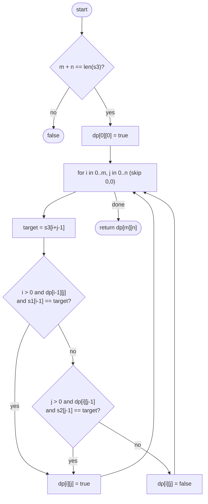

# LC 97 Interleaving String

> [!abstract] In one sentence
> Walking through s3 you must decide, at every step, whether the next letter was taken from s1 or from s2; when both match the choice is a fork, and the 2-D table over (letters used from s1, letters used from s2) explores every fork exactly once.

**Map:** [[NeetCode 150 MOC]] → [[DSA Dashboard]] · Pattern: [[2-D Dynamic Programming]] · [[DP Pattern Catalogue]]

> [!question] Predict before you read
> `s1 = "ab"`, `s2 = "ac"`, `s3 = "acab"`. A greedy pointer that always takes from s1 when it can starts with `a` from s1 — and is then stuck. Is `s3` an interleaving? What state do you need to remember so that the second `a` can come from s2?

## Problem

Given strings `s1`, `s2`, `s3`, return `true` if `s3` is an *interleaving* of `s1` and `s2`: `s3` is made by splitting `s1` and `s2` into non-empty pieces and alternating them (`s1 = a₁a₂…`, `s2 = b₁b₂…`, `s3 = a₁b₁a₂b₂…` or `b₁a₁b₂a₂…`), so that both original orders are preserved. Equivalently: `s3` is a merge of `s1` and `s2` that keeps each one's letter order.

Example: `s1 = "aabcc", s2 = "dbbca", s3 = "aadbbcbcac"` → `true` (`aa` + `dbbc` + `bc` + `a` + `c`).
Example: `s1 = "aabcc", s2 = "dbbca", s3 = "aadbbbaccc"` → `false`.
Example: `s1 = "", s2 = "", s3 = ""` → `true`.

Constraints that matter: `s1`, `s2` ≤ 100 characters, `s3` ≤ 200, lowercase. A 101 × 101 table is nothing; the follow-up asks for O(min(m, n)) extra space.

## Clarifying questions

1. Must the lengths add up? — Yes, `m + n == s3.length()` is necessary; check it first and return `false` otherwise, which also guarantees every `i + j` index into `s3` is valid.
2. Are empty strings allowed? — Yes; an empty `s1` reduces the question to `s2.equals(s3)`.
3. Is the "alternating non-empty pieces" phrasing a constraint on how many pieces? — No; any merge preserving both orders qualifies (a single piece from one string is fine).
4. Characters beyond lowercase letters? — Not here; nothing in the solution depends on the alphabet anyway.

## Brute force

Recurse: at s3 position `k = i + j`, if `s1[i] == s3[k]` try taking from `s1`; if `s2[j] == s3[k]` try taking from `s2`. Without memoisation this explores every merge, up to C(m + n, m) ≈ 10⁵⁸ for 100 + 100. The waste is enormous and obvious: two different sequences of choices that have consumed the same number of letters from `s1` and from `s2` are in exactly the same situation — same `i`, same `j`, same `k`.

## The key insight

The state is the pair `(i, j)` = letters consumed from `s1` and from `s2`; the position in `s3` is determined (`i + j`), so it is not part of the state. `dp[i][j]` = "the prefix `s3[0 … i+j)` is an interleaving of `s1[0 … i)` and `s2[0 … j)`". The last letter of that prefix came either from `s1` (then `s1[i−1] == s3[i+j−1]` and `dp[i−1][j]`) or from `s2` (then `s2[j−1] == s3[i+j−1]` and `dp[i][j−1]`). Recognition cue: "merge / interleave two sequences preserving order" — two indices, one table, LCS-shaped.

## Optimal approach

1. If `m + n != s3.length()`, return `false`.
2. `dp[0][0] = true`.
3. For every `(i, j)` in row-major order except `(0,0)`: `target = s3[i+j−1]`; `dp[i][j] = (i > 0 && dp[i−1][j] && s1[i−1] == target) || (j > 0 && dp[i][j−1] && s2[j−1] == target)`.
4. Return `dp[m][n]`.



> [!example]- Excalidraw version — the same diagram as an editable canvas
> ![[LC 97 Interleaving String — Optimal approach.excalidraw]]
> [[LC 97 Interleaving String — Optimal approach.excalidraw|Open in Excalidraw]] — needs the Excalidraw plugin (see [[Plugins to Install]]).

## Walkthrough

`s1 = "aabcc"` (rows), `s2 = "dbbca"` (columns), `s3 = "aadbbcbcac"`. A cell is 1 when the corresponding prefixes interleave; the shaded cells trace one valid merge.

> [!example] Interleaving String: dp[i][j] for aabcc / dbbca -> aadbbcbcac
> ![[LC 97 Interleaving String — Interleaving String- dp-i--j- for aabcc - dbbca -- aadbbcbcac.excalidraw]]
> [[LC 97 Interleaving String — Interleaving String- dp-i--j- for aabcc - dbbca -- aadbbcbcac.excalidraw|Open in Excalidraw]] — down = take from s1, right = take from s2; the path reads a a d b b c b c a c

%% excalidraw-spec
{"kind": "grid", "title": "Interleaving String: dp[i][j] for aabcc / dbbca -> aadbbcbcac", "col_labels": ["", "d", "b", "b", "c", "a"], "row_labels": ["", "a", "a", "b", "c", "c"], "rows": [ [1, 0, 0, 0, 0, 0], [1, 0, 0, 0, 0, 0], [1, 1, 1, 1, 1, 0], [0, 1, 1, 0, 1, 0], [0, 0, 1, 1, 1, 1], [0, 0, 0, 1, 0, 1] ], "highlight": [ [0, 0], [1, 0], [2, 0], [2, 1], [2, 2], [2, 3], [2, 4], [3, 4], [4, 4], [4, 5], [5, 5] ], "arrows": [ [ [4, 5], [5, 5] ] ], "caption": "down = take from s1, right = take from s2; the path reads a a d b b c b c a c"}
%%

| Cell | `target = s3[i+j−1]` | From above (`s1[i−1]`) | From left (`s2[j−1]`) | `dp` |
|---|---|---|---|---|
| (1,0) | `a` | `dp[0][0]` and `s1[0]='a'` ✓ | – | 1 |
| (2,1) | `d` | `dp[1][1]` is 0 | `dp[2][0]` and `s2[0]='d'` ✓ | 1 |
| (3,3) | `c` | `dp[2][3]` but `s1[2]='b'` ✗ | `dp[3][2]` but `s2[2]='b'` ✗ | 0 |
| (4,5) | `a` | `dp[3][5]` is 0 | `dp[4][4]` and `s2[4]='a'` ✓ | 1 |
| (5,5) | `c` | `dp[4][5]` and `s1[4]='c'` ✓ | – | 1 |

`dp[5][5] = 1` → `true`. Cell (3,3) shows the point: both prefixes exist but neither string supplies the needed `c` at that moment.

## Java solution

```java
import java.util.*;

class Solution {
    public boolean isInterleave(String s1, String s2, String s3) {
        int m = s1.length(), n = s2.length();
        if (m + n != s3.length()) return false;            // lengths must add up exactly
        boolean[][] dp = new boolean[m + 1][n + 1];        // dp[i][j]: s3[0..i+j) from s1[0..i) and s2[0..j)
        dp[0][0] = true;
        for (int i = 0; i <= m; i++) {
            for (int j = 0; j <= n; j++) {
                if (i == 0 && j == 0) continue;
                char target = s3.charAt(i + j - 1);
                boolean fromS1 = i > 0 && dp[i - 1][j] && s1.charAt(i - 1) == target;
                boolean fromS2 = j > 0 && dp[i][j - 1] && s2.charAt(j - 1) == target;
                dp[i][j] = fromS1 || fromS2;
            }
        }
        return dp[m][n];
    }
}
```

**Time** O(m · n) · **Space** O(m · n) for the table; O(n) with a rolling row, since row `i` only reads row `i − 1` and the cell to its left

The top-down form is the same recurrence read forwards from `(0, 0)`; it is the version to write first if the table order feels unnatural:

```java
// snippet — top-down: memo[i][j] = 0 unknown, 1 true, 2 false; m, n, s1, s2, s3, memo are fields
boolean solve(int i, int j) {
    if (i == m && j == n) return true;                  // consumed everything
    if (memo[i][j] != 0) return memo[i][j] == 1;
    int k = i + j;                                      // next position of s3 to explain
    boolean ok = (i < m && s1.charAt(i) == s3.charAt(k) && solve(i + 1, j))
              || (j < n && s2.charAt(j) == s3.charAt(k) && solve(i, j + 1));
    memo[i][j] = ok ? 1 : 2;
    return ok;
}
```

Both are O(m · n); top-down visits only reachable states (often far fewer), bottom-up has no recursion and rolls to one row trivially.

## Why it works

- **State:** `(i, j)` — letters taken from `s1` and `s2`; `s3`'s position is implied.
- **Transition:** the last letter of `s3[0 … i+j)` came from `s1` or from `s2`; each option requires the letter to match and the smaller prefix pair to be an interleaving.
- **Base:** `dp[0][0] = true` (empty from empty). First row and column degenerate to prefix equality with one string.
- **Order:** row-major; every cell reads only the cell above and the cell to the left, both already computed.
The recurrence is exhaustive because an interleaving of the prefixes ends with *some* letter, which was taken from one of the two strings, and removing it leaves an interleaving of shorter prefixes. It is sound because the two conditions reconstruct a valid merge.

## Edge cases

- All three empty → `dp[0][0]`, `true`.
- `s1` empty → first row: `true` while `s2` prefix matches `s3`.
- Lengths do not add up → `false` before allocating the table.
- Both strings supply the same letter at a fork (`"ab"`, `"ac"`, `"acab"` from the predict question) → both branches explored; `true`.
- `s3` is `s1 + s2` or `s2 + s1` → trivially `true`; the table has a straight-line path.

## Common mistakes

> [!warning] Pitfalls
> - **Greedy two pointers** — fails whenever both strings can supply the next letter and only one choice leads to the end.
> - **Three-dimensional state `(i, j, k)`** — `k = i + j`; the extra dimension multiplies work by 200 and signals that you did not see the dependency.
> - **Skipping the length check** — `s3.charAt(i + j − 1)` throws when `s3` is shorter, and a longer `s3` silently returns a wrong `true` from `dp[m][n]`.
> - **Filling the first row and column with `true`** — only the cells whose prefix actually matches are `true`; the generic loop handles them correctly, so do not special-case them.
> - **Memo with `Boolean` boxed `null` checks when you meant a sentinel** — fine, but a `byte`/`int` sentinel is faster and clearer.

## Variants & follow-ups

- Space to O(min(m, n)) → roll the table by rows and put the shorter string on the columns.
- Count the number of distinct interleavings that produce `s3` → same table with integer counts, `dp[i][j] = fromS1 + fromS2`, like [[LC 115 Distinct Subsequences]].
- Three source strings → `dp[i][j][k]`, O(m · n · p); the interviewer wants to hear that the trick ("position implied") still applies.
- Is `s3` a *shuffle* ignoring order → compare letter counts, no DP.
- What changes if the pieces must alternate strictly (s1 piece, s2 piece, s1 piece…)? Add one bit to the state: which string supplied the previous letter; a switch is forced only when the current string cannot match.

## Interview script

1. Restate: can `s3` be built by merging `s1` and `s2` while keeping each one's order.
2. Brute force: recurse on the two choices at each step — exponential; note greedy fails on forks.
3. Insight: state `(i, j)`, position in `s3` implied; `dp[i][j]` from above (took from `s1`) or left (took from `s2`).
4. Approach: length check, `(m+1) × (n+1)` boolean table, row-major fill, return `dp[m][n]`; mention the rolling row.
5. Complexity: O(m · n) time, O(m · n) or O(n) space.
6. Tests: empties, length mismatch, a fork with the same letter in both strings, `s3 = s1 + s2`.

The interviewer is checking that you kill the third dimension, that you explain the two-way transition in words ("last letter came from s1 or s2"), and that you know the space optimisation.

## Related

- [[2-D Dynamic Programming]] — two-string tables, prefix states
- [[DP Pattern Catalogue]] — the "two sequences" pattern family
- [[LC 1143 Longest Common Subsequence]] — the canonical two-string table
- [[LC 72 Edit Distance]] — three-way transition on the same grid
- [[LC 115 Distinct Subsequences]] — counting instead of deciding
- [[DSA Patterns in Java]] — 2-D DP template, memo with sentinels
- [[Java Collections Cheat Sheet]] — `charAt`, `boolean[][]` defaults

## Attempt log

| Date | Result | Minutes | What I got wrong |
|---|---|---|---|
| | | | |

### Mastery checklist
- [ ] Solved without hints in under 25 minutes
- [ ] Stated complexity before coding
- [ ] Handled every edge case above
- [ ] Code compiled first time
- [ ] Can do the follow-up variant (O(n) rolling row; count the interleavings)

## Open questions
- [ ]
