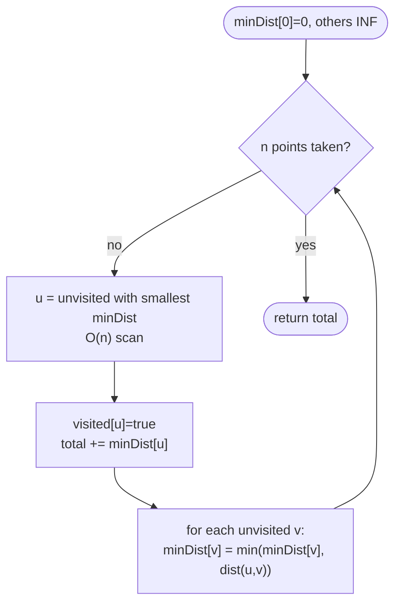

# LC 1584 Min Cost to Connect All Points

> [!abstract] In one sentence
> Every pair of points is a potential edge with Manhattan cost, you want all points connected for the least total cost, and that is exactly a minimum spanning tree — Prim's algorithm grows it from any point by repeatedly adding the cheapest edge that reaches an unvisited point.

**Map:** [[NeetCode 150 MOC]] → [[DSA Dashboard]] · Pattern: [[Advanced Graphs]]

> [!question] Predict before you read
> With n points the complete graph has n(n − 1)/2 edges. For n = 1000 that is about 500 000 edges. Would you rather sort them all (Kruskal) or keep, per unvisited point, only its cheapest known link to the tree (Prim)? What does each cost?

## Problem

You are given `points[i] = [x, y]` on a plane, all distinct. The cost of connecting two points is their Manhattan distance `|x1 − x2| + |y1 − y2|`. Return the minimum total cost to connect all points so that there is exactly one simple path between every pair (i.e. the connections form a tree).

Example: `[ [0,0],[2,2],[3,10],[5,2],[7,0] ]` → `20` (edges 0–1 cost 4, 1–3 cost 3, 3–4 cost 4, 1–2 cost 9).
Example: `[ [3,12],[-2,5],[-4,1] ]` → `18`.

Constraints that matter: 1 ≤ n ≤ 1000, coordinates in [−10⁶, 10⁶]. n = 1000 means n² = 10⁶ pair checks is fine; n² log n with a heap is also fine; anything cubic is not.

## Clarifying questions

1. Are all points distinct? — Yes, so no zero-cost edges and no duplicate handling.
2. Is the graph complete (any two points may be connected)? — Yes; the edge set is implicit, you never build it.
3. Do I return the cost or the edges? — The cost; keep a `parent[]` if asked for the edges.
4. Can the total overflow `int`? — Max edge cost is 4 × 10⁶, times 999 edges, about 4 × 10⁹: it *can* exceed `Integer.MAX_VALUE` in theory, though LeetCode's tests do not. Use `long` for the sum if you want to be safe, and say so.

## Brute force

Enumerate every spanning tree and pick the cheapest — Cayley's formula says there are nⁿ⁻² of them, hopeless beyond n ≈ 8. A less absurd baseline is Kruskal without Union-Find: sort all edges and, for each, run a BFS to check whether its endpoints are already connected: O(E log E + E · n) = O(n³). The waste is re-checking connectivity from scratch each time.

## The key insight

"Connect everything, minimum total cost, no cycles needed" is the **minimum spanning tree** definition. Two classic algorithms: **Prim** (grow one tree, always add the cheapest edge leaving it) and **Kruskal** (sort all edges, add each unless it closes a cycle, detected with [[Union-Find]]). On a *dense* complete graph, Prim with a plain `minDist[]` array and an O(n) scan per step is O(n²) with no heap and no edge list — the cleanest choice here. Recognition cue: "minimum cost to connect all", "wire/cable/road between all", with costs on pairs.

## Optimal approach

Prim with a visited array and `minDist[i]` = cheapest known edge from the current tree to point `i`.

1. `minDist[0] = 0`, every other `minDist[i] = ∞`, `visited` all false.
2. Repeat n times: pick the unvisited `u` with the smallest `minDist[u]`; mark it visited; add `minDist[u]` to the total.
3. For every unvisited `v`, `minDist[v] = min(minDist[v], dist(u, v))` — the new tree vertex may offer a cheaper link.
4. After n iterations the total is the MST cost.



> [!example]- Excalidraw version — the same diagram as an editable canvas
> ![[LC 1584 Min Cost to Connect All Points — Optimal approach.excalidraw]]
> [[LC 1584 Min Cost to Connect All Points — Optimal approach.excalidraw|Open in Excalidraw]] — needs the Excalidraw plugin (see [[Plugins to Install]]).

## Walkthrough

Points `0:(0,0) 1:(2,2) 2:(3,10) 3:(5,2) 4:(7,0)`.

| Round | Picked u | Cost added | minDist after relaxing from u (points 0..4) |
|---|---|---|---|
| start | – | 0 | [0, ∞, ∞, ∞, ∞] |
| 1 | 0 | 0 | [–, 4, 13, 7, 7] |
| 2 | 1 | 4 | [–, –, 9, 3, 7] |
| 3 | 3 | 3 | [–, –, 9, –, 4] |
| 4 | 4 | 4 | [–, –, 9, –, –] |
| 5 | 2 | 9 | [–, –, –, –, –] |

Total 0 + 4 + 3 + 4 + 9 = 20.

> [!example] MST chosen by Prim (edge labels = Manhattan cost)
> ![[LC 1584 Min Cost to Connect All Points — MST chosen by Prim (edge labels = Manhattan cost).excalidraw]]
> [[LC 1584 Min Cost to Connect All Points — MST chosen by Prim (edge labels = Manhattan cost).excalidraw|Open in Excalidraw]] — amber edges form the tree of cost 20; 0-4 (7) and 0-3 (7) are never needed

%% excalidraw-spec
{"kind": "graph", "title": "MST chosen by Prim (edge labels = Manhattan cost)", "directed": false, "nodes": [{"id": "p0", "label": "(0,0)", "level": 0}, {"id": "p1", "label": "(2,2)", "level": 1}, {"id": "p3", "label": "(5,2)", "level": 2}, {"id": "p4", "label": "(7,0)", "level": 3}, {"id": "p2", "label": "(3,10)", "level": 2}], "edges": [ ["p0", "p1", "4"], ["p1", "p3", "3"], ["p3", "p4", "4"], ["p1", "p2", "9"], ["p0", "p4", "7"], ["p0", "p3", "7"] ], "highlight_edges": [ ["p0", "p1"], ["p1", "p3"], ["p3", "p4"], ["p1", "p2"] ], "caption": "amber edges form the tree of cost 20; 0-4 (7) and 0-3 (7) are never needed"}
%%

## Java solution

```java
import java.util.*;

class Solution {
    public int minCostConnectPoints(int[][] points) {
        int n = points.length;
        int[] minDist = new int[n];                 // cheapest known edge from the tree to i
        Arrays.fill(minDist, Integer.MAX_VALUE);
        boolean[] inTree = new boolean[n];
        minDist[0] = 0;
        int total = 0;
        for (int taken = 0; taken < n; taken++) {
            int u = -1;
            for (int i = 0; i < n; i++)             // O(n) scan replaces the heap on a dense graph
                if (!inTree[i] && (u == -1 || minDist[i] < minDist[u])) u = i;
            inTree[u] = true;
            total += minDist[u];
            for (int v = 0; v < n; v++) {
                if (inTree[v]) continue;
                int d = Math.abs(points[u][0] - points[v][0]) + Math.abs(points[u][1] - points[v][1]);
                if (d < minDist[v]) minDist[v] = d;
            }
        }
        return total;
    }
}
```

**Time** O(n²) · **Space** O(n)

Kruskal with Union-Find, the version to produce when the interviewer says "sort the edges":

```java
// snippet
List<int[]> edges = new ArrayList<>();                    // {cost, u, v}
for (int i = 0; i < n; i++)
    for (int j = i + 1; j < n; j++)
        edges.add(new int[]{dist(points, i, j), i, j});
edges.sort(Comparator.comparingInt(e -> e[0]));
int[] parent = new int[n];
for (int i = 0; i < n; i++) parent[i] = i;
int total = 0, used = 0;
for (int[] e : edges) {
    int ru = find(parent, e[1]), rv = find(parent, e[2]);
    if (ru == rv) continue;                                 // would close a cycle
    parent[ru] = rv;
    total += e[0];
    if (++used == n - 1) break;                             // tree complete
}
// O(n^2 log n) time, O(n^2) space for the edge list
```

## Why it works

Prim relies on the **cut property**: for any partition of the vertices into the tree `T` and the rest, the cheapest edge crossing the cut belongs to some MST. Each round picks exactly that edge (the minimum `minDist` over unvisited points is the cheapest crossing edge), so after n − 1 picks the chosen edges form an MST. `minDist[v]` stays correct because the only way the cheapest crossing edge to `v` can change is through the vertex just added, which is exactly what the relaxation loop checks. Kruskal relies on the same property applied to the two components an edge would join.

## Edge cases

- `n = 1` — loop runs once, picks point 0 with cost 0, returns 0.
- `n = 2` — one edge; its Manhattan distance.
- Collinear points — no special case; Manhattan distance is well-defined.
- Negative coordinates — `Math.abs` handles them; no overflow because |Δ| ≤ 2 × 10⁶.
- Large n with a heap-based Prim — remember stale heap entries; see *Common mistakes*.

## Common mistakes

> [!warning] Pitfalls
> - **Building the full edge list for Prim.** You do not need it; the distance is computed on the fly. Materialising 500 000 `int[]` objects costs memory and time for nothing.
> - **Heap-based Prim without a visited check.** When popping from a `PriorityQueue<int[]>` of `{cost, point}`, a point can be pushed several times; skip it if already in the tree, otherwise you add it twice and overcount the cost.
> - **Kruskal without path compression or union by rank** is still fine at n = 1000, but say you know the α(n) bound.
> - **Starting `minDist[0]` at ∞** instead of 0 — the first pick then adds `Integer.MAX_VALUE` and overflows the total.

## Variants & follow-ups

- Return the edges, not the cost — keep `parent[v] = u` when relaxing; after the loop `(parent[v], v)` for `v ≠ 0` are the tree edges.
- Sparse graph with an explicit edge list — heap-based Prim O(E log V) or Kruskal O(E log E) beats the O(V²) scan.
- "Is this edge in every MST / some MST?" — critical and pseudo-critical edges (LC 1489): rerun Kruskal excluding then forcing the edge.
- Maximum spanning tree — negate costs, or sort descending.
- Union-Find practice first: [[LC 684 Redundant Connection]].

## Interview script

1. Restate: complete graph on the points, Manhattan weights, minimum cost to connect all → MST.
2. Brute force: enumerate spanning trees, impossible; Kruskal with BFS connectivity, cubic.
3. Insight: cut property; grow the tree with the cheapest crossing edge (Prim) or add sorted edges unless they close a cycle (Kruskal + Union-Find).
4. Approach: since the graph is dense, Prim with a `minDist` array and an O(n) scan, O(n²), no heap. Mention the heap and Kruskal variants and when you would choose them.
5. Complexity: O(n²) time, O(n) space.
6. Tests: n = 1, n = 2, the five-point example (cost 20).

The interviewer is checking that you name MST immediately, that you can justify the greedy step with the cut property, and that you pick the algorithm by graph density.

## Related

- [[Advanced Graphs]] — Prim versus Kruskal, when to use which
- [[Union-Find]] — the structure Kruskal needs
- [[LC 684 Redundant Connection]] — Union-Find warm-up
- [[LC 743 Network Delay Time]] — Dijkstra uses the same heap-and-relax skeleton with a different invariant
- [[LC 778 Swim in Rising Water]] — a bottleneck path, also solvable with Kruskal-style union
- [[DSA Patterns in Java]] — Prim / Kruskal / Union-Find templates
- [[Java Collections Cheat Sheet]] — `PriorityQueue` comparator forms, sorting `int[]` edges

## Attempt log

| Date | Result | Minutes | What I got wrong |
|---|---|---|---|
| | | | |

### Mastery checklist
- [ ] Solved without hints in under 25 minutes
- [ ] Stated complexity before coding
- [ ] Handled every edge case above
- [ ] Code compiled first time
- [ ] Can do the follow-up variant (Kruskal with Union-Find)

## Open questions
- [ ]
