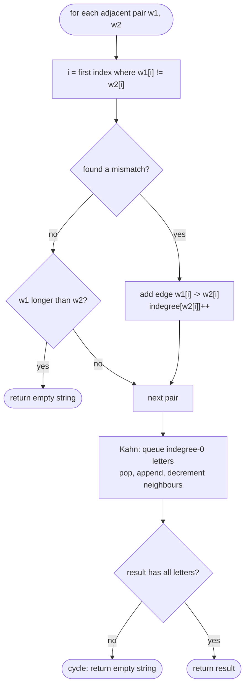

# LC 269 Alien Dictionary

> [!abstract] In one sentence
> Each adjacent pair of words contributes at most one fact — the first position where they differ says "this letter comes before that one" — and those facts form a directed graph whose topological order is the alphabet, provided the graph is acyclic and no word is followed by its own prefix.

**Map:** [[NeetCode 150 MOC]] → [[DSA Dashboard]] · Pattern: [[Advanced Graphs]]

> [!question] Predict before you read
> Words `["abc", "ab"]` are claimed to be sorted. No two letters differ at any position before one word ends. What does that tell you, and why must the answer be `""` rather than any order of `a`, `b`, `c`?

## Problem

You are given a list of words that is sorted according to an unknown alphabet that uses lowercase English letters. Derive and return any valid ordering of the letters that appear in the words. If no ordering is consistent with the list, return `""`. If several are, return any.

Example: `["wrt","wrf","er","ett","rftt"]` → `"wertf"`.
Example: `["z","x"]` → `"zx"`.
Example: `["z","x","z"]` → `""` (z before x and x before z: a cycle).
Example: `["abc","ab"]` → `""` (a longer word cannot sort before its own prefix).

Constraints that matter: 1 ≤ words ≤ 100, each 1..100 characters, lowercase only — the alphabet has at most 26 nodes, so the graph is tiny; the work is in the comparison of adjacent pairs, O(total characters).

## Clarifying questions

1. Must every letter that appears be in the output, even those with no constraints? — Yes; isolated letters go anywhere.
2. Do I only compare *adjacent* words? — Yes; sortedness is transitive, so adjacent pairs carry all the information.
3. What exactly makes the input invalid? — A cycle in the constraints, or a word followed by its own proper prefix (`"abc"` then `"ab"`).
4. Several valid answers — any is fine? — Yes.

## Brute force

Try every permutation of the distinct letters (up to 26! — impossible) and check whether the word list is sorted under it. Even for 8 letters that is 40 320 permutations times a full sort check. The waste: the constraints are local (adjacent pairs) and the question is only whether a consistent linear order exists — exactly what topological sort answers in linear time.

## The key insight

Sorted order between two words is decided by the **first differing character**; everything after it is irrelevant. So each adjacent pair yields at most one edge `a → b` ("a before b"). The letters and edges form a directed graph; a valid alphabet is a **topological order** of it, and it exists iff the graph is a DAG. [[LC 210 Course Schedule II]] with the graph hidden inside strings. The one trap is the pair that *has no* differing character because the second word ends first — `"abc"` before `"ab"` — which is impossible under any alphabet and must be caught while building the graph.

## Optimal approach

1. Initialise `indegree` for every letter that appears (value 0) and an empty adjacency set per letter.
2. For each adjacent pair `(w1, w2)`: scan positions while characters match; at the first mismatch add the edge `w1[i] → w2[i]` (if not already present) and increment `indegree`, then stop. If no mismatch and `w1.length > w2.length`, return `""`.
3. Kahn: queue every letter with `indegree 0`; pop, append to the result, decrement each neighbour, enqueue those that reach 0.
4. If the result contains fewer letters than the graph has nodes, a cycle exists → `""`; otherwise return the result.



> [!example]- Excalidraw version — the same diagram as an editable canvas
> ![[LC 269 Alien Dictionary — Optimal approach.excalidraw]]
> [[LC 269 Alien Dictionary — Optimal approach.excalidraw|Open in Excalidraw]] — needs the Excalidraw plugin (see [[Plugins to Install]]).

## Walkthrough

`["wrt","wrf","er","ett","rftt"]`.

| Pair | First mismatch | Edge |
|---|---|---|
| wrt, wrf | index 2: t vs f | t → f |
| wrf, er | index 0: w vs e | w → e |
| er, ett | index 1: r vs t | r → t |
| ett, rftt | index 0: e vs r | e → r |

> [!example] Inferred constraint graph
> ![[LC 269 Alien Dictionary — Inferred constraint graph.excalidraw]]
> [[LC 269 Alien Dictionary — Inferred constraint graph.excalidraw|Open in Excalidraw]] — indegrees: w0 e1 r1 t1 f1; Kahn peels w, e, r, t, f

%% excalidraw-spec
{"kind": "graph", "title": "Inferred constraint graph", "directed": true, "nodes": [{"id": "w", "label": "w", "level": 0}, {"id": "e", "label": "e", "level": 1}, {"id": "r", "label": "r", "level": 2}, {"id": "t", "label": "t", "level": 3}, {"id": "f", "label": "f", "level": 4}], "edges": [ ["w", "e", ""], ["e", "r", ""], ["r", "t", ""], ["t", "f", ""] ], "highlight_nodes": ["w"], "caption": "indegrees: w0 e1 r1 t1 f1; Kahn peels w, e, r, t, f"}
%%

Kahn: queue `{w}` → result `w`, `e` drops to 0 → `we`, `r` → `wer`, `t` → `wert`, `f` → `wertf`. Five letters out, five in the graph, no cycle.

## Java solution

```java
import java.util.*;

class Solution {
    public String alienOrder(String[] words) {
        Map<Character, Set<Character>> adj = new HashMap<>();
        Map<Character, Integer> indegree = new HashMap<>();
        for (String w : words)
            for (char c : w.toCharArray()) {
                adj.putIfAbsent(c, new HashSet<>());
                indegree.putIfAbsent(c, 0);
            }
        for (int i = 0; i + 1 < words.length; i++) {
            String a = words[i], b = words[i + 1];
            int len = Math.min(a.length(), b.length()), j = 0;
            while (j < len && a.charAt(j) == b.charAt(j)) j++;
            if (j == len) {                                   // no mismatch: one is a prefix of the other
                if (a.length() > b.length()) return "";       // "abc" before "ab" is impossible
                continue;
            }
            char from = a.charAt(j), to = b.charAt(j);
            if (adj.get(from).add(to))                        // Set.add tells us whether the edge is new
                indegree.merge(to, 1, Integer::sum);
        }
        Deque<Character> queue = new ArrayDeque<>();
        for (Map.Entry<Character, Integer> e : indegree.entrySet())
            if (e.getValue() == 0) queue.offer(e.getKey());
        StringBuilder order = new StringBuilder();
        while (!queue.isEmpty()) {
            char c = queue.poll();
            order.append(c);
            for (char nxt : adj.get(c))
                if (indegree.merge(nxt, -1, Integer::sum) == 0) queue.offer(nxt);
        }
        return order.length() == indegree.size() ? order.toString() : "";   // short = cycle
    }
}
```

**Time** O(C) where C is the total number of characters — building the graph dominates; Kahn on ≤ 26 nodes is constant · **Space** O(1) in practice (≤ 26 nodes, ≤ 26² edges), O(C) if you count the input

## Why it works

Each edge `a → b` is a *necessary* condition: any alphabet consistent with the list must place `a` before `b`. Adjacent pairs suffice because if the list is sorted then non-adjacent pairs are implied by transitivity. A topological order satisfies every edge, hence every necessary condition, hence is a valid alphabet; Kahn produces one iff the graph is acyclic, and a cycle would mean the constraints contradict each other, so `""` is correct. The prefix check covers the only invalidity that produces no edge at all. Letters with no edges have indegree 0 from the start and are emitted in the first wave, which is why the loop initialises *every* letter.

## Edge cases

- One word — no pairs; all its distinct letters in any order.
- Identical adjacent words — no mismatch, equal length, no edge, continue.
- Duplicate edge from two pairs — the `Set` prevents a double indegree increment (otherwise the node never reaches 0 and you falsely report a cycle).
- Letter that appears only inside words and never in a mismatch — must still be in the output; handled by initialising from all characters.
- `["abc", "ab"]` — prefix rule → `""`. `["ab", "abc"]` — fine.
- `["z", "z"]` — `"z"`.

## Common mistakes

> [!warning] Pitfalls
> - **Comparing all pairs, not just adjacent ones.** Correct but O(W² · L) and it adds nothing; interviewers see it as not understanding sortedness.
> - **Adding more than one edge per pair.** After the first mismatch, the remaining characters say *nothing*; `"ab"` and `"ba"` only tell you `a → b`.
> - **Missing the prefix check** — `["abc", "ab"]` silently returns `"abc"` (or a permutation) instead of `""`.
> - **Not registering letters that never appear in an edge** — they vanish from the output and the length check falsely reports a cycle.
> - **Double-counting an indegree** when the same edge comes from two pairs — use a `Set` for the adjacency, or check `contains` before incrementing.

## Variants & follow-ups

- Return the lexicographically smallest valid order — replace the queue with a `PriorityQueue<Character>`.
- "Is the order unique?" — unique iff at every Kahn step the queue has exactly one element.
- DFS-based topological sort with three colours instead of Kahn — same result; cycle = back edge to a grey node.
- Verify a *given* alphabet against the list (LC 953 Verifying an Alien Alphabet) — map each letter to its rank and compare adjacent words.
- The plain version with the graph given explicitly: [[LC 210 Course Schedule II]].

## Interview script

1. Restate: words sorted by an unknown alphabet; recover the alphabet or report inconsistency.
2. Brute force: permutations of letters checked against the list, factorial.
3. Insight: the first differing letter of each adjacent pair is one edge; the alphabet is a topological order; invalid = cycle or longer-word-before-its-prefix.
4. Approach: build nodes from all characters, edges from adjacent pairs with the prefix guard, Kahn with an indegree map; length check for cycles.
5. Complexity: O(total characters) time; O(1) graph space.
6. Tests: `["z","x","z"]` (cycle), `["abc","ab"]` (prefix), a single word, a letter with no constraints.

The interviewer is checking that you stop at the first mismatch, that you handle the prefix case explicitly, and that you can explain why adjacent pairs are enough.

## Related

- [[Advanced Graphs]] — topological sort as a tool, after the basics
- [[Graphs]] — Kahn's algorithm and DFS colouring from zero
- [[LC 207 Course Schedule]] — cycle detection, the simplest topological-sort problem
- [[LC 210 Course Schedule II]] — producing the order
- [[LC 332 Reconstruct Itinerary]] — the other Hard graph where you must build the right graph first
- [[Java Collections Cheat Sheet]] — `putIfAbsent`, `merge`, `Map.Entry`, `ArrayDeque`
- [[DSA Patterns in Java]] — topological sort template (Kahn and DFS)

## Attempt log

| Date | Result | Minutes | What I got wrong |
|---|---|---|---|
| | | | |

### Mastery checklist
- [ ] Solved without hints in under 25 minutes
- [ ] Stated complexity before coding
- [ ] Handled every edge case above
- [ ] Code compiled first time
- [ ] Can do the follow-up variant (smallest lexical order; uniqueness check)

## Open questions
- [ ]
