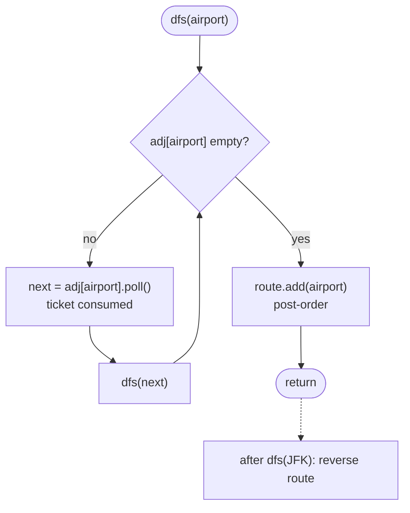

# LC 332 Reconstruct Itinerary

> [!abstract] In one sentence
> Every ticket is a directed edge and you must walk every edge exactly once, so the answer is an Eulerian path; Hierholzer's trick is to DFS greedily into the smallest neighbour, and to record an airport only when it is stuck (no tickets left), which puts the dead ends at the end of the route where they belong.

**Map:** [[NeetCode 150 MOC]] → [[DSA Dashboard]] · Pattern: [[Advanced Graphs]]

> [!question] Predict before you read
> From JFK with tickets JFK→KUL and JFK→NRT, NRT→JFK, plain greedy picks KUL first (alphabetically smaller) and gets stuck with NRT unused. What single change to *when* you write an airport into the answer fixes this without any backtracking?

## Problem

You are given a list of tickets, each a pair `[from, to]` of three-letter airport codes. All tickets belong to one traveller who starts at `JFK`. Reconstruct the full route that uses every ticket exactly once. If several routes exist, return the one that is smallest in lexical order when read as a single string of airports. You may assume at least one valid itinerary exists.

Example: tickets `[ [MUC,LHR],[JFK,MUC],[SFO,SJC],[LHR,SFO] ]` → `[JFK, MUC, LHR, SFO, SJC]`.
Example: tickets `[ [JFK,SFO],[JFK,ATL],[SFO,ATL],[ATL,JFK],[ATL,SFO] ]` → `[JFK, ATL, JFK, SFO, ATL, SFO]`; the route `[JFK, SFO, ATL, JFK, ATL, SFO]` is also valid but lexically larger.

Constraints that matter: 1 ≤ tickets ≤ 300, duplicate tickets are allowed (the same pair can appear twice), and a valid itinerary is guaranteed, so you never need to detect "impossible".

## Clarifying questions

1. Can the same ticket appear twice? — Yes; treat it as two parallel edges (a multiset, which is why the adjacency holds a priority queue or a sorted list with a cursor, not a set).
2. Is a valid itinerary guaranteed? — Yes; you do not need to check Eulerian conditions, but say what they are (see *Why it works*).
3. Does lexical order apply to the whole route or just the first choice? — The whole route as a string; greedily picking the smallest next airport *when that choice can still complete the walk* produces it.
4. Can there be airports that are never departed from (pure sinks)? — Yes; one airport may have one more arrival than departure. That is the end of the route.

## Brute force

Backtracking: at each airport, try destinations in sorted order, mark the ticket used, recurse, unmark on failure, stop at the first full-length route. It is correct and lexically smallest because it tries choices in order. In the worst case it is exponential — a graph with many dead-end branches makes the DFS retreat repeatedly — but with 300 tickets it often passes. The waste: it keeps re-exploring prefixes that are destined to fail, and each failure undoes the whole marked trail.

## The key insight

Using every edge exactly once is an **Eulerian path**, and Hierholzer's algorithm finds one in linear time without backtracking. The trick is *post-order*: walk greedily into the smallest unused neighbour until you are stuck, and only then append the stuck airport to the route. A dead end that you hit early is really the *last* airport of the itinerary; appending in post-order and reversing at the end puts it there. Recognition cue: "use every ticket / edge exactly once" plus "return the path".

## Optimal approach

1. Build `Map<String, PriorityQueue<String>>`: for each ticket `a→b`, add `b` to `adj[a]`. The min-heap gives the smallest destination first and handles duplicates naturally.
2. Run `dfs(JFK)`: while `adj[cur]` is non-empty, `poll()` the smallest destination (this *consumes* the ticket) and recurse into it.
3. When `adj[cur]` is empty, append `cur` to the route — this is post-order.
4. After the DFS, reverse the route.



> [!example]- Excalidraw version — the same diagram as an editable canvas
> ![[LC 332 Reconstruct Itinerary — Optimal approach.excalidraw]]
> [[LC 332 Reconstruct Itinerary — Optimal approach.excalidraw|Open in Excalidraw]] — needs the Excalidraw plugin (see [[Plugins to Install]]).

## Walkthrough

Tickets `[ [JFK,SFO],[JFK,ATL],[SFO,ATL],[ATL,JFK],[ATL,SFO] ]`. Adjacency after building: `JFK→{ATL, SFO}`, `ATL→{JFK, SFO}`, `SFO→{ATL}`.

> [!example] Ticket graph
> ![[LC 332 Reconstruct Itinerary — Ticket graph.excalidraw]]
> [[LC 332 Reconstruct Itinerary — Ticket graph.excalidraw|Open in Excalidraw]] — five tickets = five edges; every one must be walked once

%% excalidraw-spec
{"kind": "graph", "title": "Ticket graph", "directed": true, "nodes": [{"id": "JFK", "label": "JFK", "level": 0}, {"id": "ATL", "label": "ATL", "level": 1}, {"id": "SFO", "label": "SFO", "level": 1}], "edges": [ ["JFK", "ATL", "1"], ["JFK", "SFO", "2"], ["ATL", "JFK", "3"], ["ATL", "SFO", "4"], ["SFO", "ATL", "5"] ], "highlight_nodes": ["JFK"], "caption": "five tickets = five edges; every one must be walked once"}
%%

| Step | Stack (top on the right) | Action | Route (post-order) |
|---|---|---|---|
| 1 | JFK | poll ATL | |
| 2 | JFK, ATL | poll JFK | |
| 3 | JFK, ATL, JFK | poll SFO | |
| 4 | JFK, ATL, JFK, SFO | poll ATL | |
| 5 | JFK, ATL, JFK, SFO, ATL | poll SFO | |
| 6 | JFK, ATL, JFK, SFO, ATL, SFO | SFO has nothing left → append | SFO |
| 7 | JFK, ATL, JFK, SFO, ATL | ATL empty → append | SFO, ATL |
| 8 | … | unwind: SFO, JFK, ATL, JFK appended | SFO, ATL, SFO, JFK, ATL, JFK |
| 9 | | reverse | JFK, ATL, JFK, SFO, ATL, SFO |

Note that in this run the greedy walk never got stuck early; the post-order still produces the route in reverse. The case from the predict callout (JFK→KUL, JFK→NRT, NRT→JFK) is where it matters: greedy enters KUL, KUL is stuck and is appended *first*, the DFS unwinds to JFK, takes NRT, NRT→JFK, JFK appended, NRT appended, JFK appended; reversed: JFK, NRT, JFK, KUL.

## Java solution

```java
import java.util.*;

class Solution {
    private final Map<String, PriorityQueue<String>> adj = new HashMap<>();
    private final LinkedList<String> route = new LinkedList<>();

    public List<String> findItinerary(List<List<String>> tickets) {
        for (List<String> t : tickets)
            adj.computeIfAbsent(t.get(0), k -> new PriorityQueue<>()).offer(t.get(1));
        dfs("JFK");
        return route;                       // built by addFirst, so already in order
    }

    private void dfs(String airport) {
        PriorityQueue<String> next = adj.get(airport);
        while (next != null && !next.isEmpty())
            dfs(next.poll());               // poll = use the ticket; smallest first
        route.addFirst(airport);            // post-order: stuck airports land at the end
    }
}
```

**Time** O(E log E) — every ticket is polled once from a heap · **Space** O(E) for the adjacency and the recursion (depth up to E).

The iterative form avoids the recursion depth worry (300 is nothing, but say it):

```java
// snippet
Deque<String> stack = new ArrayDeque<>();
stack.push("JFK");
while (!stack.isEmpty()) {
    String cur = stack.peek();
    PriorityQueue<String> next = adj.get(cur);
    if (next != null && !next.isEmpty()) stack.push(next.poll());
    else route.addFirst(stack.pop());
}
```

## Why it works

A directed graph has an Eulerian path from `JFK` when every vertex has in-degree equal to out-degree, except possibly `JFK` (one extra departure) and one end vertex (one extra arrival), and all edges are connected. In such a graph a greedy walk from `JFK` can only get stuck at the end vertex (or at `JFK` itself if it is a circuit). When the walk is stuck at `v`, every remaining unused edge lies on cycles hanging off the vertices already on the stack; unwinding the stack and resuming the greedy walk from each one splices those cycles in. Appending a vertex only when it is exhausted means the sequence of appends is the route in reverse. Lexical minimality follows from always taking the smallest available edge first *and* from the fact that the post-order placement never forces a larger choice earlier than necessary.

## Edge cases

- One ticket `[JFK, X]` — DFS enters X, X is empty, route `[JFK, X]`.
- Duplicate tickets `[JFK, A], [JFK, A], [A, JFK]` — the heap holds A twice; the walk is JFK, A, JFK, A.
- A sink airport that is never departed from — `adj.get(sink)` is `null`, hence the `next != null` guard.
- Cycle back to JFK plus a dead end — the predict-callout case; post-order handles it.
- All airports identical codes except JFK — no special handling; strings compare naturally.

## Common mistakes

> [!warning] The three ways this goes wrong
> - **Appending in pre-order** (writing the airport when you enter it). The KUL/NRT case then returns `[JFK, KUL]` and leaves tickets unused. The append must happen after the while loop.
> - **Using a `Set` or `TreeSet` for the adjacency.** Duplicate tickets collapse and you lose edges. Use a `PriorityQueue` (or sort a list and keep an index per airport).
> - **Not consuming the ticket.** If you `peek` instead of `poll`, or keep a `visited` set on airports, you either loop forever or forbid revisiting an airport — revisiting airports is fine, reusing *tickets* is not.
> - **Forgetting to reverse** when you append to the tail of an `ArrayList`; using `LinkedList.addFirst` sidesteps it.

## Variants & follow-ups

- "Does a valid itinerary exist?" — check in/out degrees and connectivity (the conditions in *Why it works*).
- Eulerian *circuit* (must return to start) — same code, start anywhere with edges; all degrees balanced.
- Undirected version (Valid Arrangement of Pairs, LC 2097 in directed form) — the same Hierholzer with both directions in the adjacency and edge ids to mark used.
- Smallest-lexical path that *does not* need to use every edge — that is plain DFS/BFS, not Eulerian; be sure which one you are asked.
- Related topological shapes: [[LC 210 Course Schedule II]] (every vertex once) versus this (every edge once).

## Interview script

1. Restate: tickets are directed edges; walk every edge once from JFK; smallest lexical route.
2. Brute force: backtracking over sorted destinations, exponential in the worst case.
3. Insight: this is an Eulerian path; Hierholzer finds one greedily in linear time if I record airports in post-order and reverse.
4. Approach: min-heap adjacency, DFS that polls while possible, `addFirst` when stuck. Walk the KUL/NRT example to show why post-order matters.
5. Complexity: O(E log E) time, O(E) space.
6. Tests: single ticket, duplicate tickets, dead end that must come last.

The interviewer is checking that you know the difference between "visit every node" and "use every edge", that you understand why the post-order fixes the greedy, and that you handle duplicates.

## Related

- [[Advanced Graphs]] — Eulerian path section and when to use which graph algorithm
- [[Graphs]] — DFS basics; this is DFS with a twist
- [[LC 210 Course Schedule II]] — ordering vertices, the sibling shape
- [[LC 269 Alien Dictionary]] — another graph you must infer before solving
- [[LC 743 Network Delay Time]] — the next Advanced Graphs problem
- [[Java Collections Cheat Sheet]] — `computeIfAbsent`, `PriorityQueue.poll`, `LinkedList.addFirst`
- [[DSA Patterns in Java]] — DFS templates

## Attempt log

| Date | Result | Minutes | What I got wrong |
|---|---|---|---|
| | | | |

### Mastery checklist
- [ ] Solved without hints in under 25 minutes
- [ ] Stated complexity before coding
- [ ] Handled every edge case above
- [ ] Code compiled first time
- [ ] Can do the follow-up variant (existence check for an Eulerian path)

## Open questions
- [ ]
