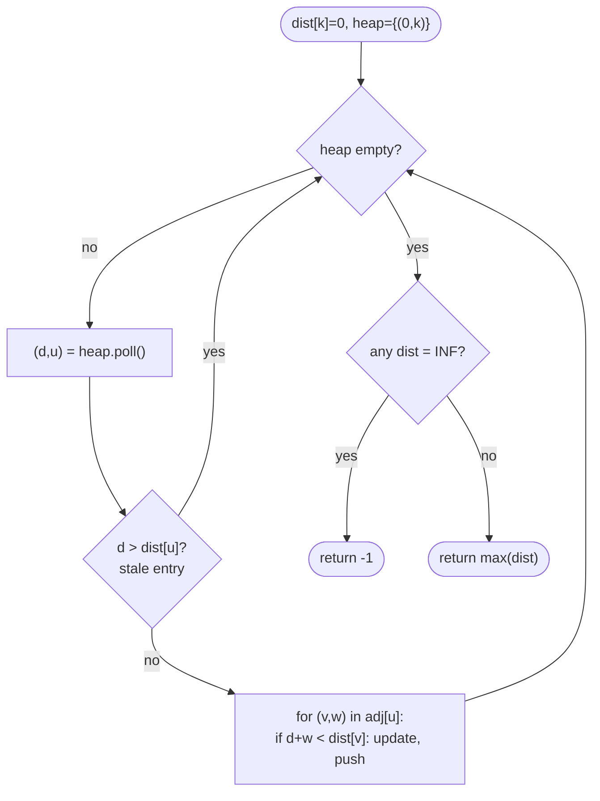

# LC 743 Network Delay Time

> [!abstract] In one sentence
> This is the canonical Dijkstra problem: non-negative edge weights, one source, shortest distance to every node, and the answer is the maximum of those distances (or −1 if some node is unreachable).

**Map:** [[NeetCode 150 MOC]] → [[DSA Dashboard]] · Pattern: [[Advanced Graphs]]

> [!question] Predict before you read
> BFS finds shortest paths when every edge costs 1. What breaks if edges cost 1 or 5, and what is the smallest change to BFS's queue that fixes it?

## Problem

You have `n` nodes labelled 1..n and a list of directed, weighted edges `times[i] = [u, v, w]` meaning a signal sent from `u` reaches `v` after `w` units. A signal is sent from node `k`. Return the time at which *all* nodes have received it, or −1 if that never happens.

Example: `times = [ [2,1,1],[2,3,1],[3,4,1] ], n = 4, k = 2` → `2` (node 1 at t = 1, node 3 at t = 1, node 4 at t = 2).
Example: `times = [ [1,2,1] ], n = 2, k = 2` → `−1` (node 1 is unreachable from 2).

Constraints that matter: 1 ≤ n ≤ 100, up to 6000 edges, weights 0 ≤ w ≤ 100, no self-loops, no duplicate edges. Weights are non-negative, which is the precondition for Dijkstra.

## Clarifying questions

1. Are weights non-negative? — Yes (0..100); so Dijkstra is valid. Negative weights would need Bellman-Ford.
2. Directed or undirected? — Directed; only add `u → v`.
3. What is the answer when the graph is connected? — The *maximum* over all shortest distances, because all nodes must be reached and signals travel in parallel.
4. Can `k` be isolated? — Yes; then if n > 1 the answer is −1; if n = 1 the answer is 0.

## Brute force

Simulate: at each time step, propagate from every node that has already received the signal to its neighbours, repeating until nothing changes. That is Bellman-Ford in disguise and costs O(V · E) = 100 × 6000 — fine here, but the point of this problem is to show the O(E log V) algorithm. A plain BFS is wrong because weighted edges mean the first time you *see* a node is not the earliest time you can *reach* it.

## The key insight

Dijkstra's algorithm is BFS where the FIFO queue is replaced by a **min-heap keyed on tentative distance**. Popping the smallest tentative distance guarantees that distance is final (with non-negative weights, no later path can be shorter), so each node is settled once and its edges relaxed once. The "network delay" is just `max(dist)`. Recognition cue: "shortest / fastest / cheapest from one source" with non-negative weights.

## Optimal approach

1. Build an adjacency list `List<int[]>[] adj`, each entry `{v, w}`.
2. `dist[]` all ∞, `dist[k] = 0`; push `(0, k)` on a `PriorityQueue<int[]>` ordered by distance.
3. Pop `(d, u)`. If `d > dist[u]` it is a stale entry — skip. Otherwise for every edge `(v, w)`: if `d + w < dist[v]`, update and push `(d + w, v)`.
4. When the heap is empty, the answer is `max(dist)`; if any `dist` is still ∞ return −1.



> [!example]- Excalidraw version — the same diagram as an editable canvas
> ![[LC 743 Network Delay Time — Optimal approach.excalidraw]]
> [[LC 743 Network Delay Time — Optimal approach.excalidraw|Open in Excalidraw]] — needs the Excalidraw plugin (see [[Plugins to Install]]).

## Walkthrough

`times = [ [2,1,1],[2,3,1],[3,4,1] ], n = 4, k = 2`.

| Pop (d, u) | Relaxations | dist[1..4] | Heap after |
|---|---|---|---|
| start | – | [∞, 0, ∞, ∞] | {(0,2)} |
| (0, 2) | 1 → 1, 3 → 1 | [1, 0, 1, ∞] | {(1,1), (1,3)} |
| (1, 1) | none | [1, 0, 1, ∞] | {(1,3)} |
| (1, 3) | 4 → 2 | [1, 0, 1, 2] | {(2,4)} |
| (2, 4) | none | [1, 0, 1, 2] | {} |

`max(dist) = 2`.

> [!example] Dijkstra from node 2 (labels = weight)
> ![[LC 743 Network Delay Time — Dijkstra from node 2 (labels = weight).excalidraw]]
> [[LC 743 Network Delay Time — Dijkstra from node 2 (labels = weight).excalidraw|Open in Excalidraw]] — levels are settle order; node 4 settles last at distance 2 = the answer

%% excalidraw-spec
{"kind": "graph", "title": "Dijkstra from node 2 (labels = weight)", "directed": true, "nodes": [{"id": "n2", "label": "2 (0)", "level": 0}, {"id": "n1", "label": "1 (1)", "level": 1}, {"id": "n3", "label": "3 (1)", "level": 1}, {"id": "n4", "label": "4 (2)", "level": 2}], "edges": [ ["n2", "n1", "1"], ["n2", "n3", "1"], ["n3", "n4", "1"] ], "highlight_nodes": ["n4"], "caption": "levels are settle order; node 4 settles last at distance 2 = the answer"}
%%

## Java solution

```java
import java.util.*;

class Solution {
    public int networkDelayTime(int[][] times, int n, int k) {
        List<List<int[]>> adj = new ArrayList<>();
        for (int i = 0; i <= n; i++) adj.add(new ArrayList<>());
        for (int[] t : times) adj.get(t[0]).add(new int[]{t[1], t[2]});   // {to, weight}

        int[] dist = new int[n + 1];
        Arrays.fill(dist, Integer.MAX_VALUE);
        dist[k] = 0;
        PriorityQueue<int[]> pq = new PriorityQueue<>((a, b) -> Integer.compare(a[0], b[0])); // {dist, node}
        pq.offer(new int[]{0, k});

        while (!pq.isEmpty()) {
            int[] cur = pq.poll();
            int d = cur[0], u = cur[1];
            if (d > dist[u]) continue;                 // stale: a shorter path was already settled
            for (int[] e : adj.get(u)) {
                int v = e[0], nd = d + e[1];
                if (nd < dist[v]) {
                    dist[v] = nd;
                    pq.offer(new int[]{nd, v});        // no decrease-key in Java: push a duplicate
                }
            }
        }
        int answer = 0;
        for (int i = 1; i <= n; i++) {
            if (dist[i] == Integer.MAX_VALUE) return -1;
            answer = Math.max(answer, dist[i]);
        }
        return answer;
    }
}
```

**Time** O(E log V) — every edge may push one heap entry · **Space** O(V + E)

## Why it works

Invariant: when `(d, u)` is popped and `d == dist[u]`, `d` is the true shortest distance. Suppose a shorter path to `u` existed; its first vertex outside the settled set, call it `x`, has `dist[x] ≤` that path's length `< d`, so `(dist[x], x)` would have been popped before `(d, u)` — contradiction, given that weights are non-negative so prefixes are never longer than the whole. Each node is therefore settled once, each edge relaxed once, and stale heap entries are harmlessly skipped by the `d > dist[u]` check.

## Edge cases

- `n = 1` — `dist[1] = 0`, answer 0 regardless of edges.
- Unreachable node — stays at `MAX_VALUE`, return −1.
- Zero-weight edges — allowed; Dijkstra is fine, only *negative* weights break it.
- Parallel paths of equal cost — both push; the second pop is skipped as stale.
- Node labels are 1-based — size arrays `n + 1` and loop from 1.

## Common mistakes

> [!warning] Pitfalls
> - **Marking visited on push instead of on pop.** A node pushed early with a long distance can later get a shorter one; you must allow re-push and skip stale pops.
> - **No stale check** (`if (d > dist[u]) continue`). The code is still correct but relaxes edges from the same node many times, turning O(E log V) into something worse on dense graphs.
> - **Comparator `a[0] - b[0]`** — safe here (distances ≤ 10⁴) but a subtraction-overflow habit; use `Integer.compare`.
> - **Returning `dist[n]`** instead of the maximum — the problem asks when *all* nodes have received it.

## Variants & follow-ups

- Path with at most k edges → Bellman-Ford limited to k rounds: [[LC 787 Cheapest Flights Within K Stops]].
- Minimise the *maximum* edge on the path instead of the sum → Dijkstra with `max` instead of `+`: [[LC 778 Swim in Rising Water]].
- Negative weights → Bellman-Ford O(VE) (and negative-cycle detection on the V-th pass).
- All-pairs → Floyd-Warshall O(V³), feasible at n = 100.
- Reconstruct the path → store `prev[v] = u` on each successful relaxation.
- Unweighted → plain BFS, see [[Graphs]].

## Interview script

1. Restate: directed weighted graph, one source, time until every node is reached = max shortest distance.
2. Brute force: repeated relaxation until stable (Bellman-Ford), O(VE); BFS is wrong with weights.
3. Insight: non-negative weights → Dijkstra; min-heap replaces the BFS queue; popped distances are final.
4. Approach: adjacency list, `dist` array, heap of `{dist, node}`, stale-skip, relax. Then max over dist or −1.
5. Complexity: O(E log V) time, O(V + E) space.
6. Tests: unreachable node, n = 1, equal-cost parallel paths.

The interviewer is checking that you can write Dijkstra without a reference, that you know why visited-on-pop matters, and that you can state when Dijkstra is *not* allowed.

## Related

- [[Advanced Graphs]] — Dijkstra from zero, with the proof picture
- [[Graphs]] — BFS, the unweighted special case
- [[LC 787 Cheapest Flights Within K Stops]] — the edge-count-limited variant
- [[LC 778 Swim in Rising Water]] — minimax Dijkstra
- [[LC 1584 Min Cost to Connect All Points]] — Prim looks identical but keeps a different invariant
- [[DSA Patterns in Java]] — Dijkstra template
- [[Java Collections Cheat Sheet]] — `PriorityQueue` with a comparator, `Integer.compare`

## Attempt log

| Date | Result | Minutes | What I got wrong |
|---|---|---|---|
| | | | |

### Mastery checklist
- [ ] Solved without hints in under 25 minutes
- [ ] Stated complexity before coding
- [ ] Handled every edge case above
- [ ] Code compiled first time
- [ ] Can do the follow-up variant (path reconstruction)

## Open questions
- [ ]
