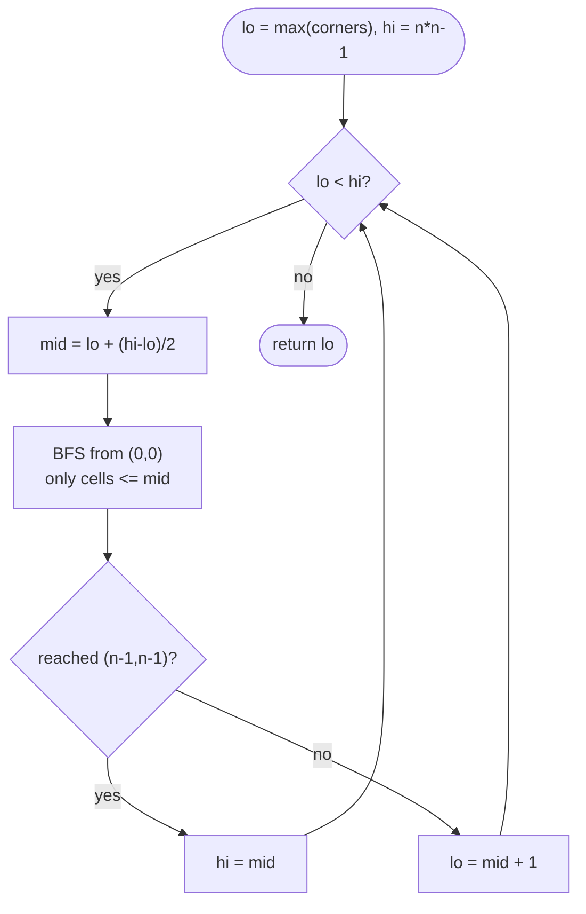

# LC 778 Swim in Rising Water

> [!abstract] In one sentence
> You want the path whose *highest* cell is as low as possible, and because "can I cross at water level t" is false then true as t grows, you can binary-search t and answer each probe with a BFS confined to cells ≤ t; the same answer falls out of Dijkstra if you relax with `max` instead of `+`, or of Union-Find if you add cells in height order until the corners connect.

**Map:** [[NeetCode 150 MOC]] → [[DSA Dashboard]] · Pattern: [[Advanced Graphs]]

> [!question] Predict before you read
> Shortest path minimises the *sum* of edge costs. Here you minimise the *maximum* cell on the path. Which line of Dijkstra changes, and does the correctness argument survive the change?

## Problem

An `n × n` grid holds distinct heights `0..n² − 1`. At time `t` the water level is `t`; you can move between 4-adjacent cells only if *both* are ≤ `t`. You start at `(0, 0)` and move instantly. Return the least `t` at which you can reach `(n − 1, n − 1)`.

Example: `[ [0,2],[1,3] ]` → `3` (you cannot leave the top-left before t = 1, and cannot enter the bottom-right before t = 3).
Example: `[ [0,1,2,3,4],[24,23,22,21,5],[12,13,14,15,16],[11,17,18,19,20],[10,9,8,7,6] ]` → `16`.

Constraints that matter: 1 ≤ n ≤ 50, so n² = 2500 cells; heights are a permutation of 0..n² − 1 (distinct, bounded — which makes binary search over values and sorting cells both cheap).

## Clarifying questions

1. Can I wait at a cell? — Yes, time passes freely; movement is instant. So the answer only depends on the *maximum* height along the best path.
2. Must the start cell be ≤ t too? — Yes; the answer is at least `max(grid[0][0], grid[n−1][n−1])`.
3. Are heights distinct? — Yes, a permutation; it makes the Union-Find version a clean "add cells in increasing order".
4. 4-directional moves only? — Yes.

## Brute force

For each candidate `t` from 0 upward, run a BFS over cells ≤ t and stop at the first `t` that reaches the corner: O(n² · n²) = O(n⁴) in the worst case. That is 6 × 10⁶ for n = 50 — it passes, but it ignores the structure: feasibility is monotone in `t`, so you do not need to try every `t`.

## The key insight

Feasibility is **monotone**: if you can cross at level `t` you can cross at every level above it. A monotone yes/no predicate over a sorted range is the [[Binary Search]] "search on the answer" shape: binary-search `t` over `[max(corners), n² − 1]`, and each probe is a BFS/DFS on cells ≤ `t`. The deeper view is that this is a **minimax (bottleneck) path** problem: Dijkstra where the path cost is `max` over cells rather than the sum, or Kruskal where you union cells in height order until the corners are connected. Recognition cue: "minimise the maximum along a path", "earliest time a path exists".

## Optimal approach

Binary search on `t` with BFS feasibility.

1. `lo = max(grid[0][0], grid[n−1][n−1])`, `hi = n² − 1`.
2. While `lo < hi`: `mid = lo + (hi − lo) / 2`; if `canReach(mid)` then `hi = mid` else `lo = mid + 1`.
3. `canReach(t)`: BFS from `(0, 0)` through 4-neighbours with height ≤ `t`; return whether `(n − 1, n − 1)` was visited.
4. Return `lo`.



> [!example]- Excalidraw version — the same diagram as an editable canvas
> ![[LC 778 Swim in Rising Water — Optimal approach.excalidraw]]
> [[LC 778 Swim in Rising Water — Optimal approach.excalidraw|Open in Excalidraw]] — needs the Excalidraw plugin (see [[Plugins to Install]]).

## Walkthrough

Grid `[ [0,2],[1,3] ]`: `lo = max(0, 3) = 3`, `hi = 3`, loop never runs, answer 3. Too small to show the search, so take the 3×3 grid below.

> [!example] Grid heights, answer = 5 via the amber path
> ![[LC 778 Swim in Rising Water — Grid heights, answer = 5 via the amber path.excalidraw]]
> [[LC 778 Swim in Rising Water — Grid heights, answer = 5 via the amber path.excalidraw|Open in Excalidraw]] — the path 0-5-4-3-2 has maximum 5; every other route to (2,2) passes through 6, 7 or 8

%% excalidraw-spec
{"kind": "grid", "title": "Grid heights, answer = 5 via the amber path", "col_labels": ["", "c0", "c1", "c2"], "row_labels": ["r0", "r1", "r2"], "rows": [ [0, 7, 8], [5, 6, 1], [4, 3, 2] ], "highlight": [ [0, 0], [1, 0], [2, 0], [2, 1], [2, 2] ], "caption": "the path 0-5-4-3-2 has maximum 5; every other route to (2,2) passes through 6, 7 or 8"}
%%

| lo | hi | mid | BFS reaches cells ≤ mid from (0,0) | corner reached? | next |
|---|---|---|---|---|---|
| 2 | 8 | 5 | (0,0),(1,0),(2,0),(2,1),(2,2) | yes | hi = 5 |
| 2 | 5 | 3 | (0,0) only — 5, 7 both > 3 | no | lo = 4 |
| 4 | 5 | 4 | (0,0) only — 5, 7 both > 4 | no | lo = 5 |
| 5 | 5 | – | | | return 5 |

## Java solution

```java
import java.util.*;

class Solution {
    private static final int[] DR = {1, -1, 0, 0};
    private static final int[] DC = {0, 0, 1, -1};

    public int swimInWater(int[][] grid) {
        int n = grid.length;
        int lo = Math.max(grid[0][0], grid[n - 1][n - 1]), hi = n * n - 1;
        while (lo < hi) {                              // find the smallest feasible t
            int mid = lo + (hi - lo) / 2;
            if (canReach(grid, mid)) hi = mid; else lo = mid + 1;
        }
        return lo;
    }

    private boolean canReach(int[][] grid, int t) {
        int n = grid.length;
        boolean[][] seen = new boolean[n][n];
        Deque<int[]> queue = new ArrayDeque<>();
        queue.offer(new int[]{0, 0});
        seen[0][0] = true;
        while (!queue.isEmpty()) {
            int[] cell = queue.poll();
            if (cell[0] == n - 1 && cell[1] == n - 1) return true;
            for (int d = 0; d < 4; d++) {
                int r = cell[0] + DR[d], c = cell[1] + DC[d];
                if (r < 0 || c < 0 || r >= n || c >= n || seen[r][c] || grid[r][c] > t) continue;
                seen[r][c] = true;
                queue.offer(new int[]{r, c});
            }
        }
        return false;
    }
}
```

**Time** O(n² log n²) = O(n² log n) — log(n²) probes, each a full BFS · **Space** O(n²) for `seen` and the queue

Minimax Dijkstra — one pass, the "cost" of a path is its maximum cell:

```java
// snippet
int[][] best = new int[n][n];                        // best[r][c] = smallest possible max-height to reach (r,c)
for (int[] row : best) Arrays.fill(row, Integer.MAX_VALUE);
PriorityQueue<int[]> pq = new PriorityQueue<>((a, b) -> Integer.compare(a[0], b[0])); // {maxSoFar, r, c}
pq.offer(new int[]{grid[0][0], 0, 0});
best[0][0] = grid[0][0];
while (!pq.isEmpty()) {
    int[] cur = pq.poll();
    int h = cur[0], r = cur[1], c = cur[2];
    if (r == n - 1 && c == n - 1) return h;          // first pop of the target is optimal
    if (h > best[r][c]) continue;                    // stale
    for (int d = 0; d < 4; d++) {
        int nr = r + DR[d], nc = c + DC[d];
        if (nr < 0 || nc < 0 || nr >= n || nc >= n) continue;
        int nh = Math.max(h, grid[nr][nc]);          // the only change from standard Dijkstra: max, not +
        if (nh < best[nr][nc]) { best[nr][nc] = nh; pq.offer(new int[]{nh, nr, nc}); }
    }
}
// O(n^2 log n) time, O(n^2) space
```

Union-Find in height order — add cells one by one, union with already-added neighbours, stop when the corners share a root:

```java
// snippet
int[] cellAt = new int[n * n];                       // height -> cell index (heights are a permutation)
for (int r = 0; r < n; r++) for (int c = 0; c < n; c++) cellAt[grid[r][c]] = r * n + c;
boolean[] added = new boolean[n * n];
for (int t = 0; t < n * n; t++) {
    int id = cellAt[t], r = id / n, c = id % n;
    added[id] = true;
    for (int d = 0; d < 4; d++) {
        int nr = r + DR[d], nc = c + DC[d];
        if (nr >= 0 && nc >= 0 && nr < n && nc < n && added[nr * n + nc]) union(id, nr * n + nc);
    }
    if (find(0) == find(n * n - 1)) return t;        // first t at which the corners connect
}
// O(n^2 α(n^2)) time, O(n^2) space — the fastest of the three
```

## Why it works

Binary search: the predicate `canReach(t)` is monotone because raising the water level only adds allowed cells, never removes any, so the set of feasible `t` is a suffix of the range; binary search finds its first element. Dijkstra variant: the invariant "the popped value is the true minimax cost" still holds because `max(h, grid[v])` is non-decreasing along any path, which is the only property the standard proof uses (prefixes never cost more than the whole path). Union-Find variant: cells are added in increasing height; the moment the corners become connected, every cell on the connecting path has height ≤ `t`, and no earlier `t` connected them, so `t` is minimal.

## Edge cases

- `n = 1` — `lo = grid[0][0] = 0`, answer 0.
- Start or end cell is the tallest — `lo` starts at that height; the search range may collapse immediately.
- A grid where the only route snakes through everything — still O(n²) per probe; no change.
- Equal heights (if the constraint were relaxed) — binary search and Dijkstra are unaffected; the Union-Find version needs a sort by height instead of `cellAt`.

## Common mistakes

> [!warning] Pitfalls
> - **Using a sum-of-costs Dijkstra** — the path cost here is the maximum cell, not the sum of cells; `nh = Math.max(h, grid[nr][nc])`.
> - **Binary-searching from `lo = 0`** — correct but wastes probes; and forgetting that the *end* cell must also be ≤ t gives a wrong answer when it is the tallest.
> - **Off-by-one in the search:** the loop is `while (lo < hi)` with `hi = mid` on success and `lo = mid + 1` on failure. Writing `hi = mid − 1` skips the answer.
> - **Not resetting `seen`** between probes — it must be fresh for each BFS.
> - **DFS recursion on the feasibility check** — fine at n = 50 but prefer BFS with an explicit queue in interviews.

## Variants & follow-ups

- Path with minimum *sum* of cell values — standard Dijkstra ([[LC 743 Network Delay Time]]).
- Path with minimum absolute height difference between consecutive cells (LC 1631 Path With Minimum Effort) — same minimax Dijkstra with `|Δ|` as the edge cost, same binary search.
- "At what time is cell X first reachable from *any* of several sources?" — multi-source variant; seed the BFS/heap with all sources.
- 8-directional moves — change the direction arrays only.
- Koko-style feasibility search is the same skeleton on a different predicate: [[LC 875 Koko Eating Bananas]].

## Interview script

1. Restate: minimise the maximum cell along a 4-connected path from the top-left to the bottom-right.
2. Brute force: try every `t` with a BFS, O(n⁴).
3. Insight: feasibility is monotone in `t` → binary search on the answer; alternatively minimax Dijkstra or Union-Find in height order.
4. Approach: binary search with BFS as the predicate; explain the loop invariants. Sketch the Dijkstra variant and say which line differs.
5. Complexity: O(n² log n) for binary search and Dijkstra; O(n² α) for Union-Find.
6. Tests: n = 1, tallest cell at a corner, snake grid.

The interviewer is checking that you recognise "minimise the max" as a bottleneck path, that you can state and prove the monotone predicate, and that you can adapt Dijkstra's relaxation and still justify it.

## Related

- [[Advanced Graphs]] — Dijkstra variants and the minimax idea
- [[Binary Search]] — search-on-answer template
- [[Union-Find]] — union in sorted order, the Kruskal idea on a grid
- [[LC 743 Network Delay Time]] — standard Dijkstra for contrast
- [[LC 1584 Min Cost to Connect All Points]] — Kruskal / union-by-cost ordering
- [[LC 875 Koko Eating Bananas]] — the same binary-search-on-answer skeleton
- [[DSA Patterns in Java]] — BFS on a grid, Dijkstra, Union-Find class
- [[Java Collections Cheat Sheet]] — `ArrayDeque` as a queue, `PriorityQueue` comparator

## Attempt log

| Date | Result | Minutes | What I got wrong |
|---|---|---|---|
| | | | |

### Mastery checklist
- [ ] Solved without hints in under 25 minutes
- [ ] Stated complexity before coding
- [ ] Handled every edge case above
- [ ] Code compiled first time
- [ ] Can do the follow-up variant (minimax Dijkstra and the Union-Find version)

## Open questions
- [ ]
