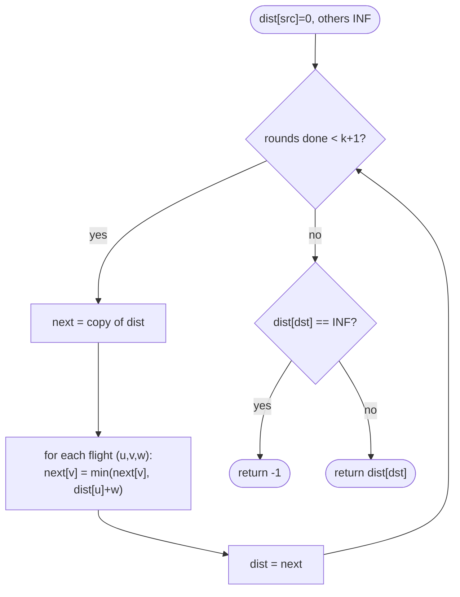

# LC 787 Cheapest Flights Within K Stops

> [!abstract] In one sentence
> Bellman-Ford's i-th round computes the cheapest path using at most i edges, so running k + 1 rounds — each reading from a frozen copy of the previous round — gives the cheapest route with at most k stops, in O(k · E), without any heap.

**Map:** [[NeetCode 150 MOC]] → [[DSA Dashboard]] · Pattern: [[Advanced Graphs]]

> [!question] Predict before you read
> Dijkstra settles city B at cost 100 via one flight, then later finds a cost-50 route to B that uses three flights. With k = 1 stop, which one must survive, and why does "settled means final" no longer hold?

## Problem

There are `n` cities and a list of one-way flights `[from, to, price]`. Given `src`, `dst` and `k`, return the cheapest price from `src` to `dst` using **at most k stops** (so at most k + 1 flights). Return −1 if no such route exists.

Example: `n = 4, flights = [ [0,1,100],[1,2,100],[2,0,100],[1,3,600],[2,3,200] ], src = 0, dst = 3, k = 1` → `700` (0→1→3; the cheaper 0→1→2→3 = 400 needs 2 stops).
Example: same graph with `k = 2` → `400`.

Constraints that matter: 1 ≤ n ≤ 100, up to n(n − 1)/2 flights, 0 ≤ k < n, prices 1..10⁴. k · E ≤ 100 × 4950 ≈ 5 × 10⁵ — Bellman-Ford limited to k + 1 rounds is comfortably fast.

## Clarifying questions

1. "k stops" means k intermediate cities, so k + 1 flights? — Yes.
2. Can prices be negative? — No, all positive here; but Bellman-Ford would survive negative edges anyway.
3. Are there cycles? — Possibly; with positive prices a cycle never helps, and the round limit stops infinite loops regardless.
4. If `src == dst`? — Return 0 (LeetCode guarantees `src != dst`, but say it).

## Brute force

DFS/backtracking from `src` exploring every path of ≤ k + 1 flights and taking the minimum: exponential in the branching factor to the power k + 1. The waste: the same city at the same depth is reached by many paths and re-expanded each time. Memoising on `(city, flightsLeft)` turns this into the DP below — the brute force *is* the top-down version.

## The key insight

Bellman-Ford is a DP over the number of edges: after round `i`, `dist[v]` is the cheapest cost to reach `v` using at most `i` edges. Normally you run n − 1 rounds; here you stop after k + 1. The one subtlety is that within a single round you must read the *previous* round's values (a copy), otherwise an update made early in the round can be used by a later edge in the same round and a path with k + 2 flights sneaks in. Recognition cue: "shortest path with at most k edges / stops / transfers". Dijkstra's "first pop is final" breaks because a pricier route with fewer flights can be the only one that fits the budget.

## Optimal approach

1. `dist[]` all ∞ except `dist[src] = 0`.
2. Repeat k + 1 times: `next = dist.clone()`; for every flight `(u, v, w)`, if `dist[u] ≠ ∞` and `dist[u] + w < next[v]` then `next[v] = dist[u] + w`; then `dist = next`.
3. Return `dist[dst]`, or −1 if still ∞.



> [!example]- Excalidraw version — the same diagram as an editable canvas
> ![[LC 787 Cheapest Flights Within K Stops — Optimal approach.excalidraw]]
> [[LC 787 Cheapest Flights Within K Stops — Optimal approach.excalidraw|Open in Excalidraw]] — needs the Excalidraw plugin (see [[Plugins to Install]]).

## Walkthrough

`k = 1` on the example graph; two rounds.

| Round | dist before (cities 0..3) | Relaxations (reading the *old* dist) | dist after |
|---|---|---|---|
| 1 | [0, ∞, ∞, ∞] | 0→1: 100 | [0, 100, ∞, ∞] |
| 2 | [0, 100, ∞, ∞] | 1→2: 200; 1→3: 700 | [0, 100, 200, 700] |

`dist[3] = 700`. Without the copy, round 2 would also apply 2→3 using the freshly written 200 and produce 400, which needs two stops — wrong for k = 1. With k = 2 a third round applies 2→3 legitimately and yields 400.

> [!example] Flights (labels = price); k = 1 allows at most 2 flights
> ![[LC 787 Cheapest Flights Within K Stops — Flights (labels = price); k = 1 allows at most 2 flights.excalidraw]]
> [[LC 787 Cheapest Flights Within K Stops — Flights (labels = price); k = 1 allows at most 2 flights.excalidraw|Open in Excalidraw]] — amber = 0-1-3 cost 700 (1 stop); 0-1-2-3 cost 400 needs 2 stops and is excluded

%% excalidraw-spec
{"kind": "graph", "title": "Flights (labels = price); k = 1 allows at most 2 flights", "directed": true, "nodes": [{"id": "c0", "label": "0", "level": 0}, {"id": "c1", "label": "1", "level": 1}, {"id": "c2", "label": "2", "level": 2}, {"id": "c3", "label": "3", "level": 2}], "edges": [ ["c0", "c1", "100"], ["c1", "c2", "100"], ["c2", "c0", "100"], ["c1", "c3", "600"], ["c2", "c3", "200"] ], "highlight_edges": [ ["c0", "c1"], ["c1", "c3"] ], "caption": "amber = 0-1-3 cost 700 (1 stop); 0-1-2-3 cost 400 needs 2 stops and is excluded"}
%%

## Java solution

```java
import java.util.*;

class Solution {
    public int findCheapestPrice(int n, int[][] flights, int src, int dst, int k) {
        int[] dist = new int[n];
        Arrays.fill(dist, Integer.MAX_VALUE);
        dist[src] = 0;
        for (int round = 0; round <= k; round++) {         // k stops = k + 1 flights = k + 1 rounds
            int[] next = dist.clone();                     // freeze the previous round
            for (int[] f : flights) {
                int u = f[0], v = f[1], w = f[2];
                if (dist[u] == Integer.MAX_VALUE) continue; // unreachable so far; also avoids overflow
                if (dist[u] + w < next[v]) next[v] = dist[u] + w;
            }
            dist = next;
        }
        return dist[dst] == Integer.MAX_VALUE ? -1 : dist[dst];
    }
}
```

**Time** O(k · E) · **Space** O(n)

Dijkstra with the stop count in the state — correct, but note that the state must include the number of flights used and that a city can be popped more than once:

```java
// snippet
List<List<int[]>> adj = new ArrayList<>();                     // {to, price}
for (int i = 0; i < n; i++) adj.add(new ArrayList<>());
for (int[] f : flights) adj.get(f[0]).add(new int[]{f[1], f[2]});
int[] bestStops = new int[n];                                   // fewest flights with which we reached city
Arrays.fill(bestStops, Integer.MAX_VALUE);
PriorityQueue<int[]> pq = new PriorityQueue<>((a, b) -> Integer.compare(a[0], b[0])); // {cost, city, flights}
pq.offer(new int[]{0, src, 0});
while (!pq.isEmpty()) {
    int[] cur = pq.poll();
    int cost = cur[0], city = cur[1], used = cur[2];
    if (city == dst) return cost;                               // cheapest pop of dst wins
    if (used > k || used >= bestStops[city]) continue;          // prune: more flights AND not cheaper
    bestStops[city] = used;
    for (int[] e : adj.get(city)) pq.offer(new int[]{cost + e[1], e[0], used + 1});
}
return -1;
// O(E * k log(E * k)) worst case; usually fast but the pruning is subtle — prefer Bellman-Ford in an interview
```

The memoised recursion that the brute force becomes — the same DP read top-down, `f(city, flightsLeft)`:

```java
// snippet
Integer[][] memo = new Integer[n][k + 2];
int f(int city, int left) {                                     // cheapest cost from city to dst using <= left flights
    if (city == dst) return 0;
    if (left == 0) return INF;
    if (memo[city][left] != null) return memo[city][left];
    int best = INF;
    for (int[] e : adj.get(city)) best = Math.min(best, e[1] + f(e[0], left - 1));
    return memo[city][left] = best;
}
// call f(src, k + 1); O(n * k + E * k) states x work
```

## Why it works

State: after round `i`, `dist[v]` = cheapest cost of a walk from `src` to `v` with at most `i` edges. Transition: a walk of ≤ i edges ending at `v` is either a walk of ≤ i − 1 edges ending at `v` (hence `next` starts as a copy of `dist`) or a walk of ≤ i − 1 edges ending at some `u` followed by the edge `u → v` (the relaxation reads `dist[u]` from the previous round). Base: round 0, only `src` is reachable at cost 0. Order: rounds increase; within a round the edge order does not matter precisely because reads come from the frozen copy. After k + 1 rounds, `dist[dst]` covers every walk with ≤ k + 1 flights, i.e. ≤ k stops. Positive prices mean walks that revisit cities are never cheaper than the simple path inside them, so "walk" and "path" give the same minimum.

## Edge cases

- `dst` unreachable within the budget — stays ∞ → −1.
- `k = 0` — exactly one round; only direct flights count.
- `k ≥ n − 1` — the budget is non-binding; this degenerates to full Bellman-Ford.
- Cycle in the graph — rounds are bounded, so no infinite loop; positive prices mean cycles never improve a cost.
- `dist[u] == MAX_VALUE` guard — prevents `MAX_VALUE + w` overflow into a negative number that would win the `min`.

## Common mistakes

> [!warning] Pitfalls
> - **Updating `dist` in place** (no copy). A single round then chains several flights and the stop limit is violated — the example returns 400 instead of 700 for k = 1.
> - **Running k rounds instead of k + 1.** k stops means k + 1 flights.
> - **Plain Dijkstra with a visited set on cities.** It settles a city at its globally cheapest cost even if that route uses too many flights, and then refuses the pricier-but-shorter route; the predict callout is exactly that failure.
> - **Overflow** when adding to `Integer.MAX_VALUE` — skip unreachable sources.

## Variants & follow-ups

- Exactly k stops (not at most) — keep a 2-D table `dp[i][v]` and read `dp[k+1][dst]`, without the "copy forward" of unchanged values.
- Negative prices — Bellman-Ford still works; Dijkstra does not.
- Count the number of cheapest routes — add a `ways[]` array updated alongside `dist`.
- No stop limit — [[LC 743 Network Delay Time]], where Dijkstra is the right tool.
- Minimise the number of flights first, then price — BFS by flights with price as a tiebreak, or lexicographic Dijkstra on `(flights, price)`.

## Interview script

1. Restate: directed weighted graph; cheapest path with at most k + 1 edges; −1 if none.
2. Brute force: DFS over all paths of bounded length, exponential; memoise on (city, flights left).
3. Insight: Bellman-Ford's rounds *are* the edge-count dimension; run k + 1 rounds with a frozen copy per round. Explain why Dijkstra's finality breaks.
4. Approach: `dist`, k + 1 rounds, relax from the copy, overflow guard, answer or −1. Walk the example for k = 1 showing why the copy matters.
5. Complexity: O(k · E) time, O(n) space.
6. Tests: k = 0, unreachable, the 700-versus-400 example.

The interviewer is checking that you can explain the edge-count invariant of Bellman-Ford, that you know why the copy is necessary, and that you can say precisely why Dijkstra needs a modified state here.

## Related

- [[Advanced Graphs]] — Bellman-Ford section, and the Dijkstra-versus-Bellman-Ford decision
- [[Dynamic Programming]] — this is DP over the number of edges
- [[LC 743 Network Delay Time]] — unconstrained Dijkstra
- [[LC 778 Swim in Rising Water]] — another modified shortest-path objective
- [[LC 322 Coin Change]] — the same "at most i steps" table shape in 1-D
- [[DSA Patterns in Java]] — Bellman-Ford and Dijkstra templates
- [[Java Collections Cheat Sheet]] — `int[].clone()`, `PriorityQueue` comparator

## Attempt log

| Date | Result | Minutes | What I got wrong |
|---|---|---|---|
| | | | |

### Mastery checklist
- [ ] Solved without hints in under 25 minutes
- [ ] Stated complexity before coding
- [ ] Handled every edge case above
- [ ] Code compiled first time
- [ ] Can do the follow-up variant (exactly k stops; Dijkstra with stops in the state)

## Open questions
- [ ]
