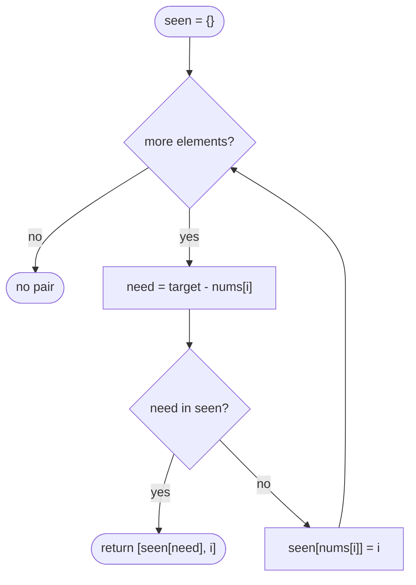

# LC 1 Two Sum

> [!abstract] In one sentence
> For each element ask the map "have I already seen `target − x`?" and only then record `x → i`; the first hit is the answer, and the look-up-before-insert order is what stops an element from pairing with itself.

**Map:** [[NeetCode 150 MOC]] → [[DSA Dashboard]] · Pattern: [[Arrays & Hashing]]

> [!question] Predict before you read
> Why does the one-pass version never need to worry about "using the same element twice", while a two-pass version (fill the map, then scan) does?

## Problem

Given an integer array `nums` and an integer `target`, return the indices of the two distinct elements whose sum is `target`. Exactly one such pair exists; return it in any order.

- `nums = [2, 7, 11, 15]`, `target = 9` → `[0, 1]`
- `nums = [3, 2, 4]`, `target = 6` → `[1, 2]` (not `[0, 0]`)
- `nums = [3, 3]`, `target = 6` → `[0, 1]`

Constraints that matter: up to 10⁴ elements, values and target in ±10⁹, so sums fit in `int` (2 × 10⁹ < 2³¹ − 1 ≈ 2.147 × 10⁹ — barely; say so), and the array is **not sorted**, so the two-pointer walk of [[LC 167 Two Sum II Input Array Is Sorted]] would lose the original indices.

## Clarifying questions

1. Exactly one solution, or could there be none / several? — Exactly one; still decide what you return otherwise (`new int[0]` or throw).
2. Can I use the same element twice? — No; indices must differ.
3. Are the indices required in a specific order? — Any order.
4. Can I sort the array? — Sorting destroys indices; you would need to sort index pairs, which is the O(n log n) alternative.

## Brute force

Two nested loops over `i < j`, check `nums[i] + nums[j] == target`. O(n²) time, O(1) space. The waste: for a fixed `i` you know exactly which value you want (`target − nums[i]`), yet you search for it linearly instead of looking it up.

## The key insight

Turn "find a `j` with `nums[j] == target − nums[i]`" into a hash lookup. Recognition cue: a pair condition that can be rewritten as *value you hold* ↔ *value you need*; whenever the needed partner is computable from the current element, a map from value to position answers it in O(1).

## Optimal approach

1. Create `HashMap<Integer, Integer> seen` from value to index.
2. For each `i`: compute `need = target − nums[i]`.
3. If `seen` contains `need`, return `[seen.get(need), i]`.
4. Otherwise `seen.put(nums[i], i)` and continue.



> [!example]- Excalidraw version — the same diagram as an editable canvas
> ![[LC 1 Two Sum — Optimal approach.excalidraw]]
> [[LC 1 Two Sum — Optimal approach.excalidraw|Open in Excalidraw]] — needs the Excalidraw plugin (see [[Plugins to Install]]).

## Walkthrough

`nums = [3, 2, 4]`, `target = 6`

| i | nums[i] | need | seen before | hit? | seen after |
|---|---|---|---|---|---|
| 0 | 3 | 3 | {} | no (3 not yet inserted) | {3→0} |
| 1 | 2 | 4 | {3→0} | no | {3→0, 2→1} |
| 2 | 4 | 2 | {3→0, 2→1} | yes → `[1, 2]` | |

At `i = 0` the complement equals the element itself; because the lookup happens before the insert, index 0 cannot pair with itself.

> [!example] Lookup at i = 2 finds its complement 2 at index 1
> ![[LC 1 Two Sum — Lookup at i = 2 finds its complement 2 at index 1.excalidraw]]
> [[LC 1 Two Sum — Lookup at i = 2 finds its complement 2 at index 1.excalidraw|Open in Excalidraw]] — the map holds values to the left of i only

%% excalidraw-spec
{"kind": "array", "title": "Lookup at i = 2 finds its complement 2 at index 1", "values": [3, 2, 4], "pointers": {"i": 2, "seen[2]": 1}, "highlight": [1, 2], "caption": "the map holds values to the left of i only"}
%%

## Java solution

```java
import java.util.*;

class Solution {
    public int[] twoSum(int[] nums, int target) {
        Map<Integer, Integer> seen = new HashMap<>();          // value -> index
        for (int i = 0; i < nums.length; i++) {
            int need = target - nums[i];                       // fits int under the problem bounds
            Integer j = seen.get(need);                        // lookup BEFORE insert: j < i guaranteed
            if (j != null) return new int[]{j, i};
            seen.put(nums[i], i);
        }
        return new int[0];                                     // problem guarantees we never get here
    }
}
```

**Time** O(n) expected · **Space** O(n)

## Why it works

Invariant: when index `i` is examined, `seen` contains exactly `nums[0..i−1]` mapped to their indices. If the unique pair is `(a, b)` with `a < b`, then when `i = b` the map holds `nums[a]`, and `need = target − nums[b] = nums[a]`, so the lookup succeeds and returns `[a, b]`. No earlier `i` can produce a false hit because any hit is by construction a valid pair with distinct indices. Duplicated values are fine: `put` overwrites the index, and the retained index is still a different one from the current `i`.

## Edge cases

- Two equal elements summing to target (`[3, 3]`, 6): at `i = 1` the map holds `3 → 0`, returns `[0, 1]`.
- Complement equals the element but appears only once (`[3, 2, 4]`, 6): lookup-before-insert prevents `[0, 0]`.
- Negative values and zero: the map does not care.
- Target near `int` limits: `target − nums[i]` can overflow if bounds were larger; with ±10⁹ it stays inside `int`, mention `long` if the interviewer widens.

## Common mistakes

> [!warning] What goes wrong
> - Inserting into the map **before** checking the complement — the self-pair bug.
> - Using `seen.containsKey(need)` then `seen.get(need)` (two lookups) — fine for correctness, but `get` returning `null` does it in one.
> - Returning values instead of indices, or 1-based indices (that is [[LC 167 Two Sum II Input Array Is Sorted]]'s convention, not this one).
> - Sorting first and returning positions in the sorted order.

## Variants & follow-ups

- Sorted input, O(1) space → [[LC 167 Two Sum II Input Array Is Sorted]] (two pointers).
- All triplets summing to zero, no duplicates → [[LC 15 3Sum]] (sort + two pointers; the map approach gets messy with dedupe).
- "Design a data structure with `add(x)` and `find(target)`" (LC 170) — keep a frequency map; `find` iterates keys and checks the complement, taking care when `need == x` (count must be ≥ 2).
- Count pairs rather than return one: accumulate `seen.getOrDefault(need, 0)` before incrementing the count of `nums[i]`.

## Interview script

Restate: "unsorted ints, exactly one pair, return indices, distinct elements." Brute force: "all pairs, O(n²)." Insight: "for each element the partner value is known; a hash map finds it in O(1)." Approach: "one pass, look up `target − x`, then insert `x → i`; the order matters so an element never pairs with itself." Complexity: "O(n) time, O(n) space." Tests: `[3, 3]`, `[3, 2, 4]`, negatives, the pair at the two ends. If asked about space: "with a sorted copy of index pairs I can do O(n log n) time and no map, but the hash version is the expected one."

## Related

- Pattern: [[Arrays & Hashing]]; what makes the lookup O(1): [[Hashing]]
- Before this: [[LC 217 Contains Duplicate]] (set membership)
- After this: [[LC 167 Two Sum II Input Array Is Sorted]], [[LC 15 3Sum]], [[LC 128 Longest Consecutive Sequence]]
- Java: [[Java Collections Cheat Sheet]] (`Map.get` returning `null`, `getOrDefault`), [[Java Pitfalls in Interviews]] (boxed `Integer` and `==`)

## Attempt log

| Date | Result | Minutes | What I got wrong |
|---|---|---|---|
| | | | |

### Mastery checklist
- [ ] Solved without hints in under 25 minutes
- [ ] Stated complexity before coding
- [ ] Handled every edge case above
- [ ] Code compiled first time
- [ ] Can do the follow-up variant

## Open questions
- [ ] If the input were a stream of 10⁹ values and target pairs had to be reported as they appear, what would you keep in memory and what would you give up?
