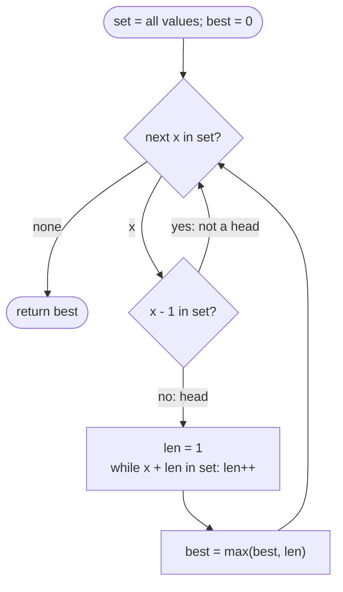

# LC 128 Longest Consecutive Sequence

> [!abstract] In one sentence
> With all values in a set, a value `x` is the *head* of a run iff `x − 1` is absent; from each head walk `x, x+1, x+2…` while present, and because a non-head is never used as a starting point each value is visited O(1) times in total.

**Map:** [[NeetCode 150 MOC]] → [[DSA Dashboard]] · Pattern: [[Arrays & Hashing]]

> [!question] Predict before you read
> If you walked forward from *every* value instead of only from heads, what input makes that O(n²), and why does the head check fix it?

## Problem

Given an unsorted integer array, return the length of the longest sequence of consecutive integers that can be formed from its values (the sequence elements need not be adjacent in the array). Required time: O(n).

- `[100, 4, 200, 1, 3, 2]` → `4` (the run `1, 2, 3, 4`)
- `[0, 3, 7, 2, 5, 8, 4, 6, 0, 1]` → `9` (`0..8`)

Constraints that matter: up to 10⁵ elements, values across the full `int` range (so no counting array), duplicates allowed, empty array possible.

## Clarifying questions

1. Must the consecutive values be contiguous in the array? — No, order is irrelevant.
2. Duplicates: does `[1, 1, 2]` have length 2 or 3? — 2; duplicates do not lengthen a run.
3. Empty input? — Return 0.
4. Is O(n log n) acceptable? — The statement says O(n); offer sorting as the baseline, then beat it.

## Brute force

Sort, then scan counting runs while `nums[i] == nums[i−1] + 1` (skipping equal neighbours). O(n log n), O(1) extra if in place. Another brute force: for each value, probe `x+1, x+2, …` in a set — O(n²) worst case when every element is probed from, e.g. `[1, 2, 3, …, n]` walked from each start. The waste: the same run is traversed once per element inside it.

## The key insight

Only traverse a run from its head. A value is a head iff `x − 1` is not in the set, which is an O(1) question. Then each run is walked exactly once, from its smallest element, and the total walk length across all runs is at most n. Recognition cue: "longest consecutive / chain / streak in unsorted data, linear time" → set for membership plus "start only where no predecessor".

## Optimal approach

1. Insert every value into a `HashSet<Integer>`.
2. For each `x` in the set: if `x − 1` is in the set, skip (not a head).
3. Otherwise walk `len = 1; while set contains x + len: len++`.
4. Track the maximum `len`.



> [!example]- Excalidraw version — the same diagram as an editable canvas
> ![[LC 128 Longest Consecutive Sequence — Optimal approach.excalidraw]]
> [[LC 128 Longest Consecutive Sequence — Optimal approach.excalidraw|Open in Excalidraw]] — needs the Excalidraw plugin (see [[Plugins to Install]]).

## Walkthrough

`[100, 4, 200, 1, 3, 2]`, set = `{100, 4, 200, 1, 3, 2}`

| x | x − 1 present? | walk | len | best |
|---|---|---|---|---|
| 100 | no (99) | 101 absent | 1 | 1 |
| 4 | yes (3) | skip | | 1 |
| 200 | no | 201 absent | 1 | 1 |
| 1 | no (0) | 2, 3, 4 present, 5 absent | 4 | 4 |
| 3 | yes | skip | | 4 |
| 2 | yes | skip | | 4 |

> [!example] Values on the number line; heads are the cells whose left neighbour is missing
> ![[LC 128 Longest Consecutive Sequence — Values on the number line; heads are the cells whose left neighbour is missing.excalidraw]]
> [[LC 128 Longest Consecutive Sequence — Values on the number line; heads are the cells whose left neighbour is missing.excalidraw|Open in Excalidraw]] — 4, 3, 2 are skipped as non-heads; the walk from 1 covers them once

%% excalidraw-spec
{"kind": "array", "title": "Values on the number line; heads are the cells whose left neighbour is missing", "values": [1, 2, 3, 4, "...", 100, "...", 200], "pointers": {"head": 0, "head ": 5, "head  ": 7}, "highlight": [0, 5, 7], "caption": "4, 3, 2 are skipped as non-heads; the walk from 1 covers them once"}
%%

## Java solution

```java
import java.util.*;

class Solution {
    public int longestConsecutive(int[] nums) {
        Set<Integer> set = new HashSet<>();
        for (int x : nums) set.add(x);                       // duplicates collapse here

        int best = 0;
        for (int x : set) {                                  // iterate the set, not the array: each distinct value once
            if (set.contains(x - 1)) continue;               // only start from the head of a run
            int len = 1;
            while (set.contains(x + len)) len++;             // walk the run once; see edge cases for the MAX_VALUE wrap
            best = Math.max(best, len);
        }
        return best;
    }
}
```

**Time** O(n) expected · **Space** O(n)

## Why it works

Partition the distinct values into maximal runs of consecutive integers. Each run has exactly one head (its minimum), and the head check `!set.contains(x − 1)` identifies precisely the heads. The walk from a head visits every element of its run once and stops at the first absent value, so the total number of `contains` calls inside walks equals the total number of distinct values, at most n. Add n head checks: O(n) `contains` calls, each O(1) expected. The maximum over runs is the answer because any consecutive sequence lies inside one maximal run.

## Edge cases

- Empty array: `best = 0` returned.
- All duplicates (`[7, 7, 7]`): set is `{7}`, answer 1.
- Single run covering everything: walked once from its minimum.
- `Integer.MAX_VALUE` present: `x + len` can wrap to negative; a wrapped value is never in the set as a continuation of that run unless the input is adversarial. To be strictly safe use `long` for the probe or check `x + len > x` — mention it rather than code it.
- Negative values: nothing special.

## Common mistakes

> [!warning] What goes wrong
> - Iterating the **array** instead of the set with duplicates present: each duplicate head re-walks its run — still O(n) amortised? No: `[1,1,1,...,1,2,3,...,k]` makes it O(n·k). Iterate the set (or guard with a visited flag).
> - Omitting the head check — the O(n²) version on sorted input.
> - Sorting and forgetting to skip equal neighbours: `[1, 2, 2, 3]` counts as 2 instead of 3 because the duplicate breaks the run.
> - Claiming O(n) worst case; hashing is O(n) *expected* — say it.

## Variants & follow-ups

- Return the sequence itself: remember the head of the best run and rebuild it.
- Longest consecutive sequence in a binary tree (LC 298): DFS with a running length, no set.
- Union-Find formulation: union `x` with `x + 1` when both present, largest component size — slower in practice but a good bridge to [[Union-Find]].
- "Longest streak of consecutive days with an event": same, on timestamps normalised to day numbers.
- Allowed O(n log n): sort + scan is simpler and uses O(1) extra space — know when the interviewer prefers it.

## Interview script

Restate: "unsorted, duplicates allowed, longest run of consecutive ints, O(n)." Brute force: "sort and scan, O(n log n); or probe forward from every element with a set, which is O(n²) on a sorted range." Insight: "start only at heads — values with no predecessor — so each run is walked once." Approach: "set of values; for each value in the set, skip if `x − 1` present, else walk forward counting." Complexity: "O(n) expected, O(n) space." Tests: empty, all duplicates, `[1, 2, 2, 3]`, values near `Integer.MAX_VALUE`.

## Related

- Pattern: [[Arrays & Hashing]]; why `contains` is O(1): [[Hashing]]
- Prerequisites: [[LC 217 Contains Duplicate]] (set membership), [[LC 1 Two Sum]] (lookup of a computed neighbour)
- Alternative structure: [[Union-Find]]
- Java: [[Java Collections Cheat Sheet]] (`HashSet` iteration, `contains`), [[Java Pitfalls in Interviews]] (int overflow)

## Attempt log

| Date | Result | Minutes | What I got wrong |
|---|---|---|---|
| | | | |

### Mastery checklist
- [ ] Solved without hints in under 25 minutes
- [ ] Stated complexity before coding
- [ ] Handled every edge case above
- [ ] Code compiled first time
- [ ] Can do the follow-up variant

## Open questions
- [ ] Construct the exact input on which "iterate the array, not the set" degrades, and compute how many `contains` calls it makes for n = 10⁵.
