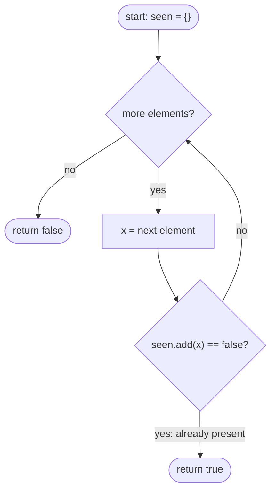

# LC 217 Contains Duplicate

> [!abstract] In one sentence
> Walk the array once, remembering every value in a `HashSet`; the first value the set already holds is your duplicate, and `Set.add` returning `false` tells you so without a separate `contains` call.

**Map:** [[NeetCode 150 MOC]] → [[DSA Dashboard]] · Pattern: [[Arrays & Hashing]]

> [!question] Predict before you read
> Sorting then scanning neighbours also finds a duplicate. What does the hash set buy you over sorting, and what does sorting buy you over the hash set?

## Problem

You are given an integer array `nums`. Return `true` if some value occurs at least twice, `false` if every value is distinct.

- `[1, 2, 3, 1]` → `true` (the `1` repeats)
- `[1, 2, 3, 4]` → `false`
- `[1, 1, 1, 3, 3, 4, 3, 2, 4, 2]` → `true`

Constraints that matter: up to 10⁵ elements, values in the full `int` range (negatives included), so a counting array indexed by value is out and the O(n²) pair scan is too slow.

## Clarifying questions

1. Can the array be empty or have one element? — Yes; the answer is `false`.
2. Are values bounded to a small range? — No, full 32-bit range; do not index an array by value.
3. Do I need to say *which* value repeats? — No, only whether one exists (the variant that asks for the value is the same loop returning early).
4. May I modify the input (sort it)? — Usually yes, but ask; it decides whether the O(1)-space answer is allowed.

## Brute force

Compare every pair `(i, j)` with `i < j`. O(n²) time, O(1) space. It wastes work because once you have looked at `nums[i]` you learn nothing reusable about it for later indices — every later element repeats the same scan over the prefix.

## The key insight

"Have I seen this before?" is a set-membership question, and a hash set answers it in O(1) expected time. Recognition cue: *any* problem whose brute force is "look back through everything I have already processed" collapses to one pass plus a hash structure holding the processed prefix.

## Optimal approach

1. Create an empty `HashSet<Integer>`.
2. For each `x` in `nums`: call `seen.add(x)`. If it returns `false`, `x` was already there — return `true`.
3. If the loop finishes, return `false`.



> [!example]- Excalidraw version — the same diagram as an editable canvas
> ![[LC 217 Contains Duplicate — Optimal approach.excalidraw]]
> [[LC 217 Contains Duplicate — Optimal approach.excalidraw|Open in Excalidraw]] — needs the Excalidraw plugin (see [[Plugins to Install]]).

## Walkthrough

`nums = [3, 1, 4, 1, 5]`

| step | x | seen before add | add returned | action |
|---|---|---|---|---|
| 1 | 3 | {} | true | continue |
| 2 | 1 | {3} | true | continue |
| 3 | 4 | {3, 1} | true | continue |
| 4 | 1 | {3, 1, 4} | false | return true |

> [!example] Second visit of 1 is caught by the set
> ![[LC 217 Contains Duplicate — Second visit of 1 is caught by the set.excalidraw]]
> [[LC 217 Contains Duplicate — Second visit of 1 is caught by the set.excalidraw|Open in Excalidraw]] — the set holds {3, 1, 4} when i reaches index 3; add(1) returns false

%% excalidraw-spec
{"kind": "array", "title": "Second visit of 1 is caught by the set", "values": [3, 1, 4, 1, 5], "pointers": {"i": 3}, "highlight": [1, 3], "caption": "the set holds {3, 1, 4} when i reaches index 3; add(1) returns false"}
%%

## Java solution

```java
import java.util.*;

class Solution {
    public boolean containsDuplicate(int[] nums) {
        Set<Integer> seen = new HashSet<>(nums.length * 2);   // presize: avoids rehashing on 10^5 inputs
        for (int x : nums) {
            if (!seen.add(x)) return true;                     // add returns false when x was already present
        }
        return false;
    }
}
```

**Time** O(n) expected · **Space** O(n)

The sort-based alternative trades space for time:

```java
// snippet
Arrays.sort(nums);
for (int i = 1; i < nums.length; i++)
    if (nums[i] == nums[i - 1]) return true;
return false;                                // O(n log n) time, O(1) extra space, mutates the input
```

## Why it works

Invariant: after processing index `i`, `seen` holds exactly the distinct values of `nums[0..i]`. When `add(x)` returns `false`, `x` is already in that set, so some earlier index holds the same value — a duplicate. When the loop ends without that, every value was new on arrival, so all are distinct. Hashing makes each membership test O(1) on average because `Integer.hashCode` is the value itself and the table spreads values across buckets.

## Edge cases

- Empty array or a single element: loop body never triggers, returns `false`.
- All elements equal: returns `true` at the second element.
- Duplicate is the last element: caught on the final iteration, no special case needed.
- `Integer.MIN_VALUE` and negatives: `HashSet<Integer>` handles any `int`; a value-indexed array would not.

## Common mistakes

> [!warning] What goes wrong
> - Calling `contains` then `add` — two hash lookups per element where one suffices. Use the boolean from `add`.
> - Indexing an array by value ("counting sort") without checking the value range; negatives throw.
> - Returning `false` inside the loop as soon as one element is new, instead of after the whole pass.
> - Sorting the input when the interviewer wanted it untouched — ask before mutating.

## Variants & follow-ups

- "Return the duplicate value" — same loop, return `x` instead of `true`.
- "Is there a duplicate within distance k?" (LC 219) — a sliding set of the last k values: add `nums[i]`, remove `nums[i - k]`; see [[Sliding Window]].
- "Values are in 1..n, array has n + 1 entries, O(1) space" — that is [[LC 287 Find the Duplicate Number]], which becomes cycle detection.
- "Count how many values repeat" — upgrade the set to a `HashMap<Integer, Integer>` of frequencies, the same tool [[LC 242 Valid Anagram]] uses.

## Interview script

Restate: "any value appearing twice, any order, full int range." Brute force: "all pairs, O(n²)." Insight: "I only need to know whether I have seen a value already — that is set membership, O(1) with a hash set." Approach: "one pass, `add` returns false on a repeat." Complexity: "O(n) time, O(n) space; sorting gives O(n log n) and O(1) extra space if I may mutate." Tests: empty, single, all equal, duplicate at the end, negatives.

## Related

- Pattern: [[Arrays & Hashing]], and why the lookup is O(1): [[Hashing]]
- Next step up: [[LC 242 Valid Anagram]] (counting), [[LC 1 Two Sum]] (map from value to index), [[LC 128 Longest Consecutive Sequence]] (set as a neighbour oracle)
- Same question with O(1) space: [[LC 287 Find the Duplicate Number]]
- Java: [[Java Collections Cheat Sheet]] (`Set.add` returns boolean, `HashSet` capacity constructor)

## Attempt log

| Date | Result | Minutes | What I got wrong |
|---|---|---|---|
| | | | |

### Mastery checklist
- [ ] Solved without hints in under 25 minutes
- [ ] Stated complexity before coding
- [ ] Handled every edge case above
- [ ] Code compiled first time
- [ ] Can do the follow-up variant

## Open questions
- [ ] Why is `HashSet.add` O(1) *expected* and not worst case, and what input would make it degrade in Java 21 (hint: treeified buckets since Java 8)?
