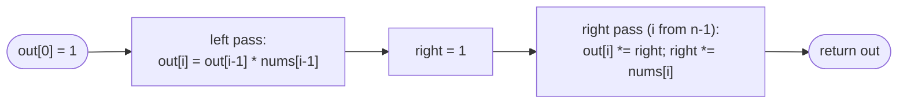

# LC 238 Product of Array Except Self

> [!abstract] In one sentence
> Everything except `nums[i]` is "everything to the left" times "everything to the right"; a left-to-right pass stores the prefix products in the output, and a right-to-left pass multiplies in a running suffix product — no division, O(1) extra space.

**Map:** [[NeetCode 150 MOC]] → [[DSA Dashboard]] · Pattern: [[Arrays & Hashing]]

> [!question] Predict before you read
> Why does the division approach (`total / nums[i]`) fail even if you special-case a single zero — and what if there are two zeros?

## Problem

Given an integer array `nums`, return an array `out` where `out[i]` is the product of all elements of `nums` except `nums[i]`. You must do it in O(n) **without the division operator**.

- `[1, 2, 3, 4]` → `[24, 12, 8, 6]`
- `[-1, 1, 0, -3, 3]` → `[0, 0, 9, 0, 0]`

Constraints that matter: `2 ≤ n ≤ 10⁵`, values in `[-30, 30]`, and the problem guarantees every prefix/suffix product fits in a 32-bit `int`. The follow-up asks for O(1) extra space, output array excluded.

## Clarifying questions

1. Is division really forbidden, or just discouraged? — Forbidden; and even if allowed, zeros make it a mess.
2. Can values be zero or negative? — Both, and multiple zeros are possible.
3. Do the intermediate products fit in `int`? — The problem promises so; without that promise, say `long`.
4. Does the output array count towards the space bound? — No.

## Brute force

For each `i`, multiply all `j ≠ i`. O(n²) time, O(1) space. The waste: the product of `nums[0..i−1]` is recomputed from scratch for every `i` although it differs from the previous one by a single factor.

## The key insight

Split "all except i" into two independent halves: `prefix[i] = nums[0] × … × nums[i−1]` and `suffix[i] = nums[i+1] × … × nums[n−1]`. Each half is a running product, so both are O(n). Recognition cue: "for every index, some aggregate of everything *else*" or "everything to the left / right" → prefix and suffix aggregates, exactly like prefix sums.

## Optimal approach

1. `out[0] = 1`; for `i = 1..n−1`: `out[i] = out[i−1] × nums[i−1]` (now `out[i]` holds the prefix product).
2. `right = 1`; for `i = n−1 down to 0`: `out[i] *= right`, then `right *= nums[i]`.
3. Return `out`.



> [!example]- Excalidraw version — the same diagram as an editable canvas
> ![[LC 238 Product of Array Except Self — Optimal approach.excalidraw]]
> [[LC 238 Product of Array Except Self — Optimal approach.excalidraw|Open in Excalidraw]] — needs the Excalidraw plugin (see [[Plugins to Install]]).

## Walkthrough

`nums = [1, 2, 3, 4]`

| i | after left pass (prefix) | right before step | out[i] final | right after |
|---|---|---|---|---|
| 3 | 6 | 1 | 6 | 4 |
| 2 | 2 | 4 | 8 | 12 |
| 1 | 1 | 12 | 12 | 24 |
| 0 | 1 | 24 | 24 | 24 |

> [!example] Prefix and suffix products combine per index
> ![[LC 238 Product of Array Except Self — Prefix and suffix products combine per index.excalidraw]]
> [[LC 238 Product of Array Except Self — Prefix and suffix products combine per index.excalidraw|Open in Excalidraw]] — out[2] = prefix[2] * suffix[2] = 2 * 4 = 8; the suffix row is never materialised, only the running right value

%% excalidraw-spec
{"kind": "grid", "title": "Prefix and suffix products combine per index", "col_labels": ["i", "0", "1", "2", "3"], "row_labels": ["nums", "prefix", "suffix", "out"], "rows": [ [1, 2, 3, 4], [1, 1, 2, 6], [24, 12, 4, 1], [24, 12, 8, 6] ], "highlight": [ [3, 2] ], "caption": "out[2] = prefix[2] * suffix[2] = 2 * 4 = 8; the suffix row is never materialised, only the running right value"}
%%

## Java solution

```java
import java.util.*;

class Solution {
    public int[] productExceptSelf(int[] nums) {
        int n = nums.length;
        int[] out = new int[n];
        out[0] = 1;
        for (int i = 1; i < n; i++) out[i] = out[i - 1] * nums[i - 1];   // out[i] = product of nums[0..i-1]

        int right = 1;                                                   // product of nums[i+1..n-1]
        for (int i = n - 1; i >= 0; i--) {
            out[i] *= right;
            right *= nums[i];
        }
        return out;
    }
}
```

**Time** O(n) · **Space** O(1) extra (the output does not count)

## Why it works

After the first pass, `out[i]` equals the product of all elements strictly left of `i` (by induction: `out[0] = 1` is the empty product; `out[i] = out[i−1] × nums[i−1]` extends it by one factor). In the second pass `right`, when visiting `i`, equals the product of all elements strictly right of `i` (it starts as the empty product and absorbs `nums[i]` only *after* use). The product of the two is the product of all elements except `nums[i]`. Multiplication's commutativity and associativity are what allow the split; zeros simply make one side zero, which is the correct answer.

## Edge cases

- One zero (`[1, 0, 3]`): every `out[i]` for `i ≠ 1` contains the zero → 0; `out[1] = 1 × 3 = 3`. No special-casing.
- Two or more zeros: every output is 0, naturally.
- Negative values: signs multiply correctly; nothing to handle.
- `n = 2`: `out = [nums[1], nums[0]]`.
- Values at the ±30 bound with n = 10⁵ would overflow — the problem's guarantee is what makes `int` safe; say "I would use `long` without that guarantee".

## Common mistakes

> [!warning] What goes wrong
> - Multiplying `right *= nums[i]` **before** `out[i] *= right` — includes `nums[i]` itself.
> - Starting the left pass with `out[0] = nums[0]` — the prefix of index 0 is the empty product 1.
> - Using division with a "count the zeros" special case; it is explicitly disallowed and still has to handle two zeros separately.
> - Allocating separate `prefix[]` and `suffix[]` arrays and then claiming O(1) space.

## Variants & follow-ups

- Prefix sums instead of products (range-sum queries, subarray sum equals k): the same two-direction thinking with addition and subtraction — see [[Arrays & Hashing]].
- "Maximum of everything except i" or "left max / right max per index": [[LC 42 Trapping Rain Water]]'s prefix-max/suffix-max arrays are exactly this shape.
- Modular products with division forbidden because of modulo: same two passes.
- Allowed division: compute total product and count zeros — 0 zeros → `total / x`; 1 zero → only that index gets the product of the others; ≥ 2 → all zeros. Know it to explain why it is worse.

## Interview script

Restate: "for each index, product of all others; no division; linear time; O(1) extra." Brute force: "n² by recomputing." Insight: "left product times right product; both are running products." Approach: "left pass writes prefixes into the output; right pass sweeps a running suffix and multiplies in." Complexity: "O(n), O(1) extra." Tests: one zero, two zeros, negatives, `n = 2`. Mention overflow and the `long` fallback.

## Related

- Pattern: [[Arrays & Hashing]] (prefix sums section)
- Same two-direction idea: [[LC 42 Trapping Rain Water]] (left/right max), [[LC 36 Valid Sudoku]] (row/column/box aggregates)
- Next in the list: [[LC 128 Longest Consecutive Sequence]]
- Java: [[DSA Patterns in Java]] (prefix-sum template), [[Java Pitfalls in Interviews]] (int overflow on products)

## Attempt log

| Date | Result | Minutes | What I got wrong |
|---|---|---|---|
| | | | |

### Mastery checklist
- [ ] Solved without hints in under 25 minutes
- [ ] Stated complexity before coding
- [ ] Handled every edge case above
- [ ] Code compiled first time
- [ ] Can do the follow-up variant

## Open questions
- [ ] Generalise: for which binary operations ⊕ can you compute "fold of everything except i" with two passes, and which ones (hint: operations without inverses, such as max or gcd) still work this way but *not* with the division trick?
