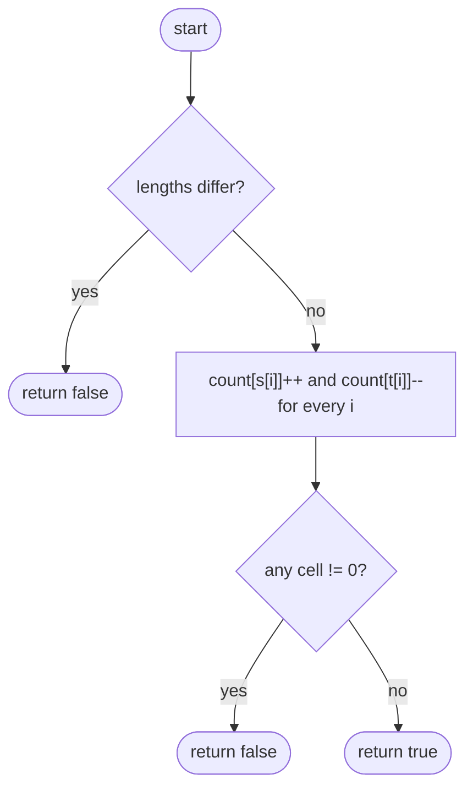

# LC 242 Valid Anagram

> [!abstract] In one sentence
> An anagram is a multiset equality, so count each letter once up for `s` and once down for `t` in a fixed 26-cell array; the strings are anagrams exactly when every cell returns to zero.

**Map:** [[NeetCode 150 MOC]] → [[DSA Dashboard]] · Pattern: [[Arrays & Hashing]]

> [!question] Predict before you read
> If you do the increment pass over `s` and the decrement pass over `t` and the lengths are equal, why is it enough to check that no cell is *negative* — why can no cell be positive?

## Problem

Given two strings `s` and `t`, return `true` if `t` is a rearrangement of the letters of `s` (every letter used exactly as many times), else `false`.

- `s = "anagram"`, `t = "nagaram"` → `true`
- `s = "rat"`, `t = "car"` → `false` (`t` has a `c`, `s` does not)

Constraints that matter: lengths up to 5 × 10⁴, lowercase English letters only — which is what licenses the fixed-size array instead of a map.

## Clarifying questions

1. Lowercase ASCII only, or Unicode? — Lowercase a–z in the base problem; Unicode means a `HashMap<Character, Integer>` (or code points) instead of `int[26]`.
2. Is case significant, are spaces significant? — Yes to both as stated; say what you would normalise if not.
3. Different lengths — can I return `false` immediately? — Yes, that is the first check.
4. Empty strings? — Two empty strings are anagrams.

## Brute force

Sort both strings and compare: `Arrays.sort(s.toCharArray())` twice, then `Arrays.equals`. O(n log n) time, O(n) space for the char arrays. It wastes work because it establishes a full ordering when all you need is equal multiplicities — the order of letters is irrelevant to the question.

## The key insight

Equality of multisets is equality of histograms. With a known small alphabet the histogram is an `int[26]`, so counting is O(n) and comparing is O(26). Recognition cue: "rearrangement", "permutation of", "same letters" — reach for a count array, and when a *window* must be an anagram, slide the same counts ([[LC 567 Permutation in String]]).

## Optimal approach

1. If `s.length() != t.length()`, return `false`.
2. Allocate `int[26] count`.
3. For each index `i`, do `count[s.charAt(i) - 'a']++` and `count[t.charAt(i) - 'a']--` in the same loop.
4. Return `true` iff every cell is 0.



> [!example]- Excalidraw version — the same diagram as an editable canvas
> ![[LC 242 Valid Anagram — Optimal approach.excalidraw]]
> [[LC 242 Valid Anagram — Optimal approach.excalidraw|Open in Excalidraw]] — needs the Excalidraw plugin (see [[Plugins to Install]]).

## Walkthrough

`s = "aab"`, `t = "aba"`. Only cells `a` and `b` are ever touched.

| i | s[i] | t[i] | count[a] | count[b] |
|---|---|---|---|---|
| 0 | a | a | +1 −1 = 0 | 0 |
| 1 | a | b | 1 | −1 |
| 2 | b | a | 0 | 0 |

All zero at the end → `true`. For `t = "abb"` the final row would be `count[a] = 1, count[b] = −1`.

> [!example] count[] after processing s = aab, t = aba
> ![[LC 242 Valid Anagram — count-- after processing s = aab, t = aba.excalidraw]]
> [[LC 242 Valid Anagram — count-- after processing s = aab, t = aba.excalidraw|Open in Excalidraw]] — only a and b were touched; both returned to zero

%% excalidraw-spec
{"kind": "array", "title": "count[] after processing s = aab, t = aba", "values": [0, 0, 0, 0, 0, 0], "labels": {"0": "a", "1": "b", "2": "c", "3": "d", "4": "e", "5": "..."}, "highlight": [0, 1], "caption": "only a and b were touched; both returned to zero"}
%%

## Java solution

```java
import java.util.*;

class Solution {
    public boolean isAnagram(String s, String t) {
        if (s.length() != t.length()) return false;
        int[] count = new int[26];
        for (int i = 0; i < s.length(); i++) {
            count[s.charAt(i) - 'a']++;          // char arithmetic: 'a' -> 0, 'z' -> 25
            count[t.charAt(i) - 'a']--;
        }
        for (int c : count) if (c != 0) return false;
        return true;
    }
}
```

**Time** O(n) · **Space** O(1) — the array is 26 cells regardless of n

For Unicode input the same idea with a map:

```java
// snippet
Map<Integer, Integer> freq = new HashMap<>();
s.codePoints().forEach(cp -> freq.merge(cp, 1, Integer::sum));
t.codePoints().forEach(cp -> freq.merge(cp, -1, Integer::sum));
return freq.values().stream().allMatch(v -> v == 0);
```

## Why it works

After the loop, `count[c]` equals (occurrences of `c` in `s`) − (occurrences of `c` in `t`). Both strings being permutations of each other means every such difference is 0, and conversely all differences 0 means identical histograms, which is the definition of anagram. The length check is needed only as a cheap early exit; with equal lengths the cells sum to zero, so "none negative" would already imply "all zero" — that is the answer to the predict question.

## Edge cases

- Different lengths: `false` before any counting.
- Both empty: loop runs zero times, all cells 0, `true`.
- Same string twice: trivially `true`.
- Characters outside a–z: `charAt(i) - 'a'` goes out of bounds — the array version assumes the stated alphabet; switch to a map if the interviewer widens it.

## Common mistakes

> [!warning] What goes wrong
> - Forgetting the length check and then only checking for negative cells — `s = "ab"`, `t = "a"` would pass if you also skipped `count[c] > 0`.
> - Using `s.charAt(i) - 97` or `(int) c - 96` instead of `- 'a'`; it works but reads as magic and invites off-by-one.
> - Building the histogram with `HashMap<Character, Integer>` and comparing with `==` on boxed `Integer`s above 127 — use `equals` or `int[]`.
> - Calling `sorted` on streams of `char` — `chars()` gives an `IntStream`; sorting then comparing is fine but it is the O(n log n) route.

## Variants & follow-ups

- Group many words by anagram class → [[LC 49 Group Anagrams]] (the histogram becomes the map key).
- Does some window of `s2` form an anagram of `s1`? → [[LC 567 Permutation in String]] (fixed-size sliding histogram).
- Smallest window of `s` covering all of `t` → [[LC 76 Minimum Window Substring]] (variable window, "need" counts).
- Minimum deletions to make two strings anagrams: sum of `|count[c]|` over all cells.

## Interview script

Restate: "same letters with the same multiplicities, lowercase only." Brute force: "sort both, compare, O(n log n)." Insight: "I only need histograms; the alphabet is 26, so an int array." Approach: "length check, one loop that increments for `s` and decrements for `t`, then all cells zero." Complexity: "O(n) time, O(1) space — 26 is a constant." Tests: unequal lengths, empty, repeated letters, strings sharing letters but different counts (`"aab"` vs `"abb"`). Mention the map fallback if the alphabet grows.

## Related

- Pattern: [[Arrays & Hashing]]; the generalisation to a hash key: [[Hashing]]
- Prerequisite: [[LC 217 Contains Duplicate]] (first use of a hash structure)
- Builds on it: [[LC 49 Group Anagrams]], [[LC 567 Permutation in String]], [[LC 76 Minimum Window Substring]]
- Java: [[Java Collections Cheat Sheet]] (`charAt`, `c - 'a'`, `Map.merge`), [[DSA Patterns in Java]]

## Attempt log

| Date | Result | Minutes | What I got wrong |
|---|---|---|---|
| | | | |

### Mastery checklist
- [ ] Solved without hints in under 25 minutes
- [ ] Stated complexity before coding
- [ ] Handled every edge case above
- [ ] Code compiled first time
- [ ] Can do the follow-up variant

## Open questions
- [ ] For Unicode, why is iterating `codePoints()` safer than `toCharArray()` (think surrogate pairs), and does the sort-based solution have the same problem?
