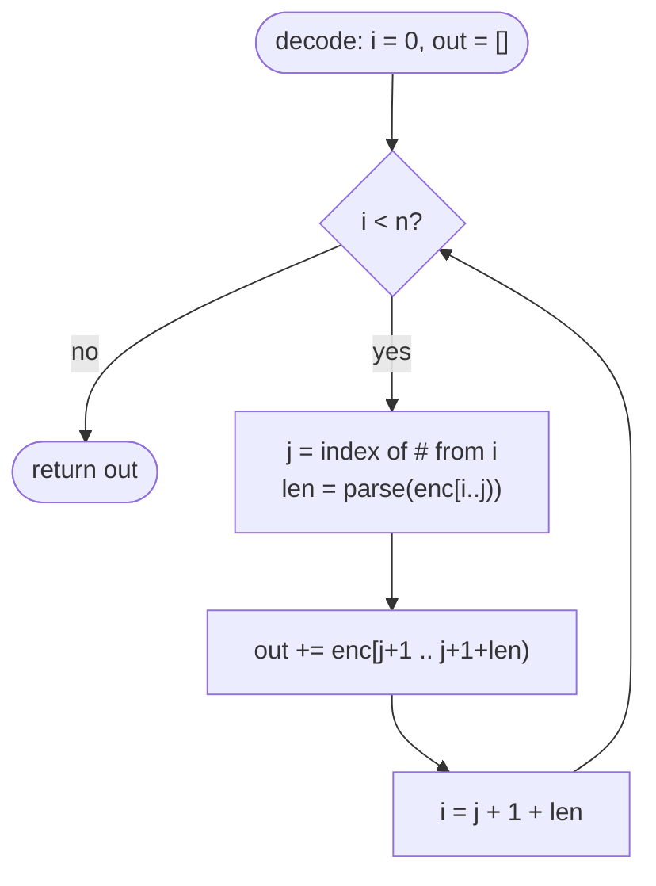

# LC 271 Encode and Decode Strings

> [!abstract] In one sentence
> Write each string as `<length>#<content>`; the decoder parses digits up to the first `#`, then consumes exactly that many characters, so the content may contain `#`, digits, or anything else and still decode uniquely.

**Map:** [[NeetCode 150 MOC]] → [[DSA Dashboard]] · Pattern: [[Arrays & Hashing]]

> [!question] Predict before you read
> If you encode with a delimiter only (`a,b,c`), what input breaks it? If you then escape the delimiter, what new cost do you pay on decode?

## Problem

Design `encode(List<String>) → String` and `decode(String) → List<String>` such that `decode(encode(list))` returns the original list for any list of strings over the full 256-character range, including empty strings and strings containing any character you might choose as a separator. No serialisation library.

- `["lint", "code", "love", "you"]` → some single string → back to the same four strings.
- `[""]` and `[]` must round-trip and be distinguishable.

Constraints that matter: up to 200 strings each up to 200 chars; characters are arbitrary, so no character is safe as a bare delimiter.

## Clarifying questions

1. Can strings contain any character, including whatever I pick as a separator? — Yes; that is the whole difficulty.
2. Can the list be empty, and can it contain empty strings? — Both yes, and `[]` must differ from `[""]`.
3. Is the encoded string required to be human-readable or compact? — No; correctness and linear time matter.
4. Does order matter? — Yes, the list must come back in order.

## Brute force

Join with a delimiter such as `","`. Breaks the moment a string contains the delimiter. Patch: escape the delimiter (`\,`) and the escape character (`\\`); now the decoder must scan character by character with state. It works but the waste is that every character is inspected and copied with branching, and the escape rules are easy to get subtly wrong.

## The key insight

Length-prefix framing: tell the reader *how many characters follow*, then the reader never has to interpret the content. The only parsing happens on a tiny header whose format you control. Recognition cue: "serialise anything, unambiguously" → length prefix (this), or a self-delimiting grammar with a sentinel for absence ([[LC 297 Serialize and Deserialize Binary Tree]]).

## Optimal approach

1. **encode**: for each `s`, append `s.length()`, then `'#'`, then `s`.
2. **decode**: `i = 0`; while `i < n`: find `j = indexOf('#', i)`, `len = parseInt(sub(i, j))`, take `sub(j + 1, j + 1 + len)`, set `i = j + 1 + len`.
3. Return the collected strings.



> [!example]- Excalidraw version — the same diagram as an editable canvas
> ![[LC 271 Encode and Decode Strings — Optimal approach.excalidraw]]
> [[LC 271 Encode and Decode Strings — Optimal approach.excalidraw|Open in Excalidraw]] — needs the Excalidraw plugin (see [[Plugins to Install]]).

## Walkthrough

`["ab", "", "3#x"]` encodes to `2#ab0#3#3#x`.

| i | header | len | content | next i |
|---|---|---|---|---|
| 0 | `2` | 2 | `ab` | 4 |
| 4 | `0` | 0 | `` | 6 |
| 6 | `3` | 3 | `3#x` | 11 = n, stop |

The third string contains both a digit and `#`, and the decoder never looks at them as syntax because it jumps by `len`.

> [!example] Encoded buffer 2#ab0#3#3#x
> ![[LC 271 Encode and Decode Strings — Encoded buffer 2-ab0-3-3-x.excalidraw]]
> [[LC 271 Encode and Decode Strings — Encoded buffer 2-ab0-3-3-x.excalidraw|Open in Excalidraw]] — amber = headers the decoder parses; everything else is skipped by length

%% excalidraw-spec
{"kind": "array", "title": "Encoded buffer 2#ab0#3#3#x", "values": ["2", "#", "a", "b", "0", "#", "3", "#", "3", "#", "x"], "pointers": {"frame 1": 0, "frame 2": 4, "frame 3": 6}, "highlight": [0, 1, 4, 5, 6, 7], "caption": "amber = headers the decoder parses; everything else is skipped by length"}
%%

## Java solution

```java
import java.util.*;

class Codec {
    public String encode(List<String> strs) {
        StringBuilder sb = new StringBuilder();
        for (String s : strs) sb.append(s.length()).append('#').append(s);
        return sb.toString();
    }

    public List<String> decode(String enc) {
        List<String> out = new ArrayList<>();
        int i = 0, n = enc.length();
        while (i < n) {
            int j = enc.indexOf('#', i);                        // first '#' after i is always the header end
            int len = Integer.parseInt(enc.substring(i, j));
            out.add(enc.substring(j + 1, j + 1 + len));
            i = j + 1 + len;                                    // jump past the content without inspecting it
        }
        return out;
    }
}

class Solution {                                                // LeetCode wraps Codec; kept for uniformity
    Codec codec = new Codec();
}
```

**Time** O(total characters) for both directions · **Space** O(total characters) for the output

## Why it works

Decoding is deterministic because at every frame start `i`, the characters from `i` up to the first `#` are guaranteed to be the decimal length — a length never contains `#`, and the previous frame ended exactly at `i` by construction. After reading `len`, the content is taken by count, so no content character can be mistaken for syntax. Induction over frames gives a unique parse; an empty list encodes to the empty string and `[""]` encodes to `0#`, so they are distinguishable.

## Edge cases

- Empty list → `""`; decode loop never runs → `[]`.
- Empty string element → `0#`; `substring(j + 1, j + 1)` yields `""`.
- Content containing `#` or digits (`"3#x"`): skipped by length.
- Very long strings: the header grows as digits of the length, still O(log len) overhead per string.
- Unicode outside the BMP: `String.length()` counts UTF-16 units and `substring` uses the same units, so it round-trips consistently.

## Common mistakes

> [!warning] What goes wrong
> - Using `enc.indexOf('#')` without the `fromIndex` argument — finds the first `#` in the whole string every time.
> - Computing `len` with `charAt(i) - '0'` — breaks for lengths ≥ 10.
> - Choosing a "rare" delimiter such as `\u0000` and skipping the length — fails on inputs that contain it, and interviewers will ask.
> - Forgetting that `[]` and `[""]` must differ; a scheme that emits nothing for an empty string collapses them.

## Variants & follow-ups

- Serialise a tree → [[LC 297 Serialize and Deserialize Binary Tree]] (sentinel for null, pre-order).
- Fixed-width header (e.g. 4 bytes big-endian) instead of `#`-terminated decimal — the framing used by Kafka records and many RPC wire formats; no scan for `#` at all.
- Chunked / streaming decode: the same state machine works on partial buffers if you wait until `len` bytes have arrived.
- Nested lists: recursively length-prefix the encoded inner list.
- Escaping-based scheme as a contrast: show why its decode cost is per-character with state.

## Interview script

Restate: "any characters, any count, must round-trip, list order preserved." Brute force: "delimiter join breaks on inputs containing it; escaping fixes it with a stateful scan." Insight: "length-prefix: the reader never interprets content." Approach: "`len#content` per string; decode by `indexOf('#')`, `parseInt`, `substring`, jump." Complexity: "linear in total characters, both ways." Tests: `[]`, `[""]`, strings with `#` and digits, long strings. Mention it is the same framing idea as TCP-level protocols and Kafka's record batches, which lands well with backend interviewers.

## Related

- Pattern: [[Arrays & Hashing]]; string APIs: [[Strings]]
- Siblings: [[LC 49 Group Anagrams]] (another "design the key" problem), [[LC 297 Serialize and Deserialize Binary Tree]] (framing a tree)
- Java: [[Java Collections Cheat Sheet]] (`indexOf(ch, from)`, `substring`, `StringBuilder`), [[Java Pitfalls in Interviews]] (`substring` cost)

## Attempt log

| Date | Result | Minutes | What I got wrong |
|---|---|---|---|
| | | | |

### Mastery checklist
- [ ] Solved without hints in under 25 minutes
- [ ] Stated complexity before coding
- [ ] Handled every edge case above
- [ ] Code compiled first time
- [ ] Can do the follow-up variant

## Open questions
- [ ] Write the escaping-based codec too, and count the branches in its decoder; then explain in one sentence why length-prefixing is preferred in binary protocols.
