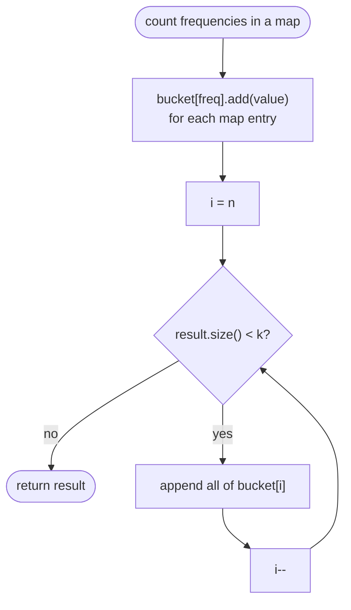

# LC 347 Top K Frequent Elements

> [!abstract] In one sentence
> Frequencies live in `1..n`, so after counting you can drop each value into `bucket[frequency]` and read the buckets from `n` downwards until you have k values — linear time, no sorting, no heap.

**Map:** [[NeetCode 150 MOC]] → [[DSA Dashboard]] · Pattern: [[Arrays & Hashing]]

> [!question] Predict before you read
> The frequency of a value is an integer between 1 and n. What does that bound let you do that a general "sort by frequency" cannot?

## Problem

Given an integer array `nums` and an integer `k`, return the `k` values that occur most often. The answer is guaranteed unique (no tie at the boundary), and any order is fine.

- `nums = [1, 1, 1, 2, 2, 3]`, `k = 2` → `[1, 2]`
- `nums = [1]`, `k = 1` → `[1]`

Constraints that matter: up to 10⁵ elements, `k` between 1 and the number of distinct values, and the follow-up asks for better than O(n log n).

## Clarifying questions

1. Are ties possible at the k-th position? — The problem says the answer is unique; still say what you would do (return any).
2. Must the output be ordered by frequency? — Not required; if asked, the bucket scan naturally produces descending order.
3. Range of `k` relative to the number of distinct values? — `1 ≤ k ≤ distinct`, so you never run out.
4. Is O(n log n) acceptable? — The explicit follow-up says it must be better, which rules out sorting the entries.

## Brute force

Count with a map, copy the entries to a list, sort by count descending, take the first `k`. O(n log n) time. The waste: sorting imposes a total order on all distinct values when you need only the top `k`, and it ignores the fact that counts are small integers.

## The key insight

Counting sort on the frequency axis. Frequencies are bounded by `n`, so an array of `n + 1` buckets indexed by frequency is a complete sort in O(n). Recognition cue: "top k by frequency" where frequencies are naturally bounded → buckets; where the ranking key is unbounded (distances, arbitrary scores) → a size-k heap ([[LC 973 K Closest Points to Origin]]).

## Optimal approach

1. `HashMap<Integer, Integer> freq`, `freq.merge(x, 1, Integer::sum)` per element.
2. Create `List<Integer>[] bucket` of length `n + 1`; for each entry put the value into `bucket[count]`.
3. Scan `i` from `n` down to 1; append every value in `bucket[i]` to the result until it has `k` elements.



> [!example]- Excalidraw version — the same diagram as an editable canvas
> ![[LC 347 Top K Frequent Elements — Optimal approach.excalidraw]]
> [[LC 347 Top K Frequent Elements — Optimal approach.excalidraw|Open in Excalidraw]] — needs the Excalidraw plugin (see [[Plugins to Install]]).

## Walkthrough

`nums = [1, 1, 1, 2, 2, 3]`, `k = 2`, `n = 6`. Counts: `1→3`, `2→2`, `3→1`.

> [!example] bucket[] indexed by frequency
> ![[LC 347 Top K Frequent Elements — bucket-- indexed by frequency.excalidraw]]
> [[LC 347 Top K Frequent Elements — bucket-- indexed by frequency.excalidraw|Open in Excalidraw]] — scan from the right: bucket[3] gives 1, bucket[2] gives 2, result has k = 2, stop

%% excalidraw-spec
{"kind": "array", "title": "bucket[] indexed by frequency", "values": ["-", "[3]", "[2]", "[1]", "[]", "[]", "[]"], "labels": {"0": "f=0", "1": "f=1", "2": "f=2", "3": "f=3", "6": "f=6"}, "highlight": [3, 2], "caption": "scan from the right: bucket[3] gives 1, bucket[2] gives 2, result has k = 2, stop"}
%%

| i | bucket[i] | result |
|---|---|---|
| 6, 5, 4 | empty | [] |
| 3 | [1] | [1] |
| 2 | [2] | [1, 2] → size k, stop |

## Java solution

```java
import java.util.*;

class Solution {
    public int[] topKFrequent(int[] nums, int k) {
        Map<Integer, Integer> freq = new HashMap<>();
        for (int x : nums) freq.merge(x, 1, Integer::sum);

        List<Integer>[] bucket = new List[nums.length + 1];   // index = frequency, 1..n
        for (Map.Entry<Integer, Integer> e : freq.entrySet()) {
            int f = e.getValue();
            if (bucket[f] == null) bucket[f] = new ArrayList<>();
            bucket[f].add(e.getKey());
        }

        int[] out = new int[k];
        int filled = 0;
        for (int f = nums.length; f >= 1 && filled < k; f--) {
            if (bucket[f] == null) continue;
            for (int v : bucket[f]) {
                if (filled == k) break;                         // guard for ties inside one bucket
                out[filled++] = v;
            }
        }
        return out;
    }
}
```

**Time** O(n) · **Space** O(n) — the generic array creation triggers an unchecked warning, which is acceptable in an interview; mention it

The heap alternative, worth knowing because it generalises to unbounded keys and streams:

```java
// snippet
PriorityQueue<Map.Entry<Integer, Integer>> pq =
        new PriorityQueue<>(Map.Entry.comparingByValue());   // min-heap on count
for (Map.Entry<Integer, Integer> e : freq.entrySet()) {
    pq.offer(e);
    if (pq.size() > k) pq.poll();                             // evict the least frequent of the k+1
}
// pq now holds exactly the k most frequent entries: O(n log k) time, O(n) space
```

## Why it works

Every distinct value has a frequency in `[1, n]` (it appears at least once, at most n times), so `bucket` has a slot for it. Reading buckets from high index to low enumerates values in non-increasing frequency order — exactly a sort, performed by placement rather than comparison. The first `k` values in that order are the k most frequent; the uniqueness guarantee means the k-th and (k+1)-th frequencies differ, so no ambiguity about which to include.

## Edge cases

- `k` equals the number of distinct values: every bucket is drained, result is all values.
- All elements identical: one entry in `bucket[n]`, returned immediately.
- Single element: `n = 1`, `bucket[1] = [x]`.
- Many values with the same frequency and `k` smaller than that bucket's size: the inner `break` stops at exactly `k` (the problem promises this cannot straddle the boundary, but the guard costs nothing).

## Common mistakes

> [!warning] What goes wrong
> - Sizing the bucket array `nums.length` instead of `nums.length + 1` — a value that appears `n` times (all equal) indexes out of bounds.
> - Scanning buckets upward from 1, which yields the *least* frequent first.
> - Building a max-heap of all entries and polling `k` times: correct but O(n log n), which fails the stated follow-up; the size-k min-heap is the O(n log k) version.
> - `PriorityQueue` with a comparator built from `a.getValue() - b.getValue()` — safe here (counts ≤ 10⁵) but a habit that overflows elsewhere; prefer `Integer.compare` or `comparingByValue`.

## Variants & follow-ups

- Top k frequent *words* with lexicographic tie-break (LC 692): the heap version with a two-level comparator, or sort within buckets.
- Kth largest by value rather than frequency → [[LC 215 Kth Largest Element in an Array]] (quickselect or heap).
- Nearest k by distance → [[LC 973 K Closest Points to Origin]] (keys unbounded, so heap, not buckets).
- Stream of values with "top k so far" queries → maintain a count map plus a heap that is rebuilt lazily, or a frequency-bucket DLL as in LFU cache design.
- Sort the whole array by frequency (LC 1636): buckets again, emitted in order.

## Interview script

Restate: "k most frequent values, unique answer, any order, must beat n log n." Brute force: "count, sort entries by count, O(n log n)." Insight: "counts are bounded by n, so bucket them by count — counting sort on frequencies." Approach: "map for counts, array of lists indexed by count, scan from the top until k collected." Complexity: "O(n) time and space." Then volunteer: "a size-k min-heap gives O(n log k) and works when the key is not bounded or the data streams." Tests: single element, all equal, `k` = distinct count.

## Related

- Pattern: [[Arrays & Hashing]]; the alternative structure: [[Heaps & Priority Queues]]
- Prerequisite: [[LC 49 Group Anagrams]] (map of lists), [[LC 242 Valid Anagram]] (counting)
- Siblings: [[LC 215 Kth Largest Element in an Array]], [[LC 973 K Closest Points to Origin]], [[LC 703 Kth Largest Element in a Stream]]
- Java: [[Java Collections Cheat Sheet]] (`Map.merge`, `Map.Entry.comparingByValue`, `PriorityQueue`), [[DSA Patterns in Java]] (heap top-k template)

## Attempt log

| Date | Result | Minutes | What I got wrong |
|---|---|---|---|
| | | | |

### Mastery checklist
- [ ] Solved without hints in under 25 minutes
- [ ] Stated complexity before coding
- [ ] Handled every edge case above
- [ ] Code compiled first time
- [ ] Can do the follow-up variant

## Open questions
- [ ] Quickselect on the entries by count gives expected O(n) without the extra array — write it and decide which of the three you would actually use under interview time pressure.
