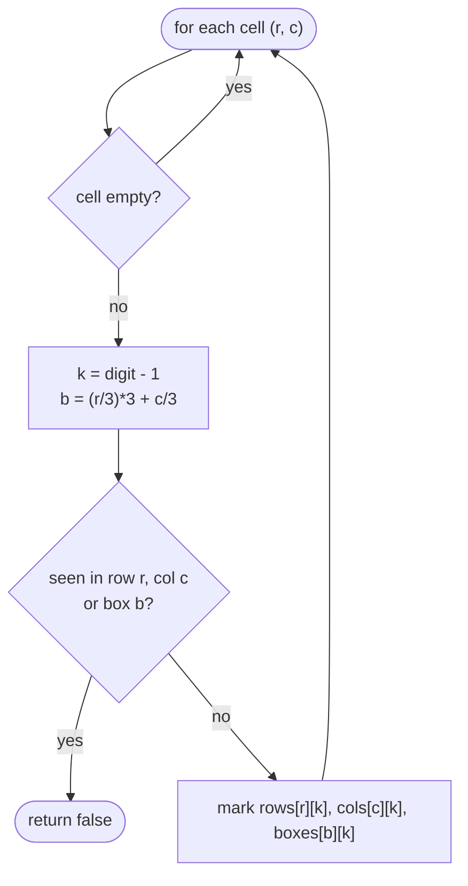

# LC 36 Valid Sudoku

> [!abstract] In one sentence
> Each filled cell `(r, c, d)` must be new in three groups — row `r`, column `c`, box `(r/3)*3 + c/3` — so keep 9 + 9 + 9 "seen" sets and reject the first duplicate; one pass over 81 cells is the whole algorithm.

**Map:** [[NeetCode 150 MOC]] → [[DSA Dashboard]] · Pattern: [[Arrays & Hashing]]

> [!question] Predict before you read
> Write the formula that maps `(r, c)` to a box number `0..8` such that cells `(0..2, 0..2)` are box 0, `(0..2, 3..5)` box 1, and `(3..5, 0..2)` box 3. Then check what integer division gives you for `r = 5, c = 7`.

## Problem

A 9×9 `char[][]` holds digits `'1'`–`'9'` or `'.'` for empty. Decide whether the filled cells are *valid*: no digit repeats within a row, within a column, or within any of the nine 3×3 boxes. You are not asked whether the puzzle is solvable, only that the current state breaks no rule.

- A standard partially filled board → `true`.
- The same board with the top-left `5` changed to `8` while another `8` sits in the same box → `false`.

Constraints that matter: fixed 9×9, so every complexity is a constant; what the interviewer measures is clarity of the three-group check and the box formula.

## Clarifying questions

1. Do I need to check solvability? — No, only the three uniqueness rules on filled cells.
2. Are the characters guaranteed to be `'1'..'9'` or `'.'`? — Yes; no validation of malformed input needed.
3. Is a completely empty board valid? — Yes.
4. Should I stop at the first violation? — Yes, return `false` immediately.

## Brute force

Three separate triple loops: for each row check 9 cells against each other; same for columns; same for boxes with nested `(br, bc)` loops. O(81 × 9) comparisons — still constant but three times the code and the box loop is where bugs hide. The waste is structural: three traversals and three chances to get indices wrong.

## The key insight

A cell belongs to exactly three groups, and group membership is a function of `(r, c)`. Visit each cell once and register its digit in all three groups' "seen" structures. Recognition cue: "no duplicates within each row / column / region" → a seen-set per group, and a pure function from coordinates to group id. The box id `(r / 3) * 3 + c / 3` is integer-division flooring `r` and `c` into a 3×3 grid of boxes and then flattening row-major.

## Optimal approach

1. Allocate `boolean[9][9] rows, cols, boxes` (first index = group, second = digit − 1).
2. For each `(r, c)` with a digit `d`: compute `b = (r / 3) * 3 + c / 3`, `k = d − '1'`.
3. If `rows[r][k] || cols[c][k] || boxes[b][k]` → return `false`; else set all three to `true`.
4. Return `true` after the pass.



> [!example]- Excalidraw version — the same diagram as an editable canvas
> ![[LC 36 Valid Sudoku — Optimal approach.excalidraw]]
> [[LC 36 Valid Sudoku — Optimal approach.excalidraw|Open in Excalidraw]] — needs the Excalidraw plugin (see [[Plugins to Install]]).

## Walkthrough

Box indices as a 9×9 grid (the formula applied once; this is the table to be able to draw):

> [!example] Box id = (r/3)*3 + c/3
> ![[LC 36 Valid Sudoku — Box id = (r-3)-3 + c-3.excalidraw]]
> [[LC 36 Valid Sudoku — Box id = (r-3)-3 + c-3.excalidraw|Open in Excalidraw]] — (5, 7): 5/3 = 1, 7/3 = 2, box 1*3 + 2 = 5

%% excalidraw-spec
{"kind": "grid", "title": "Box id = (r/3)*3 + c/3", "col_labels": ["r\\c", "0", "1", "2", "3", "4", "5", "6", "7", "8"], "row_labels": ["0", "1", "2", "3", "4", "5", "6", "7", "8"], "rows": [ [0, 0, 0, 1, 1, 1, 2, 2, 2], [0, 0, 0, 1, 1, 1, 2, 2, 2], [0, 0, 0, 1, 1, 1, 2, 2, 2], [3, 3, 3, 4, 4, 4, 5, 5, 5], [3, 3, 3, 4, 4, 4, 5, 5, 5], [3, 3, 3, 4, 4, 4, 5, 5, 5], [6, 6, 6, 7, 7, 7, 8, 8, 8], [6, 6, 6, 7, 7, 7, 8, 8, 8], [6, 6, 6, 7, 7, 7, 8, 8, 8] ], "highlight": [ [5, 7] ], "caption": "(5, 7): 5/3 = 1, 7/3 = 2, box 1*3 + 2 = 5"}
%%

Trace of a violation: suppose `(0, 0) = '5'` and `(1, 1) = '5'`. Visiting `(0, 0)` marks `rows[0][4]`, `cols[0][4]`, `boxes[0][4]`. Visiting `(1, 1)`: row 1 clear, col 1 clear, but `boxes[0][4]` is set → `false`.

## Java solution

```java
import java.util.*;

class Solution {
    public boolean isValidSudoku(char[][] board) {
        boolean[][] rows = new boolean[9][9], cols = new boolean[9][9], boxes = new boolean[9][9];
        for (int r = 0; r < 9; r++) {
            for (int c = 0; c < 9; c++) {
                char ch = board[r][c];
                if (ch == '.') continue;
                int k = ch - '1';                               // '1'..'9' -> 0..8
                int b = (r / 3) * 3 + c / 3;                    // 3x3 box index, row-major
                if (rows[r][k] || cols[c][k] || boxes[b][k]) return false;
                rows[r][k] = cols[c][k] = boxes[b][k] = true;
            }
        }
        return true;
    }
}
```

**Time** O(81) = O(1) · **Space** O(243 booleans) = O(1)

The `HashSet<String>` one-liner variant (`"r0-5"`, `"c0-5"`, `"b0-5"` as keys) is popular; it is slower and heavier than the boolean tables but easy to explain:

```java
// snippet
Set<String> seen = new HashSet<>();
// for each filled cell with digit d:
if (!seen.add(d + " in row " + r) || !seen.add(d + " in col " + c)
        || !seen.add(d + " in box " + r / 3 + "-" + c / 3)) return false;
```

## Why it works

The three rules are exactly "no repeated digit in each of 27 groups". The pass visits every filled cell once and, before marking, checks the digit against the three groups the cell belongs to. If a group ever contains a repeated digit `d`, the second occurrence of `d` is visited after the first (any traversal order works), finds the mark, and returns `false`. If no group repeats a digit, no check fires. The box formula is correct because integer division by 3 maps rows `0–2 → 0`, `3–5 → 1`, `6–8 → 2`, and `row * 3 + col` flattens the 3×3 arrangement of boxes without collisions.

## Edge cases

- Empty board: every cell is `'.'`, returns `true`.
- Violation only in a box (rows and columns fine): caught by `boxes[b][k]`.
- Violation in the last cell: the loop reaches it and returns `false`.
- A board that is valid but unsolvable: returns `true` — matches the specification.

## Common mistakes

> [!warning] What goes wrong
> - Box index as `r / 3 + c / 3` (collides: `(0,3)` and `(3,0)` both give 1) or `r / 3 * c / 3`.
> - Indexing by `ch - '0'` into a 9-cell array — `'9'` becomes index 9, out of bounds; use `- '1'` or size 10.
> - Checking rows and columns but forgetting boxes, or marking before checking (then a cell flags itself).
> - Trying to solve the puzzle (backtracking) when only validation was asked.

## Variants & follow-ups

- Actually solve it (LC 37): backtracking with the same three seen-tables as the pruning structure — the validation code becomes the `canPlace` check; see [[Backtracking]] and [[LC 51 N-Queens]].
- Validate a single move incrementally: O(1) using the persisted tables.
- Generalised n² × n² sudoku: box index `(r / n) * n + c / n`, tables of size `n² × n²`.
- Bitmask instead of boolean rows: `int[9] rows`, test `(rows[r] >> k & 1)`, set with `|= 1 << k` — see [[Bit Manipulation]].

## Interview script

Restate: "9×9, digits or dots, no repeats per row, column, 3×3 box; solvability not required." Brute force: "three separate scans, the box scan being fiddly." Insight: "each cell is in exactly three groups; one pass with a seen-table per group." Approach: "boolean[9][9] for rows, cols, boxes; box id `(r/3)*3 + c/3`; check then mark." Complexity: "constant — 81 cells, 243 flags." Tests: empty board, duplicate only inside a box, duplicate in the final cell. If asked for a follow-up: incremental validation of a move, or the bitmask version.

## Related

- Pattern: [[Arrays & Hashing]]; the seen-set idea first appears in [[LC 217 Contains Duplicate]]
- Matrix index mapping: [[Math & Geometry]]
- Backtracking continuation: [[LC 51 N-Queens]] (row/column/diagonal seen-sets), [[Backtracking]]
- Java: [[Java Collections Cheat Sheet]] (`Set.add` boolean, 2-D array init), [[Java Pitfalls in Interviews]] (char arithmetic)

## Attempt log

| Date | Result | Minutes | What I got wrong |
|---|---|---|---|
| | | | |

### Mastery checklist
- [ ] Solved without hints in under 25 minutes
- [ ] Stated complexity before coding
- [ ] Handled every edge case above
- [ ] Code compiled first time
- [ ] Can do the follow-up variant

## Open questions
- [ ] Write the bitmask version from memory (`int[] rows = new int[9]`) and explain why `rows[r] & (1 << k)` being non-zero is the test, not `== 1`.
