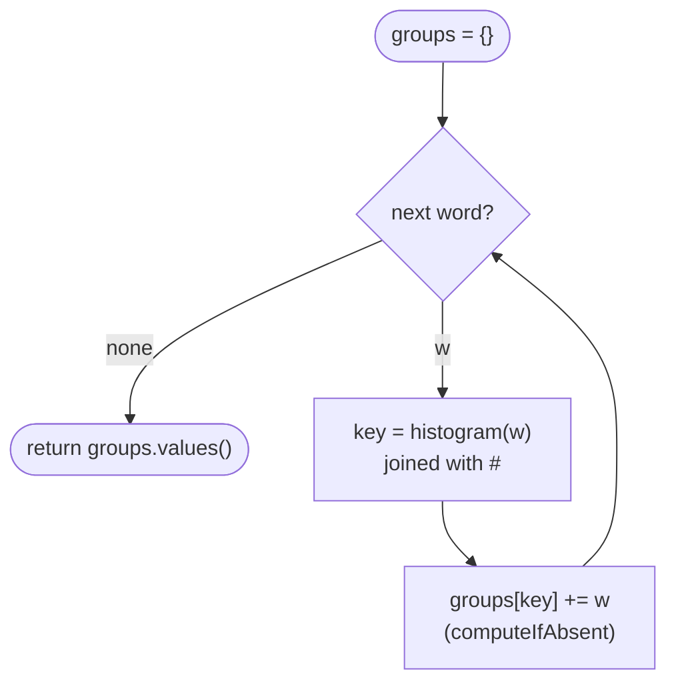

# LC 49 Group Anagrams

> [!abstract] In one sentence
> Compute, for every word, a key that depends only on its letter multiset — the sorted word or a `#`-joined count vector — and `computeIfAbsent` it into a `HashMap<String, List<String>>`; the map's values are the groups.

**Map:** [[NeetCode 150 MOC]] → [[DSA Dashboard]] · Pattern: [[Arrays & Hashing]]

> [!question] Predict before you read
> Why can you not use the `int[26]` histogram itself as the `HashMap` key, and what would happen if you tried?

## Problem

Given an array of lowercase words, group the ones that are anagrams of each other. Any order of groups and of words within a group is accepted.

- `["eat", "tea", "tan", "ate", "nat", "bat"]` → `[["bat"], ["nat", "tan"], ["ate", "eat", "tea"]]`
- `[""]` → `[[""]]`
- `["a"]` → `[["a"]]`

Constraints that matter: up to 10⁴ words, each up to 100 letters, lowercase only — so a 26-cell histogram is legal and the total work is bounded by total characters (≤ 10⁶).

## Clarifying questions

1. Lowercase a–z only? — Yes; wider alphabets push you to the sorted-string key or a map-based count.
2. Does the output order matter? — No.
3. Can the input contain duplicates (the same word twice)? — Yes; both go into the same group.
4. Typical word length versus number of words? — Decides whether the O(k log k) sort key or the O(k) count key is worth the extra code.

## Brute force

For each word, scan all existing groups and test anagram-ness against the group's representative with [[LC 242 Valid Anagram]]. O(n² · k) time. It wastes work because the anagram test is repeated against every group, when a single canonical fingerprint computed once per word would locate its group directly.

## The key insight

Choose a **canonical form** such that two words map to the same string iff they are anagrams, then hash on it. Sorted letters is the obvious one; the count vector serialised as `"1#0#0#...#2"` is the linear-time one. Recognition cue: "group / partition / count by equivalence" → design a key that is invariant under the equivalence, and let the hash map do the grouping.

## Optimal approach

1. Create `Map<String, List<String>> groups`.
2. For each word, build `int[26]` counts, then serialise to a string with separators (so `"1" + "11"` and `"11" + "1"` cannot collide).
3. `groups.computeIfAbsent(key, k -> new ArrayList<>()).add(word)`.
4. Return `new ArrayList<>(groups.values())`.



> [!example]- Excalidraw version — the same diagram as an editable canvas
> ![[LC 49 Group Anagrams — Optimal approach.excalidraw]]
> [[LC 49 Group Anagrams — Optimal approach.excalidraw|Open in Excalidraw]] — needs the Excalidraw plugin (see [[Plugins to Install]]).

## Walkthrough

`["eat", "tea", "tan", "ate", "nat", "bat"]` — showing only the non-zero cells of the key for readability.

| word | key (a, b, e, n, t counts) | map after |
|---|---|---|
| eat | a1 e1 t1 | {aet: [eat]} |
| tea | a1 e1 t1 | {aet: [eat, tea]} |
| tan | a1 n1 t1 | {aet: [...], ant: [tan]} |
| ate | a1 e1 t1 | {aet: [eat, tea, ate], ant: [tan]} |
| nat | a1 n1 t1 | ant: [tan, nat] |
| bat | a1 b1 t1 | abt: [bat] |

Three buckets, six words, one histogram each.

> [!example] Histogram key for eat: cells a..f
> ![[LC 49 Group Anagrams — Histogram key for eat- cells a..f.excalidraw]]
> [[LC 49 Group Anagrams — Histogram key for eat- cells a..f.excalidraw|Open in Excalidraw]] — plus t = 1 further right; tea and ate produce the identical array, hence the identical string key

%% excalidraw-spec
{"kind": "array", "title": "Histogram key for eat: cells a..f", "values": [1, 0, 0, 0, 1, 0], "labels": {"0": "a", "1": "b", "2": "c", "3": "d", "4": "e", "5": "f"}, "highlight": [0, 4], "caption": "plus t = 1 further right; tea and ate produce the identical array, hence the identical string key"}
%%

## Java solution

```java
import java.util.*;

class Solution {
    public List<List<String>> groupAnagrams(String[] strs) {
        Map<String, List<String>> groups = new HashMap<>();
        for (String w : strs) {
            int[] count = new int[26];
            for (char c : w.toCharArray()) count[c - 'a']++;
            StringBuilder sb = new StringBuilder();
            for (int c : count) sb.append(c).append('#');          // separator: "1#11#" != "11#1#"
            groups.computeIfAbsent(sb.toString(), k -> new ArrayList<>()).add(w);
        }
        return new ArrayList<>(groups.values());
    }
}
```

**Time** O(n · k) with n words of average length k · **Space** O(n · k) for the output plus O(n · 26) for keys

The sorted-key alternative is shorter and what most people write first:

```java
// snippet
char[] a = w.toCharArray();
Arrays.sort(a);
String key = new String(a);                  // O(k log k) per word; fine when k is small
groups.computeIfAbsent(key, k -> new ArrayList<>()).add(w);
```

## Why it works

Two words are anagrams iff their letter histograms are equal (see [[LC 242 Valid Anagram]]). The serialisation is injective on histograms because of the separator: each cell's decimal is delimited, so the string determines the 26 numbers and vice versa. Therefore `key(w1) == key(w2)` iff `w1` and `w2` are anagrams, and a hash map keyed on it puts exactly the anagram classes together. `computeIfAbsent` guarantees one list per key is created lazily.

## Edge cases

- Empty string: histogram all zeros, key `"0#0#...#"`, its own group — `[""]` → `[[""]]`.
- Single word: one group.
- Duplicate words: both land in the same list, so `["a", "a"]` → `[["a", "a"]]`.
- Words of length 100 and 10⁴ of them: 10⁶ char operations plus 2.6 × 10⁵ key characters — comfortably fast.

## Common mistakes

> [!warning] What goes wrong
> - Using `int[]` as the map key: arrays use identity `hashCode`/`equals`, so every word gets its own bucket. Use a `String` (or `List<Integer>`, which has value equality, at the cost of boxing).
> - Omitting the separator in the serialised counts — `"1" + "11"` versus `"11" + "1"` collide.
> - Building the key with `String +=` inside the 26-loop for every word; use `StringBuilder` or `Arrays.toString(count)` (which is fine and already delimited).
> - `Arrays.sort(w.toCharArray())` without keeping the array: `toCharArray` returns a fresh copy; sort the variable you then wrap in `new String(...)`.

## Variants & follow-ups

- "Is this one string an anagram of that one?" → [[LC 242 Valid Anagram]]; "which substrings of `s` are anagrams of `p`" → [[LC 567 Permutation in String]] (sliding histogram).
- Group by a different equivalence (shifted strings LC 249, same digit multiset, same sorted characters ignoring case): the only change is the key function.
- Return only the largest group or the count of groups: same map, different read-out — see [[LC 347 Top K Frequent Elements]] for ranking by size.
- Streaming words: the map works incrementally; you may need [[LC 271 Encode and Decode Strings]]-style framing if keys travel over the wire.

## Interview script

Restate: "lowercase words, partition into anagram classes, any order." Brute force: "compare each word with each group's representative, O(n²k)." Insight: "anagrams share a histogram; serialise it into a string key and let a hash map group." Approach: "per word, 26-count, join with a separator, `computeIfAbsent`, return the values." Complexity: "O(nk) time, O(nk) space; the sorted-key variant is O(nk log k) and two lines shorter — I would pick by word length." Tests: empty string, duplicates, single word, long words.

## Related

- Pattern: [[Arrays & Hashing]]; key design and `hashCode`/`equals`: [[Hashing]]
- Prerequisite: [[LC 242 Valid Anagram]]
- Siblings: [[LC 347 Top K Frequent Elements]], [[LC 271 Encode and Decode Strings]], [[LC 567 Permutation in String]]
- Java: [[Java Collections Cheat Sheet]] (`computeIfAbsent`, `Map.values`, `StringBuilder`), [[Java Pitfalls in Interviews]] (arrays as map keys)

## Attempt log

| Date | Result | Minutes | What I got wrong |
|---|---|---|---|
| | | | |

### Mastery checklist
- [ ] Solved without hints in under 25 minutes
- [ ] Stated complexity before coding
- [ ] Handled every edge case above
- [ ] Code compiled first time
- [ ] Can do the follow-up variant

## Open questions
- [ ] What would a `record Key(int[] counts)` need to override to work as a map key, and why does `record` not generate it correctly for arrays by default?
