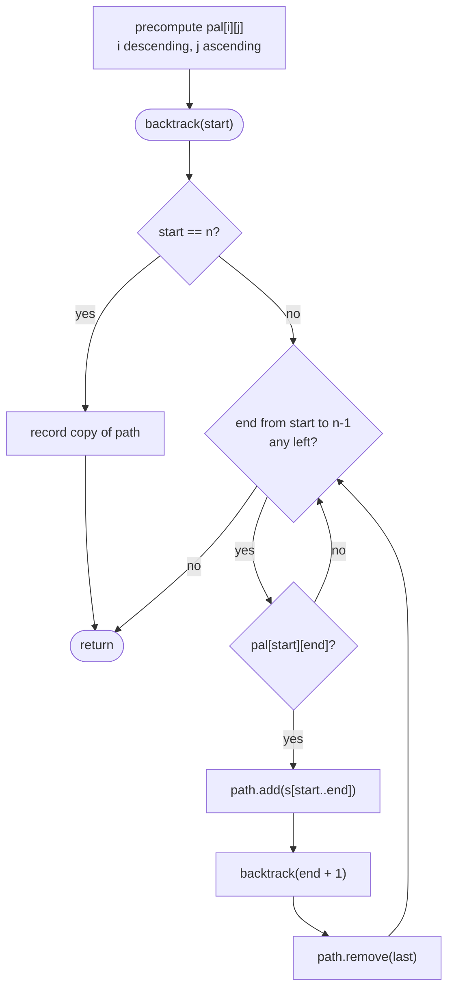

# LC 131 Palindrome Partitioning

> [!abstract] In one sentence
> A partition is a choice of where each piece ends, so from position `start` try every `end` such that `s[start..end]` is a palindrome and recurse from `end + 1`; the recursion tree is the subsets tree over cut positions with non-palindromic branches pruned, and a 2-D palindrome table makes each pruning test O(1).

**Map:** [[NeetCode 150 MOC]] → [[DSA Dashboard]] · Pattern: [[Backtracking]]

> [!question] Predict before you read
> A string of length n has n − 1 gaps, so there are 2^(n−1) ways to place cuts. For `"aab"` that is 4 partitions, of which 2 are all-palindromic. Which 2, and at what depth does the backtracking discover that `"ab"` cannot be a piece?

## Problem

Given a string `s`, partition it so that every substring of the partition is a palindrome. Return all possible such partitions, in any order.

Example: `s = "aab"` → `[ ["a","a","b"], ["aa","b"] ]`.
Example: `s = "a"` → `[ ["a"] ]`.

Constraints that matter: 1 ≤ s.length ≤ 16, lowercase letters. The output can be exponential (for `"aaaa…"` every one of the 2^(n−1) cut patterns is valid), so the algorithm is exponential by necessity; the only thing to optimise is the per-step palindrome check.

## Clarifying questions

1. Do single characters count as palindromes? — Yes, so at least one partition (all singles) always exists.
2. Is the order of pieces fixed? — Yes, pieces are contiguous and in left-to-right order; the choice is only where to cut.
3. Should the output be in any particular order? — No.
4. Is n small enough for an exponential answer? — n ≤ 16 → at most 32 768 partitions.

## Brute force

Enumerate all 2^(n−1) cut masks, split the string accordingly, and test each piece with a two-pointer palindrome check. That is O(n · 2^n): correct, and for n = 16 fast enough. The waste is in building partitions whose first piece is already not a palindrome — a mask with `"ab"` as the first piece is generated 2^(n−3) times with different suffix cuts and rejected every time. Backtracking rejects `"ab"` once, at the node that would choose it.

## The key insight

Choose the end of the next piece. At `start`, loop `end` from `start` to `n − 1`; if `s[start..end]` is a palindrome, commit to it and recurse from `end + 1`; when `start == n` the path is one answer. Every partition is reached exactly once (the pieces are determined left to right). The palindrome test is the only non-trivial cost, and all O(n²) substrings can be precomputed with `pal[i][j] = s[i] == s[j] && (j − i < 2 || pal[i+1][j−1])`, filled with `i` descending so the inner cell is ready. Recognition cue: "all ways to split / partition a string such that every piece satisfies P".

## Optimal approach

1. Build `pal[i][j]` for all `i ≤ j`, iterating `i` from `n − 1` down to 0 and `j` from `i` up.
2. `backtrack(start)`: if `start == n`, record a copy of `path` and return.
3. For `end` from `start`: if `pal[start][end]`, append `s.substring(start, end + 1)`, recurse with `end + 1`, remove.
4. Call `backtrack(0)`.



> [!example]- Excalidraw version — the same diagram as an editable canvas
> ![[LC 131 Palindrome Partitioning — Optimal approach.excalidraw]]
> [[LC 131 Palindrome Partitioning — Optimal approach.excalidraw|Open in Excalidraw]] — needs the Excalidraw plugin (see [[Plugins to Install]]).

## Walkthrough

`s = "aab"`. The palindrome table (true cells only): `pal[0][0]`, `pal[0][1]` (`"aa"`), `pal[1][1]`, `pal[2][2]`. Each node below is one call; its label is the pieces chosen so far, and amber nodes are rejected candidates.

> [!example] Palindrome Partitioning tree for aab
> ![[LC 131 Palindrome Partitioning — Palindrome Partitioning tree for aab.excalidraw]]
> [[LC 131 Palindrome Partitioning — Palindrome Partitioning tree for aab.excalidraw|Open in Excalidraw]] — two leaves at start 3 are recorded; the amber candidates are rejected by the table in O(1) and never become calls

%% excalidraw-spec
{"kind": "tree", "title": "Palindrome Partitioning tree for aab", "nodes": [{"id": "r", "label": "start 0: { }", "children": ["a", "x1", "aa"]}, {"id": "a", "label": "start 1: a", "children": ["aa2", "x2"]}, {"id": "x1", "label": "aab: not pal", "children": []}, {"id": "aa", "label": "start 2: aa", "children": ["aab2"]}, {"id": "aa2", "label": "start 2: a | a", "children": ["aab3"]}, {"id": "x2", "label": "a | ab: not pal", "children": []}, {"id": "aab2", "label": "start 3: aa | b", "children": []}, {"id": "aab3", "label": "start 3: a | a | b", "children": []}], "root": "r", "highlight": ["x1", "x2"], "caption": "two leaves at start 3 are recorded; the amber candidates are rejected by the table in O(1) and never become calls"}
%%

Check the table trace once by hand: `pal[0][1]` needs `s[0] == s[1]` (`a == a`) and `j − i = 1 < 2` → true. `pal[0][2]` needs `s[0] == s[2]` (`a` vs `b`) → false, so `"aab"` is cut from the root.

## Java solution

```java
import java.util.*;

class Solution {
    public List<List<String>> partition(String s) {
        int n = s.length();
        boolean[][] pal = new boolean[n][n];                 // pal[i][j]: s[i..j] is a palindrome
        for (int i = n - 1; i >= 0; i--)
            for (int j = i; j < n; j++)
                pal[i][j] = s.charAt(i) == s.charAt(j) && (j - i < 2 || pal[i + 1][j - 1]);
        List<List<String>> res = new ArrayList<>();
        backtrack(s, 0, pal, new ArrayList<>(), res);
        return res;
    }

    private void backtrack(String s, int start, boolean[][] pal, List<String> path, List<List<String>> res) {
        if (start == s.length()) {                           // every character is in some piece
            res.add(new ArrayList<>(path));
            return;
        }
        for (int end = start; end < s.length(); end++) {
            if (!pal[start][end]) continue;                  // O(1) thanks to the table
            path.add(s.substring(start, end + 1));
            backtrack(s, end + 1, pal, path, res);
            path.remove(path.size() - 1);
        }
    }
}
```

**Time** O(n · 2^n) — up to 2^(n−1) partitions, each with up to n pieces; the table costs O(n²) · **Space** O(n²) for the table plus O(n) recursion depth, excluding the output

Without the table, check on the fly with two pointers:

```java
// snippet — O(length) check, used instead of the pal[][] lookup
boolean isPal(String s, int i, int j) {
    while (i < j) if (s.charAt(i++) != s.charAt(j--)) return false;
    return true;
}
```

This keeps the code shorter and the space O(n); the total work rises to O(n² · 2^n) in the worst case because the same substring is re-checked on every path that reaches it. For n ≤ 16 both pass; say which one you are choosing and why.

## Why it works

Invariant: `path` is a sequence of palindromic pieces that concatenate exactly to `s[0..start−1]`. The loop tries every possible end for the next piece and only commits to palindromic ones, so every all-palindromic partition of the suffix is extended from `path`, and non-palindromic pieces are never placed. A partition is determined by its sequence of piece ends, which the DFS chooses one at a time in order, so each partition is produced once. The table recurrence is sound because a string is a palindrome iff its outer characters match and its interior (empty or one character for `j − i < 2`) is a palindrome; filling `i` downward guarantees `pal[i+1][j−1]` is already computed.

## Edge cases

- `n = 1` — one partition with one piece.
- All characters identical, `"aaaa"` — every cut pattern is valid: 8 partitions for n = 4, 2^15 for n = 16; the algorithm must not do more work per partition than O(n).
- No two adjacent characters equal and no palindromes longer than 1 (`"abc"`) — exactly one partition, all singles.
- The entire string is a palindrome — it appears as the single-piece partition, found when `end = n − 1` at the root.

## Common mistakes

> [!warning] Pitfalls
> - **Filling the table with `i` ascending** — `pal[i+1][j−1]` is read before it is written and stays false; every palindrome longer than 2 is missed.
> - **`substring(start, end)` instead of `end + 1`** — Java's end index is exclusive; the piece loses its last character.
> - **Recording at `start == n − 1`** instead of `n` — drops the last piece.
> - **Checking the whole remaining string for being a palindrome** instead of the prefix — that is a different question ("can the suffix be one piece").
> - **Sharing one `StringBuilder` for pieces** — pieces are separate strings; use a `List<String>` and copy it on record.

## Variants & follow-ups

- Minimum number of cuts so that every piece is a palindrome (LeetCode 132) → DP over positions with the same table: `cuts[i] = min over palindromic s[j..i] of cuts[j−1] + 1`, O(n²); listing is exponential, optimising is polynomial.
- Count or find palindromic substrings → [[LC 647 Palindromic Substrings]], [[LC 5 Longest Palindromic Substring]] use the same table or centre expansion.
- Pieces must be dictionary words instead of palindromes → [[LC 139 Word Break]] (existence, DP) and Word Break II (listing, backtracking with memo).
- Partition into k palindromic pieces → add a depth parameter and record only when `path.size() == k` at `start == n`.
- What changes if n = 1000? Listing is impossible; the interviewer wants the min-cut DP or the count, both O(n²).

## Interview script

1. Restate: split the string into contiguous pieces, every piece a palindrome, return all such splits.
2. Brute force: 2^(n−1) cut masks, test each piece — O(n · 2^n) with repeated rejection of the same bad prefix.
3. Insight: choose the next piece's end; only palindromic prefixes extend the path; precompute `pal[i][j]` in O(n²).
4. Approach: table with `i` descending; `backtrack(start)` records at `n`, loops `end`, checks the table, choose/recurse/un-choose.
5. Complexity: O(n · 2^n) time, O(n²) space for the table.
6. Tests: `"aab"`, `"a"`, `"aaaa"`, `"abc"`.

The interviewer is checking that you see partitioning as choosing cut points, that you know the exclusive end index of `substring`, and that you can switch to the min-cut DP when the question becomes an optimisation.

## Related

- [[Backtracking]] — partition problems as cut-point choices
- [[Strings]] — palindromes, `substring` semantics, `StringBuilder`
- [[LC 647 Palindromic Substrings]] — the same `pal` table counted
- [[LC 5 Longest Palindromic Substring]] — the same table, maximised
- [[LC 139 Word Break]] — partition with a dictionary predicate
- [[LC 78 Subsets]] — the cut positions are a subset of the gaps
- [[DSA Patterns in Java]] — backtracking on strings
- [[Java Collections Cheat Sheet]] — `substring(from, toExclusive)`, `charAt`, 2-D boolean arrays

## Attempt log

| Date | Result | Minutes | What I got wrong |
|---|---|---|---|
| | | | |

### Mastery checklist
- [ ] Solved without hints in under 25 minutes
- [ ] Stated complexity before coding
- [ ] Handled every edge case above
- [ ] Code compiled first time
- [ ] Can do the follow-up variant (minimum cuts with DP)

## Open questions
- [ ]
