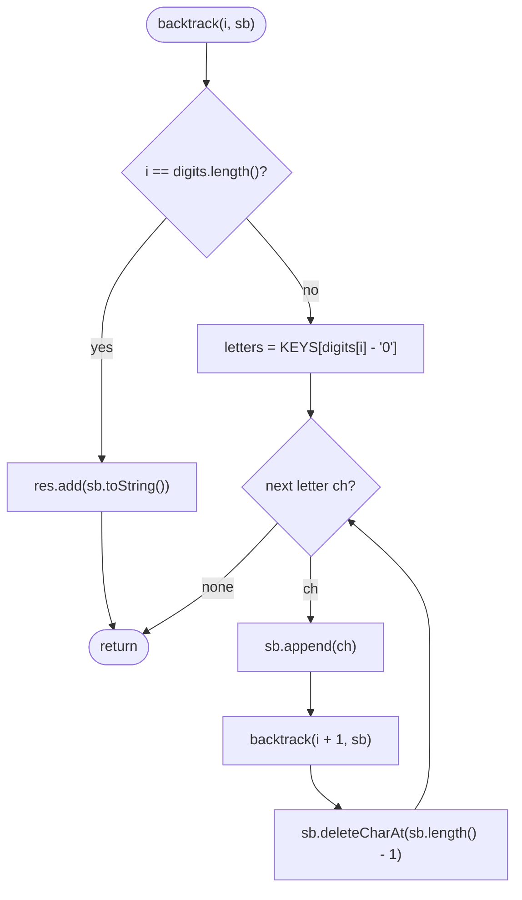

# LC 17 Letter Combinations of a Phone Number

> [!abstract] In one sentence
> This is the cleanest "one decision per level" backtracking: level `i` picks a letter for digit `i`, the depth is fixed at the number of digits, every leaf is an answer, and the only Java work is a lookup table and a `StringBuilder` you append to and trim.

**Map:** [[NeetCode 150 MOC]] → [[DSA Dashboard]] · Pattern: [[Backtracking]]

> [!question] Predict before you read
> For `"23"` there are 3 × 3 = 9 strings. Should the recursion loop over *all* letters at every level with a `used` array, or over just the letters of the digit at the current depth? What would the `used` version produce for `"22"`?

## Problem

Given a string of digits from `2` to `9`, return all strings the digits could represent on a telephone keypad (`2 → abc`, `3 → def`, `4 → ghi`, `5 → jkl`, `6 → mno`, `7 → pqrs`, `8 → tuv`, `9 → wxyz`). Any order.

Example: `digits = "23"` → `["ad","ae","af","bd","be","bf","cd","ce","cf"]`.
Example: `digits = ""` → `[]`.
Example: `digits = "2"` → `["a","b","c"]`.

Constraints that matter: 0 ≤ digits.length ≤ 4, so at most 4^4 = 256 strings. The empty input is a listed example and must return an empty list, not a list containing the empty string.

## Clarifying questions

1. Can `0` or `1` appear? — No, only `2`–`9`; still, a lookup table with empty entries for `0` and `1` costs nothing.
2. Empty input → empty output? — Yes, `[]`, not `[""]`.
3. Output order? — Any. The DFS produces lexicographic order for free because letters are listed in order.
4. Maximum length? — 4 digits, so 256 strings of length 4; no need for anything clever.

## Brute force

Nested loops: for 2 digits, two loops over the letter sets; for 3 digits, three. The depth is not known at compile time, so you cannot write the loops. The iterative replacement is the "grow a list" method: start with `[""]`, and for each digit replace the list by every string in it extended by every letter of the digit. That is O(n · 4^n) and perfectly acceptable; the backtracking version is the same work expressed as recursion with one buffer instead of a new list per digit.

## The key insight

The result is the Cartesian product `letters(d1) × letters(d2) × … × letters(dn)`. In the recursion tree, level `i` branches once per letter of digit `i`, every root-to-leaf path has length `n`, and every leaf is an answer. There is nothing to prune and no duplicates to avoid; the only state is the characters chosen so far, which a `StringBuilder` holds — append to choose, `deleteCharAt(length − 1)` to un-choose. Recognition cue: "all combinations where position `i` is drawn from set `S_i`".

## Optimal approach

1. Table `KEYS[d]` = letters for digit `d` (index by `digit − '0'`).
2. If `digits` is empty, return the empty list.
3. `backtrack(i)`: if `i == digits.length()`, record `sb.toString()` and return.
4. Look up the letters of digit `i` in `KEYS`; for each letter: append, `backtrack(i + 1)`, delete the last char.



> [!example]- Excalidraw version — the same diagram as an editable canvas
> ![[LC 17 Letter Combinations of a Phone Number — Optimal approach.excalidraw]]
> [[LC 17 Letter Combinations of a Phone Number — Optimal approach.excalidraw|Open in Excalidraw]] — needs the Excalidraw plugin (see [[Plugins to Install]]).

## Walkthrough

`digits = "23"`. Level 1 chooses from `abc`, level 2 from `def`; the 9 leaves are the answer, produced left to right in lexicographic order.

> [!example] Letter combinations tree for 23
> ![[LC 17 Letter Combinations of a Phone Number — Letter combinations tree for 23.excalidraw]]
> [[LC 17 Letter Combinations of a Phone Number — Letter combinations tree for 23.excalidraw|Open in Excalidraw]] — depth = number of digits; branching = letters per digit (3 or 4); all 9 leaves are recorded

%% excalidraw-spec
{"kind": "tree", "title": "Letter combinations tree for 23", "nodes": [{"id": "r", "label": "\"\"", "children": ["a", "b", "c"]}, {"id": "a", "label": "a", "children": ["ad", "ae", "af"]}, {"id": "b", "label": "b", "children": ["bd", "be", "bf"]}, {"id": "c", "label": "c", "children": ["cd", "ce", "cf"]}, {"id": "ad", "label": "ad", "children": []}, {"id": "ae", "label": "ae", "children": []}, {"id": "af", "label": "af", "children": []}, {"id": "bd", "label": "bd", "children": []}, {"id": "be", "label": "be", "children": []}, {"id": "bf", "label": "bf", "children": []}, {"id": "cd", "label": "cd", "children": []}, {"id": "ce", "label": "ce", "children": []}, {"id": "cf", "label": "cf", "children": []}], "root": "r", "highlight": ["ad", "cf"], "caption": "depth = number of digits; branching = letters per digit (3 or 4); all 9 leaves are recorded"}
%%

`StringBuilder` trace along the first two leaves:

| Step | i | Action | sb |
|---|---|---|---|
| 1 | 0 | append `a` | `a` |
| 2 | 1 | append `d` | `ad` |
| 3 | 2 | record | `ad` |
| 4 | 1 | delete last | `a` |
| 5 | 1 | append `e` | `ae` |
| 6 | 2 | record | `ae` |

## Java solution

```java
import java.util.*;

class Solution {
    private static final String[] KEYS = {"", "", "abc", "def", "ghi", "jkl", "mno", "pqrs", "tuv", "wxyz"};

    public List<String> letterCombinations(String digits) {
        List<String> res = new ArrayList<>();
        if (digits.isEmpty()) return res;                     // "" -> [] and not [""]
        backtrack(digits, 0, new StringBuilder(), res);
        return res;
    }

    private void backtrack(String digits, int i, StringBuilder sb, List<String> res) {
        if (i == digits.length()) {                           // one letter chosen per digit
            res.add(sb.toString());
            return;
        }
        String letters = KEYS[digits.charAt(i) - '0'];
        for (char ch : letters.toCharArray()) {
            sb.append(ch);                                    // choose
            backtrack(digits, i + 1, sb, res);                // explore the next digit
            sb.deleteCharAt(sb.length() - 1);                 // un-choose
        }
    }
}
```

**Time** O(n · 4^n) — at most 4^n strings, each built in n steps · **Space** O(n) for the builder and recursion, excluding the output

The iterative "grow the list" version, if the interviewer wants no recursion:

```java
// snippet — each digit multiplies the current list by its letters
List<String> cur = new ArrayList<>(List.of(""));
for (char d : digits.toCharArray()) {
    List<String> next = new ArrayList<>();
    for (String prefix : cur)
        for (char ch : KEYS[d - '0'].toCharArray()) next.add(prefix + ch);
    cur = next;
}
```

Same complexity, more allocation (a fresh string per combination per digit) and the empty-input check becomes "return `[]` if digits is empty, else `cur`". Prefer the recursion for the pattern, the loop for brevity.

## Why it works

Invariant: at `backtrack(i)`, `sb` holds exactly one letter for each of digits `0..i−1`, chosen from the correct keypad sets. The loop tries every letter of digit `i` and restores `sb` after each, so all extensions are explored from the same prefix. Each leaf corresponds to a unique sequence of choices (one letter per level), and each sequence is tried once, so the result contains every combination exactly once with no deduplication needed.

## Edge cases

- `""` — handled before recursion; without the guard the base case fires immediately and returns `[""]`, which is wrong.
- One digit — the tree has one level; 3 or 4 strings.
- Digits with four letters (`7`, `9`) — branching 4 at that level; `"79"` gives 16 strings.
- Repeated digits like `"22"` — nine strings including `"aa"`; there is no `used` concept here, each level is independent.
- Maximum `"7979"` — 256 strings, trivial.

## Common mistakes

> [!warning] Pitfalls
> - **Returning `[""]` for empty input** — the only edge case that fails tests on this problem.
> - **Indexing `KEYS[digits.charAt(i)]`** without `- '0'` — the char `'2'` is 50, not 2; `ArrayIndexOutOfBoundsException`.
> - **`sb.setLength(0)` or `new StringBuilder()` to un-choose** — wipes the whole prefix; remove exactly one character.
> - **Treating it as permutations with `used[]`** — the sets per level are independent; `used` would wrongly forbid `"aa"` for `"22"`.
> - **String concatenation in the recursive call** (`backtrack(prefix + ch)`) — correct and short, but allocates O(n) per call; say that it is O(n · 4^n) either way if you choose it.

## Variants & follow-ups

- Valid parentheses strings of length 2n → the same fixed-depth recursion with a pruning rule (never close more than opened): [[LC 22 Generate Parentheses]].
- Only combinations that are real words → test each leaf against a dictionary set, or walk a trie in lockstep with the recursion and prune branches that leave the trie: see [[Tries]].
- Variable sets per position in general (product of lists) → identical code with `List<List<Character>>` instead of the keypad table.
- Count the combinations instead of listing → product of set sizes, O(n), no recursion.
- What changes if digits can be up to 10 long? 4^10 ≈ 1M strings of length 10 — still listable but the interviewer is probably steering you towards streaming or counting.

## Interview script

1. Restate: each digit is a set of letters; return every string with one letter per digit.
2. Brute force: nested loops do not scale with unknown depth; the growing-list loop is O(n · 4^n).
3. Insight: Cartesian product → fixed-depth recursion, one level per digit, every leaf an answer.
4. Approach: keypad table, empty guard, `backtrack(i)` with append / recurse / deleteCharAt.
5. Complexity: O(n · 4^n) time, O(n) extra space.
6. Tests: `""`, `"2"`, `"23"`, `"79"` (branching 4).

The interviewer is checking that you handle the empty string, that you convert the digit char to an index correctly, and that you can describe the trie-pruned variant for dictionary words.

## Related

- [[Backtracking]] — fixed-depth product enumeration
- [[LC 78 Subsets]] — variable-depth sibling
- [[LC 46 Permutations]] — the contrast: dependent choices need `used[]`, independent ones do not
- [[LC 22 Generate Parentheses]] — same shape with a validity prune
- [[Strings]] — `StringBuilder` append/delete, `char - '0'`
- [[DSA Patterns in Java]] — backtracking with a `StringBuilder`
- [[Java Collections Cheat Sheet]] — `StringBuilder.deleteCharAt`, `toCharArray`, `String.isEmpty`

## Attempt log

| Date | Result | Minutes | What I got wrong |
|---|---|---|---|
| | | | |

### Mastery checklist
- [ ] Solved without hints in under 25 minutes
- [ ] Stated complexity before coding
- [ ] Handled every edge case above
- [ ] Code compiled first time
- [ ] Can do the follow-up variant (dictionary-filtered combinations with a trie)

## Open questions
- [ ]
