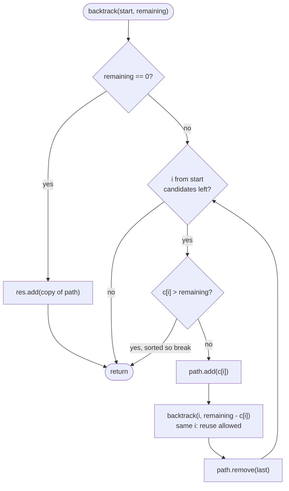

# LC 39 Combination Sum

> [!abstract] In one sentence
> The subsets template with one character changed — recurse with `i` instead of `i + 1` so a candidate may be reused — enumerates every non-decreasing sequence of candidates exactly once, and a `remaining` counter that must hit 0 turns it into a target search with cheap pruning.

**Map:** [[NeetCode 150 MOC]] → [[DSA Dashboard]] · Pattern: [[Backtracking]]

> [!question] Predict before you read
> If you let every level of the recursion pick from *all* candidates, `[2,2,3]` and `[2,3,2]` both show up. What single change to the loop bound guarantees only one of them is ever built, while still allowing `2` to be used twice?

## Problem

Given an array of **distinct** positive integers `candidates` and a `target`, return every unique combination of candidates whose sum is `target`. A candidate may be used any number of times. Two combinations are the same if they contain the same values with the same multiplicities, regardless of order.

Example: `candidates = [2,3,6,7], target = 7` → `[ [2,2,3], [7] ]`.
Example: `candidates = [2,3,5], target = 8` → `[ [2,2,2,2], [2,3,3], [3,5] ]`.
Example: `candidates = [2], target = 1` → `[]`.

Constraints that matter: 1 ≤ candidates.length ≤ 30, 2 ≤ candidates[i] ≤ 40, 1 ≤ target ≤ 40, and the number of valid combinations is guaranteed below 150. Candidates are strictly positive, which is what makes the recursion terminate.

## Clarifying questions

1. Can a candidate be reused? — Yes, unlimited times. (No reuse and duplicate candidates is [[LC 40 Combination Sum II]].)
2. Are candidates distinct and positive? — Yes. Positive guarantees `remaining` strictly decreases; a 0 would loop forever.
3. Do I return combinations or permutations? — Combinations: `[2,2,3]` once, never also `[2,3,2]`.
4. Is the output size bounded? — Fewer than 150 combinations, so building lists is fine; depth is at most `target / min(candidates)` = 20.

## Brute force

Let each level of the recursion pick any candidate, subtracting from the target, until the target is 0 or negative. This builds every *ordered* sequence, so each combination appears once per distinct ordering, and you then have to sort each result and dedupe with a set. The work is exponential in the number of orderings — for `[2,2,2,2]` harmless, for `[2,3,5,...]` a factorial blow-up — and all of the duplicate work is avoidable by forbidding the recursion from going "back" to a smaller candidate.

## The key insight

A combination is a multiset, and a multiset has one canonical form: its elements in non-decreasing order. Generate only canonical forms: at a node that last chose `candidates[i]`, the children may choose `candidates[j]` with `j ≥ i`. That is the [[LC 78 Subsets]] loop with `start = i` instead of `i + 1`. Sorting the candidates first lets the loop `break` as soon as `candidates[i] > remaining`, because every later candidate is even larger. Recognition cue: "all combinations that sum to target, unlimited reuse".

## Optimal approach

1. Sort `candidates` (only needed for the early `break`).
2. `backtrack(start, remaining)`: if `remaining == 0`, record a copy of `path` and return.
3. For `i` from `start`: if `candidates[i] > remaining`, break. Otherwise append it, recurse with `(i, remaining − candidates[i])`, remove it.
4. Call `backtrack(0, target)`.



> [!example]- Excalidraw version — the same diagram as an editable canvas
> ![[LC 39 Combination Sum — Optimal approach.excalidraw]]
> [[LC 39 Combination Sum — Optimal approach.excalidraw|Open in Excalidraw]] — needs the Excalidraw plugin (see [[Plugins to Install]]).

## Walkthrough

`candidates = [2,3,6,7]`, `target = 7`. Node labels show the path and the remaining amount; a node with no children died because every remaining candidate was too big.

> [!example] Combination Sum recursion tree, target 7
> ![[LC 39 Combination Sum — Combination Sum recursion tree, target 7.excalidraw]]
> [[LC 39 Combination Sum — Combination Sum recursion tree, target 7.excalidraw|Open in Excalidraw]] — highlighted nodes have rem 0 and are recorded; {2,3} rem 2 dies because its loop starts at 3 > 2

%% excalidraw-spec
{"kind": "tree", "title": "Combination Sum recursion tree, target 7", "nodes": [{"id": "r", "label": "{ } rem 7", "children": ["a", "f", "h", "i"]}, {"id": "a", "label": "{2} rem 5", "children": ["b", "e"]}, {"id": "b", "label": "{2,2} rem 3", "children": ["c", "d"]}, {"id": "c", "label": "{2,2,2} rem 1", "children": []}, {"id": "d", "label": "{2,2,3} rem 0", "children": []}, {"id": "e", "label": "{2,3} rem 2", "children": []}, {"id": "f", "label": "{3} rem 4", "children": ["g"]}, {"id": "g", "label": "{3,3} rem 1", "children": []}, {"id": "h", "label": "{6} rem 1", "children": []}, {"id": "i", "label": "{7} rem 0", "children": []}], "root": "r", "highlight": ["d", "i"], "caption": "highlighted nodes have rem 0 and are recorded; {2,3} rem 2 dies because its loop starts at 3 > 2"}
%%

Note what the `start` index buys: under `{2,3}` the loop begins at index 1 (value 3), so the recursion never tries to append a 2 after a 3 and `[2,3,2]` is never built. Without the `break`, the dead nodes would each run a loop over the remaining candidates and recurse into negative territory; with it they return immediately.

## Java solution

```java
import java.util.*;

class Solution {
    public List<List<Integer>> combinationSum(int[] candidates, int target) {
        Arrays.sort(candidates);                       // enables break-on-overshoot
        List<List<Integer>> res = new ArrayList<>();
        backtrack(candidates, 0, target, new ArrayList<>(), res);
        return res;
    }

    private void backtrack(int[] c, int start, int remaining, List<Integer> path, List<List<Integer>> res) {
        if (remaining == 0) {
            res.add(new ArrayList<>(path));
            return;
        }
        for (int i = start; i < c.length; i++) {
            if (c[i] > remaining) break;               // sorted: every later candidate is bigger too
            path.add(c[i]);
            backtrack(c, i, remaining - c[i], path, res);   // i, not i + 1: the same value may repeat
            path.remove(path.size() - 1);
        }
    }
}
```

**Time** O(n^(T/m)) worst case, where T = target and m = smallest candidate — the tree has depth ≤ T/m and branching ≤ n; in practice far smaller because of the break · **Space** O(T/m) recursion depth plus the output

## Why it works

Invariant: `path` is non-decreasing and sums to `target − remaining`, and the loop at a node only appends values at index `≥ start`, where `start` is the index of the last appended value. Every multiset summing to `target` has exactly one non-decreasing arrangement, and the tree builds exactly that arrangement for each (it picks the smallest element first, then the next-smallest, and so on). Because every candidate is at least 2, `remaining` drops by at least 2 per level, so the recursion is finite. The `break` is safe only because the array is sorted: if `c[i]` overshoots, so does every `c[j]` with `j > i`.

## Edge cases

- `target < min(candidates)` — the root loop breaks immediately, result `[]`.
- A single candidate equal to `target` — one combination of length 1.
- `target = 40, candidates = [2]` — depth 20, one combination of twenty 2s; the stack is fine.
- Candidates given unsorted — the code sorts; if you skip the sort, replace `break` with `continue` or add `if (remaining < 0) return;`.

## Common mistakes

> [!warning] Pitfalls
> - **Recursing with `i + 1`** — that is the no-reuse problem; `[2,2,3]` is never found.
> - **Looping from 0 at every level** — generates permutations and duplicates; the `start` parameter is the entire dedupe mechanism.
> - **`break` without sorting** — a small candidate after a large one is skipped. Either sort, or use `continue`.
> - **Checking `remaining < 0` only at the top** without the break — correct but explores every overshoot; mention the pruning explicitly in the interview.
> - **Forgetting the copy** when recording — the usual aliasing bug.

## Variants & follow-ups

- Each candidate usable once and duplicates present → sort, `i + 1`, skip equal neighbours at the same level: [[LC 40 Combination Sum II]].
- Count the combinations instead of listing them → unbounded knapsack DP in O(n · target): [[LC 518 Coin Change II]].
- Fewest candidates that reach the target → [[LC 322 Coin Change]], again DP, not backtracking.
- Count *ordered* sequences (LeetCode 377 Combination Sum IV) → 1-D DP over the target where order is deliberately counted.
- Exactly k numbers from 1..9 summing to n (LeetCode 216) → same loop with `i + 1` and a size check.
- What changes if candidates can be 0? Infinite recursion on reuse; you would have to cap the multiplicity or drop zeros up front.

## Interview script

1. Restate: distinct positive candidates, unlimited reuse, list every multiset summing to the target.
2. Brute force: pick any candidate at any level, then sort and dedupe — exponential duplicate work.
3. Insight: generate only non-decreasing sequences by looping from the last chosen index; reuse means `start = i`.
4. Approach: sort, `backtrack(start, remaining)`, record at `remaining == 0`, break when a candidate overshoots.
5. Complexity: bounded by n^(target / min) nodes; depth target / min; output is guaranteed under 150 combinations.
6. Tests: `[2],1` → empty; `[2,3,6,7],7`; a target reachable only by repeating one value.

The interviewer is checking that you can explain *why* `start = i` removes duplicates without a set, that you know the recursion terminates because candidates are positive, and that you can name the DP variants when the question switches from "list" to "count".

## Related

- [[Backtracking]] — the template and the combinations/permutations distinction
- [[LC 78 Subsets]] — the same loop with `i + 1`
- [[LC 40 Combination Sum II]] — no reuse, duplicate candidates
- [[LC 518 Coin Change II]] — counting the same combinations with DP
- [[LC 322 Coin Change]] — the optimisation version
- [[DSA Patterns in Java]] — backtracking template with a target
- [[Java Collections Cheat Sheet]] — `Arrays.sort`, `List.remove(int)`, copying lists

## Attempt log

| Date | Result | Minutes | What I got wrong |
|---|---|---|---|
| | | | |

### Mastery checklist
- [ ] Solved without hints in under 25 minutes
- [ ] Stated complexity before coding
- [ ] Handled every edge case above
- [ ] Code compiled first time
- [ ] Can do the follow-up variant (count combinations with DP)

## Open questions
- [ ]
