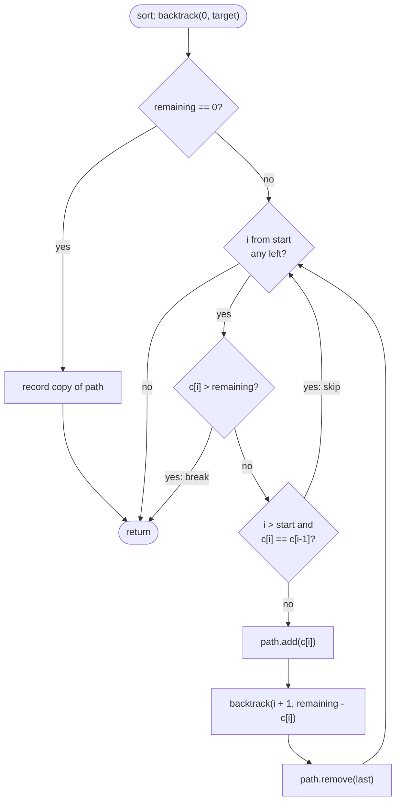

# LC 40 Combination Sum II

> [!abstract] In one sentence
> This is [[LC 39 Combination Sum]] with reuse removed (`i + 1`) and [[LC 90 Subsets II]]'s sibling-skip added, because once each candidate is a single-use item the repeated values in the input are the only source of duplicate answers.

**Map:** [[NeetCode 150 MOC]] → [[DSA Dashboard]] · Pattern: [[Backtracking]]

> [!question] Predict before you read
> `candidates = [1,1,6], target = 7`. The answer is `[ [1,6] ]`, once. Which two calls in the recursion tree would both produce `[1,6]`, and what do they have in common that a one-line check can detect?

## Problem

Given a list of positive integers `candidates` (duplicates allowed) and a `target`, return every unique combination whose sum is `target`. Each position in `candidates` may be used at most once. The result must not contain the same combination twice.

Example: `candidates = [10,1,2,7,6,1,5], target = 8` → `[ [1,1,6], [1,2,5], [1,7], [2,6] ]`.
Example: `candidates = [2,5,2,1,2], target = 5` → `[ [1,2,2], [5] ]`.

Constraints that matter: 1 ≤ candidates.length ≤ 100, 1 ≤ candidates[i] ≤ 50, 1 ≤ target ≤ 30. Candidates are positive, so sorting plus `break` prunes aggressively; the target is tiny, so depth is at most 30.

## Clarifying questions

1. "Used once" means once per *position*, not once per value? — Yes: `[1,1,6]` is valid because there are two 1s in the input.
2. Is `[1,2,5]` the same combination as `[5,2,1]`? — Yes; return one of them.
3. Can I sort the input? — Yes; both the dedupe and the pruning rely on it.
4. How big can the answer get? — Bounded by the number of distinct multisets summing to ≤ 30 from ≤ 100 items; small in practice.

## Brute force

Enumerate every subset of positions with the [[LC 78 Subsets]] loop (2^100 is impossible in principle, but the positive-sum constraint cuts the tree to sums ≤ 30), sort each hit and dedupe through a `HashSet`. It works on the given limits but it re-explores identical subtrees: with twenty 1s in the input, the subtree "choose a 1 then continue" is built twenty times at the root alone. The skip rule enters each distinct subtree once.

## The key insight

Two things go wrong relative to [[LC 78 Subsets]]: reuse must be *forbidden* (so recurse with `i + 1`) and equal values must not be chosen as alternatives at the same depth (so skip `c[i]` when `i > start` and `c[i] == c[i − 1]`). Stacking the same value *down* a path is still legal because the copies sit at different positions — that is exactly `[1,1,6]`. Sorting makes equal values adjacent for the skip and makes `break` on `c[i] > remaining` correct. Recognition cue: "each number used once" plus "candidates may repeat" plus "unique combinations".

## Optimal approach

1. Sort `candidates`.
2. `backtrack(start, remaining)`: if `remaining == 0`, record a copy of `path` and return.
3. For `i` from `start`: if `c[i] > remaining`, break; if `i > start && c[i] == c[i−1]`, continue; else append, recurse with `(i + 1, remaining − c[i])`, remove.
4. Call `backtrack(0, target)`.



> [!example]- Excalidraw version — the same diagram as an editable canvas
> ![[LC 40 Combination Sum II — Optimal approach.excalidraw]]
> [[LC 40 Combination Sum II — Optimal approach.excalidraw|Open in Excalidraw]] — needs the Excalidraw plugin (see [[Plugins to Install]]).

## Walkthrough

`candidates = [2,5,2,1,2]`, `target = 5`. Sorted: `[1,2,2,2,5]`.

| Call (start, rem) | path | i | Decision |
|---|---|---|---|
| (0, 5) | [] | 0 | choose 1 → (1, 4) |
| (1, 4) | [1] | 1 | choose 2 → (2, 2) |
| (2, 2) | [1,2] | 2 | choose 2 → (3, 0) → **record [1,2,2]** |
| (2, 2) | [1,2] | 3 | `3 > 2` and `c[3] == c[2]` → skip |
| (2, 2) | [1,2] | 4 | `5 > 2` → break |
| (1, 4) | [1] | 2, 3 | equal to left neighbour → skip both |
| (1, 4) | [1] | 4 | `5 > 4` → break |
| (0, 5) | [] | 1 | choose 2 → (2, 3) |
| (2, 3) | [2] | 2 | choose 2 → (3, 1): `2 > 1` → break, dead |
| (2, 3) | [2] | 3 | skip (duplicate sibling); 4: `5 > 3` → break |
| (0, 5) | [] | 2, 3 | skip (duplicate siblings of i = 1) |
| (0, 5) | [] | 4 | choose 5 → (5, 0) → **record [5]** |

Result `[ [1,2,2], [5] ]`. The path `[1] → [1,2] → [1,2,2]` stacks the value 2 twice legally (each time `i == start`), while the root's second and third 2s are cut as siblings.

## Java solution

```java
import java.util.*;

class Solution {
    public List<List<Integer>> combinationSum2(int[] candidates, int target) {
        Arrays.sort(candidates);
        List<List<Integer>> res = new ArrayList<>();
        backtrack(candidates, 0, target, new ArrayList<>(), res);
        return res;
    }

    private void backtrack(int[] c, int start, int remaining, List<Integer> path, List<List<Integer>> res) {
        if (remaining == 0) {
            res.add(new ArrayList<>(path));
            return;
        }
        for (int i = start; i < c.length; i++) {
            if (c[i] > remaining) break;                        // sorted: nothing after fits either
            if (i > start && c[i] == c[i - 1]) continue;        // same value already tried at this level
            path.add(c[i]);
            backtrack(c, i + 1, remaining - c[i], path, res);  // i + 1: each position at most once
            path.remove(path.size() - 1);
        }
    }
}
```

**Time** O(2^n) worst case in principle (subsets of positions), heavily pruned by sort + break + skip; O(n log n) for the sort · **Space** O(n) recursion depth, excluding the output

## Why it works

Invariant: `path` is a non-decreasing sequence of values taken from strictly increasing positions, summing to `target − remaining`. Each multiset that sums to `target` has one sorted arrangement, and that arrangement is built exactly once: `i + 1` guarantees increasing positions, the sort makes the built sequence non-decreasing, and the sibling skip ensures that among several positions holding the same value, the *leftmost unused one* is always the one chosen at a given depth — any other choice would generate an identical multiset from a smaller remaining suffix. The `break` is sound because the array is sorted and all values are positive.

## Edge cases

- `target` smaller than the smallest candidate — root loop breaks at once, `[]`.
- All candidates equal, e.g. `[1,1,1,1], target = 2` — exactly one answer `[1,1]`, not six.
- A candidate equal to `target` — a length-1 combination, recorded when its `remaining` hits 0.
- A single-element input — either `[ [x] ]` or `[]`.
- Candidates summing to less than `target` — empty result; the loop simply never reaches 0.

## Common mistakes

> [!warning] Pitfalls
> - **Recursing with `i` instead of `i + 1`** — allows reuse; `[1,1,1,1,1]` from a single 1.
> - **`i > 0` instead of `i > start`** — kills the legal down-the-path repeat, so `[1,1,6]` is lost.
> - **Skipping before breaking, or breaking without sorting** — order the checks: overshoot `break` first (it ends the loop), then the duplicate `continue`.
> - **Deduping with a `HashSet<List<Integer>>` instead** — accepted, but it explores every duplicate subtree and signals you do not know the rule.

## Variants & follow-ups

- Unlimited reuse, distinct candidates → [[LC 39 Combination Sum]] (`i`, no skip).
- No target, just all distinct subsets → [[LC 90 Subsets II]].
- Decide whether *any* subset hits the target with n up to 200 → that is 0/1 knapsack DP, see [[LC 416 Partition Equal Subset Sum]]; enumeration is hopeless there.
- Return the combinations in lexicographic order → already the case because candidates are sorted and the DFS is in index order.
- What changes if candidates may be 0? Zeros add duplicate-looking answers (`[5]` and `[0,5]`) that the problem would count as distinct; the skip handles repeated zeros, and the `break` still holds.

## Interview script

1. Restate: candidates with repeats, each position once, list unique combinations summing to the target.
2. Brute force: all position subsets with a set for dedupe — exponential duplicate subtrees.
3. Insight: sort; `i + 1` forbids reuse; skip equal siblings (`i > start`); break on overshoot.
4. Approach: subsets template with those three lines.
5. Complexity: exponential worst case bounded by 2^n, pruned hard; O(n) depth.
6. Tests: `[1,1,6], 7`; `[2,5,2,1,2], 5`; target below the minimum.

The interviewer is checking that you can separate the two sources of duplicates (reuse vs equal siblings), that you order `break` before `continue`, and that you know when to abandon enumeration for DP.

## Related

- [[Backtracking]] — dedupe-sorted and pruning rules
- [[LC 39 Combination Sum]] — the reuse version
- [[LC 90 Subsets II]] — where the sibling skip comes from
- [[LC 78 Subsets]] — the base loop
- [[LC 416 Partition Equal Subset Sum]] — the knapsack view when only existence matters
- [[DSA Patterns in Java]] — backtracking with a target
- [[Java Collections Cheat Sheet]] — `Arrays.sort`, `List.remove(int)`

## Attempt log

| Date | Result | Minutes | What I got wrong |
|---|---|---|---|
| | | | |

### Mastery checklist
- [ ] Solved without hints in under 25 minutes
- [ ] Stated complexity before coding
- [ ] Handled every edge case above
- [ ] Code compiled first time
- [ ] Can do the follow-up variant (switch to knapsack DP for existence)

## Open questions
- [ ]
