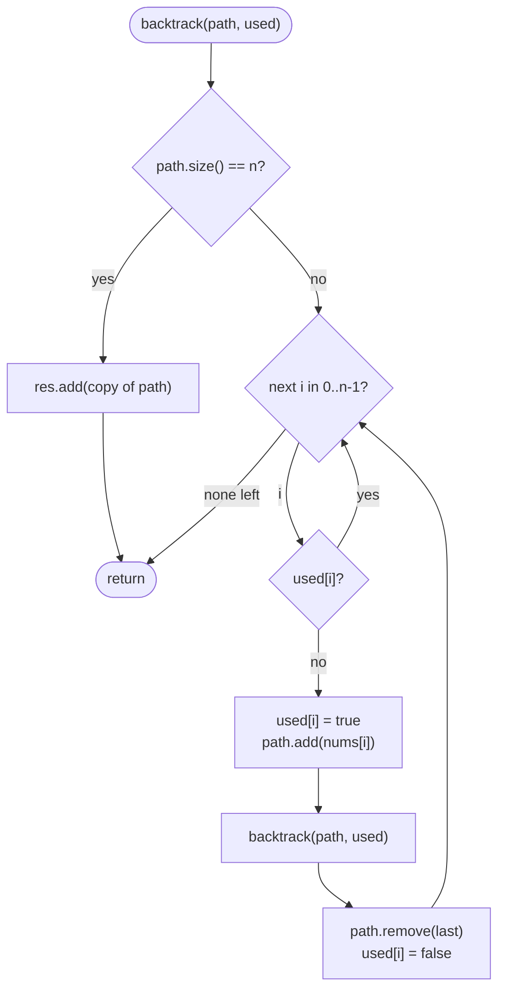

# LC 46 Permutations

> [!abstract] In one sentence
> When order matters the `start` index of the subsets template is wrong — an element skipped earlier may still be needed later — so each level loops over *all* elements and a `used[]` array is the only thing that stops an element from appearing twice.

**Map:** [[NeetCode 150 MOC]] → [[DSA Dashboard]] · Pattern: [[Backtracking]]

> [!question] Predict before you read
> Subsets recursed with `start = i + 1` and never needed a visited array. Why does that fail for permutations, and what is the cheapest replacement that still guarantees no element is used twice in one ordering?

## Problem

Given an array `nums` of **distinct** integers, return all possible orderings (permutations) of its elements, in any order.

Example: `nums = [1,2,3]` → `[ [1,2,3], [1,3,2], [2,1,3], [2,3,1], [3,1,2], [3,2,1] ]`.
Example: `nums = [0,1]` → `[ [0,1], [1,0] ]`.
Example: `nums = [1]` → `[ [1] ]`.

Constraints that matter: 1 ≤ n ≤ 6, so at most 720 permutations; values are distinct, which is what lets a plain `used[]` array dedupe.

## Clarifying questions

1. Are the elements distinct? — Yes. With duplicates you would sort and add a "skip equal neighbour unless the previous copy is in use" rule (LeetCode 47).
2. Must the output be in lexicographic order? — No, any order; if asked for sorted order, iterate elements in sorted order and the DFS produces it naturally.
3. Is n small? — n ≤ 6; n! grows so fast that anything above about 10 is unanswerable by listing.
4. Can I modify the input array? — Usually yes; it enables the in-place swap version below.

## Brute force

Generate every sequence of length n over the n values (n^n of them) and keep those in which every value appears exactly once: O(n · n^n), which at n = 6 is 46 656 sequences to filter down to 720. The waste is building sequences that repeat a value and only noticing at the end. Backtracking refuses to repeat a value at the moment of choosing it, so it builds only the n!/(n−k)! valid prefixes of length k.

## The key insight

Fill the permutation one position at a time. At position `k`, any element not already placed is a legal choice, so the loop runs over all indices and skips those marked in `used[]`. The recursion tree has n children at the root, n − 1 at the next level, and so on; its leaves are exactly the n! permutations and every leaf is an answer. Un-choosing must undo both the append and the `used` flag. Recognition cue: "all orderings / arrangements", "order matters", "each element exactly once".

## Optimal approach

1. `path` is the partial permutation, `used[i]` says whether `nums[i]` is in it.
2. `backtrack()`: if `path.size() == n`, record a copy and return.
3. For every index `i`: if `used[i]` skip; else mark, append, recurse, remove, unmark.
4. Call `backtrack()` once; return `res`.



> [!example]- Excalidraw version — the same diagram as an editable canvas
> ![[LC 46 Permutations — Optimal approach.excalidraw]]
> [[LC 46 Permutations — Optimal approach.excalidraw|Open in Excalidraw]] — needs the Excalidraw plugin (see [[Plugins to Install]]).

## Walkthrough

`nums = [1,2,3]`. The full tree has 1 + 3 + 6 + 6 = 16 nodes; the picture shows the subtree under the first choice, the other two are mirror images.

> [!example] Permutations of [1,2,3]: subtree after choosing 1 first
> ![[LC 46 Permutations — Permutations of -1,2,3-- subtree after choosing 1 first.excalidraw]]
> [[LC 46 Permutations — Permutations of -1,2,3-- subtree after choosing 1 first.excalidraw|Open in Excalidraw]] — used bits are the state; leaves at depth 3 are recorded; subtrees under {2} and {3} are symmetric

%% excalidraw-spec
{"kind": "tree", "title": "Permutations of [1,2,3]: subtree after choosing 1 first", "nodes": [{"id": "r", "label": "{ } used 000", "children": ["a", "b", "c"]}, {"id": "a", "label": "{1} used 100", "children": ["ab", "ac"]}, {"id": "b", "label": "{2} used 010", "children": []}, {"id": "c", "label": "{3} used 001", "children": []}, {"id": "ab", "label": "{1,2} used 110", "children": ["abc"]}, {"id": "ac", "label": "{1,3} used 101", "children": ["acb"]}, {"id": "abc", "label": "{1,2,3} used 111", "children": []}, {"id": "acb", "label": "{1,3,2} used 111", "children": []}], "root": "r", "highlight": ["abc", "acb"], "caption": "used bits are the state; leaves at depth 3 are recorded; subtrees under {2} and {3} are symmetric"}
%%

Trace of the `used` array along the left spine and the first backtrack:

| Step | Action | path | used |
|---|---|---|---|
| 1 | choose i=0 | [1] | T F F |
| 2 | choose i=1 | [1,2] | T T F |
| 3 | choose i=2, size 3 → record | [1,2,3] | T T T |
| 4 | un-choose i=2, loop ends | [1,2] | T T F |
| 5 | un-choose i=1, loop continues at i=2 | [1] | T F F |
| 6 | choose i=2 | [1,3] | T F T |
| 7 | choose i=1, size 3 → record | [1,3,2] | T T T |

## Java solution

```java
import java.util.*;

class Solution {
    public List<List<Integer>> permute(int[] nums) {
        List<List<Integer>> res = new ArrayList<>();
        backtrack(nums, new boolean[nums.length], new ArrayList<>(), res);
        return res;
    }

    private void backtrack(int[] nums, boolean[] used, List<Integer> path, List<List<Integer>> res) {
        if (path.size() == nums.length) {            // every position filled: one permutation
            res.add(new ArrayList<>(path));
            return;
        }
        for (int i = 0; i < nums.length; i++) {      // all indices, not "from start"
            if (used[i]) continue;
            used[i] = true;
            path.add(nums[i]);
            backtrack(nums, used, path, res);
            path.remove(path.size() - 1);            // undo both halves of the choice
            used[i] = false;
        }
    }
}
```

**Time** O(n · n!) — n! leaves, each copied in n steps; the internal nodes add a constant factor · **Space** O(n) for path, `used` and the recursion, excluding the output

The in-place alternative swaps the element for position `k` into place and needs no `used[]`:

```java
// snippet — position k takes each of nums[k..n-1] in turn
void permuteFrom(int[] nums, int k, List<List<Integer>> res) {
    if (k == nums.length) { res.add(toList(nums)); return; }
    for (int j = k; j < nums.length; j++) {
        swap(nums, k, j);
        permuteFrom(nums, k + 1, res);
        swap(nums, k, j);                 // restore before the next j
    }
}
```

It is O(1) extra space per level and slightly faster, but it mutates the input, produces permutations in a non-lexicographic order, and is harder to extend to duplicates. Use `used[]` by default and offer the swap version as the follow-up.

## Why it works

Invariant: `path` contains exactly the elements whose `used` flag is true, and no element twice. The loop considers every unused element for the next position, so every permutation whose prefix is `path` is reachable; the `used` check makes it impossible to reach a sequence with a repeat. Each leaf is reached by exactly one sequence of choices (the choices *are* the permutation), so each permutation is recorded once. Resetting `used[i]` after the recursive call matters as much as removing from `path`: the next iteration of the loop must see element `i` as available again.

## Edge cases

- `n = 1` — the root immediately has size 1, result `[ [x] ]`.
- `n = 2` — two leaves, confirms the un-choose works.
- Negative numbers or zero — never inspected, only indices matter.
- `n = 6` — 720 lists of 6; still trivial.

## Common mistakes

> [!warning] Pitfalls
> - **Using the subsets `start` index** — generates only increasing-index sequences, i.e. subsets, never `[2,1]`.
> - **Forgetting `used[i] = false`** on the way back — later branches see the element as taken and output fewer than n! results.
> - **Removing by value** — `path.remove(nums[i])` on a `List<Integer>` picks `remove(int index)`; use `path.remove(path.size() - 1)`.
> - **Checking `path.contains(nums[i])`** instead of `used[i]` — correct but O(n) per check, turning the inner loop into O(n²) per node.
> - **Recording without copying** — every result aliases the same emptied list.

## Variants & follow-ups

- Duplicates in the input (LeetCode 47) → sort; skip `nums[i]` when `i > 0 && nums[i] == nums[i−1] && !used[i−1]`, which keeps equal values in a fixed relative order.
- Next permutation (LeetCode 31) → O(n) in place, no recursion: find the rightmost ascent, swap with the smallest larger element to its right, reverse the suffix.
- k-th permutation (LeetCode 60) → factorial number system, O(n²), no enumeration.
- Permutations with constraints (no two adjacent equal, queens not attacking) → the same loop with a feasibility check before choosing: [[LC 51 N-Queens]].
- Subsets and combinations → [[LC 78 Subsets]], [[LC 39 Combination Sum]] use `start` instead of `used`.
- What changes if n = 12? 479 million permutations; the only honest answer is that listing them is infeasible and the interviewer wants counting or a specific one.

## Interview script

1. Restate: distinct integers, return every ordering, n! of them, any order.
2. Brute force: all n^n sequences, filter the ones with repeats — n^n vs n! waste.
3. Insight: choose position by position from the unused elements; `used[]` prevents repeats; leaves are the permutations.
4. Approach: `backtrack()` records at full size, loops all indices, skips used, marks/appends/recurses/removes/unmarks.
5. Complexity: O(n · n!) time, O(n) extra space.
6. Tests: `[1]`, `[0,1]`, `[1,2,3]` (count 6, no duplicates).

The interviewer is checking that you know why `start` does not work here, that un-choose restores *both* the list and the flag, and that you can produce the swap version or the duplicate-handling rule on request.

## Related

- [[Backtracking]] — subsets vs permutations: `start` vs `used[]`
- [[LC 78 Subsets]] — the ordered-indices sibling
- [[LC 39 Combination Sum]] — combinations with reuse
- [[LC 51 N-Queens]] — permutations of columns with an attack check
- [[LC 17 Letter Combinations of a Phone Number]] — fixed-depth product rather than orderings
- [[DSA Patterns in Java]] — permutation templates (`used[]` and swap)
- [[Java Collections Cheat Sheet]] — `List.remove(int)`, `new boolean[n]`, copying lists

## Attempt log

| Date | Result | Minutes | What I got wrong |
|---|---|---|---|
| | | | |

### Mastery checklist
- [ ] Solved without hints in under 25 minutes
- [ ] Stated complexity before coding
- [ ] Handled every edge case above
- [ ] Code compiled first time
- [ ] Can do the follow-up variant (permutations with duplicates)

## Open questions
- [ ]
