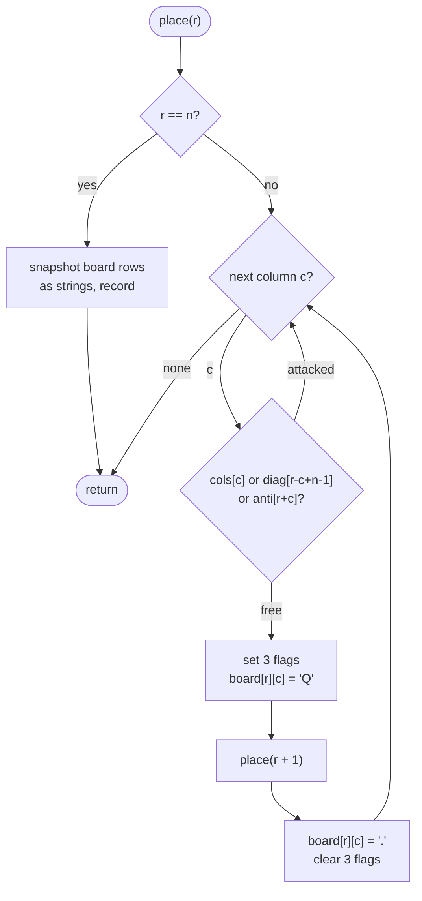

# LC 51 N-Queens

> [!abstract] In one sentence
> Because every row must hold exactly one queen, a solution is a permutation of columns with two extra constraints, and every attack can be detected in O(1) by indexing three boolean arrays with `c`, `r − c + n − 1` and `r + c` — so the search is "for each row, try each column that is free in all three arrays, mark, recurse, unmark".

**Map:** [[NeetCode 150 MOC]] → [[DSA Dashboard]] · Pattern: [[Backtracking]]

> [!question] Predict before you read
> Two queens on cells `(r1, c1)` and `(r2, c2)` share a diagonal exactly when some arithmetic expression of their coordinates is equal. Which two expressions identify the two diagonal directions, and what ranges do they take on an n × n board?

## Problem

Place `n` queens on an `n × n` chessboard so that no two queens attack each other: no two share a row, a column, or a diagonal. Return every distinct board as a list of `n` strings, each string a row with `'Q'` for a queen and `'.'` for an empty cell, in any order.

Example: `n = 4` → two solutions, `[".Q..", "...Q", "Q...", "..Q."]` and `["..Q.", "Q...", "...Q", ".Q.."]`.
Example: `n = 1` → `[ ["Q"] ]`.

Constraints that matter: 1 ≤ n ≤ 9. There are 352 solutions for n = 9 and the search visits a few thousand nodes, so the exponential algorithm is intended; `n = 2` and `n = 3` have no solutions and the answer is an empty list.

## Clarifying questions

1. All solutions or just one / the count? — All boards. (LeetCode 52 asks for the count only: same search, `count++` at the leaf.)
2. Are rotations and reflections considered distinct? — Yes; the two n = 4 solutions are mirror images and both are returned.
3. Output format? — `n` strings of length `n`; build them from a `char[][]` once a full placement is found.
4. What about `n = 2, 3`? — No solutions, return `[]`; the search must simply exhaust and return.

## Brute force

Choose `n` of the `n²` cells (`C(n², n)` ≈ 2.6 × 10^11 for n = 9) and check each configuration — hopeless. Better: one queen per row, so try every column for each row: `n^n` configurations (3.9 × 10^8 for n = 9), each checked in O(n²). Still far too much, and all the waste is in placing a queen in row 5 under a row-1 to row-4 prefix that already contains an attack. Backtracking checks the prefix *as it is built* and never extends a broken one.

## The key insight

Three facts make the search cheap. First, each row gets exactly one queen, so recurse row by row and the row constraint disappears. Second, "no shared column" means the column sequence is a permutation — this is [[LC 46 Permutations]] with `cols[]` as the `used[]` array. Third, the diagonals have constant `r − c` (going down-right) and the anti-diagonals have constant `r + c` (going down-left), so a queen at `(r, c)` attacks every later cell with the same `r − c` or the same `r + c`. Keep a boolean per column, per diagonal and per anti-diagonal; a cell is placeable iff all three are false. Recognition cue: "place items so none conflict" with constraints expressible as "this index is already taken".

## Optimal approach

1. `cols` has `n` flags; `diag` and `anti` have `2n − 1` flags each. `r − c` ranges from `−(n−1)` to `n−1`, so index it as `r − c + n − 1`; `r + c` ranges `0..2n−2` and indexes directly.
2. `place(r)`: if `r == n`, snapshot the board into strings and record it.
3. For `c` in `0..n−1`: skip if `cols[c] || diag[r−c+n−1] || anti[r+c]`; otherwise set all three, write `'Q'`, `place(r + 1)`, write `'.'`, clear all three.
4. Start at `place(0)`; the board starts as all `'.'`.



> [!example]- Excalidraw version — the same diagram as an editable canvas
> ![[LC 51 N-Queens — Optimal approach.excalidraw]]
> [[LC 51 N-Queens — Optimal approach.excalidraw|Open in Excalidraw]] — needs the Excalidraw plugin (see [[Plugins to Install]]).

## Walkthrough

`n = 4`. The first full solution the search finds, with row/column indices around it:

> [!example] First N-Queens solution for n = 4
> ![[LC 51 N-Queens — First N-Queens solution for n = 4.excalidraw]]
> [[LC 51 N-Queens — First N-Queens solution for n = 4.excalidraw|Open in Excalidraw]] — queens at columns 1,3,0,2: the r-c values -1,-2,2,1 are all distinct and so are the r+c values 1,4,2,5, which is exactly what the three flag arrays enforce

%% excalidraw-spec
{"kind": "grid", "title": "First N-Queens solution for n = 4", "col_labels": ["c0", "c1", "c2", "c3"], "row_labels": ["r0", "r1", "r2", "r3"], "rows": [ [".", "Q", ".", "."], [".", ".", ".", "Q"], ["Q", ".", ".", "."], [".", ".", "Q", "."] ], "highlight": [ [0, 1], [1, 3], [2, 0], [3, 2] ], "caption": "queens at columns 1,3,0,2: the r-c values -1,-2,2,1 are all distinct and so are the r+c values 1,4,2,5, which is exactly what the three flag arrays enforce"}
%%

The search before it gets there, row by row. `d = r − c + 3`, `a = r + c`:

| Call | Try (r, c) | cols / diag / anti check | Outcome |
|---|---|---|---|
| place(0) | (0,0) | all free | place Q, d=3, a=0 |
| place(1) | (1,0) col 0 taken; (1,1) d=3 taken; (1,2) | free | place Q, d=2, a=3 |
| place(2) | (2,0) col; (2,1) a=3 taken; (2,2) col; (2,3) d=2 taken | none free | return (dead) |
| place(1) | un-place (1,2); (1,3) | free | place Q, d=1, a=4 |
| place(2) | (2,0) col; (2,1) | free | place Q, d=4, a=3 |
| place(3) | (3,0) col; (3,1) col; (3,2) d=4 taken; (3,3) col | none free | return (dead) |
| place(2) | un-place; (2,2) d=3 taken; (2,3) col | none | return |
| place(0) | un-place (0,0); (0,1) | free | place Q, d=2, a=1 |
| place(1) | (1,0) a=1 taken; (1,1) col; (1,2) d=2 taken; (1,3) | free | place Q, d=1, a=4 |
| place(2) | (2,0) | free (d=5, a=2) | place Q |
| place(3) | (3,0) col; (3,1) col; (3,2) | free (d=4, a=5) | place Q → r = 4, **record** |

The second solution is found by continuing from `(0,2)`; every dead end above dies within one row of the bad placement because attacks are checked at placement time.

## Java solution

```java
import java.util.*;

class Solution {
    private int n;
    private boolean[] cols, diag, anti;          // column c, diagonal r - c, anti-diagonal r + c
    private char[][] board;
    private final List<List<String>> res = new ArrayList<>();

    public List<List<String>> solveNQueens(int n) {
        this.n = n;
        cols = new boolean[n];
        diag = new boolean[2 * n - 1];
        anti = new boolean[2 * n - 1];
        board = new char[n][n];
        for (char[] row : board) Arrays.fill(row, '.');
        place(0);
        return res;
    }

    private void place(int r) {
        if (r == n) {                             // one queen in every row, none attacking
            List<String> snapshot = new ArrayList<>();
            for (char[] row : board) snapshot.add(new String(row));
            res.add(snapshot);
            return;
        }
        for (int c = 0; c < n; c++) {
            int d = r - c + n - 1, a = r + c;     // shift r - c from -(n-1)..n-1 into 0..2n-2
            if (cols[c] || diag[d] || anti[a]) continue;
            cols[c] = diag[d] = anti[a] = true;   // choose
            board[r][c] = 'Q';
            place(r + 1);                         // explore
            board[r][c] = '.';                    // un-choose, in reverse order
            cols[c] = diag[d] = anti[a] = false;
        }
    }
}
```

**Time** O(n!) nodes in the search tree (row r has at most n − r free columns), each with O(1) checks; O(n²) per recorded solution · **Space** O(n²) for the board plus O(n) recursion and flags

The bit-twiddling version keeps the three flag sets in three `int`s and iterates only over free columns:

```java
// snippet — cols, d1, d2 are bitmasks; d1/d2 are shifted per row so bit c means "attacked in this row"
void place(int r, int cols, int d1, int d2) {
    if (r == n) { count++; return; }
    int free = ~(cols | d1 | d2) & ((1 << n) - 1);
    while (free != 0) {
        int bit = free & -free;                              // lowest free column
        free -= bit;
        place(r + 1, cols | bit, (d1 | bit) << 1, (d2 | bit) >> 1);
    }
}
```

It is the fastest known simple solver (the shifts move the diagonal attacks one column per row) and needs no un-choose because the masks are passed by value. It only counts; to list boards you still need the column per row, which the array version keeps on the board itself.

## Why it works

Invariant at `place(r)`: rows `0..r−1` hold exactly one queen each, no two of those queens attack each other, and `cols`, `diag`, `anti` are true for exactly the columns, `r − c` values and `r + c` values of those queens. Placing at `(r, c)` with all three flags false therefore cannot attack any earlier queen: different column, different `r − c` so not on a shared down-right diagonal, different `r + c` so not on a shared down-left diagonal, and the row is new by construction. Setting the flags and writing the board re-establishes the invariant for `place(r + 1)`; clearing them in reverse restores it for the next column. Completeness: every solution is a sequence of (row, column) placements in row order, and the loop tries every column of every row that is consistent with the prefix, so every solution is reached, and each is reached by exactly one path.

## Edge cases

- `n = 1` — `place(0)` places at `(0,0)`, `place(1)` records `["Q"]`.
- `n = 2`, `n = 3` — every branch dies, result `[]`; the code needs no special case.
- `n = 9` — 352 solutions; arrays of size 17 cover every `r − c + 8` and `r + c`; without the shift, `diag[r − c]` throws for `c > r`.
- Board reuse across solutions — the snapshot copies each row (`new String(row)`), so later mutations do not change recorded answers.

## Common mistakes

> [!warning] Pitfalls
> - **Using `r − c` as an index without the offset** — negative array index for any cell above the main diagonal.
> - **Sizing `diag`/`anti` as `n`** — the ranges have `2n − 1` values; `ArrayIndexOutOfBoundsException` for `r + c ≥ n`.
> - **Checking attacks by scanning earlier rows** — O(n) per check; correct, but the flag arrays are the point of the problem.
> - **Forgetting to clear a flag or the board cell** on the way back — subsequent branches see phantom queens and the count comes out low.
> - **Snapshotting the board *after* the recursion finishes** — it is empty by then; copy the rows at the moment `r == n`.

## Variants & follow-ups

- Count only (LeetCode 52) → drop the board, `count++` at the leaf; the bitmask snippet is the fastest form.
- One solution only → return `true` from `place` as soon as a leaf is reached and stop unwinding.
- Sudoku solver (LeetCode 37) → the same mark / recurse / unmark with three constraint sets (row, column, box) over 81 cells; [[LC 36 Valid Sudoku]] is the validation half.
- Queens may already be placed, or some cells are blocked → pre-set the flags from the givens and skip blocked cells in the loop.
- What changes if n = 20? ~ 3.9 × 10^10 solutions, so listing is impossible; counting takes minutes even with bitmasks — the honest answer is that this is a research-grade search, not an interview one.

## Interview script

1. Restate: n queens, no shared row/column/diagonal, return every board as strings.
2. Brute force: n^n column choices with O(n²) checks; too slow because broken prefixes are extended.
3. Insight: one queen per row; columns form a permutation; diagonals are `r − c` and `r + c`; three boolean arrays give O(1) attack checks.
4. Approach: `place(r)` loops columns, skips attacked ones, marks three flags and the board, recurses, unmarks.
5. Complexity: O(n!) nodes, O(n²) per solution, O(n²) space.
6. Tests: n = 1, n = 2 and 3 (empty), n = 4 (two mirror boards), index ranges for the diagonal arrays.

The interviewer is checking that you derive the diagonal identities rather than scanning, that you size and offset the arrays correctly, and that you undo every mutation in reverse order.

## Related

- [[Backtracking]] — constraint-satisfaction search, pruning at placement time
- [[LC 46 Permutations]] — the column sequence is a permutation
- [[LC 36 Valid Sudoku]] — the same "index the constraint" trick for rows, columns and boxes
- [[LC 79 Word Search]] — in-place marking and restoring on a grid
- [[Bit Manipulation]] — the three-mask version, lowest set bit
- [[DSA Patterns in Java]] — backtracking template with feasibility checks
- [[Java Collections Cheat Sheet]] — `Arrays.fill`, `new String(char[])`, 2-D char arrays

## Attempt log

| Date | Result | Minutes | What I got wrong |
|---|---|---|---|
| | | | |

### Mastery checklist
- [ ] Solved without hints in under 25 minutes
- [ ] Stated complexity before coding
- [ ] Handled every edge case above
- [ ] Code compiled first time
- [ ] Can do the follow-up variant (count with bitmasks, Sudoku solver)

## Open questions
- [ ]
