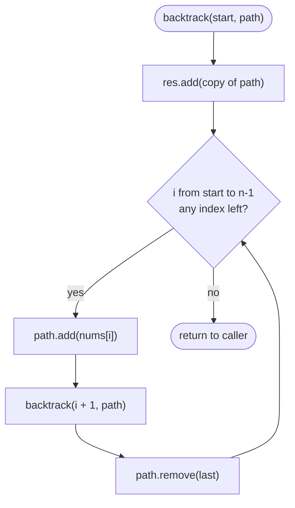

# LC 78 Subsets

> [!abstract] In one sentence
> Every subset is a strictly increasing sequence of indices, so a loop `for i from start` that recurses with `i + 1` visits each subset exactly once; recording the path at every node of that recursion tree (not only at the leaves) produces the whole power set.

**Map:** [[NeetCode 150 MOC]] → [[DSA Dashboard]] · Pattern: [[Backtracking]]

> [!question] Predict before you read
> For `[1,2,3]` there are 8 subsets. If the recursion records a subset at *every* call rather than only when it reaches the end of the array, how many calls happen in total, and why does that number not blow past 8?

## Problem

You are given an array of **distinct** integers `nums`. Return every possible subset (the power set), in any order, without duplicate subsets.

Example: `nums = [1,2,3]` → `[ [], [1], [2], [1,2], [3], [1,3], [2,3], [1,2,3] ]`.
Example: `nums = [0]` → `[ [], [0] ]`.

Constraints that matter: 1 ≤ n ≤ 10 and values are distinct. The output has 2^n entries, so any correct algorithm is Ω(2^n); at n = 10 that is 1024 subsets, which is nothing.

## Clarifying questions

1. Are the elements distinct? — Yes. With duplicates the same loop produces repeated subsets; that is [[LC 90 Subsets II]].
2. Does order inside a subset or between subsets matter? — No. `[1,2]` and `[2,1]` are the same subset; return each once.
3. Is the empty set included? — Yes, always; so is the full array.
4. Is n small enough that the exponential output is fine? — n ≤ 10, so 2^n ≤ 1024.

## Brute force

Count from `mask = 0` to `2^n − 1` and include `nums[j]` when bit `j` of `mask` is set. That is O(n · 2^n), the same as the optimal solution, and it is a perfectly good interview answer. The reason the problem is in the backtracking list is that the bitmask does not generalise: the moment a constraint appears (subsets of size k, sum equal to a target, no duplicates, letters mapping to digits) the bitmask enumerates everything and filters, while the recursion tree can stop early. Learn the tree here, on the problem where nothing can go wrong.

## The key insight

Picture a tree whose root is the empty subset. From any node holding indices ending at `last`, the children append one index `i > last`. Every subset corresponds to exactly one path from the root (its indices in increasing order), so the tree has exactly 2^n nodes and **every node is an answer**. The code is the general template: *choose* (append), *explore* (recurse with `start = i + 1`), *un-choose* (remove the last element). Recognition cue: "all subsets / combinations / power set" with small n.

## Optimal approach

1. `res` collects answers, `path` is the current subset being built.
2. `backtrack(start)`: add a **copy** of `path` to `res`.
3. For `i` from `start` to `n − 1`: append `nums[i]`, call `backtrack(i + 1)`, remove the last element.
4. Start with `backtrack(0)`; return `res`.



> [!example]- Excalidraw version — the same diagram as an editable canvas
> ![[LC 78 Subsets — Optimal approach.excalidraw]]
> [[LC 78 Subsets — Optimal approach.excalidraw|Open in Excalidraw]] — needs the Excalidraw plugin (see [[Plugins to Install]]).

## Walkthrough

`nums = [1,2,3]`. Each node is one call; the label is the subset recorded on entry. Children of a node append a larger index only, which is why the tree leans to the left.

> [!example] Recursion tree for subsets of [1,2,3]
> ![[LC 78 Subsets — Recursion tree for subsets of -1,2,3-.excalidraw]]
> [[LC 78 Subsets — Recursion tree for subsets of -1,2,3-.excalidraw|Open in Excalidraw]] — 8 nodes = 8 subsets; {1,2,3} is the deepest, recorded on the 4th call down the left spine

%% excalidraw-spec
{"kind": "tree", "title": "Recursion tree for subsets of [1,2,3]", "nodes": [{"id": "r", "label": "{ }", "children": ["a", "b", "c"]}, {"id": "a", "label": "{1}", "children": ["ab", "ac"]}, {"id": "b", "label": "{2}", "children": ["bc"]}, {"id": "c", "label": "{3}", "children": []}, {"id": "ab", "label": "{1,2}", "children": ["abc"]}, {"id": "ac", "label": "{1,3}", "children": []}, {"id": "bc", "label": "{2,3}", "children": []}, {"id": "abc", "label": "{1,2,3}", "children": []}], "root": "r", "highlight": ["abc"], "caption": "8 nodes = 8 subsets; {1,2,3} is the deepest, recorded on the 4th call down the left spine"}
%%

Order of recording: `{}`, `{1}`, `{1,2}`, `{1,2,3}`, `{1,3}`, `{2}`, `{2,3}`, `{3}` — depth-first, so the output is not sorted by size and the problem does not require it to be.

## Java solution

```java
import java.util.*;

class Solution {
    public List<List<Integer>> subsets(int[] nums) {
        List<List<Integer>> res = new ArrayList<>();
        backtrack(nums, 0, new ArrayList<>(), res);
        return res;
    }

    private void backtrack(int[] nums, int start, List<Integer> path, List<List<Integer>> res) {
        res.add(new ArrayList<>(path));            // every node of the tree is a subset: copy it
        for (int i = start; i < nums.length; i++) {
            path.add(nums[i]);                     // choose
            backtrack(nums, i + 1, path, res);     // explore: only indices after i
            path.remove(path.size() - 1);          // un-choose (remove by index, not by value)
        }
    }
}
```

**Time** O(n · 2^n) — 2^n subsets, each copied in up to n steps · **Space** O(n) for the path and recursion, excluding the output

The iterative bitmask version, for when the interviewer asks for "no recursion":

```java
// snippet — bit j of mask decides whether nums[j] is in the subset
for (int mask = 0; mask < (1 << n); mask++) {
    List<Integer> sub = new ArrayList<>();
    for (int j = 0; j < n; j++)
        if ((mask >> j & 1) == 1) sub.add(nums[j]);
    res.add(sub);
}
```

Both are O(n · 2^n). The bitmask has no recursion and produces subsets in a predictable order (mask order); the recursion can prune under constraints and is the shape you reuse in the next eight problems.

## Why it works

Invariant at every call: `path` holds elements whose indices are strictly increasing and all smaller than `start`. The loop extends `path` by every index `i ≥ start`, then recurses with `start = i + 1`, so the invariant is preserved. A subset is identified by its sorted index list; the tree generates each increasing index list exactly once (at each step the next index is chosen from the indices not yet passed), so there are no duplicates and nothing is skipped. Removing the last element after the recursive call restores `path` to exactly what the caller had, which is what makes the loop's next iteration start from a clean state.

## Edge cases

- `n = 1` — tree is root plus one child: `[ [], [x] ]`.
- Negative or zero values — irrelevant; the algorithm never looks at values, only indices.
- The empty subset must appear — it is recorded at the root before the loop runs.
- Output order — any order is accepted; do not sort unless asked.

## Common mistakes

> [!warning] Pitfalls
> - **Adding `path` itself instead of a copy.** Every entry of `res` then aliases the same list, which is empty once the recursion unwinds. Always `new ArrayList<>(path)`.
> - **`path.remove(nums[i])`** — on a `List<Integer>`, an `int` argument selects `remove(int index)` and deletes by position, not by value. Use `path.remove(path.size() - 1)`.
> - **Recursing with `start + 1` instead of `i + 1`** — produces `{1,3}` twice and `{2,3}` from two different parents. The next index must be relative to the chosen `i`.
> - **Recording only at the leaves** — a leaf here means "loop found no more indices", which happens for every node anyway; but if you add a `if (start == n) { record; return; }` guard you miss every non-maximal subset.

## Variants & follow-ups

- Duplicates in the input → sort and skip equal neighbours at the same depth: [[LC 90 Subsets II]].
- Subsets whose sum is a target with reuse → [[LC 39 Combination Sum]]; without reuse → [[LC 40 Combination Sum II]].
- Order matters (sequences, not sets) → `used[]` array instead of `start`: [[LC 46 Permutations]].
- Subsets of exactly size k (LeetCode 77 Combinations) → record only when `path.size() == k` and stop the loop when too few elements remain.
- Count subsets with a given sum instead of listing them → that is 0/1 knapsack, see [[LC 416 Partition Equal Subset Sum]] and [[LC 494 Target Sum]]; listing is exponential, counting is polynomial.
- What changes if n = 30? The output is a billion lists; the only sensible answers are "count them" or "stream them", and you should say so.

## Interview script

1. Restate: distinct integers, return every subset, 2^n of them, any order.
2. Brute force: bitmask from 0 to 2^n − 1, O(n · 2^n); mention it, then say the recursion is what generalises.
3. Insight: subsets are increasing index sequences; a tree where each node adds a later index has exactly one node per subset.
4. Approach: `backtrack(start)` records the path, loops `i` from `start`, choose / recurse with `i + 1` / un-choose.
5. Complexity: O(n · 2^n) time, O(n) extra space.
6. Tests: `[0]`, three elements (check the eight outputs, including the empty set), confirm no duplicates.

The interviewer is checking that you copy the path, that you know why `i + 1` rather than `start + 1`, and that you can switch to the bitmask or to the sized/summed variants on request.

## Related

- [[Backtracking]] — the choose / explore / un-choose template this problem introduces
- [[Recursion]] — recursion trees and the call stack
- [[LC 90 Subsets II]] — the same tree with duplicate skipping
- [[LC 39 Combination Sum]] — the same loop with reuse and a target
- [[LC 46 Permutations]] — order matters, so `used[]` replaces `start`
- [[LC 17 Letter Combinations of a Phone Number]] — fixed depth, one choice per level
- [[Bit Manipulation]] — the bitmask enumeration
- [[DSA Patterns in Java]] — backtracking templates (subsets / permutations / combinations)
- [[Java Collections Cheat Sheet]] — `List.remove(int)` vs `remove(Object)`, copying with `new ArrayList<>(list)`

## Attempt log

| Date | Result | Minutes | What I got wrong |
|---|---|---|---|
| | | | |

### Mastery checklist
- [ ] Solved without hints in under 25 minutes
- [ ] Stated complexity before coding
- [ ] Handled every edge case above
- [ ] Code compiled first time
- [ ] Can do the follow-up variant (subsets of size k, bitmask version)

## Open questions
- [ ]
