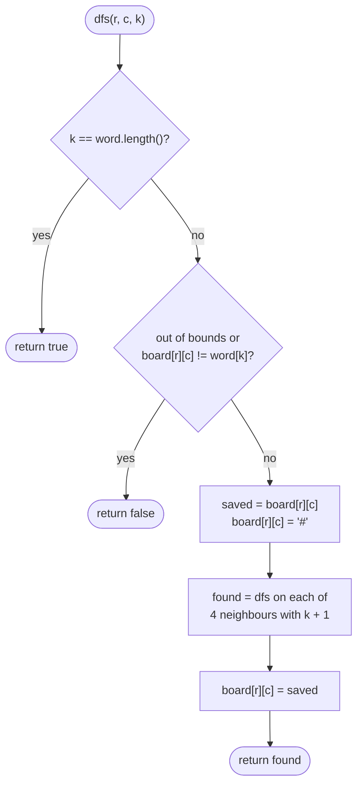

# LC 79 Word Search

> [!abstract] In one sentence
> A path through the grid is a sequence of choices (which neighbour next), so the choose / explore / un-choose template applies with the twist that the "used" set is the board: overwrite the cell with a sentinel while it is on the current path and write the letter back when you backtrack.

**Map:** [[NeetCode 150 MOC]] → [[DSA Dashboard]] · Pattern: [[Backtracking]]

> [!question] Predict before you read
> Why can a cell visited by a *failed* branch be used again by a later branch, when in [[LC 200 Number of Islands]] a visited cell is never looked at again? What is different about the question being asked?

## Problem

You are given an `m × n` grid of characters `board` and a string `word`. Return `true` if `word` can be formed from letters of sequentially adjacent cells — horizontal or vertical neighbours — where the same cell is not used more than once.

Example: `board = [ [A,B,C,E], [S,F,C,S], [A,D,E,E] ]`, `word = "ABCCED"` → `true`.
Same board, `word = "SEE"` → `true`; `word = "ABCB"` → `false` (the B would have to be reused).

Constraints that matter: 1 ≤ m, n ≤ 6, 1 ≤ word.length ≤ 15, letters only. The grid is tiny and the exponential DFS is the intended solution; a follow-up asks for pruning when the word is long.

## Clarifying questions

1. Adjacent means 4-directional, not diagonal? — Yes, up/down/left/right.
2. Can a cell be reused within one path? — No. That is the whole reason for marking.
3. Case sensitivity? — Letters compare exactly; both board and word are plain letters.
4. May I modify the board during the search? — Usually yes, provided it is restored; if not, use a separate `boolean[][] seen`.

## Brute force

From every cell, enumerate every simple path of length `L = word.length()` and compare it with the word: there are up to `m · n · 4 · 3^(L−1)` paths, ~ 36 · 4 · 3^14 ≈ 700 million for the maximum sizes, and each comparison costs up to L. The waste is obvious: a path whose second letter is already wrong is extended to full length anyway. Comparing one character per step and abandoning the branch at the first mismatch cuts almost all of that.

## The key insight

Match the word character by character as you walk. The state of a DFS call is `(r, c, k)`: "I am standing on cell `(r, c)` which must equal `word[k]`, and `word[0..k−1]` has been matched along the current path." If the cell is out of bounds, already on the path, or has the wrong letter, the branch dies immediately. Mark the cell with a sentinel such as `'#'` before exploring its neighbours and restore the letter afterwards — a failed branch must leave the board exactly as it found it, because another branch may need that cell. Recognition cue: "path in a grid", "each cell at most once", "does a sequence exist".

## Optimal approach

1. For every cell `(r, c)`, call `dfs(r, c, 0)`; return `true` on the first success.
2. `dfs(r, c, k)`: if `k == word.length()` return `true`.
3. If `(r, c)` is out of bounds or `board[r][c] != word[k]` return `false` (a `'#'` cell never matches a letter).
4. Save the letter, write `'#'`, try the four neighbours with `k + 1`, restore the letter, return whether any neighbour succeeded.



> [!example]- Excalidraw version — the same diagram as an editable canvas
> ![[LC 79 Word Search — Optimal approach.excalidraw]]
> [[LC 79 Word Search — Optimal approach.excalidraw|Open in Excalidraw]] — needs the Excalidraw plugin (see [[Plugins to Install]]).

## Walkthrough

`word = "ABCCED"` on the example board. The DFS starting at `(0,0)` matches A, moves right to B and C, then down to the second C, down to E, and left to D. Highlighted cells are the ones on the final path; the arrows are the order they were matched.

> [!example] Word Search path for ABCCED
> ![[LC 79 Word Search — Word Search path for ABCCED.excalidraw]]
> [[LC 79 Word Search — Word Search path for ABCCED.excalidraw|Open in Excalidraw]] — while the DFS sits on E at (2,2), every highlighted cell before it reads '#'; after (2,1) matches D the call for k = 6 returns true

%% excalidraw-spec
{"kind": "grid", "title": "Word Search path for ABCCED", "col_labels": ["c0", "c1", "c2", "c3"], "row_labels": ["r0", "r1", "r2"], "rows": [ ["A", "B", "C", "E"], ["S", "F", "C", "S"], ["A", "D", "E", "E"] ], "highlight": [ [0, 0], [0, 1], [0, 2], [1, 2], [2, 2], [2, 1] ], "arrows": [ [ [0, 0], [0, 1] ], [ [0, 1], [0, 2] ], [ [0, 2], [1, 2] ], [ [1, 2], [2, 2] ], [ [2, 2], [2, 1] ] ], "caption": "while the DFS sits on E at (2,2), every highlighted cell before it reads '#'; after (2,1) matches D the call for k = 6 returns true"}
%%

What happens on a dead branch: from C at `(0,2)` the DFS first tries up (out of bounds), down `(1,2)` = C which matches, and from there tries `(0,2)` — it reads `'#'`, not `'C'`, so the path cannot double back. When the branch through `(1,2)` eventually returns, `(1,2)` is restored to `'C'` before `(0,2)` tries its remaining directions.

## Java solution

```java
import java.util.*;

class Solution {
    private static final int[][] DIRS = {{1, 0}, {-1, 0}, {0, 1}, {0, -1}};

    public boolean exist(char[][] board, String word) {
        for (int r = 0; r < board.length; r++)
            for (int c = 0; c < board[0].length; c++)
                if (dfs(board, word, r, c, 0)) return true;
        return false;
    }

    private boolean dfs(char[][] b, String w, int r, int c, int k) {
        if (k == w.length()) return true;                       // every character matched
        if (r < 0 || c < 0 || r >= b.length || c >= b[0].length || b[r][c] != w.charAt(k)) return false;
        char saved = b[r][c];
        b[r][c] = '#';                                          // on the current path: never a letter
        boolean found = false;
        for (int[] d : DIRS) {
            if (dfs(b, w, r + d[0], c + d[1], k + 1)) { found = true; break; }
        }
        b[r][c] = saved;                                        // restore for sibling branches
        return found;
    }
}
```

**Time** O(m · n · 3^L) — each start explores at most 3 new directions per step after the first · **Space** O(L) recursion depth; the board is reused as the visited set

Two pruning tricks that turn a borderline test into an easy one, worth saying out loud:

```java
// snippet — reject early when the board cannot contain the word's letters
int[] cnt = new int[128];
for (char[] row : board) for (char ch : row) cnt[ch]++;
for (char ch : word.toCharArray()) if (--cnt[ch] < 0) return false;
// and search the rarer end first: if word[0] is more common than word[L-1], reverse the word
```

Counting letters costs O(m · n + L) and kills most impossible words before any DFS. Reversing the word when its last letter is rarer than its first reduces the number of starting cells, which is where the 3^L factor is multiplied.

## Why it works

Invariant: when `dfs(r, c, k)` runs, the cells currently holding `'#'` are exactly the cells of a path spelling `word[0..k−1]` that ends adjacent to `(r, c)`. Because a `'#'` never equals a letter of the word, the DFS can never step onto a cell already on its own path, which enforces "each cell once" without a separate structure. Restoring the letter on return re-establishes the invariant for the caller's next direction. Completeness: every valid path is a sequence of legal moves, and the DFS tries every legal move from every cell, so if a path exists the first start cell on it will find it.

## Edge cases

- Word longer than `m · n` — cannot fit; the DFS fails naturally but the letter-count prune returns instantly.
- Single-cell board and single-letter word — `dfs(0,0,0)` matches, then `k == 1` returns `true`.
- Word that needs to reuse a cell (`"ABCB"`) — the second B is `'#'` at that moment, so `false`.
- Multiple occurrences of `word[0]` — every one is tried; an early `return true` stops the scan.
- Board with no occurrence of `word[0]` — every start fails at `k = 0` in O(1).

## Common mistakes

> [!warning] Pitfalls
> - **Not restoring the cell** on the way back — later branches see a `'#'` and miss valid paths.
> - **Checking bounds after reading `b[r][c]`** — `ArrayIndexOutOfBoundsException`; the bounds check must come first in the condition.
> - **Marking visited in a `boolean[][]` but never clearing it** — same as not restoring; it behaves like Number of Islands and rejects paths that share a cell with a failed branch.
> - **Returning after the first direction fails** instead of trying all four — the loop must continue until one succeeds.
> - **Comparing `String` characters with `==` on boxed values** — use `charAt` against a `char`, as above.

## Variants & follow-ups

- Many words on one board → build a trie of the words and DFS once, pruning by trie branches: [[LC 212 Word Search II]].
- 8-directional adjacency → six more entries in `DIRS`, nothing else changes.
- Count the number of paths spelling the word → return an `int` and sum over directions instead of short-circuiting.
- Return the path itself → carry a `List<int[]>` of coordinates and copy it on success.
- Flood-fill style problems where visited is permanent → [[LC 200 Number of Islands]], [[LC 130 Surrounded Regions]] — the contrast is the lesson: permanent marking answers "is this cell reachable", temporary marking answers "does this *path* exist".
- What changes if the board is 1000 × 1000 with a 15-letter word? The DFS is still correct, but the letter-count and rare-end pruning become essential and you would mention memoising nothing (there is no overlapping subproblem because the path matters).

## Interview script

1. Restate: trace the word through 4-adjacent cells, no cell twice, return whether it is possible.
2. Brute force: enumerate all length-L paths from every cell — ~ 3^L per start, with full comparisons at the end.
3. Insight: match one character per step so wrong branches die immediately; mark the cell in place while on the path and restore after.
4. Approach: outer loop over start cells; `dfs(r, c, k)` with bounds/letter check, mark, four neighbours, restore.
5. Complexity: O(m · n · 3^L) time, O(L) stack.
6. Tests: `"ABCB"` (reuse rejected), single cell, word absent, letter-count prune.

The interviewer is checking that you understand why the mark must be undone, that the bounds check precedes the array read, and that you can name the trie extension for many words.

## Related

- [[Backtracking]] — choose / explore / un-choose on a grid
- [[Graphs]] — grid DFS and the direction array
- [[LC 212 Word Search II]] — the trie-driven multi-word version
- [[LC 200 Number of Islands]] — permanent marking by contrast
- [[LC 130 Surrounded Regions]] — grid DFS from the border
- [[DSA Patterns in Java]] — DFS on a grid, directions array
- [[Java Collections Cheat Sheet]] — `String.charAt`, `toCharArray`, `char` comparisons

## Attempt log

| Date | Result | Minutes | What I got wrong |
|---|---|---|---|
| | | | |

### Mastery checklist
- [ ] Solved without hints in under 25 minutes
- [ ] Stated complexity before coding
- [ ] Handled every edge case above
- [ ] Code compiled first time
- [ ] Can do the follow-up variant (letter-count pruning, trie for many words)

## Open questions
- [ ]
