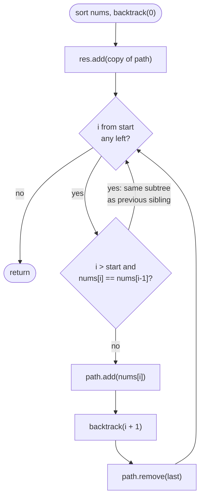

# LC 90 Subsets II

> [!abstract] In one sentence
> Duplicate subsets come from choosing two equal values as alternatives *at the same depth*; sorting puts equal values next to each other and the rule "skip `nums[i]` when `i > start` and `nums[i] == nums[i-1]`" removes the second alternative while still allowing the same value to be stacked down a path.

**Map:** [[NeetCode 150 MOC]] → [[DSA Dashboard]] · Pattern: [[Backtracking]]

> [!question] Predict before you read
> For sorted `[1,2,2]` the plain subsets loop produces `{2}` twice and `{1,2}` twice. Where exactly in the tree do the duplicates come from — the same value chosen twice *along a path*, or twice *as siblings*? Only one of those must be forbidden.

## Problem

Given an integer array `nums` that may contain duplicates, return every possible subset without duplicate subsets, in any order.

Example: `nums = [1,2,2]` → `[ [], [1], [1,2], [1,2,2], [2], [2,2] ]`.
Example: `nums = [0]` → `[ [], [0] ]`.

Constraints that matter: 1 ≤ n ≤ 10, values in −10..10. Output still has at most 2^n entries, fewer when values repeat.

## Clarifying questions

1. Is `[2,2]` a valid subset even though the two 2s are "the same"? — Yes: the two positions are distinct elements; what is forbidden is listing `[2]` twice.
2. Can I sort the input? — Yes; sorting is the enabling step, and the problem does not require any particular output order.
3. Can I use a set of lists to dedupe instead? — It works (sort each subset, insert into a `HashSet<List<Integer>>`) but costs extra hashing and reveals you do not know the skip rule.
4. Is n small? — n ≤ 10, the same output bound as [[LC 78 Subsets]].

## Brute force

Run the [[LC 78 Subsets]] enumeration (or the bitmask) and push every subset, sorted, into a `HashSet<List<Integer>>`. O(n · 2^n) time plus the hashing and the memory for the set, and it still *generates* the duplicate subtrees in full before throwing them away; for `[2,2,2,2,2]` the tree has 32 nodes for 6 distinct answers. The skip rule prunes those subtrees before they are entered.

## The key insight

Look at a node of the subsets tree whose loop is at index `i`. Choosing `nums[i]` opens a subtree containing every subset that starts with the current path plus `nums[i]`. If `nums[i − 1]` has the *same value* and was already tried in this same loop (`i − 1 ≥ start`), that subtree is a copy of one already explored, element for element. Skip it. The guard `i > start` is what keeps the value usable along a path: at the child level the loop starts at `i + 1`, so `nums[i + 1] == nums[i]` is tried there (it is the first iteration, `i + 1 == start`), producing `{2,2}`. Recognition cue: "may contain duplicates" plus "no duplicate subsets / combinations" — sort and skip siblings.

## Optimal approach

1. Sort `nums`.
2. `backtrack(start)`: record a copy of `path`.
3. For `i` from `start`: if `i > start && nums[i] == nums[i − 1]`, continue; else append, recurse with `i + 1`, remove.
4. Call `backtrack(0)`.



> [!example]- Excalidraw version — the same diagram as an editable canvas
> ![[LC 90 Subsets II — Optimal approach.excalidraw]]
> [[LC 90 Subsets II — Optimal approach.excalidraw|Open in Excalidraw]] — needs the Excalidraw plugin (see [[Plugins to Install]]).

## Walkthrough

`nums = [1,2,2]` (already sorted). The two amber nodes are the siblings the rule refuses to open.

> [!example] Subsets II tree for [1,2,2]: skipped siblings in amber
> ![[LC 90 Subsets II — Subsets II tree for -1,2,2-- skipped siblings in amber.excalidraw]]
> [[LC 90 Subsets II — Subsets II tree for -1,2,2-- skipped siblings in amber.excalidraw|Open in Excalidraw]] — 6 recorded subsets; the skipped nodes would have duplicated {2} with its child {2,2} and {1,2} with its child {1,2,2}

%% excalidraw-spec
{"kind": "tree", "title": "Subsets II tree for [1,2,2]: skipped siblings in amber", "nodes": [{"id": "r", "label": "{ } start 0", "children": ["a", "b", "c"]}, {"id": "a", "label": "{1} start 1", "children": ["ab", "ac"]}, {"id": "b", "label": "{2} start 2", "children": ["bc"]}, {"id": "c", "label": "{2} i=2 skipped", "children": []}, {"id": "ab", "label": "{1,2} start 2", "children": ["abc"]}, {"id": "ac", "label": "{1,2} i=2 skipped", "children": []}, {"id": "abc", "label": "{1,2,2}", "children": []}, {"id": "bc", "label": "{2,2}", "children": []}], "root": "r", "highlight": ["c", "ac"], "caption": "6 recorded subsets; the skipped nodes would have duplicated {2} with its child {2,2} and {1,2} with its child {1,2,2}"}
%%

Read the two kinds of repeat off the picture: `{2}` → `{2,2}` goes *down* a path (allowed, because at `{2}` the loop starts at index 2, so `i == start`), while the second `{2}` under the root is a *sibling* (`i = 2 > start = 0` with an equal left neighbour) and is cut.

## Java solution

```java
import java.util.*;

class Solution {
    public List<List<Integer>> subsetsWithDup(int[] nums) {
        Arrays.sort(nums);                                   // equal values become neighbours
        List<List<Integer>> res = new ArrayList<>();
        backtrack(nums, 0, new ArrayList<>(), res);
        return res;
    }

    private void backtrack(int[] nums, int start, List<Integer> path, List<List<Integer>> res) {
        res.add(new ArrayList<>(path));
        for (int i = start; i < nums.length; i++) {
            if (i > start && nums[i] == nums[i - 1]) continue;   // same value already tried at this level
            path.add(nums[i]);
            backtrack(nums, i + 1, path, res);
            path.remove(path.size() - 1);
        }
    }
}
```

**Time** O(n · 2^n) worst case (all distinct), less with repeats · **Space** O(n) recursion and path, excluding the output

An equivalent formulation that some people find easier to reason about: group equal values and decide *how many copies* of each to take.

```java
// snippet — per distinct value, take 0..count copies
void byCount(int[] vals, int[] cnt, int idx, List<Integer> path, List<List<Integer>> res) {
    if (idx == vals.length) { res.add(new ArrayList<>(path)); return; }
    byCount(vals, cnt, idx + 1, path, res);               // take 0 copies
    for (int k = 1; k <= cnt[idx]; k++) {
        path.add(vals[idx]);
        byCount(vals, cnt, idx + 1, path, res);           // take k copies
    }
    for (int k = 1; k <= cnt[idx]; k++) path.remove(path.size() - 1);
}
```

Same complexity; it generalises directly to "at most k of each" constraints and never needs the `i > start` reasoning, at the cost of a counting pass first.

## Why it works

Invariant: in a sorted array, the subtree opened by choosing index `i` depends only on the *value* `nums[i]` and on the suffix after `i`. If `nums[i] == nums[i−1]` and `i−1` was also a candidate at this level, the suffix after `i` is a sub-multiset of the suffix after `i−1`, so every subset producible from `i` was already produced from `i−1`. Skipping loses nothing. Conversely, when `i == start` the previous equal value lies *on the current path*, not among this level's alternatives, so choosing again builds a genuinely new multiset with one more copy. Together: each distinct multiset is built exactly once, in sorted order.

## Edge cases

- All elements equal, e.g. `[2,2,2]` — result `[ [], [2], [2,2], [2,2,2] ]`, the tree degenerates into one path.
- No duplicates — the skip never fires; behaves exactly like [[LC 78 Subsets]].
- Negative duplicates, e.g. `[-1,-1,0]` — sorting handles sign; the rule only compares neighbours.
- `n = 1` — `[ [], [x] ]`.

## Common mistakes

> [!warning] Pitfalls
> - **Forgetting to sort** — the skip compares neighbours; unsorted equal values are not neighbours and duplicates survive.
> - **`i > 0` instead of `i > start`** — also skips the *down-the-path* repeat, so `{2,2}` and `{1,2,2}` are never produced.
> - **Skipping with `nums[i] == nums[i+1]`** (looking right instead of left) — drops the first copy and keeps the later ones; with the `start` logic it loses subsets.
> - **Deduping with a set but not sorting each subset** — `[1,2]` and `[2,1]` hash differently; with the `start` loop they are already sorted, but the set is still the slower answer.

## Variants & follow-ups

- Same rule, with a target sum and no reuse → [[LC 40 Combination Sum II]].
- Permutations with duplicates (LeetCode 47) → sort and skip `nums[i]` when it equals `nums[i−1]` and `used[i−1]` is false — the same "siblings, not ancestors" idea expressed with `used[]`: see [[LC 46 Permutations]].
- Subsets of size k with duplicates → add `path.size() == k` recording, keep the skip.
- Count distinct subsets with a given sum → DP over distinct values with multiplicities, not enumeration.
- What changes if the input is a `String` with repeated characters (distinct subsequences)? Identical rule on characters; sort the characters first if order inside the result is free.

## Interview script

1. Restate: array with repeats, return every distinct subset.
2. Brute force: all subsets into a set of sorted lists — works, O(n · 2^n) plus hashing, but generates duplicate subtrees.
3. Insight: sort; duplicates arise only from equal values chosen as siblings; skip `nums[i]` if `i > start` and it equals `nums[i−1]`.
4. Approach: subsets template plus the one-line skip.
5. Complexity: O(n · 2^n) worst case, O(n) extra space.
6. Tests: `[1,2,2]` (six subsets), `[2,2,2]`, `[0]`.

The interviewer is checking that you can explain why `i > start` and not `i > 0`, and that you reach for sorting as a dedupe tool rather than a hash set.

## Related

- [[Backtracking]] — dedupe-sorted rule in the template
- [[LC 78 Subsets]] — the base tree
- [[LC 40 Combination Sum II]] — the same skip with a target
- [[LC 46 Permutations]] — the `used[]` form of the same idea
- [[Sorting]] — sorting as a preprocessing trick
- [[DSA Patterns in Java]] — backtracking templates
- [[Java Collections Cheat Sheet]] — `Arrays.sort`, `List.remove(int)`

## Attempt log

| Date | Result | Minutes | What I got wrong |
|---|---|---|---|
| | | | |

### Mastery checklist
- [ ] Solved without hints in under 25 minutes
- [ ] Stated complexity before coding
- [ ] Handled every edge case above
- [ ] Code compiled first time
- [ ] Can do the follow-up variant (permutations with duplicates)

## Open questions
- [ ]
