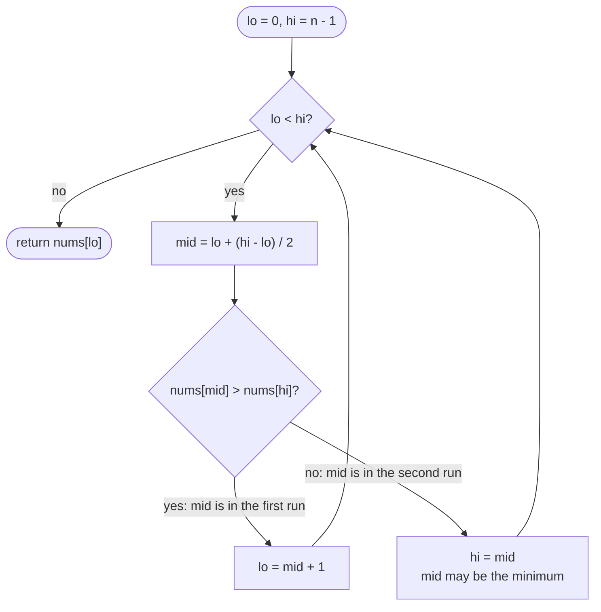

# LC 153 Find Minimum in Rotated Sorted Array

> [!abstract] In one sentence
> Compare each element with the *last* element: everything before the pivot is bigger than it, everything from the pivot on is smaller or equal, so "`nums[i] <= nums[n-1]`" is a false-then-true predicate whose first true index is the minimum — a boundary search, not a value search.

**Map:** [[NeetCode 150 MOC]] → [[DSA Dashboard]] · Pattern: [[Binary Search]]

> [!question] Predict before you read
> `[3,4,5,1,2]`. Compare each value with the last element `2`: which indices are `> 2` and which are `<= 2`? Where does the pattern flip, and what is at that index?

## Problem

A sorted array of distinct integers was rotated between 1 and `n` times (`[0,1,2,4,5,6,7]` rotated 4 times is `[4,5,6,7,0,1,2]`). Return its minimum element in O(log n).

- `[3,4,5,1,2]` → `1`
- `[4,5,6,7,0,1,2]` → `0`
- `[11,13,15,17]` → `11` (rotated `n` times = not rotated at all)

Constraints that matter: `1 ≤ n ≤ 5000`, distinct values.

## Clarifying questions

1. Distinct values? — Yes; with duplicates (LC 154) the comparison can be a tie and the worst case is O(n).
2. Can the array be effectively unrotated? — Yes; the answer is then `nums[0]`, and the algorithm must handle it without a special case if possible.
3. Return the value or the index? — The value; the index is the rotation count, worth mentioning as a follow-up.

## Brute force

`Arrays.stream(nums).min()`, O(n). It wastes the structure: the array is two ascending runs glued together, and the minimum is the exact seam between them.

## The key insight

Fix the comparison point at `nums[n − 1]`. Every element of the first run (before the pivot) is greater than the last element; every element of the second run (pivot onward) is at most the last element. So `P(i) = nums[i] <= nums[n − 1]` reads `false … false true … true` across indices, and the minimum is the first `true`. That is exactly the lower-bound template from [[LC 704 Binary Search]] / [[LC 875 Koko Eating Bananas]]: `lo < hi`, keep `hi = mid` when `P(mid)` holds, `lo = mid + 1` otherwise. Comparing with `nums[hi]` (the current right end) instead of a fixed `nums[n − 1]` gives the same answer and is the form most people write.

## Optimal approach

1. `lo = 0`, `hi = n − 1`.
2. While `lo < hi`: `mid = lo + (hi − lo) / 2`.
3. If `nums[mid] > nums[hi]`: the pivot is to the right of `mid` → `lo = mid + 1`.
4. Else (`nums[mid] < nums[hi]`): `mid` is in the second run, the minimum is `mid` or to its left → `hi = mid`.
5. Return `nums[lo]`.



> [!example]- Excalidraw version — the same diagram as an editable canvas
> ![[LC 153 Find Minimum in Rotated Sorted Array — Optimal approach.excalidraw]]
> [[LC 153 Find Minimum in Rotated Sorted Array — Optimal approach.excalidraw|Open in Excalidraw]] — needs the Excalidraw plugin (see [[Plugins to Install]]).

## Walkthrough

`nums = [4,5,6,7,0,1,2]`:

| lo | hi | mid | nums[mid] | nums[hi] | nums[mid] > nums[hi]? | update |
|---|---|---|---|---|---|---|
| 0 | 6 | 3 | 7 | 2 | yes | `lo = 4` |
| 4 | 6 | 5 | 1 | 2 | no | `hi = 5` |
| 4 | 5 | 4 | 0 | 1 | no | `hi = 4` |
| 4 | 4 | | | | | exit → `nums[4] = 0` |

> [!example] P(i) = nums[i] <= last element, over [4,5,6,7,0,1,2]
> ![[LC 153 Find Minimum in Rotated Sorted Array — P(i) = nums-i- -= last element, over -4,5,6,7,0,1,2-.excalidraw]]
> [[LC 153 Find Minimum in Rotated Sorted Array — P(i) = nums-i- -= last element, over -4,5,6,7,0,1,2-.excalidraw|Open in Excalidraw]] — false then true exactly once; the first true is the minimum, so the lower-bound template applies

%% excalidraw-spec
{"kind": "array", "title": "P(i) = nums[i] <= last element, over [4,5,6,7,0,1,2]", "values": ["F", "F", "F", "F", "T", "T", "T"], "pointers": {"lo": 4, "hi": 4}, "highlight": [4], "labels": {"0": "first run", "4": "pivot = min", "6": "last"}, "caption": "false then true exactly once; the first true is the minimum, so the lower-bound template applies"}
%%

## Java solution

```java
import java.util.*;

class Solution {
    public int findMin(int[] nums) {
        int lo = 0, hi = nums.length - 1;
        while (lo < hi) {                          // invariant: the minimum's index is in [lo, hi]
            int mid = lo + (hi - lo) / 2;
            if (nums[mid] > nums[hi]) lo = mid + 1; // mid is in the first (larger) run: minimum is to the right
            else hi = mid;                          // mid is in the second run: minimum is mid or to the left
        }
        return nums[lo];
    }
}
```

**Time** O(log n) · **Space** O(1)

## Why it works

Let `p` be the pivot index (the minimum). For `i < p`, `nums[i] > nums[n − 1]` because the first run is entirely larger than the second run's last element; for `i ≥ p`, `nums[i] ≤ nums[n − 1]` because the second run is ascending and ends there. Comparing with `nums[hi]` instead of `nums[n − 1]` is sound because `hi` only ever moves to a `mid` that lies in the second run, so `nums[hi]` stays in the second run and the two-run ordering is preserved inside `[lo, hi]`. If `nums[mid] > nums[hi]`, then `mid < p`, so `lo = mid + 1` keeps `p` inside; otherwise `mid ≥ p`, so `hi = mid` keeps `p` inside. With `mid < hi` whenever `lo < hi`, both updates shrink the window, which ends at `lo == hi == p`. An unrotated array has `nums[mid] < nums[hi]` at every step, so `hi` slides to 0: no special case.

## Edge cases

- Not rotated (`[1,2,3]`): every step takes the `hi = mid` branch; returns `nums[0]`.
- Rotated by one (`[2,1]`): `mid = 0`, `2 > 1` → `lo = 1` → returns 1.
- Single element: loop skipped, returns `nums[0]`.
- Pivot at the last index (`[2,3,4,5,1]`): `hi` stays at 4 until the window collapses there.
- Two elements already sorted (`[1,2]`): `mid = 0`, `1 > 2` false → `hi = 0` → returns 1.

## Common mistakes

> [!warning] What goes wrong
> - Comparing `nums[mid]` with `nums[lo]`: a sorted (unrotated) window then looks like "first run" and you move right past the minimum. Compare with `hi`.
> - Using `lo <= hi` with `hi = mid`: infinite loop when `lo == hi`. The lower-bound template is `lo < hi`.
> - Writing `hi = mid − 1` in the second-run branch: `mid` itself may be the minimum and gets skipped.
> - Returning `nums[mid]` from inside the loop on `nums[mid] < nums[mid − 1]`: works only with careful bounds checks; the template form is simpler.
> - Assuming the answer is `nums[0]` when `nums[0] < nums[n − 1]`: true, but it is a shortcut, not a replacement for the general loop — know both.

## Variants & follow-ups

- Duplicates (LC 154): when `nums[mid] == nums[hi]`, do `hi--` (the minimum is still inside); worst case O(n).
- Return the rotation count: the index `lo` at the end.
- Find the maximum: it sits at `p − 1` (or `n − 1` when `p == 0`).
- Combine with a value search: [[LC 33 Search in Rotated Sorted Array]] in two passes.
- Rotated descending array: compare with `nums[lo]` and flip the branches.

## Interview script

Restate: "ascending distinct array rotated an unknown number of times, return the minimum in O(log n)." Brute force: "linear scan, O(n), ignores the structure." Insight: "the array is two ascending runs; compared with the last element, the first run is all greater and the second run all smaller-or-equal — a false-then-true predicate, so I binary search for the first true." Approach: "`lo < hi`; if `nums[mid] > nums[hi]` the pivot is right of `mid`, `lo = mid + 1`; else `hi = mid`; return `nums[lo]`." Complexity: "O(log n), O(1)." Tests: "unrotated, rotated by one, single element, pivot at the end." If they push: "duplicates make the comparison ambiguous; I shrink `hi` by one in the tie case, which can degrade to O(n)."

## Related

- Pattern: [[Binary Search]] (first-true template; rotated arrays)
- Prerequisites: [[LC 704 Binary Search]], [[LC 875 Koko Eating Bananas]] (the same lower-bound loop on a predicate)
- Siblings: [[LC 33 Search in Rotated Sorted Array]] (uses this as its first pass)
- Java: [[DSA Patterns in Java]] (binary search templates), [[Java Pitfalls in Interviews]]

## Attempt log

| Date | Result | Minutes | What I got wrong |
|---|---|---|---|
| | | | |

### Mastery checklist
- [ ] Solved without hints in under 25 minutes
- [ ] Stated complexity before coding
- [ ] Handled every edge case above
- [ ] Code compiled first time
- [ ] Can do the follow-up variant

## Open questions
- [ ] Why is comparing with `nums[hi]` safe but comparing with `nums[lo]` not? Construct the smallest failing input for the `lo` version.
- [ ] Write LC 154 (duplicates) and explain exactly which inputs make it O(n).
