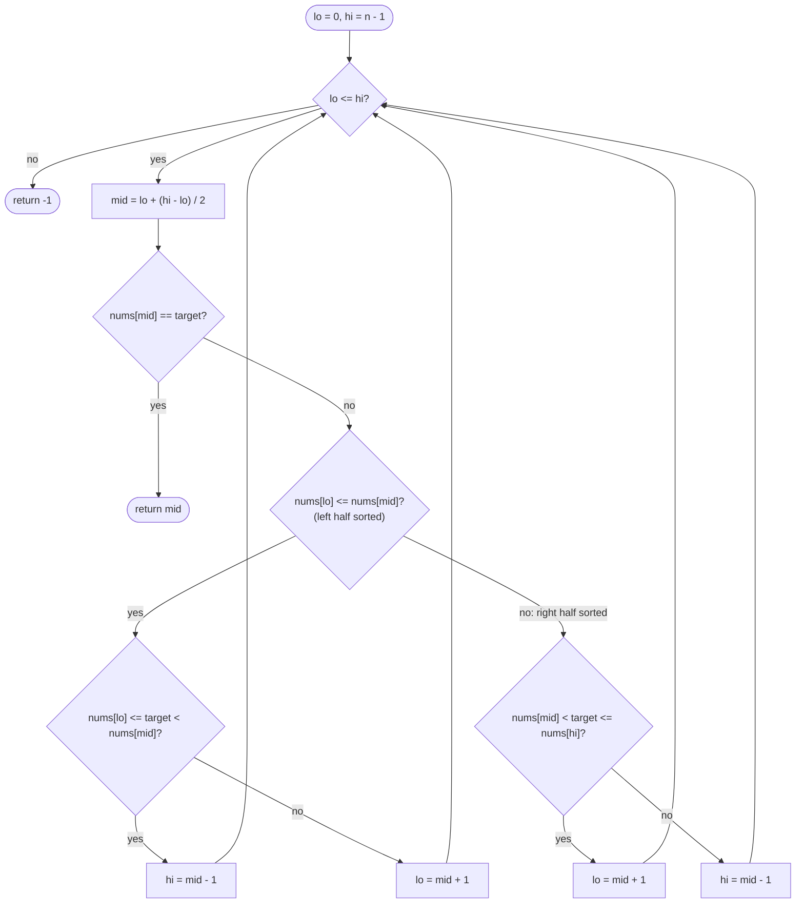

# LC 33 Search in Rotated Sorted Array

> [!abstract] In one sentence
> Cut a rotated sorted array anywhere and at least one side of the cut is still sorted; because you can test membership in a sorted range with two comparisons, you can always throw away half the array, so the search stays O(log n) even though the array as a whole is not sorted.

**Map:** [[NeetCode 150 MOC]] → [[DSA Dashboard]] · Pattern: [[Binary Search]]

> [!question] Predict before you read
> `[4,5,6,7,0,1,2]`, `mid = 3` (value 7). Which half is sorted — `[4,5,6,7]` or `[7,0,1,2]`? If the target is 1, which half do you keep, and what single comparison told you?

## Problem

`nums` was sorted ascending with distinct values, then rotated at some unknown index `k` (`[0,1,2,4,5,6,7]` → `[4,5,6,7,0,1,2]`). Return the index of `target` or `-1`, in O(log n).

- `nums = [4,5,6,7,0,1,2]`, `target = 0` → `4`
- `nums = [4,5,6,7,0,1,2]`, `target = 3` → `-1`
- `nums = [1]`, `target = 0` → `-1`

Constraints that matter: `1 ≤ n ≤ 5000`, values distinct, rotation may be zero (the array may be fully sorted).

## Clarifying questions

1. Are values distinct? — Yes. With duplicates the sorted-half test can fail (`[1,1,1,0,1]`) and the worst case degrades to O(n) (LC 81).
2. Can the array be unrotated? — Yes; the algorithm must not assume a pivot exists.
3. Return any index or the first? — Values are distinct, so there is only one.
4. Is `n` small enough that O(n) passes? — It would, but the interviewer wants O(log n); say so and commit to it.

## Brute force

Linear scan, O(n). Or find the pivot with a first binary search (as in [[LC 153 Find Minimum in Rotated Sorted Array]]), then binary search the correct sorted half: two passes, still O(log n), and a perfectly acceptable interview answer — the one-pass version below just folds the two decisions together.

## The key insight

Pick any `mid`. Compare `nums[lo]` with `nums[mid]`: if `nums[lo] ≤ nums[mid]`, the left half `[lo, mid]` contains no pivot and is sorted; otherwise the pivot is inside the left half and the right half `[mid, hi]` must be sorted. A sorted half has a known min and max, so "is the target in this half?" is two comparisons. If yes, recurse into it; if not, the target can only be in the other half. Either way half the window is gone, which is all binary search ever needed.

## Optimal approach

1. `lo = 0`, `hi = n − 1`.
2. While `lo ≤ hi`: `mid = lo + (hi − lo) / 2`; if `nums[mid] == target` return `mid`.
3. If `nums[lo] ≤ nums[mid]` (left half sorted): if `nums[lo] ≤ target < nums[mid]` then `hi = mid − 1`, else `lo = mid + 1`.
4. Else (right half sorted): if `nums[mid] < target ≤ nums[hi]` then `lo = mid + 1`, else `hi = mid − 1`.
5. Loop exits → `-1`.



> [!example]- Excalidraw version — the same diagram as an editable canvas
> ![[LC 33 Search in Rotated Sorted Array — Optimal approach.excalidraw]]
> [[LC 33 Search in Rotated Sorted Array — Optimal approach.excalidraw|Open in Excalidraw]] — needs the Excalidraw plugin (see [[Plugins to Install]]).

## Walkthrough

`nums = [4,5,6,7,0,1,2]`, `target = 0`:

| lo | hi | mid | nums[mid] | sorted half | target inside it? | update |
|---|---|---|---|---|---|---|
| 0 | 6 | 3 | 7 | left `[4..7]` (4 ≤ 7) | 4 ≤ 0 < 7? no | `lo = 4` |
| 4 | 6 | 5 | 1 | left `[0..1]` (0 ≤ 1) | 0 ≤ 0 < 1? yes | `hi = 4` |
| 4 | 4 | 4 | 0 | — | found | return 4 |

> [!example] Rotated array: the left half of [0, 3] is sorted, the pivot sits in the right half
> ![[LC 33 Search in Rotated Sorted Array — Rotated array- the left half of -0, 3- is sorted, the pivot sits in the right hal.excalidraw]]
> [[LC 33 Search in Rotated Sorted Array — Rotated array- the left half of -0, 3- is sorted, the pivot sits in the right hal.excalidraw|Open in Excalidraw]] — nums[lo] <= nums[mid] proves the shaded half is sorted; target 0 is not in [4, 7], so the search moves right

%% excalidraw-spec
{"kind": "array", "title": "Rotated array: the left half of [0, 3] is sorted, the pivot sits in the right half", "values": [4, 5, 6, 7, 0, 1, 2], "pointers": {"lo": 0, "mid": 3, "hi": 6}, "highlight": [0, 1, 2, 3], "labels": {"4": "pivot (min)"}, "caption": "nums[lo] <= nums[mid] proves the shaded half is sorted; target 0 is not in [4, 7], so the search moves right"}
%%

## Java solution

```java
import java.util.*;

class Solution {
    public int search(int[] nums, int target) {
        int lo = 0, hi = nums.length - 1;
        while (lo <= hi) {
            int mid = lo + (hi - lo) / 2;
            if (nums[mid] == target) return mid;
            if (nums[lo] <= nums[mid]) {                       // left half [lo, mid] is sorted
                if (nums[lo] <= target && target < nums[mid]) hi = mid - 1;   // target inside the sorted half
                else lo = mid + 1;                              // otherwise it can only be on the right
            } else {                                            // right half [mid, hi] is sorted
                if (nums[mid] < target && target <= nums[hi]) lo = mid + 1;
                else hi = mid - 1;
            }
        }
        return -1;
    }
}
```

**Time** O(log n) · **Space** O(1)

The two-pass alternative: find the pivot index `p` (smallest element) as in [[LC 153 Find Minimum in Rotated Sorted Array]], then binary search `[0, p − 1]` if `target ≥ nums[0]`, else `[p, n − 1]`:

```java
// snippet — two-pass version: pivot first, then an ordinary binary search on the right segment
int p = findMin(nums);                       // index of the smallest element (LC 153)
int lo = target >= nums[0] && p > 0 ? 0 : p;
int hi = target >= nums[0] && p > 0 ? p - 1 : nums.length - 1;
return binarySearch(nums, lo, hi, target);   // LC 704 template
```

## Why it works

Invariant: if `target` is in the array it is in `[lo, hi]`. A rotated sorted array has at most one "drop" (the pivot). For any `lo ≤ mid ≤ hi`, the drop lies in `[lo, mid]` or in `(mid, hi]`, not both, so at least one half is strictly ascending. The test `nums[lo] ≤ nums[mid]` is exact with distinct values: if the drop were inside `[lo, mid]`, then `nums[mid]` would be smaller than `nums[lo]`. In a sorted half the target is present only if `min ≤ target ≤ max`; the strict inequalities on the `mid` side are safe because `nums[mid] ≠ target` was already checked. Each step discards a half that cannot contain the target, so the invariant holds and the window halves every iteration.

## Edge cases

- No rotation (`[1,2,3,4,5]`): the left-sorted branch is always taken; behaves like plain binary search.
- Single element: `mid = 0`; found or `-1`.
- Two elements (`[3,1]`, `target = 1`): `mid = 0`, left half `[3]` sorted, `1` not in `[3,3]` → `lo = 1` → found.
- Target is the pivot element (`0` above): found when the window shrinks onto it.
- Target larger than every value (`target = 9`): every branch moves `lo` past `hi` → `-1`.
- `lo == mid` (window of size 2): `nums[lo] <= nums[mid]` is true by equality, the "sorted" half is one element, and the strict `target < nums[mid]` prevents a stuck loop.

## Common mistakes

> [!warning] What goes wrong
> - Writing `nums[lo] < nums[mid]` instead of `<=`: when `lo == mid` the left half is one element and *is* sorted; the strict form sends you to the wrong branch.
> - Using `target < nums[mid]` without the lower bound `nums[lo] <= target`: a target smaller than the sorted half's minimum belongs on the other side.
> - Comparing against `nums[0]` instead of `nums[lo]` to decide the sorted half: works only for the first iteration.
> - Forgetting the `nums[mid] == target` check before branching, then using non-strict inequalities that skip over `mid`.
> - Assuming duplicates are fine: `[1,1,1,0,1]` breaks the sorted-half test; LC 81 needs `lo++, hi--` when `nums[lo] == nums[mid] == nums[hi]`.

## Variants & follow-ups

- Duplicates (LC 81): return boolean; shrink both ends when the three sentinels are equal; worst case O(n).
- Find the minimum / the rotation count: [[LC 153 Find Minimum in Rotated Sorted Array]].
- Rotation in the other direction or a sorted-descending input: flip the comparisons.
- "Search in a circularly sorted linked list": no random access, so O(n) regardless — say why binary search needs indexing.
- Count how many times the array was rotated: the pivot index.

## Interview script

Restate: "ascending distinct array rotated at an unknown pivot, find the target's index in O(log n)." Brute force: "linear scan, or pivot-then-binary-search in two passes — both correct, the second already O(log n)." Insight: "any midpoint leaves at least one sorted half; I can check membership in a sorted half with two comparisons and discard the other half." Approach: "classic `lo <= hi` loop; compare `nums[lo]` with `nums[mid]` to find the sorted half; if the target is inside that half's range, go there, else go to the other side." Complexity: "O(log n) time, O(1) space." Tests: "unrotated, single element, two elements, target at the pivot, target absent." If they push: "with duplicates the sentinel test is ambiguous — I shrink both ends when `nums[lo] == nums[mid] == nums[hi]`, which degrades to O(n)."

## Related

- Pattern: [[Binary Search]] (rotated arrays: which half is sorted)
- Prerequisites: [[LC 704 Binary Search]] (the closed-interval template), [[LC 153 Find Minimum in Rotated Sorted Array]] (finding the pivot)
- Siblings: [[LC 74 Search a 2D Matrix]] (another "it is sorted if you look at it right" search)
- Java: [[Java Pitfalls in Interviews]] (`mid = lo + (hi - lo) / 2`, strict vs non-strict comparisons), [[DSA Patterns in Java]] (binary search templates)

## Attempt log

| Date | Result | Minutes | What I got wrong |
|---|---|---|---|
| | | | |

### Mastery checklist
- [ ] Solved without hints in under 25 minutes
- [ ] Stated complexity before coding
- [ ] Handled every edge case above
- [ ] Code compiled first time
- [ ] Can do the follow-up variant

## Open questions
- [ ] Prove that with distinct values exactly one of the two halves can contain the pivot. What breaks in the proof when duplicates are allowed?
- [ ] Rewrite the solution with the half-open `lo < hi` template. Which comparisons change?
