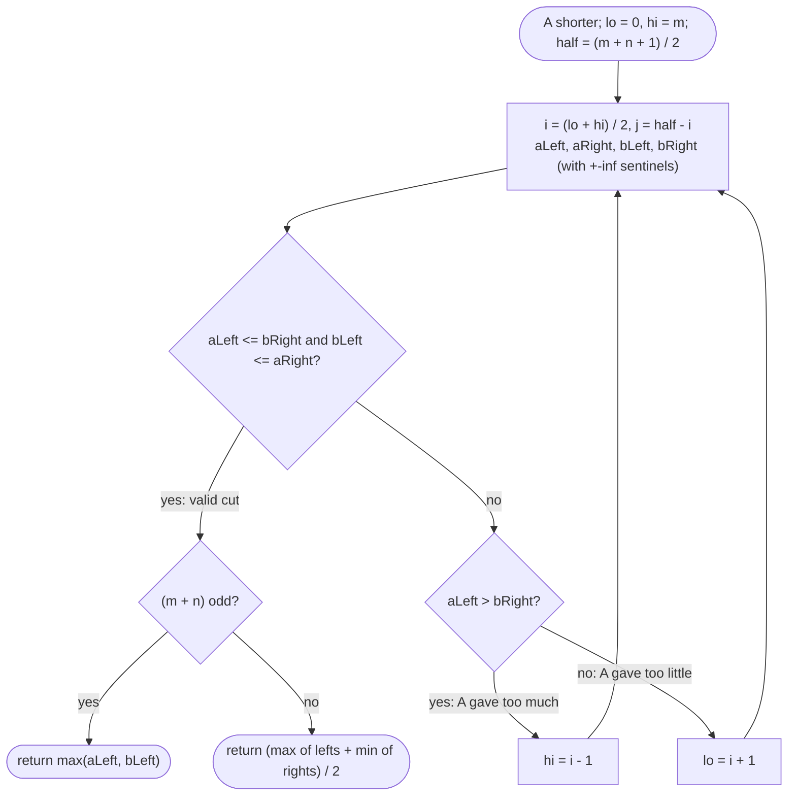

# LC 4 Median of Two Sorted Arrays

> [!abstract] In one sentence
> Instead of finding the median value, find the *cut*: choose how many elements of the smaller array go into the left half of the merged order (the rest of the left half must come from the larger array), and the cut is right precisely when the two left-side maxima are no bigger than the two right-side minima — a monotone condition, so binary search the cut position.

**Map:** [[NeetCode 150 MOC]] → [[DSA Dashboard]] · Pattern: [[Binary Search]]

> [!question] Predict before you read
> `A = [1, 3]`, `B = [2]`. The merged array has three elements, so the left half holds `(3 + 1) / 2 = 2`. If `A` contributes one element (`1`) to the left half, how many must `B` contribute, and which four values do you compare to know the cut is valid?

## Problem

Given two sorted arrays `nums1` (size `m`) and `nums2` (size `n`), return the median of the merged sorted array in O(log(m + n)).

- `[1,3]`, `[2]` → `2.0`
- `[1,2]`, `[3,4]` → `2.5`
- `[]`, `[1]` → `1.0`

Constraints that matter: `0 ≤ m, n ≤ 1000`, `m + n ≥ 1`, values in `[−10⁶, 10⁶]` — so sentinels `±∞` can be `Integer.MIN_VALUE`/`MAX_VALUE`.

## Clarifying questions

1. Can one array be empty? — Yes; the median is then the median of the other array, and the partition must handle a contribution of 0.
2. Even total length → average of the two middle values as a `double`? — Yes.
3. Is O(m + n) acceptable? — It passes the judge, but the interviewer asked for log; state both.
4. Duplicates across arrays? — Fine; the comparisons are non-strict.

## Brute force

Merge the two arrays (the merge step of merge sort, see [[LC 23 Merge k Sorted Lists]]) and index the middle: O(m + n) time and space, or O(m + n) time / O(1) space by counting without storing. Correct, simple, and the answer you give first. The waste: you merge everything to look at one or two elements.

## The key insight

Let `half = (m + n + 1) / 2` be the size of the left half (the `+1` puts the extra element on the left for odd totals). If the left half takes `i` elements from `A` (the shorter array), it must take `j = half − i` from `B`. The left half is then `A[0..i) ∪ B[0..j)` and the right half is the rest. This cut is the true median cut when `max(left) <= min(right)`, which only needs four values: `A[i−1] <= B[j]` and `B[j−1] <= A[i]`. If `A[i−1] > B[j]`, `A` gave too much — move `i` left; if `B[j−1] > A[i]`, `A` gave too little — move `i` right. "Too much / too little" is monotone in `i`, so binary search `i` over `[0, m]`. Searching the shorter array keeps `j` within `[0, n]` and makes the cost O(log(min(m, n))).

## Optimal approach

1. Ensure `A` is the shorter array (swap if needed).
2. `lo = 0`, `hi = m`, `half = (m + n + 1) / 2`.
3. Loop: `i = (lo + hi) / 2`, `j = half − i`. Let `aLeft = i == 0 ? −∞ : A[i−1]`, `aRight = i == m ? +∞ : A[i]`, `bLeft = j == 0 ? −∞ : B[j−1]`, `bRight = j == n ? +∞ : B[j]`.
4. If `aLeft <= bRight` and `bLeft <= aRight`: the cut is valid. Odd total → `max(aLeft, bLeft)`; even → `(max(aLeft, bLeft) + min(aRight, bRight)) / 2.0`.
5. Else if `aLeft > bRight`: `hi = i − 1`. Else `lo = i + 1`.



> [!example]- Excalidraw version — the same diagram as an editable canvas
> ![[LC 4 Median of Two Sorted Arrays — Optimal approach.excalidraw]]
> [[LC 4 Median of Two Sorted Arrays — Optimal approach.excalidraw|Open in Excalidraw]] — needs the Excalidraw plugin (see [[Plugins to Install]]).

## Walkthrough

`A = [1, 2]`, `B = [3, 4]`; `m = n = 2`, `half = 2`:

| lo | hi | i | j | aLeft | aRight | bLeft | bRight | valid? | action |
|---|---|---|---|---|---|---|---|---|---|
| 0 | 2 | 1 | 1 | 1 | 2 | 3 | 4 | `bLeft 3 <= aRight 2`? no | A gave too little → `lo = 2` |
| 2 | 2 | 2 | 0 | 2 | +∞ | −∞ | 3 | 2 <= 3 and −∞ <= +∞ | valid; even → (max(2, −∞) + min(+∞, 3)) / 2 = 2.5 |

> [!example] The cut i = 2, j = 0: left half {1, 2}, right half {3, 4}
> ![[LC 4 Median of Two Sorted Arrays — The cut i = 2, j = 0- left half {1, 2}, right half {3, 4}.excalidraw]]
> [[LC 4 Median of Two Sorted Arrays — The cut i = 2, j = 0- left half {1, 2}, right half {3, 4}.excalidraw|Open in Excalidraw]] — validity needs only the four boundary values: A[i-1] = 2 <= B[j] = 3 and B[j-1] = -inf <= A[i] = +inf

%% excalidraw-spec
{"kind": "grid", "title": "The cut i = 2, j = 0: left half {1, 2}, right half {3, 4}", "col_labels": ["", "left half", "right half"], "row_labels": ["", "A", "B"], "rows": [ ["", "1 2 |", "| (none)"], ["", "(none) |", "| 3 4"] ], "highlight": [ [1, 1], [2, 2] ], "caption": "validity needs only the four boundary values: A[i-1] = 2 <= B[j] = 3 and B[j-1] = -inf <= A[i] = +inf"}
%%

## Java solution

```java
import java.util.*;

class Solution {
    public double findMedianSortedArrays(int[] nums1, int[] nums2) {
        int[] a = nums1, b = nums2;
        if (a.length > b.length) { a = nums2; b = nums1; }   // binary search over the shorter array
        int m = a.length, n = b.length;
        int half = (m + n + 1) / 2;                           // size of the left half (extra element goes left)
        int lo = 0, hi = m;
        while (lo <= hi) {
            int i = lo + (hi - lo) / 2;                       // elements of a in the left half
            int j = half - i;                                 // elements of b in the left half
            int aLeft  = i == 0 ? Integer.MIN_VALUE : a[i - 1];
            int aRight = i == m ? Integer.MAX_VALUE : a[i];
            int bLeft  = j == 0 ? Integer.MIN_VALUE : b[j - 1];
            int bRight = j == n ? Integer.MAX_VALUE : b[j];
            if (aLeft <= bRight && bLeft <= aRight) {         // every left element <= every right element
                if ((m + n) % 2 == 1) return Math.max(aLeft, bLeft);
                return (Math.max(aLeft, bLeft) + (double) Math.min(aRight, bRight)) / 2.0;
            } else if (aLeft > bRight) {
                hi = i - 1;                                   // a contributed too much: move the cut left
            } else {
                lo = i + 1;                                   // a contributed too little: move the cut right
            }
        }
        throw new IllegalArgumentException("inputs are not sorted");
    }
}
```

**Time** O(log(min(m, n))) · **Space** O(1)

The O(m + n) answer you state first:

```java
// snippet — count-merge without storing: walk both arrays until the middle index/indices
int total = m + n, mid = total / 2, prev = 0, cur = 0, i = 0, j = 0;
for (int k = 0; k <= mid; k++) {
    prev = cur;
    if (j >= n || (i < m && a[i] <= b[j])) cur = a[i++]; else cur = b[j++];
}
return total % 2 == 1 ? cur : (prev + cur) / 2.0;
```

## Why it works

A cut `(i, j)` with `i + j = half` splits the multiset `A ∪ B` into a left part of size `half` and a right part of size `m + n − half`. The left part is exactly the `half` smallest elements iff `max(left) <= min(right)`. Since `A[0..i)` and `B[0..j)` are each sorted, `max(left) = max(A[i−1], B[j−1])` and `min(right) = min(A[i], B[j])`; the cross conditions `A[i−1] <= B[j]` and `B[j−1] <= A[i]` are therefore sufficient (the within-array conditions hold by sortedness). Monotonicity: as `i` increases, `A[i−1]` increases and `B[j]` (with `j` decreasing) decreases, so once `A[i−1] > B[j]` it stays true for larger `i`; symmetrically `B[j−1] > A[i]` stays true for smaller `i`. Hence the valid cuts form an interval and the binary search converges. Because `m <= n`, `j = half − i` always lies in `[0, n]`, so the sentinels cover every boundary. With `half` rounding up, for odd totals the median is the largest left element; for even totals it is the mean of the largest left and smallest right.

## Edge cases

- One array empty (`[]`, `[2,3]`): `m = 0`, `i = 0`, `j = half`, sentinels on `A`; works without special casing.
- Arrays of length 1 each.
- All of `A` smaller than all of `B` (`[1,2]`, `[3,4]`): the cut ends at `i = m`.
- All of `A` larger than all of `B`: the cut ends at `i = 0`.
- Duplicates straddling the cut (`[1,2,2]`, `[2,2,3]`): non-strict comparisons keep the cut valid.
- Extreme values near `±10⁶`: far from `Integer.MIN_VALUE`/`MAX_VALUE`, so sentinels never collide; the even-case average uses `double` to avoid `int` overflow in the sum.

## Common mistakes

> [!warning] What goes wrong
> - Not forcing `A` to be the shorter array: `j` can go negative or exceed `n`, and the sentinels do not save you.
> - `half = (m + n) / 2` without `+1`: the odd case then has the median on the right side, and the final formulas change; pick one convention and derive the return statements from it.
> - Returning `(aLeft + bRight) / 2` instead of `(max of lefts + min of rights) / 2`: you must take the max/min across both arrays.
> - Integer division in the even case: `(x + y) / 2` truncates; divide by `2.0`.
> - Using `lo < hi` with `hi = i − 1` moves: this is the closed-interval search; keep `lo <= hi`.
> - Checking only one cross condition: both `aLeft <= bRight` and `bLeft <= aRight` are required.

## Variants & follow-ups

- k-th smallest of two sorted arrays: the same cut with `half = k`; the median is `k = (m + n + 1) / 2` (and `k + 1` for even).
- Median of a stream: a different structure entirely — [[LC 295 Find Median from Data Stream]] (two heaps).
- More than two sorted arrays: no clean cut; use a heap merge ([[LC 23 Merge k Sorted Lists]]) or binary search on the *value* with per-array counting (`count(<= x)` via binary search in each array), O(k log n log range).
- Arrays too large for memory: the value-space binary search only needs "how many elements `<= x`" per array.

## Interview script

Restate: "two sorted arrays, median of the merge, target O(log) time." Brute force: "merge-count to the middle, O(m + n) time, O(1) space — I would write this first if time is short." Insight: "I search for the cut, not the value: how many elements of the shorter array land in the left half; a cut is valid when the max of the left side is `<=` the min of the right side, which is four comparisons, and the condition is monotone in the cut position." Approach: "binary search `i` in `[0, m]`, `j = half − i`, sentinels for empty sides, move left when `A[i−1] > B[j]`, right when `B[j−1] > A[i]`; odd → max of lefts, even → average with min of rights." Complexity: "O(log(min(m, n))) time, O(1) space." Tests: "empty array, all-smaller/all-larger, duplicates on the cut, even/odd totals." If they push: "the same cut answers k-th smallest; for many arrays I switch to binary search on the value."

## Related

- Pattern: [[Binary Search]] (search on a partition rather than a value)
- Prerequisites: [[LC 704 Binary Search]], [[LC 875 Koko Eating Bananas]] (monotone predicates)
- Siblings: [[LC 23 Merge k Sorted Lists]] (the merge you avoid), [[LC 295 Find Median from Data Stream]] (median under insertions)
- Java: [[Java Pitfalls in Interviews]] (integer division, `MIN_VALUE` sentinels), [[DSA Patterns in Java]]

## Attempt log

| Date | Result | Minutes | What I got wrong |
|---|---|---|---|
| | | | |

### Mastery checklist
- [ ] Solved without hints in under 25 minutes
- [ ] Stated complexity before coding
- [ ] Handled every edge case above
- [ ] Code compiled first time
- [ ] Can do the follow-up variant

## Open questions
- [ ] Derive the return formulas for the convention `half = (m + n) / 2` (extra element on the right). Which side holds the median for odd totals then?
- [ ] Write `kthSmallest(A, B, k)` with the same cut and test it against the merge-count version on random inputs.
