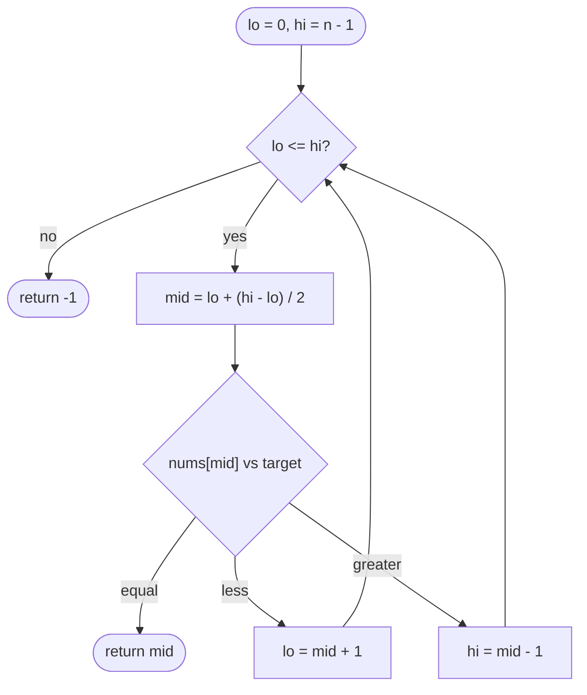

# LC 704 Binary Search

> [!abstract] In one sentence
> One comparison against the middle element tells you which half of a sorted array can still contain the target, so the candidate interval halves every step and the loop invariant "if the target is present it lies in `[lo, hi]`" is all you need to get the bounds, the loop condition and the termination right.

**Map:** [[NeetCode 150 MOC]] → [[DSA Dashboard]] · Pattern: [[Binary Search]]

> [!question] Predict before you read
> `lo = 0`, `hi = n − 1`, `while (lo < hi)`, and on `nums[mid] < target` you set `lo = mid + 1`, otherwise `hi = mid − 1`. For `nums = [5]`, `target = 5`, what is returned? Name the two things wrong with that loop before reading the template.

## Problem

Given an array `nums` of distinct integers sorted in ascending order and an integer `target`, return the index of `target` in `nums`, or `−1` if it is absent. The required running time is O(log n).

- `nums = [-1,0,3,5,9,12]`, `target = 9` → `4`
- `nums = [-1,0,3,5,9,12]`, `target = 2` → `−1`

Constraints that matter: `1 ≤ n ≤ 10⁴`, values and target in `[−10⁴, 10⁴]`, all values distinct — so there is exactly one answer when present and no "first occurrence" ambiguity; `lo + hi` cannot overflow at this size, but the habit of writing `lo + (hi − lo) / 2` is the point.

## Clarifying questions

1. Sorted ascending, and strictly (no duplicates)? — Yes; with duplicates "an index" is ambiguous and you would ask for first or last.
2. What to return when absent: `−1`, or the insertion point? — `−1` here; the insertion point is LC 35 and is what `Arrays.binarySearch` encodes as `−(insertionPoint) − 1`.
3. Can the array be empty? — Not here (`n ≥ 1`), but the template handles it (`hi = −1`, loop never runs).
4. Is the array in memory with O(1) random access? — Yes; on a linked list binary search degrades to O(n) because reaching `mid` is a walk.

## Brute force

Scan left to right and compare: O(n). Not wrong, but it ignores the only thing the problem gives you — order. The waste: after comparing with one element you learn the relative order of the target against *every* element on one side of it, and the scan throws that away by looking at the next element anyway.

## The key insight

In a sorted array, `nums[mid] < target` implies every element at or before `mid` is also `< target`, so the whole left half plus `mid` is excluded in one comparison; symmetrically for `>`. Keep an interval `[lo, hi]` with the invariant "if the target exists it is in `[lo, hi]`", shrink it by at least half each iteration, and stop when it is empty (`lo > hi`) or the probe hits. Recognition cue: "sorted" plus "O(log n)", or more generally any question where a yes/no test splits the candidates into a prefix of noes and a suffix of yeses — see [[Binary Search]] for the predicate view that [[LC 875 Koko Eating Bananas]] relies on.

## Optimal approach

1. `lo = 0`, `hi = n − 1`: the closed interval of candidate indices.
2. While `lo ≤ hi`: `mid = lo + (hi − lo) / 2`.
3. If `nums[mid] == target` return `mid`.
4. If `nums[mid] < target` the answer is right of `mid`: `lo = mid + 1`; else `hi = mid − 1`.
5. Loop exit means the interval is empty: return `−1`.



> [!example]- Excalidraw version — the same diagram as an editable canvas
> ![[LC 704 Binary Search — Optimal approach.excalidraw]]
> [[LC 704 Binary Search — Optimal approach.excalidraw|Open in Excalidraw]] — needs the Excalidraw plugin (see [[Plugins to Install]]).

## Walkthrough

`nums = [-1,0,3,5,9,12]`, `target = 9`:

| lo | hi | mid | nums[mid] | decision |
|---|---|---|---|---|
| 0 | 5 | 2 | 3 | `3 < 9` → `lo = 3` |
| 3 | 5 | 4 | 9 | equal → return `4` |

`target = 2` (absent):

| lo | hi | mid | nums[mid] | decision |
|---|---|---|---|---|
| 0 | 5 | 2 | 3 | `3 > 2` → `hi = 1` |
| 0 | 1 | 0 | −1 | `−1 < 2` → `lo = 1` |
| 1 | 1 | 1 | 0 | `0 < 2` → `lo = 2` |
| 2 | 1 | | | `lo > hi` → return `−1` |

At exit `lo = 2` is exactly where 2 would be inserted — the closed-interval template leaves the insertion point in `lo` for free.

> [!example] Searching 2 in [-1, 0, 3, 5, 9, 12]: the interval after the first probe
> ![[LC 704 Binary Search — Searching 2 in --1, 0, 3, 5, 9, 12-- the interval after the first probe.excalidraw]]
> [[LC 704 Binary Search — Searching 2 in --1, 0, 3, 5, 9, 12-- the interval after the first probe.excalidraw|Open in Excalidraw]] — everything from mid rightwards is excluded by one comparison; [lo, hi] is what may still hold the target

%% excalidraw-spec
{"kind": "array", "title": "Searching 2 in [-1, 0, 3, 5, 9, 12]: the interval after the first probe", "values": [-1, 0, 3, 5, 9, 12], "pointers": {"lo": 0, "hi": 1, "mid": 2}, "highlight": [0, 1], "labels": {"2": "3 > 2: hi = mid - 1"}, "caption": "everything from mid rightwards is excluded by one comparison; [lo, hi] is what may still hold the target"}
%%

## Java solution

```java
import java.util.*;

class Solution {
    public int search(int[] nums, int target) {
        int lo = 0, hi = nums.length - 1;                 // closed interval: target, if present, is in [lo, hi]
        while (lo <= hi) {                                // one element left is still a candidate
            int mid = lo + (hi - lo) / 2;                 // never overflows; (lo + hi) / 2 can
            if (nums[mid] == target) return mid;
            if (nums[mid] < target) lo = mid + 1;         // mid itself is excluded, hence the + 1
            else hi = mid - 1;
        }
        return -1;                                        // interval empty: not present (lo is the insertion point)
    }
}
```

**Time** O(log n) · **Space** O(1)

The second template you need is the *lower bound* — the first index whose value is `≥ target` (equivalently, the first index where a monotone predicate becomes true). It uses a half-open interval and `lo < hi`, and it is the shape behind [[LC 875 Koko Eating Bananas]] and [[LC 153 Find Minimum in Rotated Sorted Array]]:

```java
// snippet
int lo = 0, hi = nums.length;                             // half-open [lo, hi): answer is in it, hi = n means "none"
while (lo < hi) {
    int mid = lo + (hi - lo) / 2;
    if (nums[mid] >= target) hi = mid;                    // mid may be the answer: keep it
    else lo = mid + 1;                                    // mid cannot be: skip it
}
// lo == hi == first index with nums[i] >= target; check lo < n && nums[lo] == target for membership
```

## Why it works

Invariant: before every iteration, if `target` is in `nums` then its index lies in `[lo, hi]`. Initially `[0, n − 1]` covers everything. If `nums[mid] < target`, sortedness makes every index `≤ mid` hold a value `< target`, so the target's index, if any, is `≥ mid + 1`; the symmetric case gives `≤ mid − 1`. Progress: `mid ∈ [lo, hi]` always (integer division rounds `lo + (hi − lo) / 2` down, so `lo ≤ mid ≤ hi`), and both updates remove `mid` from the interval, so its length shrinks by at least one — in fact to at most half — every iteration, giving at most `⌊log₂ n⌋ + 1` probes. Termination with `lo > hi` means the interval is empty, and by the invariant the target is absent. Each probe is O(1), so O(log n) total.

## Edge cases

- Single element (`[5]`, target 5): `lo = hi = 0`, the loop runs once (`<=`), returns 0; with `<` it would never run.
- Target smaller than everything: `hi` walks down to `−1`; loop exits; `−1`.
- Target larger than everything: `lo` walks up to `n`; `−1`. Note `lo` ends at `n`, a valid insertion point but not a valid index — never read `nums[lo]` after the loop without a bounds check.
- Target at index 0 or `n − 1`: found after `⌊log₂ n⌋` halvings; no special case.
- Empty array (not in constraints): `hi = −1`, the loop body never executes, `−1`.
- Huge arrays (≥ 2³⁰ elements): `(lo + hi) / 2` overflows to a negative `mid` — the historical bug in JDK's `Arrays.binarySearch` and in many textbooks; `lo + (hi − lo) / 2` or `(lo + hi) >>> 1` fixes it.

## Common mistakes

> [!warning] What goes wrong
> - `while (lo < hi)` with the closed-interval updates: the final single-element interval is never probed (`[5]`, target 5 → `−1`).
> - `hi = mid` with `lo <= hi`: when `lo == hi == mid` and the value is larger than the target the interval never shrinks — infinite loop. Closed interval → `mid ± 1`; half-open → `hi = mid`, never mix.
> - `mid = (lo + hi) / 2`: overflow for large indices. Also `(lo + hi) >> 1` is wrong for negative sums; `>>> 1` is the safe shift.
> - Returning `lo` or `mid` after the loop as "the index" when the target is absent: the loop ended because nothing matched.
> - Binary searching a `LinkedList` via `get(mid)`: O(n) per probe; `Collections.binarySearch` switches to an iterator-walking search for large non-`RandomAccess` lists for that reason — still O(log n) comparisons, but O(n) link traversals.
> - Off-by-one in the initial `hi`: `nums.length` with a closed interval reads past the end on the first probe of a one-element array.

## Variants & follow-ups

- First or last occurrence with duplicates: lower bound / upper bound (`hi = mid` on `>=`, or on `>`), then verify.
- Insertion position (LC 35): the lower-bound snippet, or `lo` after the closed-interval loop.
- `Arrays.binarySearch(nums, target)`: returns the index or `−(insertionPoint) − 1`; it does not promise which duplicate; and on an unsorted array the result is meaningless, not an error.
- Search in a sorted 2-D matrix → [[LC 74 Search a 2D Matrix]] (virtual flattened index).
- Sorted then rotated → [[LC 33 Search in Rotated Sorted Array]], [[LC 153 Find Minimum in Rotated Sorted Array]] (one half is always sorted).
- Search on the answer space instead of the array → [[LC 875 Koko Eating Bananas]] (feasibility predicate).
- Unknown or infinite length: exponential search — double `hi` until `nums[hi] ≥ target`, then binary search; see [[Searching]].
- Real-valued search (square root to 1e-6): fixed number of iterations (~60 halvings on `double`) instead of `lo <= hi`.
- Two sorted arrays, median → [[LC 4 Median of Two Sorted Arrays]] (binary search on a partition).

## Interview script

Restate: "sorted distinct integers, return the index of the target or −1, O(log n)." Brute force: "linear scan O(n) ignores the order." Insight: "one comparison with the middle discards half of the candidates because the array is sorted; I keep the closed interval that may still contain the target." Approach: "`lo = 0`, `hi = n − 1`, loop while `lo <= hi`, `mid = lo + (hi − lo) / 2`, return on match, otherwise `lo = mid + 1` or `hi = mid − 1`." Complexity: "O(log n) probes, O(1) space." Tests: single element, absent target below and above the range, first and last index, and I state the overflow-safe `mid`. If they push: "for duplicates I switch to the lower-bound template with a half-open interval; the same template searches an answer space when the question is 'smallest value for which a predicate holds'."

## Related

- Pattern: [[Binary Search]] (the three templates, the predicate view); other search families: [[Searching]]
- Prerequisites: [[Complexity Analysis]] (why halving gives log n)
- Siblings: [[LC 74 Search a 2D Matrix]], [[LC 33 Search in Rotated Sorted Array]], [[LC 153 Find Minimum in Rotated Sorted Array]], [[LC 875 Koko Eating Bananas]]
- Java: [[Java Collections Cheat Sheet]] (`Arrays.binarySearch` return convention, `Collections.binarySearch`), [[Java Pitfalls in Interviews]] (`mid` overflow, `>>` vs `>>>`), [[DSA Patterns in Java]] (binary search templates)

## Attempt log

| Date | Result | Minutes | What I got wrong |
|---|---|---|---|
| | | | |

### Mastery checklist
- [ ] Solved without hints in under 25 minutes
- [ ] Stated complexity before coding
- [ ] Handled every edge case above
- [ ] Code compiled first time
- [ ] Can do the follow-up variant

## Open questions
- [ ] Write the half-open template (`hi = n`, `lo < hi`, `hi = mid`) for exact search and state its invariant in one sentence; where does the membership check move to?
- [ ] For an array of 2³¹ − 1 elements, what value does `(lo + hi) / 2` produce when `lo = hi = 2³¹ − 2`, and what does `(lo + hi) >>> 1` produce?
