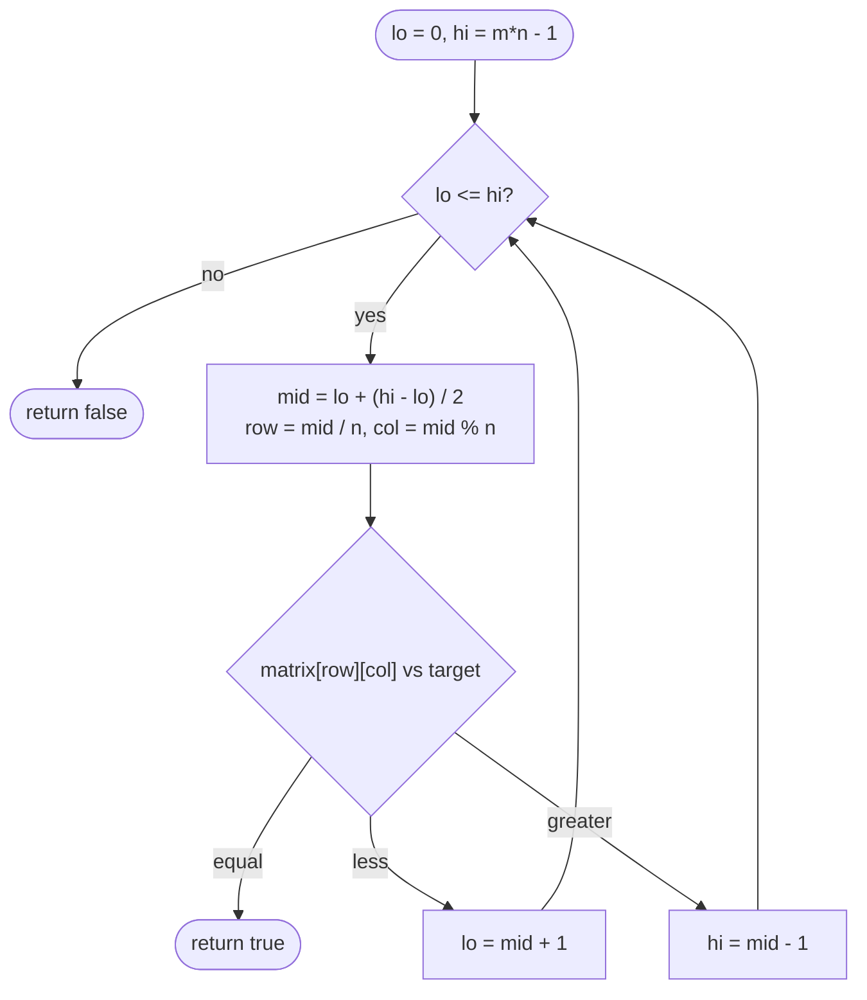

# LC 74 Search a 2D Matrix

> [!abstract] In one sentence
> The two ordering guarantees together say the matrix is a single sorted list that happens to be stored in rows, so one binary search over indices `0 … m·n − 1`, translated to a cell by `/ n` and `% n`, finds the target in O(log(m·n)) without copying anything.

**Map:** [[NeetCode 150 MOC]] → [[DSA Dashboard]] · Pattern: [[Binary Search]]

> [!question] Predict before you read
> Drop the guarantee "each row's first element is greater than the previous row's last" and keep only "rows sorted and columns sorted". Is the row-major sequence still sorted? Give a 2 × 2 counterexample, then say what that does to a single binary search.

## Problem

You are given an `m × n` integer matrix with two properties: every row is sorted in non-decreasing order, and the first element of each row is strictly greater than the last element of the previous row. Given `target`, return `true` if it is in the matrix, `false` otherwise, in O(log(m · n)) time.

- `matrix = [ [1,3,5,7], [10,11,16,20], [23,30,34,60] ]`, `target = 3` → `true`
- same matrix, `target = 13` → `false`

Constraints that matter: `1 ≤ m, n ≤ 100`, values in `[−10⁴, 10⁴]` — small enough that even O(m · n) passes, so the interviewer is grading the *technique*; the explicit O(log(m · n)) requirement rules out searching every row.

## Clarifying questions

1. Is the matrix sorted *across* rows (last of row `i` < first of row `i + 1`), or only within rows and within columns? — Across rows here; the other property is LC 240 and needs a different algorithm.
2. Can rows be empty, or can the matrix be empty? — Not by the constraints; guard `m == 0 || n == 0` if the interviewer allows it.
3. Duplicates? — Possible within the ordering (non-decreasing rows); irrelevant for a membership answer.
4. Should I return the position or a boolean? — Boolean; the position is `(mid / n, mid % n)` at the hit if asked.

## Brute force

Scan every cell: O(m · n). Slightly better: binary search each row, O(m · log n). The waste: once you know the target is not in row `i` — or more precisely, once you know it is larger than row `i`'s last element — every earlier row is excluded too, because rows are ordered among themselves; searching rows independently throws that away.

## The key insight

"Rows sorted" plus "each row starts above the previous row's end" is exactly the statement that reading the matrix row by row produces a sorted sequence. A sorted sequence of length `m · n` can be binary searched without being materialised: index `k` lives at row `k / n` and column `k % n`. So the problem is [[LC 704 Binary Search]] with a one-line address translation. The second, equally valid shape — binary search the first column for the row, then binary search that row — is also O(log m + log n) = O(log(m · n)), but has two loops and two sets of boundary cases to get right. Recognition cue: a multi-dimensional structure with a *total* order over its cells → flatten the index, search once.

## Optimal approach

1. `m = rows`, `n = columns`; `lo = 0`, `hi = m · n − 1`.
2. While `lo ≤ hi`: `mid = lo + (hi − lo) / 2`; `val = matrix[mid / n][mid % n]`.
3. `val == target` → `true`; `val < target` → `lo = mid + 1`; else `hi = mid − 1`.
4. Loop exit → `false`.



> [!example]- Excalidraw version — the same diagram as an editable canvas
> ![[LC 74 Search a 2D Matrix — Optimal approach.excalidraw]]
> [[LC 74 Search a 2D Matrix — Optimal approach.excalidraw|Open in Excalidraw]] — needs the Excalidraw plugin (see [[Plugins to Install]]).

## Walkthrough

`matrix = [ [1,3,5,7], [10,11,16,20], [23,30,34,60] ]` (`m = 3`, `n = 4`, virtual length 12), `target = 3`:

| lo | hi | mid | (row, col) | value | decision |
|---|---|---|---|---|---|
| 0 | 11 | 5 | (1, 1) | 11 | `11 > 3` → `hi = 4` |
| 0 | 4 | 2 | (0, 2) | 5 | `5 > 3` → `hi = 1` |
| 0 | 1 | 0 | (0, 0) | 1 | `1 < 3` → `lo = 1` |
| 1 | 1 | 1 | (0, 1) | 3 | equal → `true` |

> [!example] Probes for target 3: virtual indices 5, 2, 0, 1 map to (row, col) by / 4 and % 4
> ![[LC 74 Search a 2D Matrix — Probes for target 3- virtual indices 5, 2, 0, 1 map to (row, col) by - 4 and % 4.excalidraw]]
> [[LC 74 Search a 2D Matrix — Probes for target 3- virtual indices 5, 2, 0, 1 map to (row, col) by - 4 and % 4.excalidraw|Open in Excalidraw]] — row-major order 1,3,5,7,10,11,16,20,23,30,34,60 is sorted, so the matrix is one array in disguise

%% excalidraw-spec
{"kind": "grid", "title": "Probes for target 3: virtual indices 5, 2, 0, 1 map to (row, col) by / 4 and % 4", "col_labels": ["c0", "c1", "c2", "c3"], "row_labels": ["r0", "r1", "r2"], "rows": [ [1, 3, 5, 7], [10, 11, 16, 20], [23, 30, 34, 60] ], "highlight": [ [1, 1], [0, 2], [0, 0], [0, 1] ], "caption": "row-major order 1,3,5,7,10,11,16,20,23,30,34,60 is sorted, so the matrix is one array in disguise"}
%%

## Java solution

```java
import java.util.*;

class Solution {
    public boolean searchMatrix(int[][] matrix, int target) {
        int m = matrix.length, n = matrix[0].length;
        int lo = 0, hi = m * n - 1;                       // the matrix read row by row is one sorted array
        while (lo <= hi) {
            int mid = lo + (hi - lo) / 2;
            int val = matrix[mid / n][mid % n];           // virtual index -> cell; divide by the COLUMN count
            if (val == target) return true;
            if (val < target) lo = mid + 1;
            else hi = mid - 1;
        }
        return false;
    }
}
```

**Time** O(log(m · n)) · **Space** O(1)

The two-step version first finds the last row whose first element is `≤ target` (an upper-bound search on the first column), then searches that row. Same complexity, and the row search can reuse `Arrays.binarySearch`:

```java
// snippet
int lo = 0, hi = m - 1, row = -1;
while (lo <= hi) {                                        // last row with matrix[row][0] <= target
    int mid = lo + (hi - lo) / 2;
    if (matrix[mid][0] <= target) { row = mid; lo = mid + 1; } else hi = mid - 1;
}
return row >= 0 && Arrays.binarySearch(matrix[row], target) >= 0;   // negative result = insertion point encoding
```

## Why it works

Define `a[k] = matrix[k / n][k % n]` for `0 ≤ k < m · n`. Within a row `a` is non-decreasing because rows are sorted; at a row boundary, `a[(r + 1) · n − 1]` is the last element of row `r` and `a[(r + 1) · n]` is the first element of row `r + 1`, and the problem guarantees the former is strictly less than the latter. So `a` is sorted end to end, and the loop is exactly the [[LC 704 Binary Search]] loop on `a` with the invariant "if the target is in `a`, its index is in `[lo, hi]`"; each probe halves the interval and the exit condition means the interval is empty. The division and modulus are O(1), so the cost is one comparison per halving of `m · n` candidates: `⌊log₂(m · n)⌋ + 1` probes at most.

## Edge cases

- One row (`m = 1`): `mid / n = 0` always; the search is a plain row search.
- One column (`n = 1`): `mid % 1 = 0`; `mid / 1 = mid`; the search walks the column.
- `1 × 1` matrix: `lo = hi = 0`, one probe.
- Target below `matrix[0][0]` or above the last cell: the interval empties from one side; `false`.
- Target lies strictly between the end of one row and the start of the next (`13` in the example): the probes converge on the boundary and exit with `lo > hi`; `false`.
- `m · n` up to 10⁴ here; at larger sizes `m * n` could overflow `int` — use `long` for the virtual indices or the two-step version.

## Common mistakes

> [!warning] What goes wrong
> - Dividing by the row count: `matrix[mid / m][mid % m]` is wrong whenever `m ≠ n`; the divisor is the row *length* (number of columns), because that is how many cells each row consumes.
> - Treating this like LC 240 and running the staircase walk from the top-right corner: correct, but O(m + n), not O(log(m · n)) — the interviewer asked for the log bound.
> - Searching the first column for the first row with `matrix[row][0] >= target`: that finds the row *after* the one that might contain the target unless `matrix[row][0] == target`; you need the last row with first element `≤ target`.
> - Checking `matrix.length == 0` but not `matrix[0].length == 0`: `n = 0` makes `mid % n` throw `ArithmeticException`.
> - Forgetting that `Arrays.binarySearch` returns a negative *encoding* when absent — test `>= 0`, not `!= -1`.
> - Using the half-open and closed templates in the same loop (`hi = m * n` with `hi = mid − 1`, or `hi = m * n − 1` with `hi = mid`).

## Variants & follow-ups

- Rows and columns sorted, but rows not chained (LC 240): start at the top-right corner; a larger value moves left, a smaller one moves down; O(m + n). Binary search per row gives O(m log n), which is worse when `n` is small.
- k-th smallest in a row-and-column sorted matrix (LC 378): binary search on the *value* range with a staircase count of elements `≤ mid` — search on answer, not on index.
- Return the cell coordinates instead of a boolean: `(mid / n, mid % n)` at the hit.
- Count elements `≤ target`: lower/upper bound on the virtual array gives the count directly.
- Search a *sorted* 1-D array given as chunks or pages of unequal length: prefix sums of chunk lengths plus a binary search on the prefix array replace `/ n` and `% n`.
- Related index arithmetic: [[Math & Geometry]] (spiral and rotation use the same row/column translation), [[LC 36 Valid Sudoku]] (box index from `row / 3`, `col / 3`).

## Interview script

Restate: "rows sorted, and each row begins after the previous row ends; is the target present; O(log(m · n)) required." Brute force: "scan all cells, O(m · n); or binary search every row, O(m log n) — both ignore the ordering between rows." Insight: "the two guarantees mean the row-major reading is one sorted array; I binary search virtual indices `0 … m · n − 1` and translate with `/ n` and `% n`." Approach: "standard closed-interval binary search; `val = matrix[mid / n][mid % n]`; compare and halve." Complexity: "O(log(m · n)), O(1) space, nothing copied." Tests: single row, single column, 1 × 1, target between rows, target outside the range. If they push: "without the cross-row guarantee (LC 240) I would do the top-right staircase in O(m + n); for k-th smallest I would binary search on the value with a staircase count."

## Related

- Pattern: [[Binary Search]] (index arithmetic on a virtual array); the search landscape: [[Searching]]
- Prerequisites: [[LC 704 Binary Search]] (the template this reuses verbatim)
- Siblings: [[LC 33 Search in Rotated Sorted Array]], [[LC 875 Koko Eating Bananas]], [[LC 36 Valid Sudoku]] (grid index tricks)
- Java: [[Java Collections Cheat Sheet]] (`Arrays.binarySearch` on a row, `int[][]` access), [[Java Pitfalls in Interviews]] (`%` with negatives, `m * n` overflow, 2-D array initialisation), [[DSA Patterns in Java]] (matrix traversal helpers)

## Attempt log

| Date | Result | Minutes | What I got wrong |
|---|---|---|---|
| | | | |

### Mastery checklist
- [ ] Solved without hints in under 25 minutes
- [ ] Stated complexity before coding
- [ ] Handled every edge case above
- [ ] Code compiled first time
- [ ] Can do the follow-up variant

## Open questions
- [ ] Write the LC 240 staircase and explain in one sentence why the top-right (or bottom-left) corner is the only valid start — what happens from the top-left?
- [ ] Spot the bug: `int val = matrix[mid % m][mid / m];` — on which matrix shape does this happen to pass every test, and which shape exposes it?
