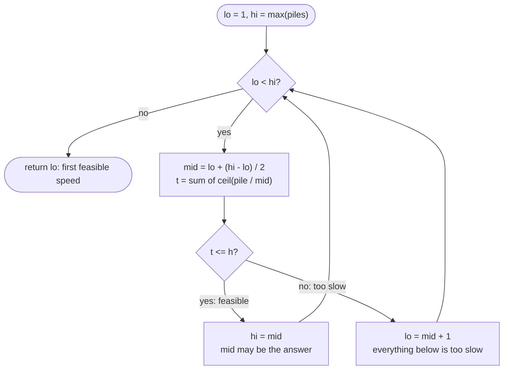

# LC 875 Koko Eating Bananas

> [!abstract] In one sentence
> You cannot binary search the piles, but you can binary search the *answer*: eating faster never takes longer, so the predicate "speed k finishes within h hours" flips from false to true exactly once as k grows, and the first true is found with O(log(max pile)) evaluations of an O(n) check.

**Map:** [[NeetCode 150 MOC]] → [[DSA Dashboard]] · Pattern: [[Binary Search]]

> [!question] Predict before you read
> Piles `[3, 6, 7, 11]`, `h = 8`. Speed 4 takes `1 + 2 + 2 + 3 = 8` hours. Without computing, can speed 5 take *more* than 8 hours? Can speed 3 take *fewer*? Say the property of `hours(k)` that answers both, and why it makes binary search legal.

## Problem

Koko has `n` piles of bananas, `piles[i]` in the `i`-th, and `h` hours. She picks an integer speed `k` and each hour chooses one pile and eats `k` bananas from it; if the pile has fewer than `k` left she finishes it and eats nothing else that hour. Return the minimum `k` such that she can eat every banana within `h` hours.

- `piles = [3,6,7,11]`, `h = 8` → `4`
- `piles = [30,11,23,4,20]`, `h = 5` → `30` (one pile per hour, so `k` must cover the largest)
- `piles = [30,11,23,4,20]`, `h = 6` → `23`

Constraints that matter: `1 ≤ n ≤ 10⁴`, `n ≤ h ≤ 10⁹`, `1 ≤ piles[i] ≤ 10⁹` — the answer lies in `[1, 10⁹]`, so trying every speed is hopeless, and `hours(k)` can reach `10⁴ · 10⁹`, which overflows an `int`.

## Clarifying questions

1. Is `h ≥ n` guaranteed? — Yes; otherwise no speed works, since one hour empties at most one pile. Say what you would return if not (`−1`).
2. Does an hour spent on a small pile really waste the remainder (no moving to the next pile)? — Yes: `ceil(pile / k)` hours per pile, not `pile / k` fractional.
3. Must `k` be an integer? — Yes; the answer space is the integers `1 … max(piles)`.
4. Can the total hours overflow? — At `k = 1` the sum is `Σ piles ≤ 10¹³`; use `long` or stop summing once the total exceeds `h`.

## Brute force

Try `k = 1, 2, 3, …` and compute `hours(k)` until it is `≤ h`: O(n · max(piles)) = 10¹³ in the worst case. The waste: after testing `k = 500` and finding it too slow, the brute force tests 501, 502, … one at a time, although "too slow at 500" already excludes every speed below 500 and says nothing about the speeds above — a situation that halving exploits.

## The key insight

The question is not "where is `x` in this array" but "what is the smallest `k` with property P(k)", and P(k) = `hours(k) ≤ h` is *monotone*: if speed `k` suffices, every faster speed does too, because each `ceil(pile / k)` can only shrink as `k` grows. A monotone predicate over an integer range is a sequence `false … false true … true`, and binary search finds the first `true` in O(log range) evaluations — this is the lower-bound template of [[LC 704 Binary Search]] with "predicate true" in place of `nums[mid] ≥ target`. The array of piles is never searched; it is only used to evaluate the predicate. Recognition cue: "minimum value such that …" or "maximum value such that …", the feasibility of a value is checkable in O(n), and feasibility is monotone in that value → binary search on the answer (see [[Binary Search]], search on answer).

## Optimal approach

1. `lo = 1`, `hi = max(piles)` — `hi` is always feasible because `n ≤ h`.
2. While `lo < hi`: `mid = lo + (hi − lo) / 2`.
3. If `hours(mid) ≤ h`, `mid` is feasible and the answer is `mid` or smaller: `hi = mid`.
4. Else `mid` is too slow and so is everything below: `lo = mid + 1`.
5. Return `lo` (`== hi`), the first feasible speed. `hours(k) = Σ ⌈piles[i] / k⌉` with integer arithmetic `(p − 1) / k + 1`.



> [!example]- Excalidraw version — the same diagram as an editable canvas
> ![[LC 875 Koko Eating Bananas — Optimal approach.excalidraw]]
> [[LC 875 Koko Eating Bananas — Optimal approach.excalidraw|Open in Excalidraw]] — needs the Excalidraw plugin (see [[Plugins to Install]]).

## Walkthrough

`piles = [3,6,7,11]`, `h = 8`, answer space `[1, 11]`:

| lo | hi | mid | hours(mid) = Σ ⌈p / mid⌉ | feasible? | update |
|---|---|---|---|---|---|
| 1 | 11 | 6 | 1 + 1 + 2 + 2 = 6 | yes (6 ≤ 8) | `hi = 6` |
| 1 | 6 | 3 | 1 + 2 + 3 + 4 = 10 | no | `lo = 4` |
| 4 | 6 | 5 | 1 + 2 + 2 + 3 = 8 | yes | `hi = 5` |
| 4 | 5 | 4 | 1 + 2 + 2 + 3 = 8 | yes | `hi = 4` |
| 4 | 4 | | | | exit → `4` |

Speed 4 and speed 5 both take exactly 8 hours; the lower-bound search keeps moving `hi` down onto feasible values until nothing smaller is feasible.

> [!example] The predicate hours(k) <= 8 over the answer space k = 1..11
> ![[LC 875 Koko Eating Bananas — The predicate hours(k) -= 8 over the answer space k = 1..11.excalidraw]]
> [[LC 875 Koko Eating Bananas — The predicate hours(k) -= 8 over the answer space k = 1..11.excalidraw|Open in Excalidraw]] — false then true, never back: that monotone shape is the licence to binary search a value you never stored in an array

%% excalidraw-spec
{"kind": "array", "title": "The predicate hours(k) <= 8 over the answer space k = 1..11", "values": ["F", "F", "F", "T", "T", "T", "T", "T", "T", "T", "T"], "pointers": {"lo": 3, "hi": 3}, "highlight": [3], "labels": {"0": "k = 1", "3": "k = 4: first true", "10": "k = 11 = max pile"}, "caption": "false then true, never back: that monotone shape is the licence to binary search a value you never stored in an array"}
%%

## Java solution

```java
import java.util.*;

class Solution {
    public int minEatingSpeed(int[] piles, int h) {
        int lo = 1, hi = 0;
        for (int p : piles) hi = Math.max(hi, p);         // speed max(piles) finishes in n <= h hours: always feasible
        while (lo < hi) {                                 // invariant: the answer is in [lo, hi]
            int mid = lo + (hi - lo) / 2;
            if (hours(piles, mid) <= h) hi = mid;         // feasible: the answer is mid or something smaller
            else lo = mid + 1;                            // too slow: the answer is strictly larger
        }
        return lo;
    }

    private long hours(int[] piles, int k) {
        long total = 0;                                   // long: up to 10^4 piles x 10^9 bananas at k = 1
        for (int p : piles) total += (p - 1) / k + 1;     // ceil(p / k) in integer arithmetic, no overflow
        return total;
    }
}
```

**Time** O(n · log(max pile)) — about 30 evaluations of an O(n) sum · **Space** O(1)

## Why it works

Let `P(k)` be "`hours(k) ≤ h`". For `k₁ < k₂`, `⌈p / k₁⌉ ≥ ⌈p / k₂⌉` for every pile, so `hours` is non-increasing and `P(k₁)` implies `P(k₂)`: the predicate is monotone, and the set of feasible speeds is a suffix `[k*, ∞)` of the integers. `P(max(piles))` holds because every pile then takes one hour and `n ≤ h`, so `k* ≤ hi` and the invariant "`k* ∈ [lo, hi]`" is true initially. If `P(mid)` then `k* ≤ mid`, so setting `hi = mid` keeps `k*` inside; if not, `k* > mid`, so `lo = mid + 1` keeps it inside. `mid < hi` whenever `lo < hi` (rounding down), so `hi = mid` strictly shrinks the interval, and `lo = mid + 1` does too; the loop ends with `lo == hi == k*`. The ceiling formula `(p − 1) / k + 1` equals `⌈p / k⌉` for `p ≥ 1`, `k ≥ 1`, and never exceeds `p`, so no intermediate overflows an `int`; the running total needs `long`.

## Edge cases

- `h == n` (`[30,11,23,4,20]`, `h = 5`): only `k = max(piles)` is feasible; the search climbs to `hi` and returns 30.
- Single pile (`[10]`, `h = 3`): `⌈10 / k⌉ ≤ 3` first holds at `k = 4`.
- Huge `h` (`h = 10⁹`): `k = 1` is feasible; the search collapses to `lo = 1` after ~30 steps.
- All piles equal to 1: `hi = 1`, the loop never runs, answer 1.
- A pile of 10⁹ with `k = 1`: `(p − 1) / k + 1 = 10⁹`, fine in `int`; the *sum* over 10⁴ such piles is 10¹³ — hence `long`.
- `k` exactly dividing a pile (`6 / 3`): the formula gives 2, not 3; a naive `p / k + 1` would be wrong here.

## Common mistakes

> [!warning] What goes wrong
> - `ceil` via `Math.ceil((double) p / k)`: works, but is slower and invites `int` casting mistakes; or `p / k + 1`, which over-counts exact divisions.
> - `int total` for the hours: overflows at `k = 1` on large inputs, which can make an infeasible speed look feasible (negative total ≤ h).
> - Closed-interval template (`lo <= hi`, `hi = mid − 1`) with the feasible branch: you then need a separate `best` variable; mixing it with `hi = mid` loops forever.
> - Starting `hi` at `Σ piles` or `10⁹` "to be safe": correct but wastes iterations; the tightest feasible upper bound is `max(piles)`.
> - Starting `lo` at 0: `k = 0` divides by zero in `hours`.
> - Returning `mid` or `hi` from inside the loop when a feasible speed is first seen: that is *a* feasible speed, not the minimum.

## Variants & follow-ups

- Ship packages within `D` days (LC 1011): capacity instead of speed; `lo = max(weights)`, `hi = Σ weights`; feasibility is a greedy packing count.
- Split array largest sum (LC 410): same shape; the answer is the minimal possible maximum.
- Minimum days to make `m` bouquets (LC 1482): the predicate counts adjacent runs; feasibility is monotone in days.
- Maximise the minimum (e.g. magnetic force between balls, LC 1552): the predicate is true-then-false; search for the *last* true (`lo = mid` with an upper-rounded `mid`, or negate the predicate).
- Real-valued answer (minimise the maximum gap, LC 774): fixed iteration count or an epsilon instead of `lo < hi`.
- Return the speed *and* the schedule: run `hours` once more at the answer and record per-pile hours.
- Same monotone-predicate reasoning on an index space → [[LC 153 Find Minimum in Rotated Sorted Array]]; feasibility checks that are themselves greedy: [[Greedy]].

## Interview script

Restate: "integer speed `k`, each hour one pile, `⌈pile / k⌉` hours per pile; minimum `k` to finish within `h` hours; `h ≥ n`." Brute force: "try every speed from 1 upwards, O(n · max pile), far too slow." Insight: "feasibility is monotone in `k` — faster is never worse — so I binary search the answer range `[1, max pile]` for the first feasible speed." Approach: "`lo = 1`, `hi = max pile`; while `lo < hi`, compute `hours(mid)` with `(p − 1) / k + 1` in a `long`; feasible → `hi = mid`, else `lo = mid + 1`; return `lo`." Complexity: "O(n log(max pile)), about 30 · n operations; O(1) space." Tests: `h == n`, one pile, enormous `h`, exact divisions, overflow of the total. If they push: "the same template solves ship-capacity and split-array; for maximise-the-minimum I search for the last true instead."

## Related

- Pattern: [[Binary Search]] (search on answer, lower-bound template); the feasibility check as a greedy count: [[Greedy]]
- Prerequisites: [[LC 704 Binary Search]] (the `lo < hi` / `hi = mid` template)
- Siblings: [[LC 153 Find Minimum in Rotated Sorted Array]] (first-true search on an index), [[LC 1851 Minimum Interval to Include Each Query]]; LC 410 Split Array Largest Sum and LC 1011 (not in this vault) are the same shape with a different predicate
- Java: [[Java Collections Cheat Sheet]] (`Math.max`, `long` accumulators), [[Java Pitfalls in Interviews]] (`int` overflow, integer division rounding), [[DSA Patterns in Java]] (binary search on answer template)

## Attempt log

| Date | Result | Minutes | What I got wrong |
|---|---|---|---|
| | | | |

### Mastery checklist
- [ ] Solved without hints in under 25 minutes
- [ ] Stated complexity before coding
- [ ] Handled every edge case above
- [ ] Code compiled first time
- [ ] Can do the follow-up variant

## Open questions
- [ ] Write the "last true" version for a maximise-the-minimum problem: why does `mid = lo + (hi − lo) / 2` with `lo = mid` loop forever, and what is the fix?
- [ ] What changes if Koko may switch piles mid-hour (fractional hours)? Is the answer then `⌈Σ piles / h⌉`, and why does binary search become unnecessary?
