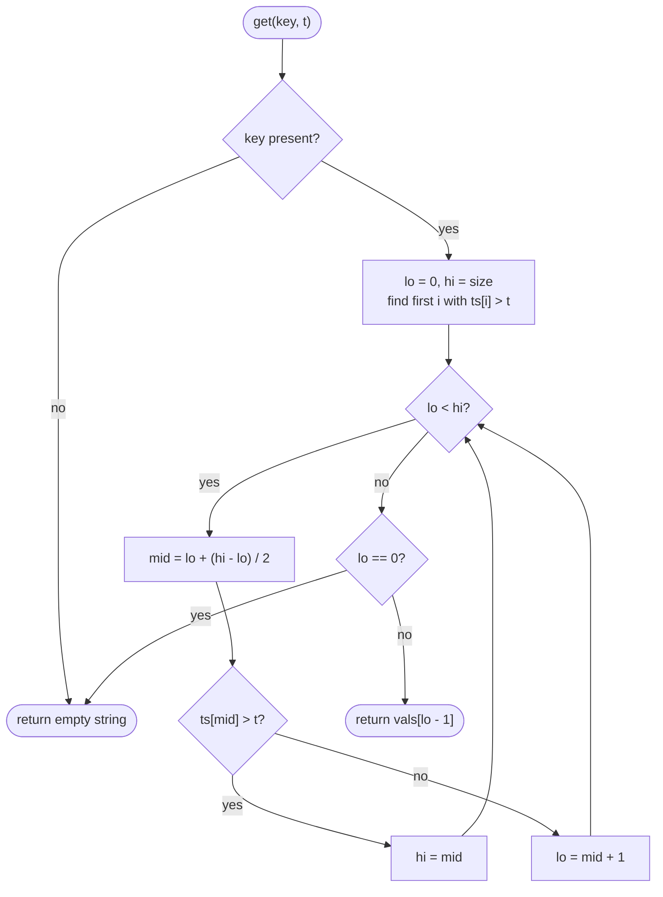

# LC 981 Time Based Key-Value Store

> [!abstract] In one sentence
> Because the problem promises that timestamps only ever increase, every key's `(timestamp, value)` history is already sorted the moment you append to it, and "the value at or before time t" is the last element with `timestamp <= t` — a binary search for the last true, which is the mirror image of the first-true template you already know.

**Map:** [[NeetCode 150 MOC]] → [[DSA Dashboard]] · Pattern: [[Binary Search]]

> [!question] Predict before you read
> Key `foo` has timestamps `[1, 4, 7]`. `get("foo", 5)` must return the value stored at 4. If you binary search for "first timestamp `> 5`", what index do you get, and how does it give you the answer?

## Problem

Design `TimeMap` with `set(key, value, timestamp)` and `get(key, timestamp)`. `get` returns the value that was set for `key` with the largest `timestamp_prev <= timestamp`, or `""` if none. All timestamps passed to `set` for the same key are strictly increasing.

- `set("foo","bar",1)`; `get("foo",1)` → `"bar"`; `get("foo",3)` → `"bar"`; `set("foo","bar2",4)`; `get("foo",4)` → `"bar2"`; `get("foo",5)` → `"bar2"`.

Constraints that matter: up to `2·10⁵` calls, timestamps up to `10⁷`, keys/values short strings. Many reads per key → reads must be sub-linear.

## Clarifying questions

1. Are timestamps strictly increasing per key? — Yes (the statement says so); this is what makes appending keep the list sorted. Ask what to do if not (insert into a `TreeMap` instead).
2. Can `get` ask for a time before the first `set`? — Yes; return `""`.
3. Can the same key be set with the same timestamp twice? — Not with strictly increasing timestamps; if allowed, the later value should win (overwrite).
4. Memory bound? — Every version is kept; `2·10⁵` entries total is fine.

## Brute force

Store `Map<String, List<Entry>>` and, on `get`, scan the list from the end for the first `timestamp <= t`: O(m) per read where `m` is the key's history length. With `10⁵` reads against a key with `10⁵` versions that is `10¹⁰`. The waste: the list is sorted and the scan ignores it.

## The key insight

Sorted list + "largest element `<= t`" = binary search for the last true of the predicate `ts[i] <= t`. The predicate is `true … true false … false`, so the answer is the last index of the true prefix, or none if even `ts[0] > t`. Two clean ways to write it: search for the *first* index with `ts[i] > t` (first-true template) and take the element before it, or use the upper-bound style loop directly. Java also has this built in: `TreeMap.floorEntry(t)` — fine in an interview if you explain it is a red-black tree with O(log m) floor lookups, but the interviewer usually wants to see the binary search.

## Optimal approach

1. `map: HashMap<String, List<int[]>>` or two parallel lists per key (`List<Integer> ts`, `List<String> vals`) — parallel lists avoid allocating a pair object per entry.
2. `set`: append `(timestamp, value)` to the key's lists — O(1) amortised, order preserved by the strictly-increasing guarantee.
3. `get`: if the key is absent return `""`. Binary search for the first index `i` with `ts[i] > t` (`lo = 0`, `hi = size`; `lo < hi`; `ts[mid] > t → hi = mid` else `lo = mid + 1`). If `lo == 0` nothing is `<= t` → `""`; else return `vals[lo − 1]`.



> [!example]- Excalidraw version — the same diagram as an editable canvas
> ![[LC 981 Time Based Key-Value Store — Optimal approach.excalidraw]]
> [[LC 981 Time Based Key-Value Store — Optimal approach.excalidraw|Open in Excalidraw]] — needs the Excalidraw plugin (see [[Plugins to Install]]).

## Walkthrough

Key `foo`: `ts = [1, 4, 7, 9]`, `vals = [a, b, c, d]`; `get("foo", 5)`:

| lo | hi | mid | ts[mid] | ts[mid] > 5? | update |
|---|---|---|---|---|---|
| 0 | 4 | 2 | 7 | yes | `hi = 2` |
| 0 | 2 | 1 | 4 | no | `lo = 2` |
| 2 | 2 | | | | exit; `lo = 2` → return `vals[1] = b` |

`get("foo", 0)`: `lo` ends at 0 → `""`. `get("foo", 100)`: `lo` ends at 4 → `vals[3] = d`.

> [!example] ts[i] > 5 over the history [1, 4, 7, 9]: first true at index 2, answer is index 1
> ![[LC 981 Time Based Key-Value Store — ts-i- - 5 over the history -1, 4, 7, 9-- first true at index 2, answer is index 1.excalidraw]]
> [[LC 981 Time Based Key-Value Store — ts-i- - 5 over the history -1, 4, 7, 9-- first true at index 2, answer is index 1.excalidraw|Open in Excalidraw]] — the first-true search for ts > t lands one past the answer; lo - 1 is the floor

%% excalidraw-spec
{"kind": "array", "title": "ts[i] > 5 over the history [1, 4, 7, 9]: first true at index 2, answer is index 1", "values": ["1: F", "4: F", "7: T", "9: T"], "pointers": {"lo": 2, "hi": 2}, "highlight": [1], "labels": {"1": "answer: last ts <= 5", "2": "first ts > 5"}, "caption": "the first-true search for ts > t lands one past the answer; lo - 1 is the floor"}
%%

## Java solution

```java
import java.util.*;

class TimeMap {
    private final Map<String, List<Integer>> times = new HashMap<>();
    private final Map<String, List<String>> values = new HashMap<>();

    public TimeMap() {}

    public void set(String key, String value, int timestamp) {
        times.computeIfAbsent(key, k -> new ArrayList<>()).add(timestamp);   // strictly increasing: stays sorted
        values.computeIfAbsent(key, k -> new ArrayList<>()).add(value);
    }

    public String get(String key, int timestamp) {
        List<Integer> ts = times.get(key);
        if (ts == null) return "";
        int lo = 0, hi = ts.size();                         // search [0, size): first index with ts > timestamp
        while (lo < hi) {
            int mid = lo + (hi - lo) / 2;
            if (ts.get(mid) > timestamp) hi = mid;
            else lo = mid + 1;
        }
        return lo == 0 ? "" : values.get(key).get(lo - 1);  // element before the first "too late" one
    }
}
```

**Time** `set` O(1) amortised, `get` O(log m) for a key with m versions · **Space** O(total entries)

The library alternative, with the same complexity:

```java
// snippet — TreeMap per key: floorEntry is the "last timestamp <= t" lookup in a red-black tree
Map<String, TreeMap<Integer, String>> store = new HashMap<>();
// set:  store.computeIfAbsent(key, k -> new TreeMap<>()).put(timestamp, value);
// get:  var m = store.get(key); if (m == null) return "";
//       var e = m.floorEntry(timestamp); return e == null ? "" : e.getValue();
```

## Why it works

Strictly increasing timestamps mean `ts` is sorted ascending after every `set`, with no sorting work. For sorted `ts`, the predicate `ts[i] > t` is monotone (`false … false true … true`), so the `lo < hi` / `hi = mid` loop returns the first true index `f` (or `size` if none); every index below `f` satisfies `ts[i] <= t`, and `f − 1` is the largest of them, which is exactly the requested entry. `f == 0` means even the earliest version is in the future → `""`. Using `hi = size` (half-open) lets `lo` land on `size` naturally when every timestamp is `<= t`.

## Edge cases

- Unknown key → `""`.
- Query before the first set (`t < ts[0]`) → `""`.
- Query after the last set → the last value.
- Exact-timestamp query → that value (`ts[mid] > t` is false for equality, so the entry stays in the true prefix).
- One version only: `size = 1`, search returns 0 or 1 correctly.
- Same key, many versions: the history grows unbounded; mention compaction or a cap if asked about memory.

## Common mistakes

> [!warning] What goes wrong
> - Searching for `ts[mid] >= t` instead of `> t`: an exact match then counts as "too late" and you return the previous version.
> - Using `hi = size − 1` with the `hi = mid` loop: the last entry can never be "first true = none", so a query after the last timestamp returns the wrong index or crashes.
> - Storing entries as `Map<Integer, String>` (HashMap) per key: no ordering, so `get` degenerates to a scan.
> - Sorting the list on every `set`: O(m log m) per write; the guarantee makes it unnecessary.
> - Returning `null` instead of `""`.
> - Allocating a `String[]`/`int[]` pair object per entry when parallel lists would do (fine, but say why you chose it).

## Variants & follow-ups

- Timestamps not monotonic: switch to `TreeMap` per key, O(log m) writes.
- "Get the value strictly before t": search for first `ts >= t` instead.
- Expire old versions / cap history: a bounded deque per key, or delete prefixes periodically.
- Thread safety: the per-key lists are append-only; a read-write lock per key or `ConcurrentHashMap` + copy-on-write; discuss with [[LC 146 LRU Cache]] in mind.
- Persisting to disk: this is the shape of an LSM-style versioned store; link to the HLD vault's key-value-store problem in your own words.

## Interview script

Restate: "versioned key-value store; `get` returns the value with the largest timestamp `<= t`; timestamps per key arrive increasing." Brute force: "scan each key's history from the end, O(m) per get." Insight: "the history is sorted for free, so I binary search for the last timestamp `<= t`, equivalently the first `> t` minus one." Approach: "`HashMap<String, List<Integer>>` of timestamps plus a parallel list of values; `set` appends; `get` runs the first-true loop over `[0, size)` and returns `vals[lo − 1]` or empty." Complexity: "O(1) amortised set, O(log m) get, O(total) space." Tests: "unknown key, query before first, exact timestamp, after last." If they push: "`TreeMap.floorEntry` does the same in library form; if timestamps were not monotonic I would use it for the writes too."

## Related

- Pattern: [[Binary Search]] (last-true / upper-bound form), [[Hashing]] (`computeIfAbsent`, map of lists)
- Prerequisites: [[LC 704 Binary Search]], [[LC 875 Koko Eating Bananas]] (the predicate-search loop)
- Siblings: [[LC 146 LRU Cache]] (another design problem with a map plus a structure); the HLD vault's "Design a Distributed Key-Value Store" problem is the same idea at system scale
- Java: [[Java Collections Cheat Sheet]] (`computeIfAbsent`, `TreeMap.floorEntry`, `List.get` cost), [[DSA Patterns in Java]]

## Attempt log

| Date | Result | Minutes | What I got wrong |
|---|---|---|---|
| | | | |

### Mastery checklist
- [ ] Solved without hints in under 25 minutes
- [ ] Stated complexity before coding
- [ ] Handled every edge case above
- [ ] Code compiled first time
- [ ] Can do the follow-up variant

## Open questions
- [ ] Rewrite `get` as a direct last-true search (`lo = 0, hi = size − 1`, upper-rounded `mid`). Why does the rounding direction matter there?
- [ ] If `set` calls could arrive out of order, what is the cost of keeping the list sorted with `Collections.binarySearch` + insert versus a `TreeMap`?
