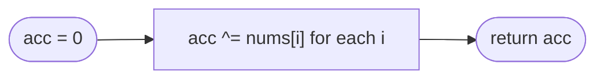

# LC 136 Single Number

> [!abstract] In one sentence
> XOR adds bits modulo 2 without carries, so two equal numbers cancel to zero no matter where they sit in the array, and the running XOR of the whole array is simply the element that had no partner.

**Map:** [[NeetCode 150 MOC]] → [[DSA Dashboard]] · Pattern: [[Bit Manipulation]]

> [!question] Predict before you read
> `4 ^ 1 ^ 2 ^ 1 ^ 2`. Reorder the terms so the pairs sit together and compute it in your head. Which two properties of XOR allowed the reordering?

## Problem

Every element of `nums` appears exactly twice except one, which appears once. Find it in linear time and constant extra space.

- `[2,2,1]` → `1`
- `[4,1,2,1,2]` → `4`
- `[1]` → `1`

Constraints that matter: up to `3·10⁴` elements, values in `[−3·10⁴, 3·10⁴]` (negatives are fine for XOR); the O(1) space requirement rules out a hash set.

## Clarifying questions

1. Exactly one element appears once and all others exactly twice? — Yes; the XOR trick depends on it.
2. Negative numbers? — Allowed; XOR works on the two's-complement bit pattern.
3. Can the array be sorted or modified? — Not needed.
4. O(1) space is required? — Yes, that is the point of the problem.

## Brute force

Hash map counts, then return the key with count 1: O(n) time, O(n) space. Or sort and scan pairs: O(n log n). Both ignore the arithmetic structure that makes O(1) space possible.

## The key insight

XOR properties: `a ^ a = 0`, `a ^ 0 = a`, and XOR is associative and commutative. XOR of the whole array can therefore be rearranged so that each pair sits together and cancels, leaving `single ^ 0 ^ 0 ^ … = single`.

## Optimal approach

1. `acc = 0`.
2. For each `x`: `acc ^= x`.
3. Return `acc`.



> [!example]- Excalidraw version — the same diagram as an editable canvas
> ![[LC 136 Single Number — Optimal approach.excalidraw]]
> [[LC 136 Single Number — Optimal approach.excalidraw|Open in Excalidraw]] — needs the Excalidraw plugin (see [[Plugins to Install]]).

## Walkthrough

`[4,1,2,1,2]`:

> [!example] Running XOR of [4, 1, 2, 1, 2] (3-bit view)
> ![[LC 136 Single Number — Running XOR of -4, 1, 2, 1, 2- (3-bit view).excalidraw]]
> [[LC 136 Single Number — Running XOR of -4, 1, 2, 1, 2- (3-bit view).excalidraw|Open in Excalidraw]] — the pairs 1,1 and 2,2 flip their bits twice and vanish; bit 2 (from 4) is the only one flipped once

%% excalidraw-spec
{"kind": "bits", "title": "Running XOR of [4, 1, 2, 1, 2] (3-bit view)", "rows": [{"label": "4", "bits": "100"}, {"label": "^ 1 = 5", "bits": "101"}, {"label": "^ 2 = 7", "bits": "111"}, {"label": "^ 1 = 6", "bits": "110"}, {"label": "^ 2 = 4", "bits": "100"}], "highlight_cols": [0], "caption": "the pairs 1,1 and 2,2 flip their bits twice and vanish; bit 2 (from 4) is the only one flipped once"}
%%

## Java solution

```java
import java.util.*;

class Solution {
    public int singleNumber(int[] nums) {
        int acc = 0;
        for (int x : nums) acc ^= x;    // pairs cancel: x ^ x == 0; the lone element survives
        return acc;
    }
}
```

**Time** O(n) · **Space** O(1)

## Why it works

Each bit position is independent under XOR, and a bit of the result is 1 iff that bit is 1 in an odd number of inputs. Every paired value contributes its bits twice (even), the single value once; so the result's bits are exactly the single value's bits. Associativity and commutativity justify computing the XOR in array order rather than pair order.

## Edge cases

- Single element → itself.
- Negative single (`[−1, 2, 2]`) → `−1`: two's complement bits XOR like any others.
- Zero as the single value → `0` (all pairs cancel to 0).
- Large arrays: no overflow concerns, XOR never carries.

## Common mistakes

> [!warning] What goes wrong
> - Using `+`/`−` tricks with a set (`2·sum(set) − sum(nums)`): correct but O(n) space and possible overflow.
> - Assuming the trick works when elements appear three times (LC 137 needs per-bit counting mod 3).
> - Starting `acc` at `nums[0]` and XOR-ing from index 0 again: cancels `nums[0]` itself.
> - Thinking XOR "sorts" or "pairs" elements: it only counts parity per bit; the property fails with two singles (LC 260 needs a split by a differing bit).

## Variants & follow-ups

- Every element appears three times except one (LC 137): count bits modulo 3, or the two-mask trick `ones`/`twos`.
- Two elements appear once (LC 260): XOR all → `a ^ b`; split by the lowest set bit of that value; XOR each group.
- Missing number in `0..n` → [[LC 268 Missing Number]] (XOR with indices).
- Find the duplicate when all others appear once: same XOR with the range.
- Swap without a temp (`a ^= b; b ^= a; a ^= b`): a party trick, dangerous when `a` and `b` alias the same variable.

## Interview script

Restate: "one element unpaired, everything else paired; O(n) time, O(1) space." Brute force: "hash counts or sort — O(n) space or O(n log n)." Insight: "XOR cancels equal values and is order-independent, so XOR-ing everything leaves the unpaired one." Approach: "one accumulator, one pass." Complexity: "O(n), O(1)." Tests: "single element, negative, zero as the answer." If they push: "three copies → bit counting mod 3; two singles → split by a differing bit."

## Related

- Pattern: [[Bit Manipulation]] (XOR cancellation)
- Siblings: [[LC 268 Missing Number]], [[LC 191 Number of 1 Bits]], [[LC 371 Sum of Two Integers]]
- Alternative tool: [[Hashing]] (count map, when space is not constrained)
- Java: [[Java Pitfalls in Interviews]] (`==` binds tighter than `^`, so `a ^ b == c` parses as `a ^ (b == c)` and does not compile — always write `(a ^ b) == c`)

## Attempt log

| Date | Result | Minutes | What I got wrong |
|---|---|---|---|
| | | | |

### Mastery checklist
- [ ] Solved without hints in under 25 minutes
- [ ] Stated complexity before coding
- [ ] Handled every edge case above
- [ ] Code compiled first time
- [ ] Can do the follow-up variant

## Open questions
- [ ] Write LC 260 (two singles): why does the lowest set bit of `a ^ b` separate `a` from `b`, and why do the pairs still cancel within each group?
- [ ] Why does `+` with carries fail where `^` succeeds? Build a 2-element example where the sum trick needs extra space.
