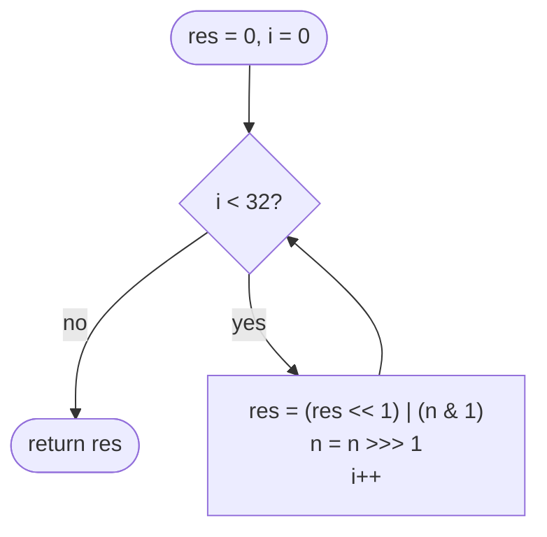

# LC 190 Reverse Bits

> [!abstract] In one sentence
> Reversing 32 bits is reversing a 32-character string of 0s and 1s: read the input from its right end one bit at a time and append each bit to the output's right end, which, after 32 steps, has placed bit 0 at position 31 and so on — the only Java-specific trap is that the "string" must be read with the unsigned shift.

**Map:** [[NeetCode 150 MOC]] → [[DSA Dashboard]] · Pattern: [[Bit Manipulation]]

> [!question] Predict before you read
> Input bits `…0001` (the number 1). After the 32-step loop, where does that single 1 end up, and what decimal value is that? Is it positive or negative as a Java `int`?

## Problem

Reverse the bits of a 32-bit unsigned integer. In Java the input and output are `int`s whose bit patterns are interpreted as unsigned.

- `00000010100101000001111010011100` (43261596) → `00111001011110000010100101000000` (964176192)
- `11111111111111111111111111111101` (−3 as a signed int) → `10111111111111111111111111111111` (−1073741825 signed)

Constraints that matter: exactly 32 bits; follow-up: the function is called many times — optimise.

## Clarifying questions

1. Signed or unsigned interpretation? — The bit pattern is what matters; the returned `int` may be negative.
2. Exactly 32 bits, including leading zeros? — Yes; leading zeros become trailing zeros.
3. Many calls with repeated inputs? — Then cache by byte: reverse each of the four bytes with a 256-entry table and reassemble.
4. Is `Integer.reverse` allowed? — Same answer as `bitCount`: show the loop, then mention it.

## Brute force

Convert to a 32-character binary string, reverse it, parse back. O(32) as well but allocation-heavy, and `Integer.toBinaryString` drops leading zeros, so you must pad — a trap in itself.

## The key insight

Each iteration moves the input's lowest bit to the output's lowest position and then shifts the output left; after 32 iterations the first bit taken (input bit 0) has been shifted left 31 times and sits at position 31. Shifting the input right must be `>>>` so that for negative inputs the vacated top bits are zeros (with `>>` the loop still terminates after 32 fixed iterations, but you would read copies of the sign bit — fine, actually, since only the low bit is read each time; the `>>>` matters in the `while (n != 0)` variant). The branch-free alternative swaps halves, then quarters, then bytes, nibbles, pairs and single bits using masks.

## Optimal approach

1. `res = 0`.
2. Repeat 32 times: `res = (res << 1) | (n & 1)`; `n >>>= 1`.
3. Return `res`.



> [!example]- Excalidraw version — the same diagram as an editable canvas
> ![[LC 190 Reverse Bits — Optimal approach.excalidraw]]
> [[LC 190 Reverse Bits — Optimal approach.excalidraw|Open in Excalidraw]] — needs the Excalidraw plugin (see [[Plugins to Install]]).

## Walkthrough

8-bit miniature with input `0000 0110` (6):

> [!example] Reversing 8 bits of 00000110 step by step (res after each of the first 4 steps, then final)
> ![[LC 190 Reverse Bits — Reversing 8 bits of 00000110 step by step (res after each of the first 4 steps, then final).excalidraw]]
> [[LC 190 Reverse Bits — Reversing 8 bits of 00000110 step by step (res after each of the first 4 steps, then final).excalidraw|Open in Excalidraw]] — bits 1 and 2 of the input land at positions 6 and 5 of the output: reversed around the centre

%% excalidraw-spec
{"kind": "bits", "title": "Reversing 8 bits of 00000110 step by step (res after each of the first 4 steps, then final)", "rows": [{"label": "n", "bits": "00000110"}, {"label": "res after 1", "bits": "00000000"}, {"label": "res after 2", "bits": "00000001"}, {"label": "res after 3", "bits": "00000011"}, {"label": "res after 4", "bits": "00000110"}, {"label": "res after 8", "bits": "01100000"}], "highlight_cols": [1, 2], "caption": "bits 1 and 2 of the input land at positions 6 and 5 of the output: reversed around the centre"}
%%

## Java solution

```java
import java.util.*;

class Solution {
    public int reverseBits(int n) {
        int res = 0;
        for (int i = 0; i < 32; i++) {
            res = (res << 1) | (n & 1);   // push the current lowest bit of n onto the right end of res
            n >>>= 1;                     // unsigned shift: never replicate the sign bit
        }
        return res;
    }
}
```

**Time** O(32) = O(1) · **Space** O(1)

Branch-free mask swapping (what `Integer.reverse` does):

```java
// snippet — swap halves, then within each half, recursively down to single bits
n = (n >>> 16) | (n << 16);
n = ((n & 0xff00ff00) >>> 8) | ((n & 0x00ff00ff) << 8);
n = ((n & 0xf0f0f0f0) >>> 4) | ((n & 0x0f0f0f0f) << 4);
n = ((n & 0xcccccccc) >>> 2) | ((n & 0x33333333) << 2);
n = ((n & 0xaaaaaaaa) >>> 1) | ((n & 0x55555555) << 1);
return n;
```

Many-queries follow-up: a 256-entry table `rev[b]` of reversed bytes, then `rev[n & 0xff] << 24 | rev[(n >>> 8) & 0xff] << 16 | rev[(n >>> 16) & 0xff] << 8 | rev[n >>> 24]`.

## Why it works

Invariant after `i` iterations: `res` holds the first `i` bits of the original input (bits 0..i−1) in reverse order in its low `i` positions, and `n` holds the original input shifted right by `i`. Each iteration appends original bit `i` at the low end of `res` after shifting the existing bits up by one, which preserves the invariant. After 32 iterations the low 32 bits of `res` are the full reversal; since `res` is a 32-bit `int`, bits shifted beyond position 31 never existed (the shift count is exactly 32 steps and `res` started empty). The sign bit of the result is original bit 0, which is why reversing an odd number yields a negative `int`.

## Edge cases

- `0` → `0`; `−1` → `−1` (all ones).
- `1` → `Integer.MIN_VALUE` (`1 << 31`).
- `Integer.MIN_VALUE` → `1`.
- Bit-palindromic patterns such as `0x81000081` (`1000 0001 0000 0000 0000 0000 1000 0001`) map to themselves.
- Inputs with the sign bit set behave like any other pattern under `>>>`.

## Common mistakes

> [!warning] What goes wrong
> - `while (n != 0)` with `>>` on a negative input: infinite loop (sign bit replicated).
> - `while (n != 0)` with `>>>`: terminates, but then you must shift `res` left by the remaining count — the fixed 32-iteration loop avoids the bookkeeping.
> - Building the result with `res |= (n & 1) << (31 − i)` is also correct; mixing the two schemes is not.
> - Treating the return as unsigned and being surprised by a negative number: it is the same bits.
> - Using `Integer.toBinaryString` and forgetting the leading zeros.

## Variants & follow-ups

- Reverse the decimal digits instead: [[LC 7 Reverse Integer]] (overflow becomes the issue).
- Reverse bits of a 64-bit value: 64 iterations or `Long.reverse`.
- Reverse the bytes only: `Integer.reverseBytes` (endianness swaps).
- Check if a number's bit pattern is a palindrome: `reverseBits(n) == n`.
- Count how many numbers in a range are bit-palindromes: iterate or construct palindromes directly.

## Interview script

Restate: "reverse the 32-bit pattern; Java's `int` sign is irrelevant." Brute force: "binary string, pad, reverse, parse." Insight: "peel the lowest bit and push it onto the result from the right, 32 times, shifting with `>>>`." Approach: "fixed loop of 32 iterations." Complexity: "O(32) time, O(1) space." Tests: "0, −1, 1, MIN_VALUE." If they push: "mask-swap in five steps is branch-free; a byte table handles many queries; `Integer.reverse` is the library call."

## Related

- Pattern: [[Bit Manipulation]] (shifts and masks)
- Siblings: [[LC 191 Number of 1 Bits]], [[LC 338 Counting Bits]], [[LC 7 Reverse Integer]]
- Java: [[Java Pitfalls in Interviews]] (`>>` vs `>>>`, hex masks are `int` literals)

## Attempt log

| Date | Result | Minutes | What I got wrong |
|---|---|---|---|
| | | | |

### Mastery checklist
- [ ] Solved without hints in under 25 minutes
- [ ] Stated complexity before coding
- [ ] Handled every edge case above
- [ ] Code compiled first time
- [ ] Can do the follow-up variant

## Open questions
- [ ] Why does the mask-swap sequence reverse the bits? Trace one bit, say bit 5, through the five steps.
- [ ] Build the byte table with the recurrence `rev[i] = (rev[i >> 1] >> 1) | ((i & 1) << 7)` and explain it.
