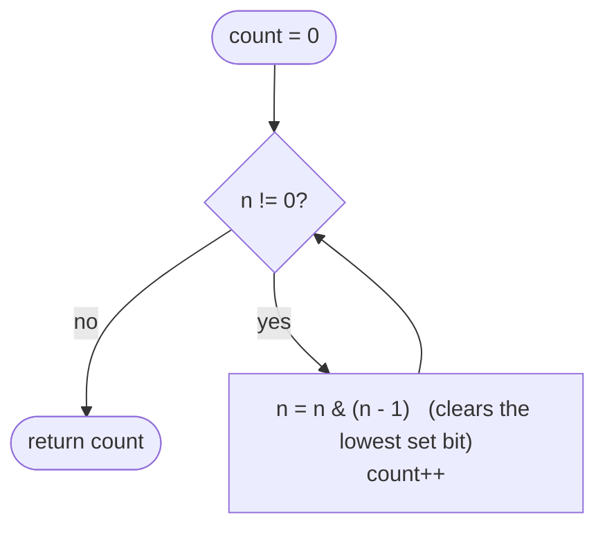

# LC 191 Number of 1 Bits

> [!abstract] In one sentence
> Subtracting 1 from a number flips its lowest set bit to 0 and every bit below it to 1, so `n & (n − 1)` deletes exactly that lowest set bit; repeat until zero and the number of repetitions is the number of ones — and in Java the input may be "negative", which only matters if you shift with `>>` instead of `>>>`.

**Map:** [[NeetCode 150 MOC]] → [[DSA Dashboard]] · Pattern: [[Bit Manipulation]]

> [!question] Predict before you read
> `n = 12 = 1100₂`. Compute `n − 1` in binary, then `n & (n − 1)`. Which bit disappeared, and why is it always the *lowest* set bit and never a higher one?

## Problem

Given an integer, return the number of set bits (Hamming weight) in its 32-bit representation. In Java the parameter is an `int` that may be negative when the top bit is set (it should be treated as unsigned).

- `11` (`1011₂`) → `3`
- `128` (`10000000₂`) → `1`
- `2147483645` → `30`
- `−1` (all 32 bits set) → `32`

Constraints that matter: the input is a 32-bit pattern; the loop must not run forever on negative values.

## Clarifying questions

1. Is the input signed or unsigned? — Treat the 32-bit pattern as unsigned; in Java that means `>>>` or the `n & (n−1)` loop, which does not care about sign.
2. Is `Integer.bitCount` allowed? — Usually after you show you know how it works; ask.
3. Many calls with the same inputs (follow-up)? — Precompute a 256-entry table for bytes, or use [[LC 338 Counting Bits]].

## Brute force

Check each of the 32 bits: `count += (n >>> i) & 1` for `i = 0..31`. O(32) always. Fine, but the interviewer wants the lowest-set-bit trick and the `>>>` awareness.

## The key insight

`n − 1` borrows from the lowest set bit: that bit becomes 0 and all lower bits (which were 0) become 1; higher bits are untouched. AND-ing with `n` therefore keeps the higher bits and clears the lowest set bit. Each iteration removes one 1-bit, so the loop runs exactly `popcount(n)` times — 1 iteration for 128, 32 for −1.

## Optimal approach

1. `count = 0`.
2. While `n != 0`: `n &= n − 1`; `count++`.
3. Return `count`.



> [!example]- Excalidraw version — the same diagram as an editable canvas
> ![[LC 191 Number of 1 Bits — Optimal approach.excalidraw]]
> [[LC 191 Number of 1 Bits — Optimal approach.excalidraw|Open in Excalidraw]] — needs the Excalidraw plugin (see [[Plugins to Install]]).

## Walkthrough

`n = 11 = 1011₂`:

> [!example] n & (n - 1) three times on 11
> ![[LC 191 Number of 1 Bits — n & (n - 1) three times on 11.excalidraw]]
> [[LC 191 Number of 1 Bits — n & (n - 1) three times on 11.excalidraw|Open in Excalidraw]] — each step erases the lowest set bit; three steps to zero, so the answer is 3

%% excalidraw-spec
{"kind": "bits", "title": "n & (n - 1) three times on 11", "rows": [{"label": "n = 11", "bits": "1011"}, {"label": "n-1 = 10", "bits": "1010"}, {"label": "n & (n-1) = 10", "bits": "1010"}, {"label": "next: 10 & 9 = 8", "bits": "1000"}, {"label": "next: 8 & 7 = 0", "bits": "0000"}], "highlight_cols": [3], "caption": "each step erases the lowest set bit; three steps to zero, so the answer is 3"}
%%

## Java solution

```java
import java.util.*;

class Solution {
    public int hammingWeight(int n) {
        int count = 0;
        while (n != 0) {
            n &= n - 1;        // clear the lowest set bit; sign bit is just another bit here
            count++;
        }
        return count;
    }
}
```

**Time** O(k) where k = number of set bits (≤ 32) · **Space** O(1)

The shift version, correct only with the unsigned shift:

```java
// snippet — bit by bit; >>> fills with zeros so negative inputs terminate after 32 steps
int count = 0;
while (n != 0) { count += n & 1; n >>>= 1; }
// Integer.bitCount(n) does the same with a parallel bit-count trick in ~12 operations
```

## Why it works

Let the lowest set bit of `n` be at position `p`. Then `n = H·2^(p+1) + 2^p` for some `H`, and `n − 1 = H·2^(p+1) + (2^p − 1)`, whose low `p+1` bits are `0 1…1`. ANDing: the high part `H·2^(p+1)` is common and survives; bit `p` is 1 in `n` and 0 in `n − 1` → 0; bits below `p` are 0 in `n` → 0. So exactly bit `p` is removed. Induction on the number of set bits gives the count. For negative `int`s the same identity holds on the two's-complement pattern; `n != 0` terminates because bits only disappear.

## Edge cases

- `n = 0` → 0 (loop skipped).
- `n = 1` → 1.
- `n = −1` (`0xFFFFFFFF`) → 32; with `>>` instead of `>>>` the shift version would loop forever.
- `n = Integer.MIN_VALUE` (only the sign bit) → 1; `n − 1` is `Integer.MAX_VALUE` and the AND gives 0 — correct, and no overflow exception in Java.
- Powers of two → 1 in one iteration.

## Common mistakes

> [!warning] What goes wrong
> - `while (n > 0)` instead of `n != 0`: negative inputs return 0 immediately.
> - `n >>= 1` (arithmetic shift) on negative numbers: the sign bit is replicated and the loop never reaches 0.
> - Counting with `n % 2` on negatives: `−3 % 2 == −1` in Java.
> - Returning `Integer.bitCount` without being able to explain any method: fine as a final answer, weak as the only one.
> - Confusing `n & (n − 1)` (clear lowest set bit) with `n & −n` (isolate lowest set bit) — the latter is the Fenwick `lowbit`.

## Variants & follow-ups

- Count bits for every number in `0..n` → [[LC 338 Counting Bits]] (DP on `n & (n − 1)` or `n >> 1`).
- Is `n` a power of two? `n > 0 && (n & (n − 1)) == 0`.
- Hamming distance between `a` and `b` (LC 461): `popcount(a ^ b)`.
- Total Hamming distance (LC 477): per bit position, `ones × zeros`.
- Fast popcount for billions of words: `Long.bitCount` uses SWAR; hardware `POPCNT` is what the JIT emits for it.

## Interview script

Restate: "number of set bits in the 32-bit pattern, which may look negative in Java." Brute force: "test 32 bits with an unsigned shift." Insight: "`n & (n − 1)` clears the lowest set bit, so the loop runs once per set bit." Approach: "loop while `n != 0`, clear and count." Complexity: "O(number of ones) ≤ 32, O(1) space." Tests: "0, 1, −1, MIN_VALUE, powers of two." If they push: "`Integer.bitCount` is the library form; precomputed byte tables answer many queries faster; `n & −n` isolates instead of clears."

## Related

- Pattern: [[Bit Manipulation]] (lowest set bit, unsigned shift)
- Siblings: [[LC 338 Counting Bits]], [[LC 190 Reverse Bits]], [[LC 136 Single Number]]
- Builds on this: [[Fenwick Trees]] (`lowbit = n & −n`, the sibling identity)
- Java: [[Java Pitfalls in Interviews]] (`>>` vs `>>>`, `%` on negatives), [[Java Collections Cheat Sheet]] (`Integer.bitCount`, `toBinaryString`)

## Attempt log

| Date | Result | Minutes | What I got wrong |
|---|---|---|---|
| | | | |

### Mastery checklist
- [ ] Solved without hints in under 25 minutes
- [ ] Stated complexity before coding
- [ ] Handled every edge case above
- [ ] Code compiled first time
- [ ] Can do the follow-up variant

## Open questions
- [ ] Derive `n & −n` (isolate the lowest set bit) from two's complement, the same way `n & (n − 1)` was derived above.
- [ ] Look up how `Integer.bitCount` works (the 0x55555555 / 0x33333333 masks) and explain why it is branch-free.
