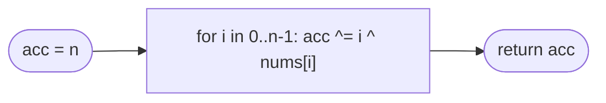

# LC 268 Missing Number

> [!abstract] In one sentence
> Pair every number in `0..n` with the array's values: the full range XOR-ed with the array contains each present number twice (cancelling) and the missing number once (surviving) — [[LC 136 Single Number]] in disguise, where the "pairs" are supplied by the index range instead of the input.

**Map:** [[NeetCode 150 MOC]] → [[DSA Dashboard]] · Pattern: [[Bit Manipulation]]

> [!question] Predict before you read
> `nums = [3, 0, 1]`, `n = 3`. Write out `0 ^ 1 ^ 2 ^ 3 ^ 3 ^ 0 ^ 1` and cancel pairs. Now say why `n` itself must be included on the range side even though the array only has indices up to `n − 1`.

## Problem

`nums` contains `n` distinct numbers from the range `[0, n]`; exactly one number of the range is missing. Return it in O(n) time and O(1) extra space.

- `[3,0,1]` → `2`
- `[0,1]` → `2`
- `[9,6,4,2,3,5,7,0,1]` → `8`

Constraints that matter: `n ≤ 10⁴`, values distinct; sorting is allowed but is O(n log n).

## Clarifying questions

1. Exactly one number missing, no duplicates? — Yes.
2. Range is `0..n` inclusive with `n = nums.length`? — Yes; the missing number may be `n` itself.
3. Constant extra space required? — Preferred; a boolean array is the easy O(n)-space version.
4. Can the input be modified? — Not needed.

## Brute force

Sort and find the first `nums[i] != i` (O(n log n)), or a `boolean[n + 1]` seen-array (O(n) space). Both correct; neither meets both bounds.

## The key insight

Two O(1)-space routes. XOR: `acc = 0 ^ 1 ^ … ^ n ^ nums[0] ^ … ^ nums[n−1]`; each present value appears once in the range and once in the array, cancelling; the missing value appears only in the range. Sum: `n(n+1)/2 − Σ nums` — fine mathematically, but the sum of up to `10⁴` values ≤ `10⁴` is `5·10⁷`, safe in `int` here; for larger `n` the XOR version never overflows, which is why it is the better interview default in Java.

## Optimal approach

1. `acc = n` (covers the range endpoint).
2. For `i = 0..n−1`: `acc ^= i ^ nums[i]`.
3. Return `acc`.



> [!example]- Excalidraw version — the same diagram as an editable canvas
> ![[LC 268 Missing Number — Optimal approach.excalidraw]]
> [[LC 268 Missing Number — Optimal approach.excalidraw|Open in Excalidraw]] — needs the Excalidraw plugin (see [[Plugins to Install]]).

## Walkthrough

`nums = [3, 0, 1]`, `n = 3`: `acc = 3`; `i = 0`: `3 ^ 0 ^ 3 = 0`; `i = 1`: `0 ^ 1 ^ 0 = 1`; `i = 2`: `1 ^ 2 ^ 1 = 2` → `2`.

> [!example] Range 0..3 above, array values below: everything pairs up except 2
> ![[LC 268 Missing Number — Range 0..3 above, array values below- everything pairs up except 2.excalidraw]]
> [[LC 268 Missing Number — Range 0..3 above, array values below- everything pairs up except 2.excalidraw|Open in Excalidraw]] — each cell shows index | value; XOR of both rows cancels every number that appears on both sides

%% excalidraw-spec
{"kind": "array", "title": "Range 0..3 above, array values below: everything pairs up except 2", "values": ["0 | 3", "1 | 0", "2 | 1", "3 | -"], "pointers": {"missing": 2}, "highlight": [2], "labels": {"3": "n sits only on the range side"}, "caption": "each cell shows index | value; XOR of both rows cancels every number that appears on both sides"}
%%

## Java solution

```java
import java.util.*;

class Solution {
    public int missingNumber(int[] nums) {
        int acc = nums.length;                     // the range endpoint n has no index partner
        for (int i = 0; i < nums.length; i++) {
            acc ^= i ^ nums[i];                    // index i and value nums[i] both enter; equal ones cancel
        }
        return acc;
    }
}
```

**Time** O(n) · **Space** O(1)

The arithmetic version:

```java
// snippet — Gauss sum; use long if n could be large
long expected = (long) n * (n + 1) / 2, actual = 0;
for (int x : nums) actual += x;
return (int) (expected - actual);
```

## Why it works

Let `M` be the missing number. The multiset `{0, …, n} ∪ nums` contains every element of `0..n` exactly twice except `M`, which appears once. XOR is commutative and associative with `x ^ x = 0`, so the XOR of the multiset equals `M`. The loop computes exactly that XOR: `n` once up front, and for each `i` both `i` and `nums[i]`. No ordering or overflow concerns: XOR has no carries.

## Edge cases

- `[0]` → 1 (`n = 1` is missing).
- `[1]` → 0.
- Missing number is `n` (`[0,1,2]` → 3): `acc` starts as 3 and every pair cancels.
- Missing number is 0: 0 contributes nothing on the range side, and no array value cancels it — the result is `0 ^ (everything else cancelled)` = 0.
- Largest input `n = 10⁴`: still a single pass.

## Common mistakes

> [!warning] What goes wrong
> - XOR-ing indices `0..n−1` only and forgetting `n`: wrong when `n` is missing.
> - Sum formula with `int` on large `n` (beyond this problem's limits): overflow; use `long`.
> - `n * (n + 1) / 2` evaluated as `n * ((n + 1) / 2)`: integer division error for even… no — for odd `n` the halving truncates; keep the multiplication first.
> - Assuming the array is sorted.
> - Confusing with [[LC 287 Find the Duplicate Number]], where values are `1..n` and one repeats — XOR with the range does *not* isolate a duplicate when another value is missing.

## Variants & follow-ups

- Two numbers missing: sum-and-sum-of-squares, or XOR + split by a differing bit (as in LC 260).
- Missing number in a sorted array: binary search for the first `nums[i] != i`, O(log n).
- One duplicate instead of one missing: [[LC 287 Find the Duplicate Number]] (cycle detection or binary search on value).
- Missing from `1..n` with duplicates present (LC 448): mark by negating `nums[|x| − 1]`.
- Missing element in an arithmetic progression (LC 1228): binary search on the expected value.

## Interview script

Restate: "`n` distinct values from `0..n`, one missing, O(n) time and O(1) space." Brute force: "sort or a seen-array." Insight: "XOR the full range with the array; present values cancel against their index twins, the missing one survives — or Gauss sum minus array sum, minding overflow." Approach: "start with `n`, XOR `i` and `nums[i]` for every `i`." Complexity: "O(n), O(1)." Tests: "missing 0, missing `n`, single element." If they push: "two missing → sum and sum of squares or XOR split; sorted input → binary search."

## Related

- Pattern: [[Bit Manipulation]] (XOR cancellation), [[Math & Geometry]] (Gauss sum)
- Prerequisites: [[LC 136 Single Number]]
- Siblings: [[LC 287 Find the Duplicate Number]], [[Arrays & Hashing]] (index-as-hash marking for LC 448)
- Java: [[Java Pitfalls in Interviews]] (sum overflow, integer division order)

## Attempt log

| Date | Result | Minutes | What I got wrong |
|---|---|---|---|
| | | | |

### Mastery checklist
- [ ] Solved without hints in under 25 minutes
- [ ] Stated complexity before coding
- [ ] Handled every edge case above
- [ ] Code compiled first time
- [ ] Can do the follow-up variant

## Open questions
- [ ] Work out the two-missing-numbers solution with XOR: after computing `a ^ b`, how does the lowest set bit split the range and the array into two single-missing problems?
- [ ] For which `n` would the `int` sum formula overflow, and does the XOR version have any limit at all?
