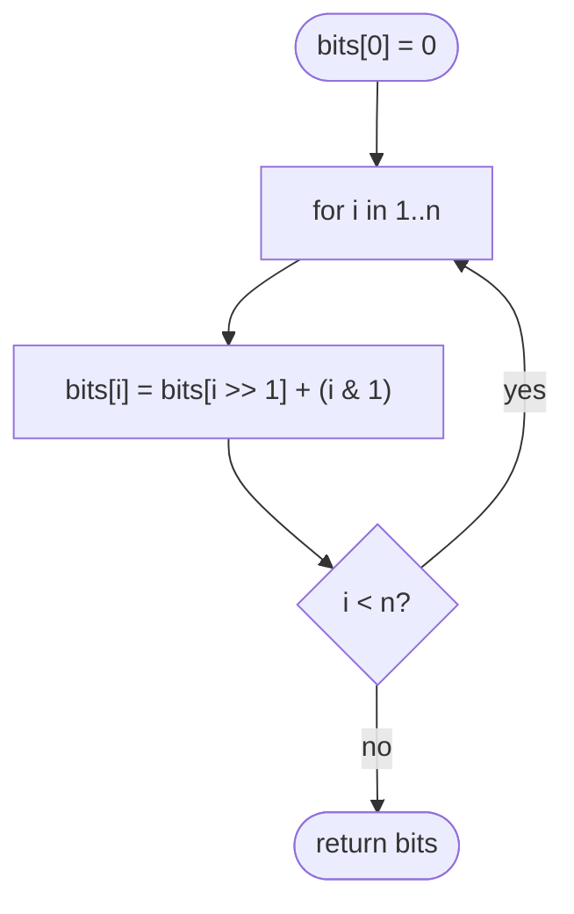

# LC 338 Counting Bits

> [!abstract] In one sentence
> Every number is a smaller number with one extra piece of information — its last bit (`i >> 1` plus `i & 1`) or its lowest set bit (`i & (i − 1)` plus one) — and because that smaller number was already answered, the count for `i` is one lookup and one addition, which is dynamic programming on the shape of integers.

**Map:** [[NeetCode 150 MOC]] → [[DSA Dashboard]] · Pattern: [[Bit Manipulation]]

> [!question] Predict before you read
> `bits[5]` where `5 = 101₂`. `5 >> 1 = 2 = 10₂` has one set bit, and `5 & 1 = 1`. Write the recurrence that gives `bits[5] = 2`, then check it on 6 and 7.

## Problem

Given `n`, return an array `ans` of length `n + 1` where `ans[i]` is the number of 1s in the binary representation of `i`.

- `n = 2` → `[0,1,1]`
- `n = 5` → `[0,1,1,2,1,2]`

Constraints that matter: `n ≤ 10⁵`; the follow-up asks for a single pass in O(n) without a built-in popcount.

## Clarifying questions

1. Is calling `Integer.bitCount` for each `i` acceptable? — As a baseline (O(n · small)); the follow-up wants the recurrence.
2. Does `ans` include `0`? — Yes, `ans[0] = 0`.
3. Memory for `n + 1` ints is fine? — Yes.

## Brute force

For each `i` run [[LC 191 Number of 1 Bits]]: O(n · popcount) ≤ O(n log n). Already fast, but it recomputes from scratch what the previous entries already contain.

## The key insight

Two equally good recurrences. (1) Drop the last bit: `i >> 1` has the same bits minus the lowest position, so `bits[i] = bits[i >> 1] + (i & 1)`. (2) Drop the lowest set bit: `i & (i − 1)` has exactly one fewer 1, so `bits[i] = bits[i & (i − 1)] + 1`. Both reference a strictly smaller index, so filling the array in increasing order never reads an unfilled cell.

## Optimal approach

1. `bits = new int[n + 1]`, `bits[0] = 0`.
2. For `i = 1..n`: `bits[i] = bits[i >> 1] + (i & 1)`.
3. Return `bits`.



> [!example]- Excalidraw version — the same diagram as an editable canvas
> ![[LC 338 Counting Bits — Optimal approach.excalidraw]]
> [[LC 338 Counting Bits — Optimal approach.excalidraw|Open in Excalidraw]] — needs the Excalidraw plugin (see [[Plugins to Install]]).

## Walkthrough

`n = 7`:

> [!example] bits[i] = bits[i >> 1] + (i & 1) for i = 0..7
> ![[LC 338 Counting Bits — bits-i- = bits-i -- 1- + (i & 1) for i = 0..7.excalidraw]]
> [[LC 338 Counting Bits — bits-i- = bits-i -- 1- + (i & 1) for i = 0..7.excalidraw|Open in Excalidraw]] — bits[5] = bits[2] + 1: the answer for 2 was computed three rows earlier

%% excalidraw-spec
{"kind": "grid", "title": "bits[i] = bits[i >> 1] + (i & 1) for i = 0..7", "col_labels": ["", "i", "binary", "i >> 1", "i & 1", "bits[i]"], "row_labels": ["", "", "", "", "", "", "", "", ""], "rows": [ [0, "000", "-", "-", 0], [1, "001", 0, 1, 1], [2, "010", 1, 0, 1], [3, "011", 1, 1, 2], [4, "100", 2, 0, 1], [5, "101", 2, 1, 2], [6, "110", 3, 0, 2], [7, "111", 3, 1, 3] ], "highlight": [ [6, 5], [3, 5] ], "arrows": [ [ [3, 5], [6, 5] ] ], "caption": "bits[5] = bits[2] + 1: the answer for 2 was computed three rows earlier"}
%%

## Java solution

```java
import java.util.*;

class Solution {
    public int[] countBits(int n) {
        int[] bits = new int[n + 1];
        for (int i = 1; i <= n; i++) {
            bits[i] = bits[i >> 1] + (i & 1);   // bits of i = bits of i without its last bit, plus that bit
        }
        return bits;
    }
}
```

**Time** O(n) · **Space** O(n) for the output

The lowest-set-bit form, one lookup and no branch on the last bit:

```java
// snippet — bits[i] = bits[i & (i - 1)] + 1
for (int i = 1; i <= n; i++) bits[i] = bits[i & (i - 1)] + 1;
```

## Why it works

`i >> 1` is `i` with its least significant bit removed (for non-negative `i` the shift is exact division by 2), so `popcount(i) = popcount(i >> 1) + lsb(i)` where `lsb(i) = i & 1`. Since `i >> 1 < i` for `i ≥ 1`, increasing-order filling guarantees the referenced entry is final. The alternative uses the fact proven in [[LC 191 Number of 1 Bits]] that `i & (i − 1)` removes exactly one set bit. Base `bits[0] = 0`. Each entry costs O(1), so O(n) total — better than the O(n log n) of counting each number independently.

## Edge cases

- `n = 0` → `[0]`.
- `n = 1` → `[0, 1]`.
- Powers of two: `bits[2^k] = bits[2^(k−1)] + 0 = 1`.
- `n = 10⁵`: array of 100 001 ints, instant.
- Negative `n`: not in the domain; guard if reused.

## Common mistakes

> [!warning] What goes wrong
> - Using `i / 2` and `i % 2`: equivalent for non-negative `i`, but shows no understanding of the bit view; use shifts and masks.
> - Starting the loop at 0 and reading `bits[0 >> 1] + (0 & 1)` — harmless here, but the base case should be explicit.
> - Writing `bits[i] = bits[i − 1] + 1` because "the count grows": false for `i = 2` (`bits[2] = 1`, not 2).
> - Off-by-one in the array length (`n` instead of `n + 1`).
> - Using `>>>` here is fine; `>>` is also fine for non-negative `i`. Know why both work in this problem and only `>>>` in [[LC 191 Number of 1 Bits]].

## Variants & follow-ups

- Count bits for arbitrary queries without the table: [[LC 191 Number of 1 Bits]].
- Sum of all bits in `0..n`: `Σ bits[i]`, or a closed form per bit position (each bit cycles with period `2^(k+1)`).
- Sort numbers by popcount then value (LC 1356): sort with `Integer.bitCount` as the key.
- Numbers with a prime number of set bits in a range (LC 762).
- Gray code (LC 89): `i ^ (i >> 1)`, another "the previous number plus one bit" idea.

## Interview script

Restate: "popcount for every integer from 0 to `n`." Brute force: "count each number with the lowest-set-bit loop, O(n log n)." Insight: "`i >> 1` is `i` without its last bit and was already computed, so `bits[i] = bits[i >> 1] + (i & 1)`." Approach: "one array, one increasing loop." Complexity: "O(n) time, O(n) output." Tests: "0, 1, powers of two." If they push: "`bits[i & (i − 1)] + 1` is the other recurrence; Gray code uses the same shift trick."

## Related

- Pattern: [[Bit Manipulation]], [[Dynamic Programming]] (a DP over integers)
- Prerequisites: [[LC 191 Number of 1 Bits]]
- Siblings: [[LC 190 Reverse Bits]], [[LC 268 Missing Number]]
- Java: [[Java Pitfalls in Interviews]] (`>>` vs `>>>`), [[Java Collections Cheat Sheet]] (`Integer.bitCount`)

## Attempt log

| Date | Result | Minutes | What I got wrong |
|---|---|---|---|
| | | | |

### Mastery checklist
- [ ] Solved without hints in under 25 minutes
- [ ] Stated complexity before coding
- [ ] Handled every edge case above
- [ ] Code compiled first time
- [ ] Can do the follow-up variant

## Open questions
- [ ] Derive a closed form for `Σ_{i=0}^{n} bits[i]` by counting how often bit `k` is set in `0..n`.
- [ ] Which of the two recurrences generalises to counting trailing zeros, and why does the other not?
