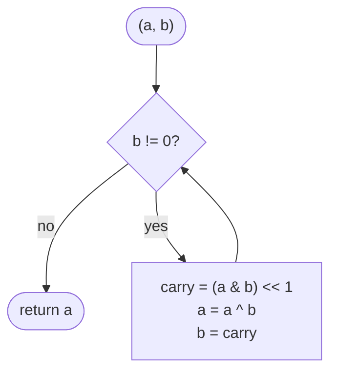

# LC 371 Sum of Two Integers

> [!abstract] In one sentence
> Binary addition is two separable effects — a bit is set where exactly one input has it (XOR) and a carry is produced where both have it (AND shifted left) — and feeding the carry back as a new addend until no carry remains is the ripple-carry adder written as a loop, which Java's fixed-width two's-complement `int` makes correct for negatives for free.

**Map:** [[NeetCode 150 MOC]] → [[DSA Dashboard]] · Pattern: [[Bit Manipulation]]

> [!question] Predict before you read
> `3 + 5`: `011 + 101`. Compute `011 ^ 101` and `(011 & 101) << 1`. Add those two numbers again with the same two operations. How many rounds until the carry is zero, and what is the final XOR?

## Problem

Given two integers `a` and `b`, return their sum without using `+` or `−`.

- `1, 2` → `3`
- `2, 3` → `5`
- `−1, 1` → `0`

Constraints that matter: values in `[−1000, 1000]`, so the sum fits in `int`; the loop must terminate for negatives (it does, because of fixed width).

## Clarifying questions

1. Are `*`, `/`, `++` also banned? — Assume only `+` and `−` are banned; the bit solution uses none of them.
2. Negative numbers? — Yes; two's complement handles them.
3. Overflow behaviour? — Inputs are small; in general the result wraps like `int` addition does.
4. Subtraction too? — `a − b = a + (~b + 1)`; the "+ 1" is itself done with the same routine.

## Brute force

Increment `a` by one `b` times (using `++`, which is arguably `+`): O(|b|) and nonsensical for negatives. Or `Math.addExact` — banned in spirit. The interviewer wants the adder.

## The key insight

For single bits, `sum = x ^ y` and `carry = x & y` (to be added at the next position). For whole words: `partial = a ^ b` (all positions summed without carries) and `carry = (a & b) << 1` (all carries moved to where they must be added). Now `a + b = partial + carry`, a smaller problem of the same shape; repeat. Each round, the lowest set bit of the carry moves at least one position left, so within 32 rounds the carry shifts out of the word and becomes 0. Negatives: Java `int` arithmetic is modulo `2³²`, and XOR/AND/shift on two's-complement patterns produce exactly the modular sum.

## Optimal approach

1. While `b != 0`: `carry = (a & b) << 1`; `a = a ^ b`; `b = carry`.
2. Return `a`.



> [!example]- Excalidraw version — the same diagram as an editable canvas
> ![[LC 371 Sum of Two Integers — Optimal approach.excalidraw]]
> [[LC 371 Sum of Two Integers — Optimal approach.excalidraw|Open in Excalidraw]] — needs the Excalidraw plugin (see [[Plugins to Install]]).

## Walkthrough

`a = 3 (011)`, `b = 5 (101)`:

> [!example] 3 + 5 with XOR and shifted AND
> ![[LC 371 Sum of Two Integers — 3 + 5 with XOR and shifted AND.excalidraw]]
> [[LC 371 Sum of Two Integers — 3 + 5 with XOR and shifted AND.excalidraw|Open in Excalidraw]] — the carry walks left one position per round until it has nothing left to collide with; 3 + 5 = 8

%% excalidraw-spec
{"kind": "bits", "title": "3 + 5 with XOR and shifted AND", "rows": [{"label": "a = 3", "bits": "0011"}, {"label": "b = 5", "bits": "0101"}, {"label": "a ^ b = 6", "bits": "0110"}, {"label": "(a & b) << 1 = 2", "bits": "0010"}, {"label": "round 2: 6 ^ 2 = 4", "bits": "0100"}, {"label": "(6 & 2) << 1 = 4", "bits": "0100"}, {"label": "round 3: 4 ^ 4 = 0", "bits": "0000"}, {"label": "(4 & 4) << 1 = 8", "bits": "1000"}, {"label": "round 4: 0 ^ 8 = 8", "bits": "1000"}], "highlight_cols": [0], "caption": "the carry walks left one position per round until it has nothing left to collide with; 3 + 5 = 8"}
%%

## Java solution

```java
import java.util.*;

class Solution {
    public int getSum(int a, int b) {
        while (b != 0) {
            int carry = (a & b) << 1;   // positions where both have a 1 produce a carry one place left
            a = a ^ b;                  // positions where exactly one has a 1 sum without carry
            b = carry;                  // add the carries in the next round
        }
        return a;
    }
}
```

**Time** O(32) = O(1) rounds worst case · **Space** O(1)

Subtraction with the same routine:

```java
// snippet — a - b == a + (-b) == a + (~b + 1); the inner +1 is getSum(~b, 1)
int negB = getSum(~b, 1);
return getSum(a, negB);
```

## Why it works

Claim: for any `a, b`, `a + b ≡ (a ^ b) + ((a & b) << 1) (mod 2³²)`. Per bit position `i` with input bits `x, y` and incoming carry handled separately: the sum bit is `x ^ y` and the carry to position `i + 1` is `x & y`; summing `(a ^ b)` and the carries placed at `i + 1` reproduces the full addition because the carries are themselves just another addend. Termination: if `c = (a & b) << 1 ≠ 0`, its lowest set bit is strictly higher than the lowest set bit of `a & b`, and since `a ^ b` has zeros exactly where `a & b` has ones, the next round's AND can only have set bits strictly above the previous carry's lowest bit; after at most 32 rounds the carry is shifted out of the 32-bit word. Java's `<<` on `int` discards bits beyond 31, which is the modular behaviour `int` addition has anyway, so negative inputs and overflow wrap identically to `+`.

## Edge cases

- `b = 0` → `a` immediately.
- `a = −1, b = 1` → carry `(−1 & 1) << 1 = 2`, `a ^ b = −2`; then `−2, 2` → `4`, `−4`; … the carry climbs to bit 31 and shifts out → 0.
- Both negative (`−3 + −5 = −8`): works by the same modular argument.
- Overflow (`MAX_VALUE + 1`): returns `MIN_VALUE`, exactly like `+`.
- `a == b`: `a ^ b = 0`, carry `= a << 1` → result `2a`.

## Common mistakes

> [!warning] What goes wrong
> - Using `>>` or `>>>` on the carry instead of `<<`: carries move left.
> - Looping `while (b > 0)`: negative carries (bit 31 set) stop the loop early.
> - Computing `a ^ b` before saving the carry: `carry` must use the original `a` and `b`.
> - Recursion `getSum(a ^ b, (a & b) << 1)`: fine, but depth up to 32 — iterate instead.
> - Believing it loops forever on negatives in Java: it cannot, because the word width is fixed (it *would* in Python without masking).
> - Using `long` to "avoid overflow": the problem's semantics are 32-bit wrap; mixing widths changes behaviour.

## Variants & follow-ups

- Subtraction: `a + (~b + 1)` (snippet).
- Multiplication without `*`: shift-and-add using `getSum` for the additions, O(32) rounds.
- Division without `/` (LC 29): repeated subtraction of doubled divisors, with `long` and the `MIN_VALUE / −1` overflow case.
- Implement an adder for `BigInteger`-style arrays of bits: the same two operations per word plus a carry between words.
- Hardware view: this is the ripple-carry adder; carry-lookahead adders compute the carries in parallel.

## Interview script

Restate: "add two 32-bit integers without `+`/`−`, negatives included." Brute force: "repeated increment — not an algorithm." Insight: "XOR is the carry-less sum, AND shifted left is the carry; add them again until the carry is zero; two's complement makes negatives work." Approach: "loop while `b != 0`: compute carry, XOR into `a`, set `b = carry`." Complexity: "at most 32 rounds, O(1) space." Tests: "`b = 0`, `−1 + 1`, both negative, overflow wrap." If they push: "subtraction via two's complement negation; multiplication via shift-and-add; this is the ripple-carry adder."

## Related

- Pattern: [[Bit Manipulation]] (XOR as carry-less addition, two's complement)
- Siblings: [[LC 136 Single Number]] (XOR properties), [[LC 191 Number of 1 Bits]], [[LC 7 Reverse Integer]] (overflow handling)
- Related arithmetic: [[LC 43 Multiply Strings]] (carries in decimal)
- Java: [[Java Pitfalls in Interviews]] (`<<` discards high bits, `>>>` vs `>>`)

## Attempt log

| Date | Result | Minutes | What I got wrong |
|---|---|---|---|
| | | | |

### Mastery checklist
- [ ] Solved without hints in under 25 minutes
- [ ] Stated complexity before coding
- [ ] Handled every edge case above
- [ ] Code compiled first time
- [ ] Can do the follow-up variant

## Open questions
- [ ] Prove the termination bound precisely: why is the number of rounds at most 32, and construct an input that needs close to that many (hint: `−1 + 1`).
- [ ] Write multiplication without `*` using `getSum`, and handle a negative multiplier.
