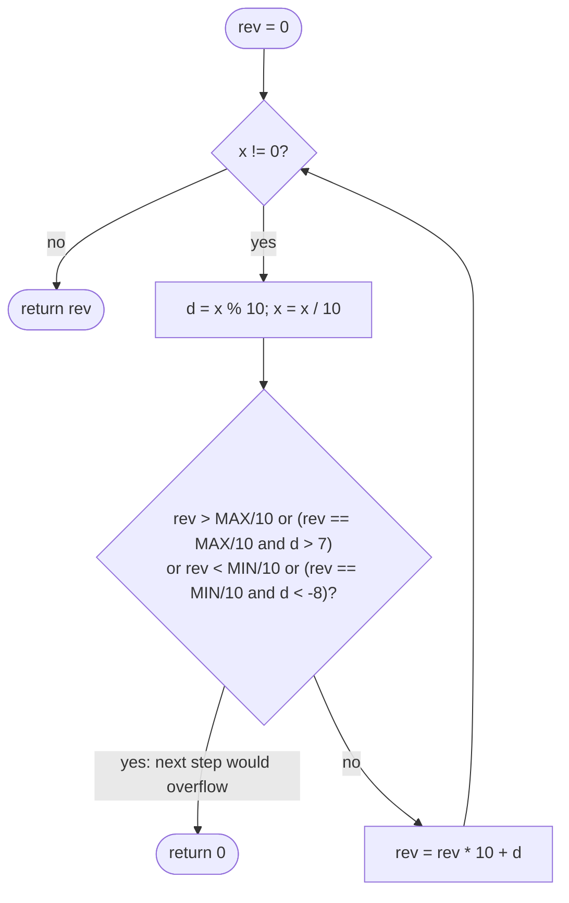

# LC 7 Reverse Integer

> [!abstract] In one sentence
> Reversing digits is trivial; the problem is that the reversed number may not fit in 32 bits, and since you are forbidden a 64-bit intermediate, you must predict the overflow one step early — `rev` can only be multiplied by 10 safely if it is below `MAX_VALUE / 10`, or equal to it with a last digit of at most 7 (resp. at least −8 on the negative side).

**Map:** [[NeetCode 150 MOC]] → [[DSA Dashboard]] · Pattern: [[Bit Manipulation]]

> [!question] Predict before you read
> `Integer.MAX_VALUE = 2147483647`. Reversing `1534236469` gives `9646324351`, which does not fit. At which step of the digit loop could you first know that the result will overflow, using only `int` comparisons?

## Problem

Given a signed 32-bit integer `x`, return `x` with its digits reversed. If the result would fall outside `[−2³¹, 2³¹ − 1]`, return `0`. Assume the environment cannot store 64-bit integers.

- `123` → `321`
- `−123` → `−321`
- `120` → `21`
- `1534236469` → `0`

Constraints that matter: the input is any `int`; the output must be checked against the 32-bit range without `long`.

## Clarifying questions

1. Is using `long` for the intermediate really forbidden? — Treat it as forbidden; show the `int`-only check, then mention `long` as the easy way.
2. Trailing zeros vanish (`120 → 21`)? — Yes.
3. Negative numbers keep their sign? — Yes; `−123 → −321`.
4. Is `Integer.MIN_VALUE` a valid input? — Yes; its reversal `−8463847412` overflows → 0.

## Brute force

Convert to a string, reverse, parse with `Integer.parseInt` inside a try/catch for `NumberFormatException` on overflow. Works, but relies on exceptions for control flow and the interviewer explicitly wants arithmetic overflow handling.

## The key insight

The loop `rev = rev * 10 + d` overflows exactly when `rev * 10 + d > MAX` (or `< MIN`). Divide by 10 to turn that into a check on the *current* `rev`: overflow iff `rev > MAX / 10`, or `rev == MAX / 10` and `d > 7` (since `MAX % 10 == 7`); symmetrically `rev < MIN / 10`, or `rev == MIN / 10` and `d < −8` (`MIN % 10 == −8`). In Java, `%` and `/` truncate toward zero, so for negative `x` the digits come out negative and `rev` stays negative — one loop handles both signs.

## Optimal approach

1. `rev = 0`.
2. While `x != 0`: `d = x % 10`; `x /= 10`; if `rev > MAX/10 || (rev == MAX/10 && d > 7)` return 0; if `rev < MIN/10 || (rev == MIN/10 && d < −8)` return 0; `rev = rev * 10 + d`.
3. Return `rev`.



> [!example]- Excalidraw version — the same diagram as an editable canvas
> ![[LC 7 Reverse Integer — Optimal approach.excalidraw]]
> [[LC 7 Reverse Integer — Optimal approach.excalidraw|Open in Excalidraw]] — needs the Excalidraw plugin (see [[Plugins to Install]]).

## Walkthrough

`x = 1534236469`:

| step | x after | d | rev before | check | rev after |
|---|---|---|---|---|---|
| 1 | 153423646 | 9 | 0 | ok | 9 |
| 2 | 15342364 | 6 | 9 | ok | 96 |
| … | … | … | … | ok | … |
| 9 | 1 | 5 | 96463243 | ok | 964632435 |
| 10 | 0 | 1 | 964632435 | 964632435 > 214748364 → overflow | return 0 |

> [!example] Digits of 1534236469 peeled from the right; the 10th digit cannot be appended
> ![[LC 7 Reverse Integer — Digits of 1534236469 peeled from the right; the 10th digit cannot be appended.excalidraw]]
> [[LC 7 Reverse Integer — Digits of 1534236469 peeled from the right; the 10th digit cannot be appended.excalidraw|Open in Excalidraw]] — the check happens before the multiply, so rev never leaves the int range

%% excalidraw-spec
{"kind": "array", "title": "Digits of 1534236469 peeled from the right; the 10th digit cannot be appended", "values": [9, 6, 4, 6, 3, 2, 4, 3, 5, 1], "pointers": {"overflow at": 9}, "highlight": [9], "labels": {"0": "first peeled", "9": "rev = 964632435 > MAX/10"}, "caption": "the check happens before the multiply, so rev never leaves the int range"}
%%

## Java solution

```java
import java.util.*;

class Solution {
    public int reverse(int x) {
        int rev = 0;
        while (x != 0) {
            int d = x % 10;                       // keeps the sign of x in Java: -123 % 10 == -3
            x /= 10;                              // truncates toward zero: -123 / 10 == -12
            if (rev > Integer.MAX_VALUE / 10 || (rev == Integer.MAX_VALUE / 10 && d > 7)) return 0;
            if (rev < Integer.MIN_VALUE / 10 || (rev == Integer.MIN_VALUE / 10 && d < -8)) return 0;
            rev = rev * 10 + d;                   // safe: the checks above guarantee no overflow
        }
        return rev;
    }
}
```

**Time** O(number of digits) ≤ 10 · **Space** O(1)

The `long` version, when the environment allows it:

```java
// snippet — accumulate in long, check once per step
long rev = 0;
while (x != 0) { rev = rev * 10 + x % 10; x /= 10; if (rev > Integer.MAX_VALUE || rev < Integer.MIN_VALUE) return 0; }
return (int) rev;
```

## Why it works

Invariant: `rev` is always the reversal of the digits consumed so far, with the sign of `x`, and lies in the `int` range. The next value `rev * 10 + d` exceeds `MAX` iff `rev > MAX / 10` (then even `rev * 10 ≥ (MAX/10 + 1) * 10 > MAX`) or `rev == MAX / 10` and `d > MAX % 10 = 7`; when `rev < MAX / 10`, `rev * 10 + d ≤ (MAX/10 − 1) * 10 + 9 < MAX`. The mirror argument with `MIN / 10 = −214748364` and `MIN % 10 = −8` covers the negative side. Because Java's `/` and `%` truncate toward zero and agree in sign with the dividend, negative inputs produce negative digits and the same formulas apply. The `d > 7` / `d < −8` cases are in fact unreachable for a 10-digit input (a reversed 10-digit `int` starts with the original's last digit, which is at most 2 for inputs near the boundary) — but the check is the correct general condition and costs nothing.

## Edge cases

- `0` → 0.
- Trailing zeros (`120` → 21, `1000` → 1).
- Negative (`−123` → −321).
- `Integer.MIN_VALUE` → 0 (overflow on the last digit).
- `1463847412` → `2147483641` (fits exactly); `1563847412` → overflow → 0.
- Single digit → itself.

## Common mistakes

> [!warning] What goes wrong
> - Checking overflow *after* `rev = rev * 10 + d`: by then the value has already wrapped and the comparison lies.
> - Using `Math.abs(x)` to normalise the sign: `Math.abs(Integer.MIN_VALUE)` is still `MIN_VALUE`.
> - Thinking `x % 10` is non-negative for negative `x` in Java (it is not; that is `Math.floorMod`).
> - Writing `rev > Integer.MAX_VALUE` with `int rev`: always false.
> - Returning `−0`-style results or forgetting that trailing zeros simply disappear.
> - Using `long` when the interviewer asked for 32-bit-only reasoning, without showing the `MAX / 10` check.

## Variants & follow-ups

- Palindrome number (LC 9): reverse half the digits and compare; no overflow risk.
- Reverse bits instead of digits: [[LC 190 Reverse Bits]].
- String to integer (LC 8): same overflow check while parsing with sign and whitespace handling.
- Reverse in another base: replace 10 with the base and recompute the boundary digits.
- Detect overflow in `a * b` generally: `Math.multiplyExact`, or compare `a > MAX / b` with sign care.

## Interview script

Restate: "reverse the decimal digits of a 32-bit integer; return 0 on overflow; no 64-bit storage." Brute force: "string reverse and parse with an exception catch." Insight: "digit loop with `% 10` and `/ 10`, which keep the sign in Java; overflow is predicted one step early by comparing `rev` with `MAX / 10` and the boundary digit 7 (or `MIN / 10` and −8)." Approach: "loop while `x != 0`, check, then `rev = rev * 10 + d`." Complexity: "O(digits), O(1)." Tests: "0, trailing zeros, negatives, MIN_VALUE, values just inside and outside the range." If they push: "with `long` it is one comparison per step; LC 8 reuses the same check while parsing."

## Related

- Pattern: [[Bit Manipulation]] (32-bit range reasoning), [[Math & Geometry]] (digit arithmetic)
- Siblings: [[LC 190 Reverse Bits]], [[LC 371 Sum of Two Integers]], [[LC 50 Pow(x, n)]] (negative exponent and `MIN_VALUE` handling)
- Java: [[Java Pitfalls in Interviews]] (`%` on negatives, `Math.abs(MIN_VALUE)`, overflow before the check)

## Attempt log

| Date | Result | Minutes | What I got wrong |
|---|---|---|---|
| | | | |

### Mastery checklist
- [ ] Solved without hints in under 25 minutes
- [ ] Stated complexity before coding
- [ ] Handled every edge case above
- [ ] Code compiled first time
- [ ] Can do the follow-up variant

## Open questions
- [ ] Show that the `d > 7` branch is unreachable for valid 10-digit inputs. Does that mean you may drop it? What would the interviewer say?
- [ ] Rewrite the loop with `Math.floorMod`/`Math.floorDiv` and explain why it then breaks for negative inputs.
