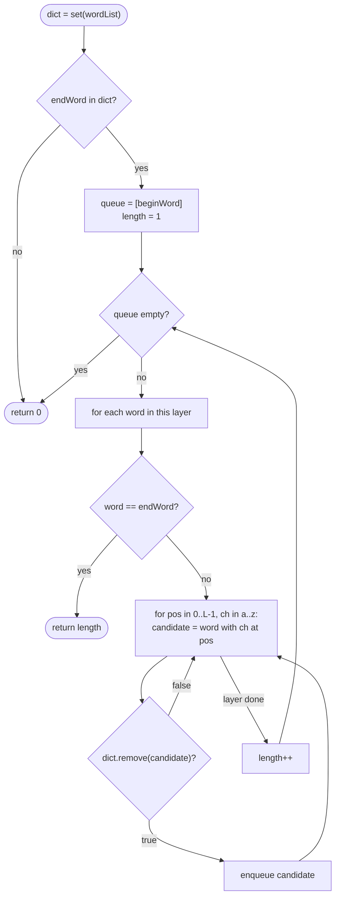

# LC 127 Word Ladder

> [!abstract] In one sentence
> "Fewest one-letter changes through valid words" is an unweighted shortest path in a graph you never build: BFS over words, where the neighbours of a word are the dictionary words at Hamming distance 1, generated on the fly by trying every letter at every position.

**Map:** [[NeetCode 150 MOC]] → [[DSA Dashboard]] · Pattern: [[Graphs]]

> [!question] Predict before you read
> With `N = 5000` words of length 10, building the graph by comparing every pair of words costs how many character comparisons? And generating neighbours by substitution (26 letters × 10 positions per word) costs how many hash lookups? Decide which one you would write before reading.

## Problem

Given `beginWord`, `endWord` and a list `wordList`, a *transformation sequence* is `beginWord → s₁ → s₂ → … → endWord` where consecutive words differ in exactly one letter and every `sᵢ` (including `endWord`) is in `wordList`. `beginWord` need not be in the list. Return the number of words in the shortest sequence, or `0` if none exists.

Example: `beginWord = "hit", endWord = "cog", wordList = ["hot","dot","dog","lot","log","cog"]` → `5` (`hit → hot → dot → dog → cog`).
Example: the same with `"cog"` removed from the list → `0`.

Constraints that matter: 1 ≤ word length `L` ≤ 10, 1 ≤ `N` ≤ 5000, all words the same length, lowercase, `beginWord != endWord`. Pairwise graph construction is O(N² · L) ≈ 2.5 × 10⁸, borderline; substitution generation is O(N · L · 26) ≈ 1.3 × 10⁶ hash lookups, comfortable.

## Clarifying questions

1. Does the answer count words or edges? — Words: the example answer is 5 for 4 changes. Start `length` at 1.
2. Must `endWord` be in `wordList`? — Yes, otherwise return 0 immediately (cheap early exit).
3. Is `beginWord` in the list? — It may or may not be; either way it is the BFS source and must be marked visited.
4. Any sequence or the length only? — Length only. Reconstructing all shortest sequences is LeetCode 126 and needs parent tracking per level.

## Brute force

Build the explicit graph: for every pair of words count differing positions, add an edge when exactly one differs, then BFS. The BFS is linear but the construction is O(N² · L); at the limits it is slow enough to time out in some languages. DFS instead of BFS is simply wrong for "shortest": it finds *a* path, not the shortest, and without depth bounding it explores an exponential number of sequences. The waste is in the N² pairing — most pairs differ in many positions and the comparison tells you nothing.

## The key insight

You do not need the graph; you need a function `neighbours(word)`. Take the word, and for each position substitute each of the 26 letters: that produces at most `26 · L` candidate strings, and the candidate is a neighbour iff it is in the dictionary `HashSet`. Then plain BFS gives the shortest path, with the dictionary set itself serving as the visited set: `dict.remove(candidate)` returning `true` means "valid, unvisited, now visited" in one call. Recognition cue: "minimum number of steps between states where a step is a small local change" — state-space BFS, the same shape as sliding puzzles and lock combinations.

## Optimal approach

1. Put `wordList` into a `HashSet`. If it does not contain `endWord`, return 0.
2. Queue with `beginWord`; remove `beginWord` from the set; `length = 1`.
3. Process the queue layer by layer. For each word in the layer: if it equals `endWord`, return `length`. Otherwise for each position and each letter `'a' … 'z'` (skipping the original letter), build the candidate; if `dict.remove(candidate)` succeeds, enqueue it.
4. After each layer, `length++`. If the queue empties, return 0.



> [!example]- Excalidraw version — the same diagram as an editable canvas
> ![[LC 127 Word Ladder — Optimal approach.excalidraw]]
> [[LC 127 Word Ladder — Optimal approach.excalidraw|Open in Excalidraw]] — needs the Excalidraw plugin (see [[Plugins to Install]]).

## Walkthrough

`hit → cog` over `["hot","dot","dog","lot","log","cog"]`. The BFS layers are exactly the distances from `hit`.

> [!example] Word Ladder: BFS layers from hit (level = number of changes)
> ![[LC 127 Word Ladder — Word Ladder- BFS layers from hit (level = number of changes).excalidraw]]
> [[LC 127 Word Ladder — Word Ladder- BFS layers from hit (level = number of changes).excalidraw|Open in Excalidraw]] — cog is reached in layer 4, so the sequence has 5 words; dot-lot and dog-log are edges BFS never needs

%% excalidraw-spec
{"kind": "graph", "title": "Word Ladder: BFS layers from hit (level = number of changes)", "directed": false, "nodes": [ {"id": "hit", "label": "hit", "level": 0}, {"id": "hot", "label": "hot", "level": 1}, {"id": "dot", "label": "dot", "level": 2}, {"id": "lot", "label": "lot", "level": 2}, {"id": "dog", "label": "dog", "level": 3}, {"id": "log", "label": "log", "level": 3}, {"id": "cog", "label": "cog", "level": 4} ], "edges": [ ["hit", "hot"], ["hot", "dot"], ["hot", "lot"], ["dot", "lot"], ["dot", "dog"], ["lot", "log"], ["dog", "log"], ["dog", "cog"], ["log", "cog"] ], "highlight_nodes": ["hit", "hot", "dot", "dog", "cog"], "highlight_edges": [ ["hit", "hot"], ["hot", "dot"], ["dot", "dog"], ["dog", "cog"] ], "caption": "cog is reached in layer 4, so the sequence has 5 words; dot-lot and dog-log are edges BFS never needs"}
%%

| `length` | Layer popped | Candidates that hit the dictionary | Dictionary after the layer |
|---|---|---|---|
| 1 | hit | hot | {dot, dog, lot, log, cog} |
| 2 | hot | dot, lot | {dog, log, cog} |
| 3 | dot, lot | dog (from dot), log (from lot) | {cog} |
| 4 | dog, log | cog (from dog; `log` finds it already removed) | {} |
| 5 | cog | equals `endWord` → return 5 | – |

Each word generates `3 × 25 = 75` candidate strings; only the ones listed survive the `remove`.

## Java solution

```java
import java.util.*;

class Solution {
    public int ladderLength(String beginWord, String endWord, List<String> wordList) {
        Set<String> dict = new HashSet<>(wordList);
        if (!dict.contains(endWord)) return 0;
        Deque<String> queue = new ArrayDeque<>();
        queue.offer(beginWord);
        dict.remove(beginWord);                              // the set doubles as "not yet visited"
        int length = 1;                                      // beginWord itself counts as word #1
        while (!queue.isEmpty()) {
            int layer = queue.size();
            for (int i = 0; i < layer; i++) {
                String word = queue.poll();
                if (word.equals(endWord)) return length;
                char[] chars = word.toCharArray();
                for (int pos = 0; pos < chars.length; pos++) {
                    char original = chars[pos];
                    for (char c = 'a'; c <= 'z'; c++) {
                        if (c == original) continue;
                        chars[pos] = c;
                        String next = new String(chars);
                        if (dict.remove(next)) queue.offer(next);   // remove == visit exactly once
                    }
                    chars[pos] = original;                   // restore before trying the next position
                }
            }
            length++;
        }
        return 0;
    }
}
```

**Time** O(N · L · 26 · L) — each of the N words is dequeued at most once, generates 26 · L candidates, and each candidate costs O(L) to build and hash; with L ≤ 10 this is about 1.3 × 10⁷ character operations · **Space** O(N · L) for the set and the queue

The bidirectional refinement searches from both ends and always expands the smaller frontier. A BFS with branching factor `b` and depth `d` touches about `b^d` words; two half-depth searches touch about `2 · b^(d/2)`.

```java
// snippet — bidirectional BFS; dict has had beginWord and endWord removed; returns the word count
Set<String> front = new HashSet<>(List.of(beginWord)), back = new HashSet<>(List.of(endWord));
int length = 1;
while (!front.isEmpty() && !back.isEmpty()) {
    if (front.size() > back.size()) { Set<String> t = front; front = back; back = t; }   // expand the smaller side
    Set<String> next = new HashSet<>();
    for (String word : front)
        for (String nb : allSubstitutions(word)) {           // the 26·L candidate strings, unfiltered
            if (back.contains(nb)) return length + 1;         // the two searches touch
            if (dict.remove(nb)) next.add(nb);
        }
    front = next;
    length++;
}
return 0;
```

Two details matter: the candidates must be checked against `back` *before* the dictionary filter (the far side's words are no longer in `dict`), and `endWord` must be removed from `dict` at the start so the forward search cannot "visit" it as an ordinary word. A third option is the wildcard-bucket graph — map every pattern like `h*t` to the words that match it, so neighbours are "all words sharing a pattern with me" — which is the right choice when `L` is large and 26 · L substitutions become expensive; for L ≤ 10 substitution is simpler and faster.

## Why it works

The implicit graph has words as nodes and an edge between words at Hamming distance 1; substitution enumerates exactly the strings at distance 1 from a word, and the set membership test keeps only the ones that are dictionary words, so `neighbours(word)` is correct and complete. BFS on an unweighted graph dequeues nodes in non-decreasing distance order, so the layer in which `endWord` is first dequeued is its shortest distance. Removing a word on enqueue is a valid visited mark because BFS reaches every node first by a shortest path, and a word enqueued later would only ever be on a path that is no shorter. The early `contains(endWord)` check is not just an optimisation: without it the BFS correctly returns 0 anyway, but after exploring everything.

## Edge cases

- `endWord` not in the list → 0 before any BFS.
- `beginWord` in the list — removed at the start so it is never re-enqueued as a "neighbour" of itself.
- `endWord` adjacent to `beginWord` (`"hit" → "hot"`, list `["hot"]`) → 2.
- No path (two disconnected clusters) — the queue empties, return 0.
- Length-1 words — each word has 25 candidates; nothing special.
- Duplicates in `wordList` — the set collapses them.

## Common mistakes

> [!warning] Pitfalls
> - **Returning the number of changes instead of words** — start at `length = 1`, or add 1 at the end; the example answer is 5.
> - **Visited set separate from the dictionary, checked only on dequeue** — the same word is enqueued from many neighbours; frontier size explodes. `dict.remove` on enqueue fixes both.
> - **Building strings with `substring` concatenation inside the 26-loop** — correct but allocates three strings per candidate; mutate a `char[]` and restore the original letter.
> - **Forgetting to restore `chars[pos]`** — subsequent positions start from a corrupted word and the search silently misses neighbours.
> - **Checking `word.equals(endWord)` on enqueue instead of dequeue** — fine if you return `length + 1`, but mixing the two conventions gives an off-by-one. Pick one.
> - **DFS "because the graph is implicit"** — exponential, and not shortest.

## Variants & follow-ups

- All shortest sequences (LeetCode 126) → BFS by layers recording, for each word, the set of predecessors in the previous layer; then DFS backwards from `endWord` to enumerate.
- Each change has a cost (e.g. vowels cost 2) → the graph is weighted; Dijkstra as in [[LC 743 Network Delay Time]].
- Allow insert/delete as well as substitute → neighbours include words of length ± 1; the same BFS with a richer generator.
- Many queries on the same dictionary → precompute the wildcard-bucket graph once and BFS per query.
- What changes if `L` is 1000 and `N` is 100? Substitution costs 26 000 candidates per word; pairwise comparison costs 10⁴ pairs × 1000 chars — now the explicit graph wins. The right choice depends on `N · L · 26` vs `N² · L`.

## Interview script

1. Restate: shortest chain of dictionary words from begin to end, one letter per step; count words; 0 if impossible.
2. Model: implicit graph, edge = Hamming distance 1; shortest path in an unweighted graph → BFS.
3. Brute force: explicit graph via pairwise comparison, O(N² · L), then BFS.
4. Approach: BFS layer by layer; neighbours by 26 · L substitutions checked against a `HashSet` that is also the visited set (`remove` on enqueue); `length` starts at 1.
5. Complexity: O(N · L² · 26) time, O(N · L) space; mention bidirectional BFS and the wildcard-bucket graph as refinements.
6. Tests: `endWord` missing, adjacent words, no path, `beginWord` in the list.

The interviewer is checking that you choose BFS over DFS and can say why, that you generate neighbours without building the graph, that your visited marking is on enqueue, and that you know the bidirectional trick exists and roughly what it saves.

## Related

- [[Graphs]] — BFS layers, implicit graphs, state-space search
- [[LC 994 Rotting Oranges]] — layer-counted BFS on a grid
- [[LC 286 Walls and Gates]] — multi-source BFS
- [[LC 133 Clone Graph]] — visited bookkeeping with a hash structure
- [[LC 743 Network Delay Time]] — when steps have weights
- [[Strings]] — `char[]` mutation versus `String` concatenation
- [[DSA Patterns in Java]] — BFS template, string neighbour generation
- [[Java Collections Cheat Sheet]] — `HashSet.remove` returns a boolean, `new String(char[])`

## Attempt log

| Date | Result | Minutes | What I got wrong |
|---|---|---|---|
| | | | |

### Mastery checklist
- [ ] Solved without hints in under 25 minutes
- [ ] Stated complexity before coding
- [ ] Handled every edge case above
- [ ] Code compiled first time
- [ ] Can do the follow-up variant (bidirectional BFS; all shortest sequences)

## Open questions
- [ ]
