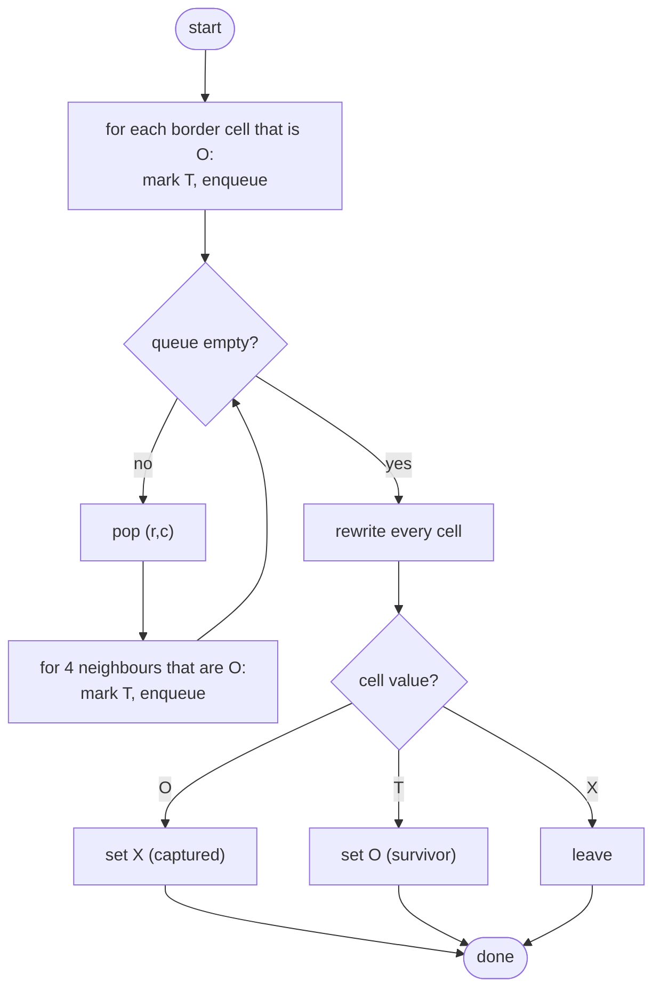

# LC 130 Surrounded Regions

> [!abstract] In one sentence
> A region of O's is captured unless it touches the border, so the cheap question is not "is this region surrounded" but "which O's are connected to the border" — flood-fill from every border O, protect what you reach, and flip the rest.

**Map:** [[NeetCode 150 MOC]] → [[DSA Dashboard]] · Pattern: [[Graphs]]

> [!question] Predict before you read
> You flood-fill an O-region from its first cell and only discover at the end that one of its cells lies on the border. What do you have to do now with every cell you already flipped? That cost is what the border-first approach removes.

## Problem

You are given an `m × n` board of characters `'X'` and `'O'`. A region is a maximal 4-connected group of `'O'` cells. A region is *surrounded* if none of its cells lies on the board's border. Capture every surrounded region by replacing its `'O'` cells with `'X'`, in place.

Example:
```
X X X X        X X X X
X O O X   →    X X X X
X X O X        X X X X
X O X X        X O X X
```
The bottom-left `O` is on the border, so it survives; the three-cell region in the middle is captured.
Example: `[ ["X"] ]` → unchanged.

Constraints that matter: 1 ≤ m, n ≤ 200 (40 000 cells). A recursive DFS over a snake-shaped region of 40 000 cells is a real stack-depth risk; the queue version has none.

## Clarifying questions

1. Does "border" mean any cell in row 0, row m−1, column 0 or column n−1? — Yes; a region touching the border anywhere survives entirely.
2. Diagonal connectivity? — No, four directions.
3. In place? — Yes; you may write a temporary third character into the board.
4. Can the whole board be O's? — Yes; then everything touches the border and nothing changes.

## Brute force

For each unvisited `'O'`, flood-fill its region into a list while noting whether any cell is on the border; if none was, flip the list. This is already O(m · n), but it needs a buffer of up to m · n cells per region and a two-phase "collect then decide" structure that is easy to get wrong (flipping as you go and then needing to undo). The slower brute force people write under pressure is "for each O, DFS to see if it can reach the border", which is O((m · n)²) because the same region is re-explored from each of its cells.

## The key insight

Reverse the question. The O's that survive are exactly those connected to a border `'O'`. You know where the border is, so start there: flood-fill from every border `'O'`, marking each reached cell with a temporary `'T'`. After that, every remaining `'O'` is provably not connected to the border and can be flipped to `'X'` with no further checks, and every `'T'` is restored to `'O'`. One traversal, no per-region decision, no undo. Recognition cue: "regions that touch / do not touch the boundary" — the same reversal as [[LC 417 Pacific Atlantic Water Flow]].

## Optimal approach

1. For every cell on the four edges that is `'O'`: mark it `'T'` and enqueue it.
2. BFS: pop a cell; for each 4-neighbour that is `'O'`, mark `'T'` and enqueue.
3. Rewrite the board: `'O'` → `'X'` (captured), `'T'` → `'O'` (survivor), `'X'` untouched.



> [!example]- Excalidraw version — the same diagram as an editable canvas
> ![[LC 130 Surrounded Regions — Optimal approach.excalidraw]]
> [[LC 130 Surrounded Regions — Optimal approach.excalidraw|Open in Excalidraw]] — needs the Excalidraw plugin (see [[Plugins to Install]]).

## Walkthrough

The example board. The only border `'O'` is (3,1); the flood from it reaches nothing else, so the three interior O's stay `'O'` after the fill and are flipped in the rewrite pass.

> [!example] Surrounded Regions: board before the rewrite pass
> ![[LC 130 Surrounded Regions — Surrounded Regions- board before the rewrite pass.excalidraw]]
> [[LC 130 Surrounded Regions — Surrounded Regions- board before the rewrite pass.excalidraw|Open in Excalidraw]] — T = reached from the border (survives); the shaded O cells were never reached and become X

%% excalidraw-spec
{"kind": "grid", "title": "Surrounded Regions: board before the rewrite pass", "col_labels": ["c0", "c1", "c2", "c3"], "row_labels": ["r0", "r1", "r2", "r3"], "rows": [ ["X", "X", "X", "X"], ["X", "O", "O", "X"], ["X", "X", "O", "X"], ["X", "T", "X", "X"] ], "highlight": [ [1, 1], [1, 2], [2, 2] ], "caption": "T = reached from the border (survives); the shaded O cells were never reached and become X"}
%%

| Phase | Cells touched | Board change |
|---|---|---|
| seed border | (3,1) is `'O'` | (3,1) → `'T'`, enqueued |
| BFS | pop (3,1): neighbours (2,1)=X, (3,0)=X, (3,2)=X | nothing enqueued, queue empties |
| rewrite | (1,1), (1,2), (2,2) are still `'O'` | → `'X'` |
| rewrite | (3,1) is `'T'` | → `'O'` |

## Java solution

```java
import java.util.*;

class Solution {
    public void solve(char[][] board) {
        int m = board.length, n = board[0].length;
        Deque<int[]> queue = new ArrayDeque<>();
        for (int r = 0; r < m; r++) { protect(board, r, 0, queue); protect(board, r, n - 1, queue); }
        for (int c = 0; c < n; c++) { protect(board, 0, c, queue); protect(board, m - 1, c, queue); }
        int[][] dirs = {{1, 0}, {-1, 0}, {0, 1}, {0, -1}};
        while (!queue.isEmpty()) {                               // flood from the border: these O's survive
            int[] cell = queue.poll();
            for (int[] d : dirs) protect(board, cell[0] + d[0], cell[1] + d[1], queue);
        }
        for (int r = 0; r < m; r++)
            for (int c = 0; c < n; c++) {
                if (board[r][c] == 'O') board[r][c] = 'X';       // never reached from the border: captured
                else if (board[r][c] == 'T') board[r][c] = 'O';  // restore the survivors
            }
    }

    // mark an O as safe and enqueue it; silently ignores out-of-range, X and already-marked cells
    private void protect(char[][] b, int r, int c, Deque<int[]> q) {
        if (r < 0 || c < 0 || r >= b.length || c >= b[0].length || b[r][c] != 'O') return;
        b[r][c] = 'T';                                           // mark on enqueue
        q.offer(new int[]{r, c});
    }
}
```

**Time** O(m · n) — each cell is enqueued at most once, plus one rewrite pass · **Space** O(m · n) worst case for the queue (an all-O board), O(1) extra otherwise because the board is the visited set

Union-Find is the other textbook answer: connect every O to its O-neighbours and connect every border O to a virtual node `m · n`; a cell survives iff it shares a root with the virtual node.

```java
// snippet — Union-Find with a virtual border node; dsu is a Union-Find over m*n + 1 elements
int border = m * n;
for (int r = 0; r < m; r++)
    for (int c = 0; c < n; c++) {
        if (board[r][c] != 'O') continue;
        int id = r * n + c;
        if (r == 0 || c == 0 || r == m - 1 || c == n - 1) dsu.union(id, border);
        if (r + 1 < m && board[r + 1][c] == 'O') dsu.union(id, id + n);
        if (c + 1 < n && board[r][c + 1] == 'O') dsu.union(id, id + 1);
    }
// then: every O whose find() != find(border) becomes X
```

It is O(m · n · α) with more code and no benefit here; it earns its place only when regions change over time (cells flipped online), where re-running a flood fill would be O(m · n) per update.

## Why it works

Let `S` be the set of O's connected (through O's) to some border O. The BFS seeded with all border O's visits exactly `S`: every cell in `S` has an O-path from a border cell, and BFS from the seeds follows O-paths only. A region is surrounded iff none of its cells is on the border iff it contains no border O iff it is disjoint from `S` (a region is connected, so if one cell were in `S` all would be). So "still `'O'` after the fill" is exactly "belongs to a surrounded region". Marking on enqueue gives each cell one queue entry and the linear bound.

## Edge cases

- Whole board `'X'` — no seeds, no fill, rewrite changes nothing.
- Whole board `'O'` — every border cell seeds; the fill marks everything `'T'`; rewrite restores all O's.
- `1 × n` or `m × 1` — every cell is a border cell; nothing is ever captured.
- `1 × 1` — a lone `'O'` is on the border and survives.
- Region touching the border only at a corner cell — the corner is seeded by both loops; the second `protect` call sees `'T'` and returns.

## Common mistakes

> [!warning] Pitfalls
> - **Flood-filling regions from the inside and deciding at the end** — you then need to undo or buffer; border-first has no undo.
> - **Seeding only the corners** — every border cell is a seed; both loops are needed (rows for the left/right columns, columns for the top/bottom rows).
> - **Forgetting the restore step** — `'T'` cells left in the board fail the test; the rewrite must handle both `'O'` and `'T'`.
> - **Recursive DFS on 200 × 200** — a 40 000-cell region can overflow the stack; use the queue or say the risk out loud.
> - **Checking `board[r][c] == "O"`** — a `String` compared with a `char`; it does not compile, but `== 'o'` (lower case) compiles and silently fails.

## Variants & follow-ups

- Reachability from the border with a height condition → [[LC 417 Pacific Atlantic Water Flow]].
- Count enclosed regions instead of flipping (LeetCode 1020 Number of Enclaves counts cells) → same border fill, then count remaining O's.
- Count regions, border or not → [[LC 200 Number of Islands]].
- Cells flipped online with "is this region still surrounded" queries → Union-Find with the virtual border node (see the snippet), since each update is a union.
- What changes if diagonal adjacency counts? Eight directions in the fill; the rest is identical.

## Interview script

1. Restate: `'O'` regions not touching the border become `'X'`, in place, 4-connectivity.
2. Brute force: fill each region while checking for border contact, then decide — needs a buffer or an undo.
3. Insight: survivors are exactly the O's connected to a border O; flood from the border and flip the rest.
4. Approach: seed the four edges, BFS marking `'T'` on enqueue, rewrite `'O'` → `'X'` and `'T'` → `'O'`.
5. Complexity: O(m · n) time, O(m · n) worst-case queue.
6. Tests: all X, all O, single row, lone corner O, region touching the border at one cell.

The interviewer is checking that you reverse the question instead of testing each region, that the temporary marker is restored, and that you can name Union-Find as the alternative and say why you did not pick it.

## Related

- [[Graphs]] — flood fill, reversing the start point, the grid as the visited set
- [[LC 200 Number of Islands]] — the plain flood fill
- [[LC 417 Pacific Atlantic Water Flow]] — the same reverse idea with a height condition
- [[LC 286 Walls and Gates]] — multi-source BFS from known targets
- [[LC 323 Number of Connected Components in an Undirected Graph]] — components via Union-Find
- [[Union-Find]] — the virtual-node trick
- [[DSA Patterns in Java]] — grid BFS template
- [[Java Collections Cheat Sheet]] — `char` comparisons, `ArrayDeque`

## Attempt log

| Date | Result | Minutes | What I got wrong |
|---|---|---|---|
| | | | |

### Mastery checklist
- [ ] Solved without hints in under 25 minutes
- [ ] Stated complexity before coding
- [ ] Handled every edge case above
- [ ] Code compiled first time
- [ ] Can do the follow-up variant (Union-Find with a virtual border node)

## Open questions
- [ ]
