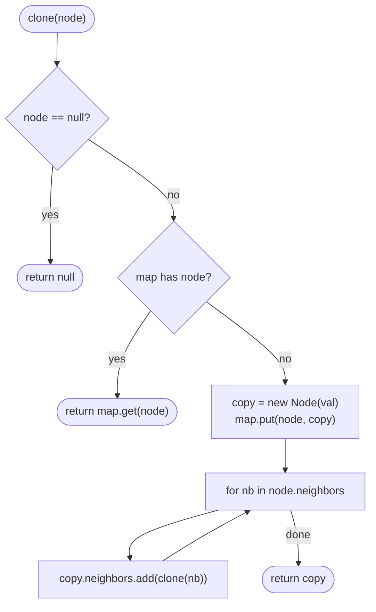

# LC 133 Clone Graph

> [!abstract] In one sentence
> Walk the graph once and keep a map `original → clone`; the map tells you both "have I been here" and "which copy do I wire this edge to", so every node is created once and every edge is copied once.

**Map:** [[NeetCode 150 MOC]] → [[DSA Dashboard]] · Pattern: [[Graphs]]

> [!question] Predict before you read
> You create a copy of node 1, then recurse into its neighbour 2 *before* recording the copy in the map. On the two-node graph 1 — 2, what happens?

## Problem

You are given a reference to one node of a connected, undirected graph. Each node has an integer `val` and a list `neighbors` of adjacent nodes. Return a deep copy of the graph: new node objects, same values, same adjacency, and no reference back into the original.

Example: the square `1 — 2 — 3 — 4 — 1` (adjacency `[ [2,4], [1,3], [2,4], [1,3] ]`) → a new square with the same adjacency.
Example: a single node with no neighbours → a new single node. `null` → `null`.

Constraints that matter: 1 ≤ number of nodes ≤ 100, values are unique and equal to `1 … n`, no self-loops, no repeated edges, and the graph is connected. Uniqueness means an array of size 101 indexed by `val` can replace the map; connectivity means one traversal from the given node reaches everything.

## Clarifying questions

1. Is the graph guaranteed connected? — Yes, so one traversal from the given node copies the whole graph.
2. Can the input be `null`? — Yes, return `null`.
3. Are values unique? — Yes, `1 … n`; you may key the map by `val` or by node identity.
4. Undirected means every edge appears in both neighbour lists? — Yes; the copy must have the same symmetry, which falls out naturally if you copy each list as you see it.

## Brute force

Two passes without a map: BFS to collect all original nodes into a list and create a bare clone for each, then for every original node and every neighbour, find the clone by scanning the list for the matching `val` — O(V · E) for the scans. Or one pass that recurses into neighbours without remembering what was already cloned, which never terminates on any cycle. The wasted work is the search for "which clone corresponds to this original"; a hash map answers it in O(1), and the same map tells you whether you have visited a node.

## The key insight

One `HashMap<Node, Node>` from original to clone does two jobs. Lookup hit → you have visited this node, return its clone immediately (no recursion). Lookup miss → create the clone, **put it in the map before touching the neighbours**, then fill `clone.neighbors` with the clones of the original's neighbours. Because every edge `u — v` is examined once from `u` and once from `v`, each clone's list ends up complete. Recognition cue: "deep copy a structure with cycles or shared references" — the same trick solves [[LC 138 Copy List with Random Pointer]].

## Optimal approach

1. If `node` is `null`, return `null`. If the map already has `node`, return `map.get(node)`.
2. Create `copy = new Node(node.val)` and store `map.put(node, copy)`.
3. For each `nb` in `node.neighbors`, add `clone(nb)` to `copy.neighbors` (the recursive call returns either the existing clone or a freshly built one).
4. Return `copy`.



> [!example]- Excalidraw version — the same diagram as an editable canvas
> ![[LC 133 Clone Graph — Optimal approach.excalidraw]]
> [[LC 133 Clone Graph — Optimal approach.excalidraw|Open in Excalidraw]] — needs the Excalidraw plugin (see [[Plugins to Install]]).

## Walkthrough

The square graph, DFS starting at node 1, neighbours visited in list order.

> [!example] Clone Graph: DFS order on the square 1-2-3-4
> ![[LC 133 Clone Graph — Clone Graph- DFS order on the square 1-2-3-4.excalidraw]]
> [[LC 133 Clone Graph — Clone Graph- DFS order on the square 1-2-3-4.excalidraw|Open in Excalidraw]] — highlighted edges are the ones that create a new clone; the other visits hit the map

%% excalidraw-spec
{"kind": "graph", "title": "Clone Graph: DFS order on the square 1-2-3-4", "directed": false, "nodes": [ {"id": "1", "label": "1", "level": 0}, {"id": "2", "label": "2", "level": 1}, {"id": "4", "label": "4", "level": 1}, {"id": "3", "label": "3", "level": 2} ], "edges": [ ["1", "2"], ["2", "3"], ["3", "4"], ["4", "1"] ], "highlight_nodes": ["1"], "highlight_edges": [ ["1", "2"], ["2", "3"], ["3", "4"] ], "caption": "highlighted edges are the ones that create a new clone; the other visits hit the map"}
%%

| Call | Map before the call | What happens |
|---|---|---|
| `clone(1)` | `{}` | create 1', register; recurse into 2, later into 4 |
| `clone(2)` | `{1}` | create 2', register; neighbour 1 is a hit (returns 1'), then recurse into 3 |
| `clone(3)` | `{1, 2}` | create 3', register; neighbour 2 is a hit, recurse into 4 |
| `clone(4)` | `{1, 2, 3}` | create 4', register; neighbours 3 and 1 are both hits; return 4' |
| unwinding | `{1, 2, 3, 4}` | 3' gets [2', 4'], 2' gets [1', 3'], 1' gets 2' and then its second neighbour 4 is a hit → [2', 4'] |

Four creations, eight neighbour lookups, every edge copied twice (once per endpoint), which is exactly what an undirected adjacency list needs.

## Java solution

```java
import java.util.*;

class Node {
    public int val;
    public List<Node> neighbors;
    public Node() { val = 0; neighbors = new ArrayList<>(); }
    public Node(int val) { this.val = val; neighbors = new ArrayList<>(); }
    public Node(int val, ArrayList<Node> neighbors) { this.val = val; this.neighbors = neighbors; }
}

class Solution {
    private final Map<Node, Node> clones = new HashMap<>();   // original -> copy; also the visited set

    public Node cloneGraph(Node node) {
        if (node == null) return null;
        Node existing = clones.get(node);
        if (existing != null) return existing;                 // seen before: reuse, do not recurse
        Node copy = new Node(node.val);
        clones.put(node, copy);                                // register BEFORE visiting neighbours
        for (Node nb : node.neighbors) copy.neighbors.add(cloneGraph(nb));
        return copy;
    }
}
```

**Time** O(V + E) — each node is cloned once, each adjacency entry is looked up once · **Space** O(V) for the map plus O(V) recursion depth in the worst case (a path graph)

The iterative BFS version creates a clone when a node is *discovered* and wires the edge when the node is *dequeued*:

```java
// snippet — BFS clone: discover = create and enqueue, dequeue = connect
Map<Node, Node> map = new HashMap<>();
Deque<Node> queue = new ArrayDeque<>();
map.put(node, new Node(node.val));
queue.offer(node);
while (!queue.isEmpty()) {
    Node cur = queue.poll();
    for (Node nb : cur.neighbors) {
        if (!map.containsKey(nb)) { map.put(nb, new Node(nb.val)); queue.offer(nb); }
        map.get(cur).neighbors.add(map.get(nb));            // the clone of cur points at the clone of nb
    }
}
return map.get(node);
```

Same complexity, no recursion depth, and the pattern "create on discovery, connect on dequeue" is worth remembering because it generalises to any structure with shared references.

## Why it works

Invariant: at any moment the map contains exactly the originals whose clone object exists, and a clone's neighbour list is complete once its `cloneGraph` call returns. Registering before recursing means any path that comes back to a node already in progress finds its clone in the map and stops, so recursion terminates on cycles. Every original neighbour entry `u → v` is processed exactly once (in `u`'s loop), producing exactly one entry `u' → v'`; since the original is undirected and symmetric, so is the copy. Connectivity guarantees the traversal from the given node reaches every node, so no node is left uncloned.

## Edge cases

- `null` input — return `null` before touching the map.
- Single node, empty neighbour list — one clone, loop body never runs.
- Two nodes `1 — 2` — the classic cycle for the "register before recursing" rule; without it the recursion never ends.
- Dense graph (every node adjacent to every other) — O(V²) edges, still fine for 100 nodes.
- Called twice on the same `Solution` instance — the map is a field; LeetCode constructs a fresh instance per test, but clear it or make it local if the interviewer asks about reuse.

## Common mistakes

> [!warning] Pitfalls
> - **Registering the clone after the recursive calls** — `StackOverflowError` on any cycle; the lookup must succeed while the node is still being processed.
> - **Shallow copy of the list** — `copy.neighbors = node.neighbors` shares the original list; the "deep copy" check fails.
> - **Keying by `val` and forgetting uniqueness is a constraint** — fine here, wrong on a graph with repeated values; keying by the node reference is always safe (`Node` does not override `equals`, so the map uses identity).
> - **Wiring edges only one way in the BFS version** — adding `map.get(nb).neighbors.add(map.get(cur))` as well doubles every edge; let the symmetric adjacency do the work.
> - **Forgetting the `null` guard** — the first line, not an afterthought.

## Variants & follow-ups

- Same trick on a linked list with an extra pointer → [[LC 138 Copy List with Random Pointer]] (map node → copy, then wire `next` and `random`).
- Directed graph → identical code; the loop simply copies out-edges.
- Weighted edges stored as `(neighbour, weight)` pairs → map keys are still nodes; copy the weight alongside.
- Clone without a map (O(1) extra space) → interleave copies into the original structure, the LC 138 trick; for graphs it is rarely worth it.
- What changes if the graph is not connected and you get a list of entry points? Run the same procedure from each entry point with one shared map.

## Interview script

1. Restate: one node of a connected undirected graph, return a structurally identical graph of new nodes.
2. Brute force: copy nodes first, then find clones by scanning for `val` while copying edges — O(V · E); or recursion without memory — never terminates.
3. Insight: a map original → clone serves as the visited set and as the edge translation table.
4. Approach: DFS; on miss create, register, then recurse into neighbours; on hit return the clone. Mention the BFS variant if asked for iteration.
5. Complexity: O(V + E) time, O(V) space.
6. Tests: `null`, single node, two-node cycle, the square.

The interviewer is checking that you register before recursing, that you know why the map replaces a visited set, and that you can switch to BFS if they worry about stack depth.

## Related

- [[Graphs]] — adjacency lists, DFS vs BFS, visited bookkeeping
- [[LC 138 Copy List with Random Pointer]] — the same map trick on a list
- [[LC 200 Number of Islands]] — DFS/BFS with the grid as the visited set
- [[LC 207 Course Schedule]] — the next step: traversal that detects cycles
- [[LC 323 Number of Connected Components in an Undirected Graph]] — when the graph is not connected
- [[DSA Patterns in Java]] — graph DFS and BFS templates
- [[Java Collections Cheat Sheet]] — `HashMap.get` vs `containsKey`, `ArrayDeque` as a queue

## Attempt log

| Date | Result | Minutes | What I got wrong |
|---|---|---|---|
| | | | |

### Mastery checklist
- [ ] Solved without hints in under 25 minutes
- [ ] Stated complexity before coding
- [ ] Handled every edge case above
- [ ] Code compiled first time
- [ ] Can do the follow-up variant (BFS version, and LC 138 with the same map)

## Open questions
- [ ]
