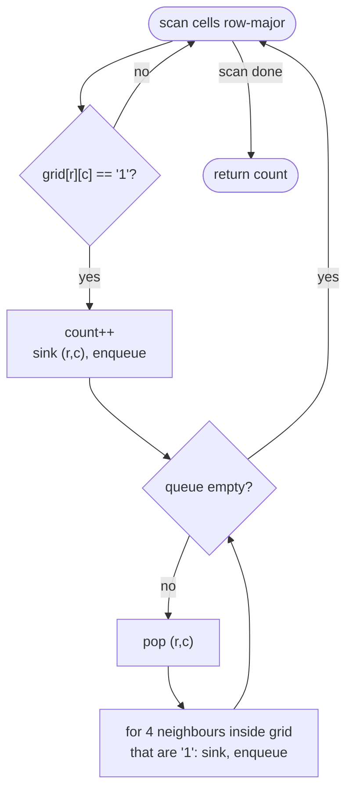

# LC 200 Number of Islands

> [!abstract] In one sentence
> An island is a connected component of the implicit graph whose nodes are land cells and whose edges join 4-adjacent land cells, so the answer is "how many times does a scan of the grid hit land that no earlier flood fill has already sunk".

**Map:** [[NeetCode 150 MOC]] → [[DSA Dashboard]] · Pattern: [[Graphs]]

> [!question] Predict before you read
> If you walk the grid row by row and simply count every land cell that has water to its left and above, where does that go wrong? Draw a U-shaped island and check.

## Problem

You are given an `m × n` grid of characters where `'1'` is land and `'0'` is water. An island is a maximal group of land cells connected horizontally or vertically (not diagonally); the grid is surrounded by water. Return the number of islands.

Example: `grid = [ [1,1,0,0,0], [1,1,0,0,0], [0,0,1,0,0], [0,0,0,1,1] ]` → `3`.
Example: `grid = [ [1,1,1,1,0], [1,1,0,1,0], [1,1,0,0,0], [0,0,0,0,0] ]` → `1`.

Constraints that matter: 1 ≤ m, n ≤ 300, so up to 90 000 cells. That is large enough that a recursive DFS can hit a deep stack on a snake-shaped island, and small enough that O(m · n) with a queue is instant.

## Clarifying questions

1. Is adjacency 4-directional? — Yes; diagonal cells belong to different islands.
2. May I modify the grid? — Usually yes (sink visited land to `'0'`). If not, keep a `boolean[][] seen`.
3. Characters or integers? — Characters `'1'`/`'0'`; compare against `'1'`, not `1`.
4. Can the grid be empty? — Constraints say no, but a guard for `grid.length == 0` costs one line.

## Brute force

Build an explicit graph: one node per land cell, an edge to each adjacent land cell, then count components with any traversal. It is still O(m · n) but allocates adjacency lists for 90 000 nodes and does nothing the grid does not already encode. The real brute force people write is worse: for each land cell, check whether any *already counted* island touches it, which needs component labels and merging — that is Union-Find reinvented badly. The grid is the adjacency structure; traverse it directly.

## The key insight

Flood fill. Scan cells in row-major order. The first land cell you see belongs to an island nobody has counted yet; count it, then visit every land cell reachable from it and mark them as water. By the time the scan moves on, that whole island has been sunk, so the next unvisited land cell you meet is necessarily a different island. Each cell is visited a constant number of times, so the total is O(m · n). Recognition cue: "count groups / regions / connected areas in a grid".

## Optimal approach

1. For each cell `(r, c)`: if it is not `'1'`, continue.
2. Increment `count`; set `grid[r][c] = '0'` and push it on a queue.
3. While the queue is not empty: pop `(r, c)`; for each of the four neighbours inside the grid that is `'1'`, set it to `'0'` and push it.
4. Return `count`.



> [!example]- Excalidraw version — the same diagram as an editable canvas
> ![[LC 200 Number of Islands — Optimal approach.excalidraw]]
> [[LC 200 Number of Islands — Optimal approach.excalidraw|Open in Excalidraw]] — needs the Excalidraw plugin (see [[Plugins to Install]]).

## Walkthrough

First example. The scan meets `(0,0)` and sinks the 2 × 2 block; then `(2,2)`; then `(3,3)` and its neighbour `(3,4)`.

> [!example] Three islands; shaded cells are sunk by the first flood fill
> ![[LC 200 Number of Islands — Three islands; shaded cells are sunk by the first flood fill.excalidraw]]
> [[LC 200 Number of Islands — Three islands; shaded cells are sunk by the first flood fill.excalidraw|Open in Excalidraw]] — after the first fill the scan continues at (0,2) and sees only water until (2,2): island 2; then (3,3): island 3

%% excalidraw-spec
{"kind": "grid", "title": "Three islands; shaded cells are sunk by the first flood fill", "col_labels": ["c0", "c1", "c2", "c3", "c4"], "row_labels": ["r0", "r1", "r2", "r3"], "rows": [ [1, 1, 0, 0, 0], [1, 1, 0, 0, 0], [0, 0, 1, 0, 0], [0, 0, 0, 1, 1] ], "highlight": [ [0, 0], [0, 1], [1, 0], [1, 1] ], "caption": "after the first fill the scan continues at (0,2) and sees only water until (2,2): island 2; then (3,3): island 3"}
%%

| Scan position | Action | count | Cells sunk by the fill |
|---|---|---|---|
| (0,0) | land → fill | 1 | (0,0) (0,1) (1,0) (1,1) |
| (0,1) … (2,1) | water or already sunk | 1 | – |
| (2,2) | land → fill | 2 | (2,2) |
| (3,3) | land → fill | 3 | (3,3) (3,4) |
| (3,4) | already sunk | 3 | – |

## Java solution

```java
import java.util.*;

class Solution {
    public int numIslands(char[][] grid) {
        int m = grid.length, n = grid[0].length, count = 0;
        int[][] dirs = {{1, 0}, {-1, 0}, {0, 1}, {0, -1}};
        Deque<int[]> queue = new ArrayDeque<>();
        for (int r = 0; r < m; r++) {
            for (int c = 0; c < n; c++) {
                if (grid[r][c] != '1') continue;
                count++;                                   // unvisited land = a new island
                grid[r][c] = '0';                          // mark when enqueued, not when dequeued
                queue.offer(new int[]{r, c});
                while (!queue.isEmpty()) {
                    int[] cell = queue.poll();
                    for (int[] d : dirs) {
                        int nr = cell[0] + d[0], nc = cell[1] + d[1];
                        if (nr < 0 || nc < 0 || nr >= m || nc >= n || grid[nr][nc] != '1') continue;
                        grid[nr][nc] = '0';
                        queue.offer(new int[]{nr, nc});
                    }
                }
            }
        }
        return count;
    }
}
```

**Time** O(m · n) — every cell is scanned once and enqueued at most once · **Space** O(m · n) worst case for the queue (an all-land grid), O(1) extra beyond that because the grid is the visited set

The recursive DFS is shorter and most people's first instinct:

```java
// snippet — recursive sink; depth can reach m·n on a snake-shaped island
void sink(char[][] g, int r, int c) {
    if (r < 0 || c < 0 || r >= g.length || c >= g[0].length || g[r][c] != '1') return;
    g[r][c] = '0';
    sink(g, r + 1, c); sink(g, r - 1, c); sink(g, r, c + 1); sink(g, r, c - 1);
}
```

On a 300 × 300 grid a single winding island can produce ~90 000 nested calls, which is beyond the default Java thread stack. Say that out loud and use the queue (or an explicit `ArrayDeque` as a stack) when the grid is large.

## Why it works

Invariant after processing cell `(r, c)` in the scan: every land cell in a component that contains any cell at or before `(r, c)` has been sunk, and `count` equals the number of such components. When the scan meets a `'1'`, that cell's component contains no earlier cell (else it would be sunk), so it is a new component and `count++` is correct; the flood fill then sinks exactly that component, because BFS from a cell reaches precisely the cells connected to it. Marking on enqueue guarantees each cell enters the queue once, which gives the linear bound and prevents double counting.

## Edge cases

- All water — the scan never fills; return 0.
- All land — one fill sinks everything; the queue holds up to m · n entries.
- Single cell — `'1'` → 1, `'0'` → 0.
- Diagonal-only contact — two islands; the direction array has no diagonals.
- `1 × n` or `m × 1` grids — the bounds checks cover both; nothing special.

## Common mistakes

> [!warning] Pitfalls
> - **Marking visited on dequeue** — the same cell can be enqueued from several neighbours before it is popped; on a solid block this multiplies the queue size by up to 4 and, with DFS, can even overflow.
> - **Comparing `grid[r][c] == 1`** — the grid holds the char `'1'` (code 49); the comparison is always false and the answer is 0.
> - **Counting during the fill instead of at the scan** — `count++` belongs where the scan discovers land, once per island.
> - **Recursion on 300 × 300** — `StackOverflowError` on adversarial inputs; use the queue or mention the risk.
> - **Forgetting the bounds check before reading the neighbour** — `ArrayIndexOutOfBoundsException`.

## Variants & follow-ups

- Size of the biggest island → the same fill returning a count: [[LC 695 Max Area of Island]].
- Islands touching the border are special → fill from the border first: [[LC 130 Surrounded Regions]].
- Components in an explicit edge list → [[LC 323 Number of Connected Components in an Undirected Graph]] with Union-Find or DFS.
- Islands added one at a time with a running count (LeetCode 305) → Union-Find over cells: each new land cell adds a component, each union with a neighbouring land cell removes one.
- Multi-source spread in the same grid → [[LC 994 Rotting Oranges]].
- What changes if the grid does not fit in memory? Process row by row with Union-Find on the current row plus the previous row's labels — the streaming version of the same idea.

## Interview script

1. Restate: grid of land/water, 4-adjacency, count maximal connected land groups.
2. Brute force: explicit graph plus component counting, or per-cell neighbour checks that need label merging — unnecessary.
3. Insight: islands are components; scan, and flood-fill each new land cell, sinking what you visit.
4. Approach: row-major scan, BFS with a queue and a direction array, mark on enqueue, count at discovery.
5. Complexity: O(m · n) time, O(m · n) worst-case queue.
6. Tests: all water, all land, single cell, diagonal neighbours, a snake island (stack depth).

The interviewer is checking that you see the grid as a graph without building one, that you mark on enqueue, and that you know the recursion-depth risk at m · n = 90 000.

## Related

- [[Graphs]] — grid traversal, BFS vs DFS, the direction array
- [[LC 695 Max Area of Island]] — the fill that returns a size
- [[LC 130 Surrounded Regions]] — fill from the border
- [[LC 323 Number of Connected Components in an Undirected Graph]] — components without a grid
- [[LC 994 Rotting Oranges]] — multi-source BFS on a grid
- [[Union-Find]] — the online (islands added over time) variant
- [[DSA Patterns in Java]] — grid BFS template
- [[Java Collections Cheat Sheet]] — `ArrayDeque` as a queue, `int[]` pairs

## Attempt log

| Date | Result | Minutes | What I got wrong |
|---|---|---|---|
| | | | |

### Mastery checklist
- [ ] Solved without hints in under 25 minutes
- [ ] Stated complexity before coding
- [ ] Handled every edge case above
- [ ] Code compiled first time
- [ ] Can do the follow-up variant (islands added online with Union-Find)

## Open questions
- [ ]
