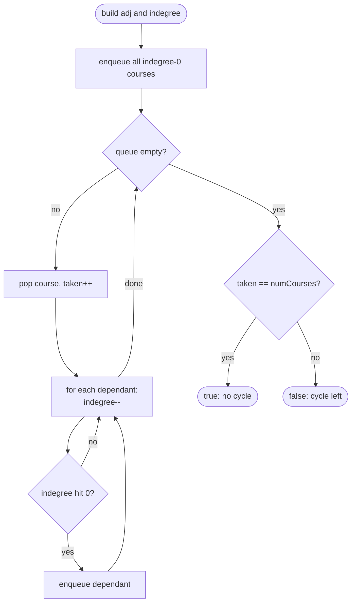

# LC 207 Course Schedule

> [!abstract] In one sentence
> Courses are nodes and "b before a" is an edge b → a, so the question is whether the directed graph is acyclic; Kahn's algorithm peels off zero-indegree nodes and any node it cannot reach is stuck on a cycle.

**Map:** [[NeetCode 150 MOC]] → [[DSA Dashboard]] · Pattern: [[Graphs]]

> [!question] Predict before you read
> In a DFS, meeting a node you have already *finished* is harmless, but meeting one that is still *on the current path* means a cycle. Why does a plain `boolean visited[]` not let you tell those two cases apart?

## Problem

There are `numCourses` courses labelled `0 … numCourses − 1` and a list of pairs `[a, b]` meaning "you must take `b` before `a`". Return `true` if it is possible to finish every course, `false` otherwise.

Example: `numCourses = 2, prerequisites = [ [1,0] ]` → `true` (take 0, then 1).
Example: `numCourses = 2, prerequisites = [ [1,0], [0,1] ]` → `false` (each needs the other).

Constraints that matter: 1 ≤ numCourses ≤ 2000, up to 5000 pairs, all pairs distinct. Small enough for anything linear; large enough that a recursive DFS over a 2000-node chain is fine (depth 2000) but worth a sentence.

## Clarifying questions

1. Direction of the pair? — `[a, b]` means `b` is a prerequisite of `a`; I will draw the edge `b → a` so that an order of taking courses is a topological order.
2. Can there be courses with no prerequisites and no dependants? — Yes; they are isolated nodes and always "finish".
3. Duplicate pairs? — Constraints say no; if allowed, a duplicate edge just increments indegree twice and decrements twice, so Kahn's algorithm still works.
4. Do I need the order itself? — Not here; that is [[LC 210 Course Schedule II]] with the same code plus a list.

## Brute force

For each course, DFS along prerequisite edges and see whether you come back to the start: O(V · (V + E)) — up to about 10⁷ steps here, so it passes, but it re-explores the same subgraph from every node. Worse, people often implement it with a single `visited` array that is never reset and then cannot distinguish "reached earlier via another branch" from "reached again on the current path", which produces false cycles. The wasted work is re-walking the graph; the real problem is the bookkeeping.

## The key insight

A directed graph has a topological order iff it has no cycle, and Kahn's algorithm constructs the order while testing for it: a course with indegree 0 has no unmet prerequisites, so take it, and taking it lowers the indegree of everything that depended on it. If a cycle exists, none of its nodes ever reaches indegree 0 (each waits for another cycle member), so the number of courses taken falls short of `numCourses`. Recognition cue: "can all tasks be completed given before/after constraints" — dependency resolution.

## Optimal approach

1. Build the adjacency list `adj[b] ∋ a` for each pair `[a, b]`, and `indegree[a]++`.
2. Push every course with `indegree == 0` onto a queue.
3. Pop a course, count it as taken, and for each dependant `a` decrement `indegree[a]`; push `a` when it hits 0.
4. Return `taken == numCourses`.



> [!example]- Excalidraw version — the same diagram as an editable canvas
> ![[LC 207 Course Schedule — Optimal approach.excalidraw]]
> [[LC 207 Course Schedule — Optimal approach.excalidraw|Open in Excalidraw]] — needs the Excalidraw plugin (see [[Plugins to Install]]).

## Walkthrough

`numCourses = 4, prerequisites = [ [1,0], [2,0], [3,1], [3,2] ]` → `true`. Edges 0→1, 0→2, 1→3, 2→3; a diamond.

> [!example] Course Schedule: diamond dependency graph (edge = must come before)
> ![[LC 207 Course Schedule — Course Schedule- diamond dependency graph (edge = must come before).excalidraw]]
> [[LC 207 Course Schedule — Course Schedule- diamond dependency graph (edge = must come before).excalidraw|Open in Excalidraw]] — Kahn peels level by level; course 3 waits until both 1 and 2 are taken

%% excalidraw-spec
{"kind": "graph", "title": "Course Schedule: diamond dependency graph (edge = must come before)", "directed": true, "nodes": [ {"id": "0", "label": "0 (in 0)", "level": 0}, {"id": "1", "label": "1 (in 1)", "level": 1}, {"id": "2", "label": "2 (in 1)", "level": 1}, {"id": "3", "label": "3 (in 2)", "level": 2} ], "edges": [ ["0", "1"], ["0", "2"], ["1", "3"], ["2", "3"] ], "highlight_nodes": ["0"], "caption": "Kahn peels level by level; course 3 waits until both 1 and 2 are taken"}
%%

| Step | Queue before | Popped | Indegree after `[0,1,2,3]` | `taken` |
|---|---|---|---|---|
| seed | – | – | [0, 1, 1, 2] | 0 |
| 1 | [0] | 0 | [0, 0, 0, 2] → push 1, 2 | 1 |
| 2 | [1, 2] | 1 | [0, 0, 0, 1] | 2 |
| 3 | [2] | 2 | [0, 0, 0, 0] → push 3 | 3 |
| 4 | [3] | 3 | [0, 0, 0, 0] | 4 |

`taken == 4` → `true`. Add the pair `[0, 3]` (edge 3→0): indegree becomes `[1, 1, 1, 2]`, the queue starts empty, `taken` stays 0 → `false`.

## Java solution

```java
import java.util.*;

class Solution {
    public boolean canFinish(int numCourses, int[][] prerequisites) {
        List<List<Integer>> adj = new ArrayList<>();
        for (int i = 0; i < numCourses; i++) adj.add(new ArrayList<>());
        int[] indegree = new int[numCourses];
        for (int[] p : prerequisites) {           // p = [course, prereq]: edge prereq -> course
            adj.get(p[1]).add(p[0]);
            indegree[p[0]]++;
        }
        Deque<Integer> queue = new ArrayDeque<>();
        for (int i = 0; i < numCourses; i++) if (indegree[i] == 0) queue.offer(i);
        int taken = 0;
        while (!queue.isEmpty()) {
            int course = queue.poll();
            taken++;
            for (int next : adj.get(course))
                if (--indegree[next] == 0) queue.offer(next);   // its last prerequisite is done
        }
        return taken == numCourses;                             // anything left sits on a cycle
    }
}
```

**Time** O(V + E) — each course is enqueued once, each edge decrements one counter · **Space** O(V + E) for the adjacency list, O(V) for indegrees and the queue

The DFS alternative uses three colours: white (0) unvisited, grey (1) on the current recursion path, black (2) finished. A grey neighbour is a back edge, hence a cycle; a black one is a node whose subtree was already cleared.

```java
// snippet — DFS cycle detection; call for every white node, return false if any call finds a cycle
boolean hasCycle(int u, List<List<Integer>> adj, int[] color) {
    color[u] = 1;                                       // grey: on the path
    for (int v : adj.get(u)) {
        if (color[v] == 1) return true;                 // back edge to an ancestor still open
        if (color[v] == 0 && hasCycle(v, adj, color)) return true;
    }
    color[u] = 2;                                       // black: fully explored, safe to revisit
    return false;
}
```

Both are O(V + E). Kahn's version is iterative, gives the order for free and is the one to default to; the DFS version is shorter if you only need a yes/no and you remember the three colours.

## Why it works

Kahn invariant: every course in the queue has all its prerequisites already taken. Popping it and decrementing its dependants keeps the invariant, so the sequence of pops is a valid order. If the graph is acyclic, some node always has indegree 0 among the remaining nodes (a DAG has a source), so the process takes every course. If there is a cycle, every node on it has a predecessor on the cycle that is never taken, so its indegree never reaches 0, and `taken < numCourses`. The DFS argument: a directed graph has a cycle iff DFS finds a back edge, i.e. an edge to a grey node.

## Edge cases

- No prerequisites — every course seeds the queue; `taken == numCourses` immediately.
- Self-loop `[a, a]` — `indegree[a]` is 1 and only `a` can decrement it; `a` is never taken → `false`. (Constraints exclude it, but the code is correct.)
- Disconnected graph with one cyclic component — the acyclic components are taken, the cyclic one is not → `false`.
- `numCourses = 1`, no pairs → `true`.
- Long chain 0→1→…→1999 — Kahn handles it iteratively; recursive DFS reaches depth 2000, still fine.

## Common mistakes

> [!warning] Pitfalls
> - **Edge direction reversed** — building `adj[a] ∋ b` still detects cycles correctly (a reversed graph has the same cycles), but the order you get in LC 210 is backwards; fix the direction here so the follow-up is free.
> - **A single boolean `visited` in DFS** — cannot distinguish "finished" from "on the path"; reports a cycle on the diamond above. Three colours, or a separate `onPath` array.
> - **Not seeding every indegree-0 course** — starting from course 0 only misses other sources.
> - **Pushing a course when its indegree is decremented but not yet 0** — it enters the queue with unmet prerequisites and may be counted twice.
> - **Returning `queue.isEmpty()` or similar** — the queue is always empty at the end; compare `taken` with `numCourses`.

## Variants & follow-ups

- Return the order itself → [[LC 210 Course Schedule II]]: record the pops.
- Derive the edges from data (sorted words) and then topologically sort → [[LC 269 Alien Dictionary]].
- Undirected cycle detection is a different test (parent tracking or Union-Find) → [[LC 261 Graph Valid Tree]].
- Minimum semesters when any number of courses can be taken in parallel → number of Kahn layers (process the queue level by level).
- What changes if prerequisites can be added online and you must answer "still feasible" after each? Re-running Kahn is O(V + E) per update; incremental cycle detection is a research topic — say that, then offer the re-run.

## Interview script

1. Restate: courses and before/after pairs; can every course be taken?
2. Model: directed graph, edge prerequisite → course; feasible iff acyclic.
3. Brute force: DFS from every node looking for a return to the start, O(V · (V + E)), with error-prone visited bookkeeping.
4. Approach: Kahn — indegrees, queue of zero-indegree courses, pop and decrement, compare the count. Mention DFS three-colour as the alternative.
5. Complexity: O(V + E) time and space.
6. Tests: no edges, two-node cycle, diamond, disconnected graph with a cycle.

The interviewer is checking that you state the direction of the edge explicitly, that you know why `taken == numCourses` detects cycles, and that you can explain grey vs black if they ask for DFS.

## Related

- [[Graphs]] — directed graphs, topological sort, cycle detection
- [[LC 210 Course Schedule II]] — same algorithm, return the order
- [[LC 269 Alien Dictionary]] — topological sort where you must first build the edges
- [[LC 261 Graph Valid Tree]] — the undirected cycle question
- [[LC 133 Clone Graph]] — plain traversal before adding cycle logic
- [[DSA Patterns in Java]] — topological sort (Kahn and DFS) templates
- [[Java Collections Cheat Sheet]] — `List<List<Integer>>` adjacency, `ArrayDeque<Integer>`

## Attempt log

| Date | Result | Minutes | What I got wrong |
|---|---|---|---|
| | | | |

### Mastery checklist
- [ ] Solved without hints in under 25 minutes
- [ ] Stated complexity before coding
- [ ] Handled every edge case above
- [ ] Code compiled first time
- [ ] Can do the follow-up variant (DFS with three colours; minimum number of semesters)

## Open questions
- [ ]
