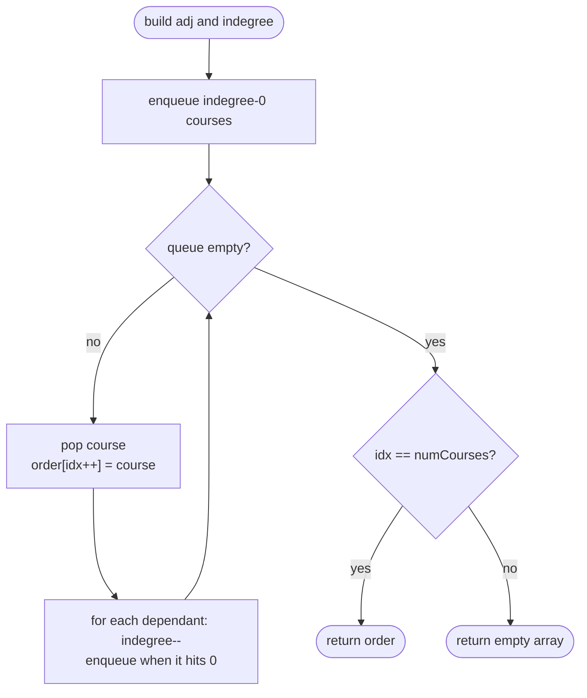

# LC 210 Course Schedule II

> [!abstract] In one sentence
> The sequence in which Kahn's algorithm pops courses is itself a topological order, so [[LC 207 Course Schedule]] plus an output array solves this; if the array is not full at the end, there was a cycle and the answer is empty.

**Map:** [[NeetCode 150 MOC]] → [[DSA Dashboard]] · Pattern: [[Graphs]]

> [!question] Predict before you read
> In the DFS version a node is appended to a list after all its descendants are finished. Is that list the order to take courses, or the reverse of it? Decide before you read, using the single edge 0 → 1.

## Problem

Same setting as [[LC 207 Course Schedule]]: `numCourses` courses and pairs `[a, b]` meaning take `b` before `a`. Return *any* order in which all courses can be taken. If it is impossible, return an empty array.

Example: `numCourses = 2, prerequisites = [ [1,0] ]` → `[0, 1]`.
Example: `numCourses = 4, prerequisites = [ [1,0], [2,0], [3,1], [3,2] ]` → `[0, 1, 2, 3]` or `[0, 2, 1, 3]`.
Example: `numCourses = 1, prerequisites = []` → `[0]`.

Constraints that matter: 1 ≤ numCourses ≤ 2000, up to 5000 distinct pairs. Any valid order is accepted, so the judge checks the constraints, not a specific sequence.

## Clarifying questions

1. Any valid order, or a specific one (lexicographically smallest)? — Any. If they want the smallest, replace the queue by a min-heap: O(E log V).
2. Edge direction? — `[a, b]`: `b → a`. Say it out loud; the output order depends on it.
3. Courses with no constraints at all? — They can appear anywhere; Kahn puts them first.
4. What to return on a cycle? — An empty `int[0]`, not `null`.

## Brute force

Try permutations and check each against the pairs: O(V! · E). Or repeatedly scan for a course whose prerequisites have all been taken, take it, and rescan: O(V · (V + E)), which is the Kahn idea without the queue — the queue is what removes the rescans. Both produce a correct order; only the second is worth describing, as the stepping stone to the linear version.

## The key insight

Kahn's algorithm *is* a topological sort: a course is popped only after all its prerequisites have been popped (that is what indegree 0 means), so the pop sequence respects every edge. Record the pops into an array. The cycle check is the same as before: fewer than `numCourses` pops means some course never became available. Recognition cue: "give me an order that satisfies before/after constraints" — scheduling, build systems, package installation.

## Optimal approach

1. Build `adj` (prereq → course) and `indegree`.
2. Enqueue every course with indegree 0.
3. Pop, append to `order`, decrement each dependant's indegree, enqueue those that hit 0.
4. Return `order` if its length is `numCourses`, else an empty array.



> [!example]- Excalidraw version — the same diagram as an editable canvas
> ![[LC 210 Course Schedule II — Optimal approach.excalidraw]]
> [[LC 210 Course Schedule II — Optimal approach.excalidraw|Open in Excalidraw]] — needs the Excalidraw plugin (see [[Plugins to Install]]).

## Walkthrough

The diamond `[ [1,0], [2,0], [3,1], [3,2] ]` with 4 courses. Edges 0→1, 0→2, 1→3, 2→3.

> [!example] Course Schedule II: pops happen level by level
> ![[LC 210 Course Schedule II — Course Schedule II- pops happen level by level.excalidraw]]
> [[LC 210 Course Schedule II — Course Schedule II- pops happen level by level.excalidraw|Open in Excalidraw]] — order = [0, 1, 2, 3]; [0, 2, 1, 3] is equally valid and comes from the other adjacency order

%% excalidraw-spec
{"kind": "graph", "title": "Course Schedule II: pops happen level by level", "directed": true, "nodes": [ {"id": "0", "label": "0", "level": 0}, {"id": "1", "label": "1", "level": 1}, {"id": "2", "label": "2", "level": 1}, {"id": "3", "label": "3", "level": 2} ], "edges": [ ["0", "1"], ["0", "2"], ["1", "3"], ["2", "3"] ], "highlight_nodes": ["0", "1", "2", "3"], "caption": "order = [0, 1, 2, 3]; [0, 2, 1, 3] is equally valid and comes from the other adjacency order"}
%%

| Step | Queue | Popped | `order` so far | Indegree `[0,1,2,3]` after |
|---|---|---|---|---|
| seed | [0] | – | [] | [0, 1, 1, 2] |
| 1 | [1, 2] | 0 | [0] | [0, 0, 0, 2] |
| 2 | [2] | 1 | [0, 1] | [0, 0, 0, 1] |
| 3 | [3] | 2 | [0, 1, 2] | [0, 0, 0, 0] |
| 4 | [] | 3 | [0, 1, 2, 3] | [0, 0, 0, 0] |

Four pops for four courses → return `[0, 1, 2, 3]`. With the extra pair `[0, 3]` the queue starts empty and the function returns `new int[0]`.

## Java solution

```java
import java.util.*;

class Solution {
    public int[] findOrder(int numCourses, int[][] prerequisites) {
        List<List<Integer>> adj = new ArrayList<>();
        for (int i = 0; i < numCourses; i++) adj.add(new ArrayList<>());
        int[] indegree = new int[numCourses];
        for (int[] p : prerequisites) {               // p = [course, prereq]: edge prereq -> course
            adj.get(p[1]).add(p[0]);
            indegree[p[0]]++;
        }
        Deque<Integer> queue = new ArrayDeque<>();
        for (int i = 0; i < numCourses; i++) if (indegree[i] == 0) queue.offer(i);
        int[] order = new int[numCourses];
        int idx = 0;
        while (!queue.isEmpty()) {
            int course = queue.poll();
            order[idx++] = course;                    // popped = all prerequisites already popped
            for (int next : adj.get(course))
                if (--indegree[next] == 0) queue.offer(next);
        }
        return idx == numCourses ? order : new int[0];
    }
}
```

**Time** O(V + E) · **Space** O(V + E) for the adjacency list, O(V) for indegree, queue and output

DFS gives the same result through the *reverse post-order*: a node is finished only after everything reachable from it, so finishing order is "dependants first"; reversing it puts prerequisites first. Pushing onto the front of a deque reverses for free.

```java
// snippet — DFS topological sort; call for every white node; `post` ends up already in course order
boolean dfs(int u, List<List<Integer>> adj, int[] color, Deque<Integer> post) {
    color[u] = 1;                                               // grey: on the current path
    for (int v : adj.get(u)) {
        if (color[v] == 1) return false;                        // back edge = cycle
        if (color[v] == 0 && !dfs(v, adj, color, post)) return false;
    }
    color[u] = 2;                                               // black: finished
    post.push(u);                                               // push = addFirst, so no reversal needed
    return true;
}
```

Kahn is the default: iterative, and the order comes out in the natural direction. The DFS version matters when the interviewer asks "can you do it with DFS" or when you already have a DFS for another reason (as in [[LC 269 Alien Dictionary]] some people do).

## Why it works

Kahn: a course enters the queue exactly when its indegree reaches 0, i.e. after every prerequisite has been popped and written to `order` at a smaller index. So for every edge `b → a`, `b` appears before `a` — the definition of a topological order. The cycle argument is as in LC 207: nodes on a cycle never reach indegree 0, so `idx < numCourses`. DFS: for an edge `u → v`, if `v` is white when `u` explores it, `v` finishes before `u`; if `v` is black it already finished; if grey there is a cycle. So in finishing order every edge points to an earlier node, and the reverse respects every edge.

## Edge cases

- No prerequisites — every course seeds; the order is `[0, 1, …, n−1]`.
- One course — `[0]`.
- Cycle anywhere — empty array even if most courses were placed; partial orders are not valid answers.
- Multiple valid orders — any is accepted; do not sort the output "to be safe", that can break it.
- Disconnected components — Kahn interleaves them; still valid.

## Common mistakes

> [!warning] Pitfalls
> - **Returning the partial order on a cycle** — the test expects `[]`; check `idx == numCourses`.
> - **Reversed edge direction** — the output comes out backwards (dependants first) and the judge rejects it; LC 207 tolerated the mistake, this problem does not.
> - **Returning the DFS post-order without reversing** — that is the order to *un*-take courses. `Deque.push` (add at the front) does the reversal implicitly.
> - **Using `List<Integer>` and forgetting to convert** — the signature wants `int[]`; write into an array directly.
> - **Treating isolated courses as missing** — every course `0 … n−1` exists even if no pair mentions it; they must appear in the output.

## Variants & follow-ups

- Yes/no only → [[LC 207 Course Schedule]].
- Build the graph from implicit constraints first → [[LC 269 Alien Dictionary]].
- Lexicographically smallest order → replace `ArrayDeque` with `PriorityQueue<Integer>`; O(E log V).
- Longest path in a DAG (critical path, longest increasing path) → process in topological order and relax; see [[LC 329 Longest Increasing Path in a Matrix]].
- What changes if a course may be taken in parallel with others and you want the minimum number of terms? Count Kahn layers: everything in the queue at the start of a round is one term.

## Interview script

1. Restate: produce an order satisfying all before/after pairs, or empty if impossible.
2. Model: directed graph prereq → course; a valid order is a topological order; exists iff acyclic.
3. Brute force: repeatedly scan for a course with no untaken prerequisites, O(V · (V + E)).
4. Approach: Kahn with an output array; cycle iff fewer than `numCourses` pops. DFS reverse post-order as the alternative.
5. Complexity: O(V + E) time and space.
6. Tests: no pairs, single course, diamond, two-node cycle, isolated course.

The interviewer is checking that you know why the pop order is topological, that you handle the cycle case by returning an empty array, and that you can explain the reversal in the DFS version.

## Related

- [[Graphs]] — topological sort: Kahn and DFS post-order
- [[LC 207 Course Schedule]] — the yes/no version
- [[LC 269 Alien Dictionary]] — topological sort on edges you derive yourself
- [[LC 329 Longest Increasing Path in a Matrix]] — DP in topological order on a grid DAG
- [[LC 261 Graph Valid Tree]] — the undirected counterpart of cycle detection
- [[DSA Patterns in Java]] — topological sort templates
- [[Java Collections Cheat Sheet]] — `ArrayDeque.push/addFirst`, `PriorityQueue` for the lexicographic variant

## Attempt log

| Date | Result | Minutes | What I got wrong |
|---|---|---|---|
| | | | |

### Mastery checklist
- [ ] Solved without hints in under 25 minutes
- [ ] Stated complexity before coding
- [ ] Handled every edge case above
- [ ] Code compiled first time
- [ ] Can do the follow-up variant (DFS reverse post-order; lexicographically smallest order with a heap)

## Open questions
- [ ]
