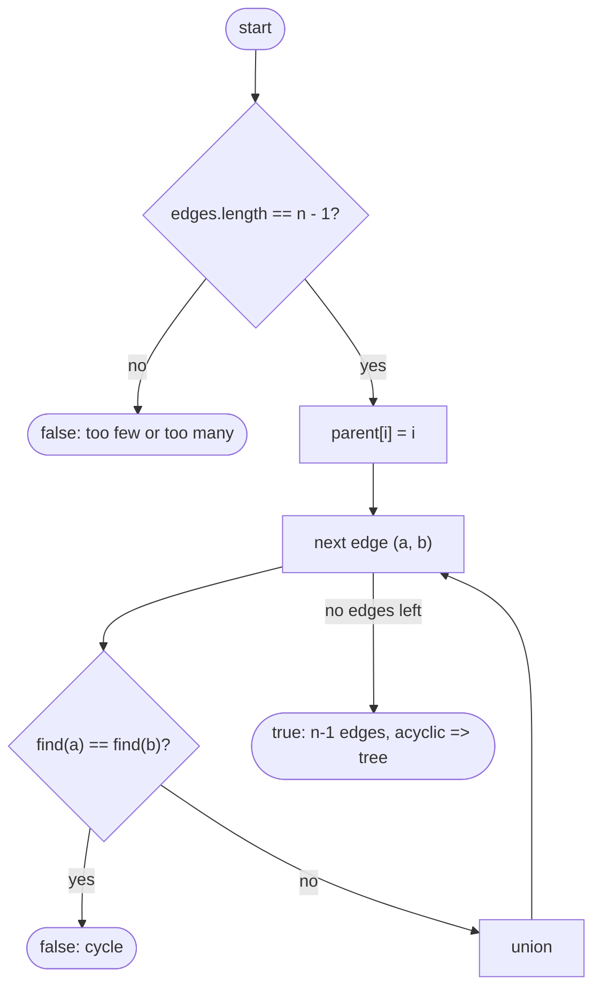

# LC 261 Graph Valid Tree

> [!abstract] In one sentence
> A graph on `n` nodes is a tree iff it has `n − 1` edges and no cycle (two of the three properties connected / acyclic / `n − 1` edges imply the third), so check the edge count in O(1) and then let Union-Find reject the first edge that would close a cycle.

**Map:** [[NeetCode 150 MOC]] → [[DSA Dashboard]] · Pattern: [[Graphs]] · [[Union-Find]]

> [!question] Predict before you read
> You check "no cycle" and "exactly n − 1 edges" but never check "connected". Can a graph pass both checks and still be disconnected? Try to draw one with n = 4.

## Problem

You are given `n` nodes labelled `0 … n − 1` and a list of undirected edges. Return `true` if the edges form a valid tree: connected and without cycles.

Example: `n = 5, edges = [ [0,1], [0,2], [0,3], [1,4] ]` → `true`.
Example: `n = 5, edges = [ [0,1], [1,2], [2,3], [1,3], [1,4] ]` → `false` (1-2-3 is a cycle).
Example: `n = 1, edges = []` → `true` (a single node is a tree).

Constraints that matter: 1 ≤ n ≤ 2000, up to 5000 edges, no duplicates, no self-loops. The edge-count check prunes most invalid inputs before any traversal.

## Clarifying questions

1. Can the edge list be empty? — Yes; with `n = 1` that is a tree, with `n > 1` it is not (disconnected).
2. Duplicate edges like `[0,1]` and `[1,0]`? — Excluded by the constraints; if allowed, treat them as a cycle of length 2 (the second union fails), which is the usual convention.
3. Directed or undirected? — Undirected; for a directed "is it a rooted tree" question you would check one node of indegree 0 and all others of indegree 1 plus reachability.
4. Is an empty graph (`n = 0`) a tree? — Not in the constraints; by convention `true`.

## Brute force

DFS from node 0 with a visited array to test connectivity, then separately detect a cycle by checking, for every edge, whether removing it disconnects the endpoints — O(E · (n + E)). Or, more sensibly, a single DFS that counts visited nodes and flags a cycle when it meets a visited node that is not its parent: already O(n + E), and the real alternative to DSU. What the edge-count fact buys you is skipping half of that: with `n − 1` edges you only need *one* of the two checks.

## The key insight

For an undirected graph on `n` nodes, any two of these imply the third: (a) connected, (b) acyclic, (c) exactly `n − 1` edges. So `edges.length != n − 1` → not a tree, immediately. Otherwise run Union-Find over the edges: a failed union means a cycle → `false`; if all `n − 1` unions succeed, the graph is acyclic with `n − 1` edges, hence connected, hence a tree. Recognition cue: "is this graph a tree / a forest / does it contain a cycle" with an edge-list input.

## Optimal approach

1. If `edges.length != n − 1`, return `false`.
2. `parent[i] = i`.
3. For each edge: if `find(a) == find(b)` return `false`, else union.
4. Return `true`.



> [!example]- Excalidraw version — the same diagram as an editable canvas
> ![[LC 261 Graph Valid Tree — Optimal approach.excalidraw]]
> [[LC 261 Graph Valid Tree — Optimal approach.excalidraw|Open in Excalidraw]] — needs the Excalidraw plugin (see [[Plugins to Install]]).

## Walkthrough

Second example: `n = 5, edges = [ [0,1], [1,2], [2,3], [1,3], [1,4] ]`. Five nodes, four edges — the count check passes; the cycle check must do the work.

> [!example] Graph Valid Tree: edge (1,3) closes the cycle 1-2-3
> ![[LC 261 Graph Valid Tree — Graph Valid Tree- edge (1,3) closes the cycle 1-2-3.excalidraw]]
> [[LC 261 Graph Valid Tree — Graph Valid Tree- edge (1,3) closes the cycle 1-2-3.excalidraw|Open in Excalidraw]] — with the cycle, 4 edges cannot also reach node 4 and stay a tree; the DSU rejects (1,3) before ever seeing (1,4)

%% excalidraw-spec
{"kind": "graph", "title": "Graph Valid Tree: edge (1,3) closes the cycle 1-2-3", "directed": false, "nodes": [ {"id": "0", "label": "0", "level": 0}, {"id": "1", "label": "1", "level": 1}, {"id": "2", "label": "2", "level": 2}, {"id": "4", "label": "4", "level": 2}, {"id": "3", "label": "3", "level": 3} ], "edges": [ ["0", "1"], ["1", "2"], ["2", "3"], ["1", "3"], ["1", "4"] ], "highlight_edges": [ ["1", "3"] ], "caption": "with the cycle, 4 edges cannot also reach node 4 and stay a tree; the DSU rejects (1,3) before ever seeing (1,4)"}
%%

| Edge | Roots | Result | Parent array (0 … 4) |
|---|---|---|---|
| (0,1) | 0, 1 | union, `parent[0] = 1` | [1, 1, 2, 3, 4] |
| (1,2) | 1, 2 | union, `parent[1] = 2` | [1, 2, 2, 3, 4] |
| (2,3) | 2, 3 | union, `parent[2] = 3` | [1, 2, 3, 3, 4] |
| (1,3) | 3, 3 | same root → **return false** | – |

The first example has four edges for five nodes and every union succeeds → `true`. Node 4 is reached by `(1,4)`, and no explicit connectivity test is needed.

## Java solution

```java
import java.util.*;

class Solution {
    public boolean validTree(int n, int[][] edges) {
        if (edges.length != n - 1) return false;         // a tree on n nodes has exactly n-1 edges
        int[] parent = new int[n];
        for (int i = 0; i < n; i++) parent[i] = i;
        for (int[] e : edges) {
            int ra = find(parent, e[0]), rb = find(parent, e[1]);
            if (ra == rb) return false;                  // edge inside one component = cycle
            parent[ra] = rb;
        }
        return true;                                     // n-1 edges and no cycle => connected
    }

    private int find(int[] parent, int x) {
        while (parent[x] != x) {
            parent[x] = parent[parent[x]];               // path halving
            x = parent[x];
        }
        return x;
    }
}
```

**Time** O(n · α(n)) — at most `n − 1` unions, each with two amortised near-constant finds · **Space** O(n)

The DFS alternative needs the "parent" trick, because in an undirected adjacency list every edge is visible from both ends and would otherwise look like a cycle:

```java
// snippet — DFS from 0; a visited neighbour other than the one we came from is a cycle
boolean dfs(int u, int from, List<List<Integer>> adj, boolean[] seen) {
    seen[u] = true;
    for (int v : adj.get(u)) {
        if (v == from) continue;                         // the edge we arrived by, not a cycle
        if (seen[v] || !dfs(v, u, adj, seen)) return false;
    }
    return true;
}
// tree iff edges.length == n - 1 && dfs(0, -1, adj, seen) && every seen[i] is true
```

With the edge-count check in place the final "every node seen" test is redundant (acyclic plus `n − 1` edges forces connectivity), but keeping it costs O(n) and makes the DFS version self-evidently correct without the counting argument.

## Why it works

A forest with `n` nodes and `k` components has exactly `n − k` edges (each component with `nᵢ` nodes is a tree with `nᵢ − 1` edges). So an acyclic graph with `n − 1` edges has `k = 1` component — it is connected. The DSU loop verifies acyclicity: every union succeeding means every edge joined two different components, so no edge ever closed a cycle. Conversely a cycle contains some edge whose endpoints were already connected when it was processed, and that union fails. Combined with the count check, `true` is returned iff the graph is a tree.

## Edge cases

- `n = 1, edges = []` — count check passes (0 == 0), loop does nothing, `true`.
- `n = 2, edges = []` — `0 != 1`, `false` (disconnected).
- `n = 2, edges = [ [0,1] ]` — `true`.
- Too many edges — rejected by the count before any union; with `n` edges there must be a cycle (pigeonhole on the forest formula).
- Right number of edges but disconnected — `n = 4` with a triangle on 0, 1, 2 and node 3 isolated: the count passes (3 edges), the triangle's third edge fails the union → `false`. The same holds for a duplicate edge if the input allowed one: the second copy fails.

## Common mistakes

> [!warning] Pitfalls
> - **Skipping the edge-count check and only testing for cycles** — a forest (acyclic but disconnected) passes; the predict question's `n = 4, edges = [ [0,1], [2,3] ]` is exactly this.
> - **Skipping the cycle check and only testing connectivity** — `n` edges reaching every node pass; connected is not enough.
> - **DFS without the `from` parameter** — every undirected edge is reported as a cycle on the way back.
> - **DFS with the `from` parameter but allowing duplicate edges** — two copies of `(0,1)` are skipped as "the edge we came by"; use an edge index or DSU if duplicates are possible.
> - **Returning the `parent[i] == i` count instead of `true`** — this problem wants a boolean; do not over-engineer.

## Variants & follow-ups

- Count the components of a forest → [[LC 323 Number of Connected Components in an Undirected Graph]].
- Find *which* edge breaks the tree → [[LC 684 Redundant Connection]].
- Directed version ("is this a rooted tree") → one node with indegree 0, every other node indegree 1, and all reachable from the root; cycle detection as in [[LC 207 Course Schedule]].
- Minimum edges to add to make it a tree → `components − 1` extra edges, after removing cycle edges.
- What changes if the input is an adjacency matrix instead of an edge list? Edge count is half the number of `true` cells; then DFS is more natural than DSU since the structure is already there.

## Interview script

1. Restate: `n` labelled nodes, undirected edges; is the graph connected and acyclic?
2. Fact: any two of {connected, acyclic, `n − 1` edges} give the third.
3. Approach: reject if `edges.length != n − 1`; then Union-Find, `false` on the first failed union, `true` otherwise. DFS with parent tracking as the alternative.
4. Why connectivity is free: acyclic with `n − 1` edges forces one component (forest formula).
5. Complexity: O(n · α) time, O(n) space.
6. Tests: `n = 1`, `n = 2` with and without the edge, triangle plus isolated node, forest of two edges on four nodes.

The interviewer is checking that you state the three-properties fact, that you know why one of the two checks can be dropped, and that you handle the undirected DFS "came-from" subtlety if you go that way.

## Related

- [[Union-Find]] — cycle detection by failed union
- [[Graphs]] — trees as graphs, undirected DFS with a parent parameter
- [[LC 684 Redundant Connection]] — the same loop, returning the offending edge
- [[LC 323 Number of Connected Components in an Undirected Graph]] — counting components
- [[LC 207 Course Schedule]] — cycle detection in the directed setting
- [[Trees]] — what a tree is, before it is a graph
- [[DSA Patterns in Java]] — Union-Find template
- [[Java Collections Cheat Sheet]] — `List<List<Integer>>` adjacency building

## Attempt log

| Date | Result | Minutes | What I got wrong |
|---|---|---|---|
| | | | |

### Mastery checklist
- [ ] Solved without hints in under 25 minutes
- [ ] Stated complexity before coding
- [ ] Handled every edge case above
- [ ] Code compiled first time
- [ ] Can do the follow-up variant (DFS with parent tracking; directed rooted-tree check)

## Open questions
- [ ]
