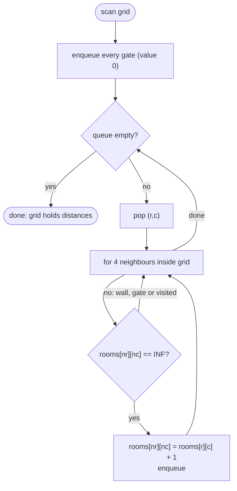

# LC 286 Walls and Gates

> [!abstract] In one sentence
> "Nearest gate for every room" is one breadth-first search started from all gates simultaneously: the BFS layer in which a room is first reached is its distance, so the whole grid is answered in a single O(m · n) pass instead of one search per room.

**Map:** [[NeetCode 150 MOC]] → [[DSA Dashboard]] · Pattern: [[Graphs]]

> [!question] Predict before you read
> A BFS from one gate gives the distance to *that* gate. If you put every gate in the queue at the start, what does the BFS compute for each room, and why is the first arrival always the shortest?

## Problem

You are given an `m × n` grid of integers: `-1` is a wall, `0` is a gate, and `INF = 2³¹ − 1` is an empty room. Fill each empty room with the number of steps (4-directional) to its nearest gate. A room that cannot reach any gate stays `INF`. Modify the grid in place.

Example (`I` = INF):
```
I  -1   0   I          3  -1   0   1
I   I   I  -1    →     2   2   1  -1
I  -1   I  -1          1  -1   2  -1
0  -1   I   I          0  -1   3   4
```
Example: `[ [-1] ]` → unchanged; `[ [0] ]` → unchanged.

Constraints that matter: 1 ≤ m, n ≤ 250, so up to 62 500 cells; `INF` is exactly `Integer.MAX_VALUE`, and adding 1 to it overflows to a negative number, which is why you must never do arithmetic on an unvisited room's value.

## Clarifying questions

1. Are the sentinel values fixed? — Yes: `-1`, `0`, `2147483647`. Compare against `Integer.MAX_VALUE`.
2. Can there be no gates? — Yes; then every room stays `INF` and the queue starts empty.
3. In place or a new grid? — In place; the grid is also your visited marker (a room is unvisited exactly while it still holds `INF`).
4. Diagonal moves? — No, four directions.

## Brute force

For each empty room run a BFS until you hit a gate: O(m · n) per room, O((m · n)²) total — about 4 × 10⁹ steps at the limit. Almost all of that work repeats itself: two adjacent rooms explore nearly the same region. Even a single-source BFS per gate, taking the minimum per cell, is O(gates · m · n), which degenerates when half the cells are gates. The wasted work is re-walking the same cells from many starting points.

## The key insight

Reverse the direction of the question. Instead of "from this room, where is the nearest gate", ask "from the gates, which rooms do I reach in 1 step, 2 steps, …". Put *all* gates in the queue at distance 0 and run one BFS; the first time a room is dequeued-from-a-neighbour it is being reached by the shortest possible path from the closest gate, because BFS processes cells in non-decreasing distance order. Recognition cue: "distance to the nearest of many sources" — the same shape as [[LC 994 Rotting Oranges]] and as "nearest 0" in the 01-matrix problem.

## Optimal approach

1. Scan the grid; push every gate `(r, c)` onto a queue.
2. Pop a cell; for each 4-neighbour that is inside the grid and still equals `INF`: set it to `current + 1` and push it.
3. Stop when the queue is empty. Walls and gates are never `INF`, so they are skipped without any special case.



> [!example]- Excalidraw version — the same diagram as an editable canvas
> ![[LC 286 Walls and Gates — Optimal approach.excalidraw]]
> [[LC 286 Walls and Gates — Optimal approach.excalidraw|Open in Excalidraw]] — needs the Excalidraw plugin (see [[Plugins to Install]]).

## Walkthrough

The example above. Both gates enter the queue first; the BFS then spreads in rings.

> [!example] Walls and Gates: final distances (-1 = wall, 0 = gate)
> ![[LC 286 Walls and Gates — Walls and Gates- final distances (-1 = wall, 0 = gate).excalidraw]]
> [[LC 286 Walls and Gates — Walls and Gates- final distances (-1 = wall, 0 = gate).excalidraw|Open in Excalidraw]] — shaded cells are the two gates; every other number is the BFS layer in which the room was first reached

%% excalidraw-spec
{"kind": "grid", "title": "Walls and Gates: final distances (-1 = wall, 0 = gate)", "col_labels": ["c0", "c1", "c2", "c3"], "row_labels": ["r0", "r1", "r2", "r3"], "rows": [ [3, -1, 0, 1], [2, 2, 1, -1], [1, -1, 2, -1], [0, -1, 3, 4] ], "highlight": [ [0, 2], [3, 0] ], "caption": "shaded cells are the two gates; every other number is the BFS layer in which the room was first reached"}
%%

| Layer | Dequeued | Rooms written |
|---|---|---|
| 0 | (0,2), (3,0) | (1,2)=1, (0,3)=1, (2,0)=1 |
| 1 | (1,2), (0,3), (2,0) | (1,1)=2, (2,2)=2, (1,0)=2 |
| 2 | (1,1), (2,2), (1,0) | (3,2)=3, (0,0)=3 |
| 3 | (3,2), (0,0) | (3,3)=4 |
| 4 | (3,3) | nothing; queue empties |

Room (1,1) was reached in layer 1 from (1,2); when (1,0) is processed later, (1,1) no longer holds `INF`, so it is not overwritten with 3.

## Java solution

```java
import java.util.*;

class Solution {
    private static final int INF = Integer.MAX_VALUE;        // 2147483647 = empty room
    private static final int[][] DIRS = {{1, 0}, {-1, 0}, {0, 1}, {0, -1}};

    public void wallsAndGates(int[][] rooms) {
        int m = rooms.length, n = rooms[0].length;
        Deque<int[]> queue = new ArrayDeque<>();
        for (int r = 0; r < m; r++)
            for (int c = 0; c < n; c++)
                if (rooms[r][c] == 0) queue.offer(new int[]{r, c});   // every gate is a source at distance 0
        while (!queue.isEmpty()) {
            int[] cell = queue.poll();
            for (int[] d : DIRS) {
                int nr = cell[0] + d[0], nc = cell[1] + d[1];
                if (nr < 0 || nc < 0 || nr >= m || nc >= n) continue;
                if (rooms[nr][nc] != INF) continue;              // wall, gate, or already reached
                rooms[nr][nc] = rooms[cell[0]][cell[1]] + 1;     // first arrival is the shortest
                queue.offer(new int[]{nr, nc});
            }
        }
    }
}
```

**Time** O(m · n) — every cell enters the queue at most once and each pop inspects four neighbours · **Space** O(m · n) worst case for the queue (a grid that is all gates), nothing else beyond the grid itself

## Why it works

Invariant of BFS: cells are dequeued in non-decreasing order of their written distance, and a cell at distance `k` enqueues only cells at distance `k + 1`. With all gates seeded at distance 0, the written value of a room equals the length of the shortest path from the *set* of gates, because any shorter path would have reached the room in an earlier layer. Equivalently: imagine a virtual super-source connected to every gate by a zero-length edge; a single-source BFS from it is exactly this multi-source BFS. Writing on enqueue (not on dequeue) ensures each room is written once, which both preserves the first-arrival distance and gives the linear bound.

## Edge cases

- No gates — queue starts empty, nothing changes, every room stays `INF`.
- No rooms (only walls and gates) — every neighbour check fails on `!= INF`.
- A room enclosed by walls — never reached, stays `INF`, which is the required answer.
- Gate adjacent to a gate — the second gate is not `INF`, so it is skipped; distances stay 0.
- `1 × 1` grid — the loops run once; nothing to do.

## Common mistakes

> [!warning] Pitfalls
> - **One BFS per room** — correct but O((m · n)²); the interviewer will wait for you to flip the direction.
> - **Marking visited on dequeue** — a room can be enqueued from several neighbours before it is popped; distances stay correct but the queue bloats and the bound breaks.
> - **`rooms[nr][nc] = Math.min(rooms[nr][nc], dist + 1)` on an INF cell** — unnecessary (BFS never needs `min`) and it tempts you to compute `INF + 1`, which overflows to a negative number.
> - **Checking `== 2147483647` by typing the literal** — use `Integer.MAX_VALUE`; a typo there silently makes every room a wall.
> - **Running a separate BFS per gate and taking the minimum** — works, but it is O(gates · m · n) and misses the point.

## Variants & follow-ups

- Same multi-source BFS counted in layers (minutes) → [[LC 994 Rotting Oranges]].
- "Distance to the nearest 0 in a binary matrix" (LeetCode 542) → identical code with 0-cells as sources.
- Weighted steps (some cells cost more) → multi-source Dijkstra, see [[LC 743 Network Delay Time]] for the single-source form.
- Reverse the flow from the border instead of from gates → [[LC 417 Pacific Atlantic Water Flow]] and [[LC 130 Surrounded Regions]] use the same "start where the answer is known" idea.
- What changes if gates can be added over time and you must keep distances current? Re-running BFS per insertion is O(m · n) each; an incremental BFS from the new gate that only lowers values it improves is the practical answer.

## Interview script

1. Restate: grid of walls, gates, empty rooms; write the shortest 4-step distance to any gate into each room, in place.
2. Brute force: BFS from each room, O((m · n)²).
3. Insight: reverse it — one BFS seeded with every gate; first arrival is the nearest gate.
4. Approach: scan for gates, queue of `int[]`, direction array, write distance on enqueue, skip anything not `INF`.
5. Complexity: O(m · n) time, O(m · n) queue in the worst case.
6. Tests: no gates, enclosed room, adjacent gates, `1 × 1`.

The interviewer is checking that you recognise multi-source BFS, that you use the grid as the visited set, and that you never do arithmetic on `INF`.

## Related

- [[Graphs]] — BFS layers, the grid as an implicit graph
- [[LC 994 Rotting Oranges]] — multi-source BFS counted by layer
- [[LC 200 Number of Islands]] — the single-source flood fill this builds on
- [[LC 417 Pacific Atlantic Water Flow]] — reverse traversal from the border
- [[LC 130 Surrounded Regions]] — border-first flood fill
- [[DSA Patterns in Java]] — grid BFS template
- [[Java Collections Cheat Sheet]] — `ArrayDeque.offer/poll`, `Integer.MAX_VALUE`

## Attempt log

| Date | Result | Minutes | What I got wrong |
|---|---|---|---|
| | | | |

### Mastery checklist
- [ ] Solved without hints in under 25 minutes
- [ ] Stated complexity before coding
- [ ] Handled every edge case above
- [ ] Code compiled first time
- [ ] Can do the follow-up variant (01-matrix: nearest 0 for every cell)

## Open questions
- [ ]
