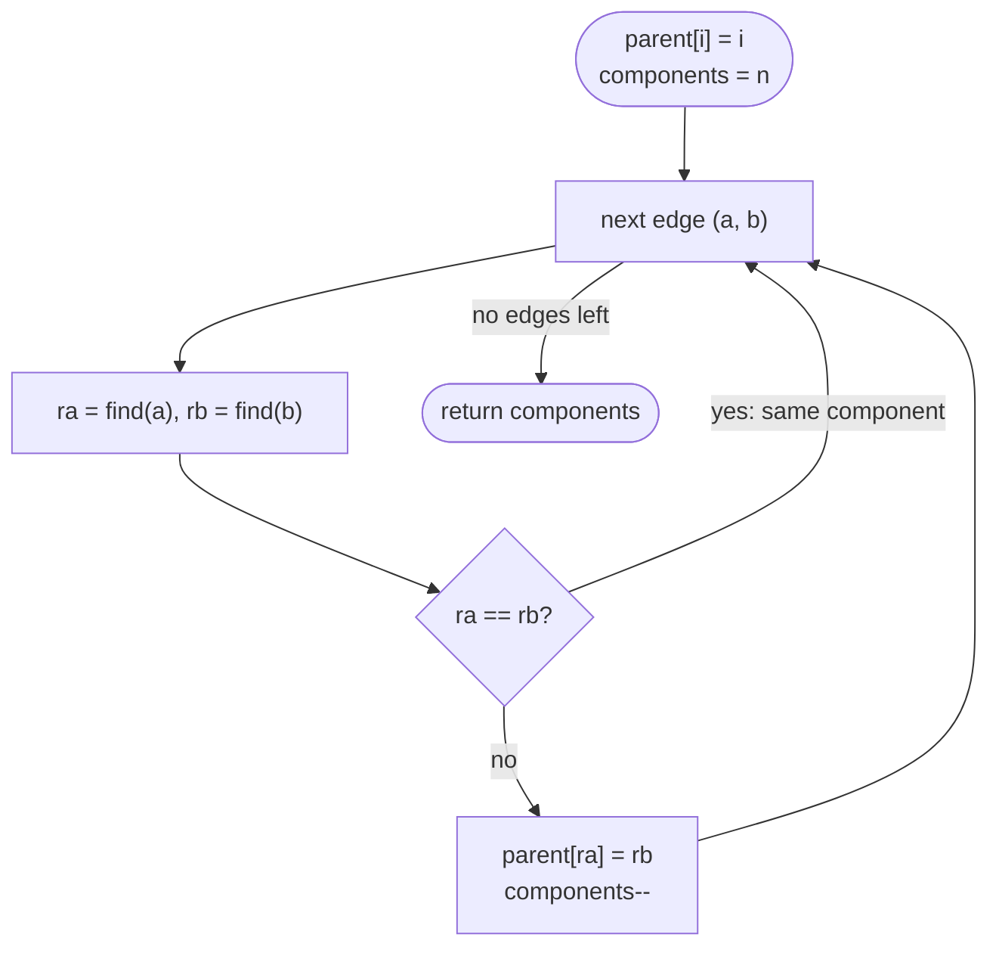

# LC 323 Number of Connected Components in an Undirected Graph

> [!abstract] In one sentence
> Every node begins as its own component and every edge that joins two *different* components reduces the count by exactly one, so `components = n − (number of successful unions)` — a one-line consequence of Union-Find, with DFS counting as the equally valid alternative.

**Map:** [[NeetCode 150 MOC]] → [[DSA Dashboard]] · Pattern: [[Graphs]] · [[Union-Find]]

> [!question] Predict before you read
> Five nodes, edges (0,1), (1,2), (0,2), (3,4). Why is the answer not `5 − 4 = 1`? Which edge should not count, and how does Union-Find notice it?

## Problem

You have `n` nodes labelled `0 … n − 1` and a list of undirected edges. Return the number of connected components.

Example: `n = 5, edges = [ [0,1], [1,2], [3,4] ]` → `2`.
Example: `n = 5, edges = [ [0,1], [1,2], [2,3], [3,4] ]` → `1`.
Example: `n = 3, edges = []` → `3`.

Constraints that matter: 1 ≤ n ≤ 2000, up to 5000 edges, no duplicate edges, no self-loops. Nodes that appear in no edge are still components, so the answer is never "the number of groups in the edge list".

## Clarifying questions

1. Are nodes 0-based and all present, even without edges? — Yes; an isolated node is a component of size 1.
2. Duplicate or self-loop edges? — Not in the constraints; if present, the union simply fails and nothing changes, so DSU is robust to them.
3. Do I need the components themselves, or only the count? — Only the count; if they wanted the members, DFS collecting lists is the natural choice.
4. Will there be queries later ("are a and b connected?") — If yes, keep the DSU around; it answers in O(α) each.

## Brute force

Compute, for every pair of nodes, whether a path exists (BFS from each node) and count equivalence classes: O(n · (n + E)) — about 10⁷ here, passable but pointless. The wasted work is re-walking the same component from each of its nodes; one traversal per component, or one incremental union per edge, is enough.

## The key insight

Think of components as a quantity that only changes when an edge *merges* two sets. Start at `n`. For each edge, if its endpoints already share a root, nothing changes (that edge lies inside a component); otherwise unite them and decrement. No adjacency list, no visited array, no recursion — two integer arrays and a loop. Recognition cue: "nodes and an edge list, how many groups / are these two in the same group" — DSU. If the input were a grid or an adjacency list, DFS counting (as in [[LC 200 Number of Islands]]) is just as natural.

## Optimal approach

1. `parent[i] = i`; `components = n`.
2. For each edge `(a, b)`: `ra = find(a)`, `rb = find(b)`; if equal, continue.
3. Otherwise `parent[ra] = rb` and `components--`.
4. Return `components`.



> [!example]- Excalidraw version — the same diagram as an editable canvas
> ![[LC 323 Number of Connected Components in an Undirected Graph — Optimal approach.excalidraw]]
> [[LC 323 Number of Connected Components in an Undirected Graph — Optimal approach.excalidraw|Open in Excalidraw]] — needs the Excalidraw plugin (see [[Plugins to Install]]).

## Walkthrough

`n = 5, edges = [ [0,1], [1,2], [3,4] ]`.

> [!example] Two components: {0,1,2} and {3,4}
> ![[LC 323 Number of Connected Components in an Undirected Graph — Two components- {0,1,2} and {3,4}.excalidraw]]
> [[LC 323 Number of Connected Components in an Undirected Graph — Two components- {0,1,2} and {3,4}.excalidraw|Open in Excalidraw]] — every successful union removes one component: 5 - 3 = 2

%% excalidraw-spec
{"kind": "graph", "title": "Two components: {0,1,2} and {3,4}", "directed": false, "nodes": [ {"id": "0", "label": "0", "level": 0}, {"id": "1", "label": "1", "level": 1}, {"id": "2", "label": "2", "level": 2}, {"id": "3", "label": "3", "level": 0}, {"id": "4", "label": "4", "level": 1} ], "edges": [ ["0", "1"], ["1", "2"], ["3", "4"] ], "highlight_nodes": ["0", "3"], "caption": "every successful union removes one component: 5 - 3 = 2"}
%%

| Edge | `find(a)`, `find(b)` | Union? | `components` | Parent array (0 … 4) |
|---|---|---|---|---|
| start | – | – | 5 | [0, 1, 2, 3, 4] |
| (0,1) | 0, 1 | yes, `parent[0] = 1` | 4 | [1, 1, 2, 3, 4] |
| (1,2) | 1, 2 | yes, `parent[1] = 2` | 3 | [1, 2, 2, 3, 4] |
| (3,4) | 3, 4 | yes, `parent[3] = 4` | 2 | [1, 2, 2, 4, 4] |

Add the edge (0,2): `find(0)` climbs 0 → 1 → 2 (and halves the path so `parent[0] = 2`), `find(2) = 2`, same root, no change — the count stays 2, which is the answer to the predict question.

## Java solution

```java
import java.util.*;

class Solution {
    public int countComponents(int n, int[][] edges) {
        int[] parent = new int[n];
        for (int i = 0; i < n; i++) parent[i] = i;
        int components = n;                               // every node starts alone
        for (int[] e : edges) {
            int ra = find(parent, e[0]), rb = find(parent, e[1]);
            if (ra == rb) continue;                       // edge inside a component: adds nothing
            parent[ra] = rb;
            components--;                                 // one merge = one component fewer
        }
        return components;
    }

    private int find(int[] parent, int x) {
        while (parent[x] != x) {
            parent[x] = parent[parent[x]];                // path halving keeps later finds short
            x = parent[x];
        }
        return x;
    }
}
```

**Time** O((n + E) · α(n)) — path halving alone gives O(log n) amortised per find, which is already fine here; add union by rank for the full α bound · **Space** O(n)

The DFS version counts how many times the outer loop has to start a new traversal:

```java
// snippet — adjacency list + DFS; count the number of DFS roots
List<List<Integer>> adj = new ArrayList<>();
for (int i = 0; i < n; i++) adj.add(new ArrayList<>());
for (int[] e : edges) { adj.get(e[0]).add(e[1]); adj.get(e[1]).add(e[0]); }   // both directions
boolean[] seen = new boolean[n];
int components = 0;
for (int i = 0; i < n; i++) {
    if (seen[i]) continue;
    components++;                                      // unvisited node = a component nobody has explored
    Deque<Integer> stack = new ArrayDeque<>(List.of(i));
    seen[i] = true;
    while (!stack.isEmpty())
        for (int v : adj.get(stack.pop()))
            if (!seen[v]) { seen[v] = true; stack.push(v); }
}
```

Same O(n + E). Choose DSU when the input is an edge list or when more edges will arrive later; choose DFS when you also need the members of each component or already have an adjacency list.

## Why it works

Invariant: after processing any prefix of the edges, `components` equals the number of connected components of the graph formed by that prefix, and `find(x) == find(y)` iff `x` and `y` are connected in it. Adding an edge between two different components merges them into one (count −1); adding an edge inside a component changes nothing (count unchanged). Union-Find reports exactly which case applies, so the arithmetic is exact. Nodes without edges are never touched and remain counted, which is why starting from `n` rather than from the number of distinct endpoints is essential.

## Edge cases

- No edges — return `n`.
- Already connected (a spanning tree, `n − 1` successful unions) — return 1.
- Extra edges inside a component — unions fail, count unaffected.
- Isolated node plus one big component — counted as 2, because isolated nodes start in the count.
- `n = 1` — return 1 regardless of (necessarily empty) edges.

## Common mistakes

> [!warning] Pitfalls
> - **Counting distinct roots at the end by scanning `parent[i] == i`** — correct, but only if you remember that path halving does not change roots; the decrement counter is simpler and avoids the scan.
> - **Starting the count from the number of nodes that appear in edges** — isolated nodes are lost.
> - **Setting `parent[a] = b` instead of `parent[ra] = rb`** — links nodes, not roots; the set structure is corrupted.
> - **Adding each edge in one direction only in the DFS version** — undirected graphs need both adjacency entries.
> - **Recursive DFS on a 2000-node path** — fine here, but say "iterative if n were large".

## Variants & follow-ups

- Components in a grid → [[LC 200 Number of Islands]] (DFS/BFS; DSU over cells also works).
- Exactly one component and no cycle → [[LC 261 Graph Valid Tree]].
- The edge that creates a cycle → [[LC 684 Redundant Connection]].
- Online: edges arrive and after each you must report the count → DSU, decrementing as above; DFS would be O(n + E) per query.
- What changes if you need the *size* of the largest component? Keep a `size[]` array, add sizes on union, track the max.

## Interview script

1. Restate: `n` labelled nodes, undirected edge list; count connected components, isolated nodes included.
2. Brute force: BFS from every node and group — O(n · (n + E)).
3. Insight: components = `n` minus the number of edges that merge two distinct sets; Union-Find tells you which edges do.
4. Approach: parent array with path halving; for each edge find both roots, union if different, decrement. Offer DFS counting as the alternative.
5. Complexity: O((n + E) · α) time, O(n) space.
6. Tests: no edges, spanning tree, cycle edge, isolated node, `n = 1`.

The interviewer is checking that you remember isolated nodes, that you know when an edge changes the count, and that you can justify DSU over DFS (edge-list input, possible online updates).

## Related

- [[Union-Find]] — the structure, path halving, union by rank
- [[Graphs]] — components, DFS counting, adjacency lists
- [[LC 200 Number of Islands]] — components in a grid
- [[LC 684 Redundant Connection]] — the edge whose union fails
- [[LC 261 Graph Valid Tree]] — one component, no cycle
- [[DSA Patterns in Java]] — Union-Find class and iterative DFS templates
- [[Java Collections Cheat Sheet]] — `ArrayDeque` as a stack, `List.of`

## Attempt log

| Date | Result | Minutes | What I got wrong |
|---|---|---|---|
| | | | |

### Mastery checklist
- [ ] Solved without hints in under 25 minutes
- [ ] Stated complexity before coding
- [ ] Handled every edge case above
- [ ] Code compiled first time
- [ ] Can do the follow-up variant (largest component size with a size array; DFS version)

## Open questions
- [ ]
